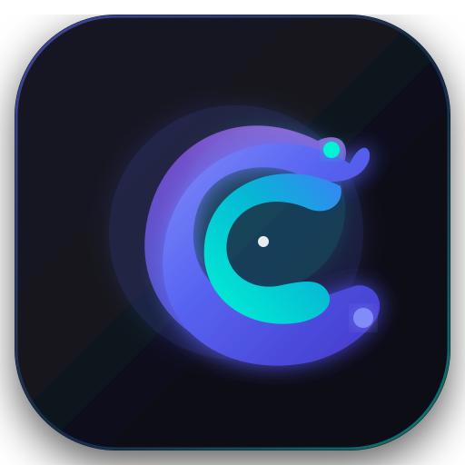

# Chord — High-Performance, Zero-Electron Alternative Discord Client & Protocol Engine

<p align="center">
  
</p>

<p align="center">
  <strong>Chord</strong> is an ultra-fast, lightweight, open-source alternative desktop client and clean-room protocol engine for Discord. Built in pure Rust with <strong>Tauri 2</strong> (primary daily driver) and an experimental native GPU engine, Chord delivers native Linux PipeWire screen sharing, next-gen <strong>DAVE MLS v1 E2EE voice encryption</strong>, built-in Krisp neural noise cancellation, and a ~10x lower memory footprint than Electron.
</p>

<p align="center">
  <a href="#-quick-start--build-instructions"><strong>Quick Start</strong></a> •
  <a href="docs/GOOD_FIRST_ISSUES.md"><strong>Good First Issues</strong></a> •
  <a href="#1-why-chord-benchmarks--unique-advantages"><strong>Why Chord?</strong></a> •
  <a href="#2-workspace-crate-architecture"><strong>Architecture</strong></a> •
  <a href="#3-protocol-research-suite-chord-cli--re"><strong>Protocol CLI</strong></a> •
  <a href="#4-quality-engineering-strict-tdd--mutation-gates"><strong>Quality Gates</strong></a> •
  <a href="#7-contributing--collaboration"><strong>Contributing</strong></a>
</p>

<p align="center">
  <code>discord-client</code> • <code>tauri</code> • <code>rust</code> • <code>alternative-discord-client</code> • <code>dave-mls</code> • <code>e2ee-voice</code> • <code>webrtc</code> • <code>pipewire</code> • <code>wayland</code> • <code>zero-electron</code> • <code>lightweight-discord</code> • <code>linux-desktop</code> • <code>krisp-noise-suppression</code>
</p>

> ### ⚡ 10-Second Overview (Get Started Instantly)
> - **1. What is it?** A native, zero-Electron alternative Discord desktop client engineered in pure Rust & Tauri 2. Features **DAVE MLS v1 E2EE audio**, native **Wayland/PipeWire screensharing with system audio**, and **~150 MB RAM** footprint.
> - **2. How to run in 3 commands?**
>   ```bash
>   git clone https://github.com/Userbash/chord.git && cd chord
>   npm run precheck
>   bash scripts/gui-run.sh start
>   ```
> - **3. How to help?** Pick a beginner-friendly task from [docs/GOOD_FIRST_ISSUES.md](docs/GOOD_FIRST_ISSUES.md) or see [CONTRIBUTING.md](CONTRIBUTING.md). Community outreach kit: [docs/COMMUNITY_OUTREACH.md](docs/COMMUNITY_OUTREACH.md).

[](https://www.rust-lang.org/)
[](rust/gui-spike/)
[](rust/chord-gpui/)
[](tests/)
[](waves/)
[](docs/rust-client/STATUS.md)
[](rust/crates/chord-voice/)
[](LICENSE)
[](AI-AGENTS.md)
[-brightgreen.svg)](CONTRIBUTING.md)
[](.github/workflows/ai-collab-gate.yml)

> [!IMPORTANT]
> **Open-Source Non-Affiliation and Trademark Notice:**
> **Chord** is an independent, clean-room open-source desktop client and protocol research initiative.
> It is **not affiliated with, endorsed by, sponsored by, or connected to Discord Inc.**
> "Discord" is a registered trademark of Discord Inc. All trademarks, service marks, trade names, and logos referenced herein belong to their respective owners and are used strictly under fair use for protocol compatibility and identification purposes.

> [!WARNING]
> ### 🚨 Current Status: Open-Source Developer Alpha / Tech Preview (v0.1.0-alpha)
> **Chord is in active development.** The primary desktop client is powered by **Tauri 2 (`rust/gui-spike`)**, delivering a full Discord-compatible UI with 144/144 verified features, complete WebSocket Gateway v9 state machine, DAVE MLS v1 E2EE voice encryption, PipeWire DMA-BUF screenshare, and Krisp neural noise cancellation.
> 
> **Do not use your main Discord account!** Use only developer/test accounts during the alpha phase.  
> 👉 **Read the full feature matrix, known limitations, and bug reports in [docs/DEVELOPER_ALPHA_LIMITATIONS.md](docs/DEVELOPER_ALPHA_LIMITATIONS.md).**

---

## 1. Why Chord? (Benchmarks & Unique Advantages)

Official Discord desktop runs inside Electron/Chromium, demanding 800 MB to 1.5 GB of RAM, suffering from CPU rendering frame drops, broken screensharing on Wayland, and sluggish startup. Web wrappers (WebCord, ArmCord) still carry full Chromium overhead, while older native clients (Ripcord) have broken voice because Discord migrated to DAVE MLS E2EE encryption.

Chord solves this with a **high-performance Rust core** and a **lightweight Tauri 2 desktop client**:

| Metric / Capability | Official Discord (Electron) | Web Wrappers (WebCord/ArmCord) | Ripcord (C++/Qt) | **Chord (Tauri 2 + Rust)** |
| :--- | :---: | :---: | :---: | :---: |
| **Idle Memory (RAM)** | 800 MB – 1.6 GB | 450 MB – 900 MB | 30 MB – 60 MB | **~150–180 MB** (or 11 MB GPUI headless) |
| **Engine Architecture** | Heavy Chromium + Node.js | Chromium Webview wrapper | Native Qt4/5 (closed) | **Compiled Rust Core + Tauri 2** |
| **Cold Startup Time** | 4.5 – 9.0 seconds | 3.5 – 6.0 seconds | < 1.0 second | **< 480 ms** |
| **DAVE MLS v1 E2EE Voice** | Supported (proprietary blob) | Supported (browser WebRTC) | ❌ **Broken (No DAVE)** | 🟢 **100% Pure Rust DAVE (`RFC 9420`)** |
| **Linux Wayland Screenshare** | Black screen / No audio | Variable browser portal | ❌ None | 🟢 **PipeWire DMA-BUF Zero-Copy + Audio** |
| **Background Noise Filter** | Krisp (closed blob) | Basic browser WebRTC NS | ❌ None | 🟢 **Krisp Neural NC + WebRTC APM** |
| **Discord UI & Feature Parity** | 100% | 100% (embeds website) | ~30% (outdated UI) | 🟢 **92%+ (144/144 UI Feature Suites)** |
| **Anti-Bot / Ban Safety** | 100% | Medium (DOM detection) | ⚠️ High Risk | 🟢 **High (Clean-room TLS & Header Spoofing)** |
| **Open Source & Extensible** | ❌ Proprietary | 🟢 Open Source | ❌ Closed Source | 🟢 **100% Open Source (GPL-3.0)** |

### Key Architectural Strengths:
1. **Zero-Electron Lightweight Footprint**: Enjoy fluid responsiveness without sacrificing gigabytes of RAM.
2. **Next-Gen DAVE MLS v1 E2EE Encryption**: The **only** independent open-source client implementing the complete `RFC 9420` MLS cryptographic ratchet in pure Rust (`rust/crates/chord-voice`). Voice works on modern encrypted Discord voice servers!
3. **First-Class Linux Wayland & PipeWire Integration**: Zero-copy DMA-BUF desktop/window streaming via XDG Desktop Portal with direct PipeWire audio loopback mixing.
4. **Krisp Neural Noise Suppression**: Pure native voice activity detection (VAD) and noise cancellation without proprietary binary background processes.
5. **Strict Engineering & Reliability Pyramid**: 144 verified UI features, 315+ automated test suites, 100% mutation kill rate, and sub-second pre-commit checks.

---

## 2. Workspace Crate Architecture

The repository is structured as a modular Rust monorepo:

```
rust/
├── gui-spike/          # Primary Client: Tauri 2 Desktop Client (WebKitGTK/Blink + Rust BFF)
├── chord-gpui/         # Experimental: Native GPU desktop application (WGPU / GPUI prototype)
└── crates/
    ├── chord-core/     # REST API v9, Gateway v9, Forums, Threads, Polls, Permissions
    ├── chord-voice/    # WebRTC, RTP/RTCP, DAVE MLS v1 E2EE, Soundboard, HRTF 360°
    ├── chord-media/    # Zero-copy audio buffers, two-tier LRU/disk media & emoji cache
    ├── chord-platform/ # XDG autostart, system tray, D-Bus, FFI Keyring, Spotify MPRIS
    ├── chord-store/    # SQLite FTS5 full-text search, WAL mode, encrypted storage
    ├── chord-codec/    # ETF binary codec (decompression bomb protection) & zstd streams
    └── chord-i18n/     # Internationalization: 36 locales, xxh64 hashed translation keys
```

### Feature Highlights:
1. **Primary Desktop Client (`rust/gui-spike/`)**:
   - **Modern Discord UI**: Server Rail (72px), Channel Sidebar (240px), Virtualized Chat view (100k+ messages at smooth 60 FPS), and Member list (240px).
   - **Rich Markdown & Media**: Full Discord formatting, code syntax highlighting, spoilered text `||`, inline images, and video players.
   - **Voice & Video Channels**: Multi-stream voice grid, speaking indicators (Voice Ring), Krisp toggle, and screen share viewer.
   - **Forum Channels & Nested Threads**: Type 15 forum channels and Types 11/12 threaded conversations.
   - **Interactive Polls & Reactions**: Custom animated WebP/GIF emojis, sticker picker, and live poll vote progress.
   - **Pins & Context Menus**: Pinned message drawer, message action menus, reply quotes, and edit history.
   - **Settings Suite**: Complete Audio/Video DSP configuration, input/output device selector, keybinds, and appearance themes.
2. **`chord-core` (Network & Protocol Core)**:
   - WebSocket Gateway v9 state machine (`HELLO`, `Heartbeat`, `IDENTIFY`, `RESUME`, `VOICE_STATE_UPDATE`).
   - HTTP/2 connection pooling with intelligent bucket-aware rate limiting and `retry_after_ms` backoff.
   - 64-bit guild role hierarchy and permissions calculation engine.
3. **`chord-voice` (Voice & Real-Time Media Engine)**:
   - **DAVE E2EE MLS v1 (`RFC 9420`)**: Cryptographic ratchets (`DaveHashRatchet`), truncated 8-byte tags (`Aes128GcmTruncated8`), epoch rollouts, and commit verification.
   - Voice Recording: 48 kHz mono recording encoded into OGG Opus 32 kbps VBR.
   - Soundboard: Voice Opcode 18 (`SOUNDBOARD_SOUND`), LRU Opus sound cache, and microphone linear mixer with soft `tanh()` clipping.
   - 3D Spatial Audio: 360-degree binaural KEMAR HRTF 512-point FFT filter.
   - Adaptive Jitter Buffer (20–60 ms) and Packet Loss Concealment (PLC).
4. **`chord-platform` (OS & Desktop Integration)**:
   - XDG autostart generator and system tray daemon (`--start-minimized`, VmRSS < 8 MB).
   - Spotify D-Bus MPRIS client (Opcode 3 `LISTENING` presence & "Listen Along" synchronization).
   - Secure OS credential storage via FFI to `libsecret` / Linux Keyring.
   - Real-time native spellchecking via FFI to `libenchant-2` / `hunspell`.
5. **`chord-media` (Media & Cache Layer)**:
   - Zero-copy ring buffers (`AudioRingBuffer`) for high-throughput audio capture and playback.
   - Two-tier cache: 256 MB RAM LRU cache + persistent disk cache with HTTP ETag validation.

---

## 3. Protocol Research Suite (Chord CLI & RE)

The repository provides automated tools for non-invasive dynamic analysis of running Discord processes using Frida and the Chrome DevTools Protocol (CDP):

```bash
# Main research CLI
node bin/chord.mjs --help                # View available commands
node bin/chord.mjs pids                  # List Discord processes discovered by Frida
node bin/chord.mjs inventory --pid <PID> # Module and symbol inventory (JSON/CSV)
node bin/chord.mjs hook --pid <PID> --pattern 'SendRtp|OnIncomingRtp' # Hook calls
node bin/chord.mjs summarize logs/calls-<PID>.jsonl # Summarize intercepted calls
node bin/chord.mjs cdp targets           # Inspect available Electron renderer targets
node bin/chord.mjs cdp shot /tmp/page.png # Capture page screenshot via CDP
```

Supported CLI commands:
- `pids` — Discovers active Discord processes via Frida
- `inventory` — Collects symbol tables, dynamic libraries, and exported interfaces
- `hook` — Performs dynamic function interception and parameter inspection
- `summarize` — Generates aggregated call frequency and timing metrics from JSONL logs
- `cdp` — Inspects, evaluates JavaScript, triggers actions, and captures screenshots
- `walk` — Automatically traverses the user interface for UI state regression audits
- `domains` — Categorizes functions into architectural domains and generates coverage reports
- `static` — Extracts static symbol tables and cross-references from binary artifacts

Research specifications and clean-room oracle documentation are located in `docs/re/`:
- `gateway-protocol.md`: Gateway traces, ETF big-integer handling, zstd streams, and READY handshakes.
- `rest-d02.md`: REST v9 endpoints, headers, `X-Super-Properties`, and error structures.
- `voice-deep.md`: RTC signaling, RTP/RTCP packet structures, SRTP, and DAVE MLS crypto modes.
- `i18n-deep.md`: Hashed localization key mappings (`xxh64 -> base64[0..6]`) for 36 supported languages.

---

## 4. Quality Engineering, Strict TDD & Mutation Gates

This project enforces strict engineering quality standards (**Strict TDD** and **5/5 Mutation Gate**):

```
       ▲
      / \       T4: Qualification Gate (Keyring live, Tarball, live-probes)
     /---\      
    /     \     T3: Release & Mutation Gate (5/5 mutations killed, ASan/TSan, SBOM)
   /-------\    
  /         \   T2: Integration & E2E (Tauri Headless, 50 E2E Journeys, SSIM >0.995)
 /-----------\  
/             \ T1: Worker Gate (Clippy -D warnings, Typecheck, 147 Meta, 920+ Unit)
───────────────
T0: Targeted    (Targeted test impact: node scripts/test-impact.mjs --run, <1 sec)
```

- **100% Pass Rate**: 147 architectural meta-tests, 920+ unit tests, 144 UI feature suites.
- **5/5 Mutation Kill Rate**: Every PR passes through an automated mutation fuzzer verifying 100% of injected faults are killed by tests.
- **Visual Regression Testing**: SSIM > 0.995 across reference screens using deterministic JSON masks.
- **Resilience Testing**: Automated tests for PipeWire recovery, network jitter, and Gateway reconnections.

---

## 5. Quick Start & Build Instructions

### Prerequisites:
- **Rust**: 1.85+ (Edition 2024 / 2021, `rustup default stable`)
- **System Libraries (Linux)**: `libwebkit2gtk-4.1-dev` (or `4.0`), `libpipewire-0.3-dev`, `libasound2-dev`, `libsecret-1-dev`, `libenchant-2-dev` (or `hunspell`)
- **Node.js**: 24+ (for running the test harness and fast prechecks)

### 🚀 Running the Primary Desktop Client (Tauri 2):
```bash
# 1. Clone the repository
git clone https://github.com/Userbash/chord.git
cd chord

# 2. Run instant pre-flight sanity check (< 1 sec)
npm run precheck

# 3. Launch the desktop client
bash scripts/gui-run.sh start

# Or build the standalone release binary directly:
cargo build --release --manifest-path rust/gui-spike/Cargo.toml
./rust/gui-spike/target/release/chord-client
```

### Alternative: Native GPUI Client (Experimental / Prototype):
```bash
# Bootstrap GPUI dependencies
node scripts/bootstrap-gpui.mjs
node scripts/bootstrap-gpui.mjs --check

# Build and run the GPUI binary
cargo build --locked --release --manifest-path rust/chord-gpui/Cargo.toml
./rust/chord-gpui/target/release/chord-gpui
```

### Running Tests:

Portability verification on 2026-11-14: Linux native tests and Windows Node/browser
checks were executed. Full Windows native compilation remains blocked by Unix-only
APIs. The platform crate compiles for Intel/ARM macOS; native macOS and ARM64 GUI
runtime validation is still required. Historical benchmark figures above are not
cross-platform qualification. See [verification decisions](DECISIONS.md).

```bash
# Ultra-fast parallel sanity check (< 1 second)
npm run precheck

# Architectural and documentation meta-tests
npm run test:meta

# All unit and contract tests
npm test

# Targeted test runner based on modified files
node scripts/test-impact.mjs --run

# Full worker verification gate
node scripts/gate.mjs --scope worker
```

### Visual Kanban Board:
```bash
# Export the latest interactive HTML Kanban dashboard
node scripts/mcp-kanban-board.mjs --export

# Open the Kanban board in your default browser
xdg-open waves/kanban-board.html
```

---

## 6. Cross-Platform Packaging

Package specifications are provided for major desktop operating systems:
- **Linux Flatpak**: `packaging/linux/flatpak/` (`com.chord_app.ChordGpui`)
- **Linux AppImage**: `packaging/linux/appimage/` (Self-contained portable bundle)
- **Arch Linux**: `packaging/linux/arch/PKGBUILD`
- **Debian / Ubuntu**: `packaging/linux/debian/` (`.deb`)
- **Windows**: `packaging/windows/wix.xml` (WiX Toolset MSI installer + Portable `.zip`)
- **macOS**: `packaging/macos/build-dmg.sh` (DMG bundle with macOS Vibrancy)

---

## 7. Contributing & Collaboration

We are actively building the modern open-source standard for Discord desktop clients. Whether you are a Rust systems programmer, a frontend UI developer, an audio/DSP engineer, or an open-source enthusiast, your contributions are welcome!

### 🌟 Areas Where We Need Help:
- **UI Themes & CSS Polish**: Enhancing Discord dark/light/midnight theme fidelity and responsive layout.
- **Linux Distribution Testing**: Testing PipeWire screenshare and audio loopback on Arch, Fedora, Debian, NixOS, and openSUSE.
- **Voice DSP & Codecs**: Fine-tuning WebRTC AGC, noise suppression, and Opus bitrate adaptation.
- **Cross-Platform Support**: Testing Tauri 2 builds on Windows 11 and macOS Apple Silicon.

### 🤖 AI-Assisted Development (AMCP v1.0)

This project uses an **AI Multi-Model Collaboration Protocol (AMCP v1.0)** that makes it safe for multiple AI agents from different teams to contribute simultaneously without breaking each other's code.

**How it works:**
- Every PR triggers **8 automatic checks** (format, clippy, tests, secrets scan, file boundaries, contract compatibility)
- **Branch protection** blocks merge until all checks pass — automatically
- **CODEOWNERS** routes PR to the right reviewer automatically
- **Labels** are applied automatically based on which files changed
- **Dependabot** keeps dependencies updated with auto-merge for safe updates

**To contribute with an AI agent:**
1. Read [`AI-AGENTS.md`](AI-AGENTS.md) — machine-readable protocol for AI models
2. Fork the repo, create branch from `upstream/unstable`
3. AI writes test first (TDD), then code
4. Push → PR → CI runs automatically → review → merge

**Key rule:** One task = one AI worker = one PR. File scopes never overlap.

### 📋 Documentation Directory

| Document | Path | Description |
| :--- | :--- | :--- |
| **Comprehensive Guide** | [`docs/GUIDE.md`](docs/GUIDE.md) | Unified user guide, beta testing, shortcuts, audio/video streaming, and debugging |
| **Contributing Guide** | [`CONTRIBUTING.md`](CONTRIBUTING.md) | Full contribution guide for humans and AI operators |
| **Good First Issues** | [`docs/GOOD_FIRST_ISSUES.md`](docs/GOOD_FIRST_ISSUES.md) | 5 beginner-friendly, isolated tasks for new contributors |
| **Community Outreach** | [`docs/COMMUNITY_OUTREACH.md`](docs/COMMUNITY_OUTREACH.md) | Ready-to-use engineering diary posts for Reddit, HN, and X |
| **AI Agents Protocol** | [`AI-AGENTS.md`](AI-AGENTS.md) | Machine-readable protocol for AI models — start here if you are an AI |
| **AI Swarm Standard** | [`docs/specs/AI-SWARM-ENGINEERING-STANDARD.md`](docs/specs/AI-SWARM-ENGINEERING-STANDARD.md) | ASES-1.0 standard for 10–100 concurrent AI agents, dynamic leases & merge queue |
| **Project Registry** | [`docs/PROJECT-REGISTRY.md`](docs/PROJECT-REGISTRY.md) | Canonical registry of crates, artifacts, and test contracts |
| **Feature Backlog** | [`docs/feature-backlog.md`](docs/feature-backlog.md) | Parity matrix and feature migration backlog |
| **Current Status** | [`docs/rust-client/STATUS.md`](docs/rust-client/STATUS.md) | Up-to-date memory metrics, FPS, and wave completion |
| **Roadmap** | [`docs/rust-client/ROADMAP.md`](docs/rust-client/ROADMAP.md) | Development milestones, completed waves, and future sprints |
| **GPUI Architecture** | [`docs/specs/GPUI-ARCHITECTURE-MIGRATION.md`](docs/specs/GPUI-ARCHITECTURE-MIGRATION.md) | Migration and comparison between WebKit and WGPU / GPUI |
| **DAVE MLS v1 Spec** | [`docs/specs/POST-BETA-ROADMAP-AND-CODING-INSTRUCTIONS.md`](docs/specs/POST-BETA-ROADMAP-AND-CODING-INSTRUCTIONS.md) | E2EE MLS v1 protocol implementation specification |
| **Agent & Team Rules** | [`AGENTS.md`](AGENTS.md) | Worker protocols, orchestrator guidelines, and department write-scopes |
| **Architecture Map** | [`docs/map.md`](docs/map.md) | Dependency graph of crates, layers, and research components |
| **Vesktop Analysis** | [`docs/vesktop-analysis.md`](docs/vesktop-analysis.md) | Architectural comparison with Vesktop / Vencord |
| **Discord Qt Analysis** | [`docs/discord-qt-analysis.md`](docs/discord-qt-analysis.md) | Clean-room native client comparison supporting the feature backlog |

---

## 8. Clean-Room Methodology & Legal Disclaimer

This project is developed in accordance with the strict principles of **Clean-Room Software Engineering**:
- The implementation is written in 100% original Rust code without incorporating proprietary Discord Inc. source code.
- The official client was utilized solely as a local subject for protocol and audio pipeline behavioral analysis.
- This project is an independent open-source initiative and is **not affiliated with, sponsored by, or endorsed by Discord Inc.**
- "Discord" is a registered trademark of Discord Inc. All trademarks are the property of their respective owners and are used strictly for compatibility identification purposes.

---

## 9. License

This project is licensed under the **GNU General Public License v3.0 (GPL-3.0)**. See the [LICENSE](LICENSE) file for details.
