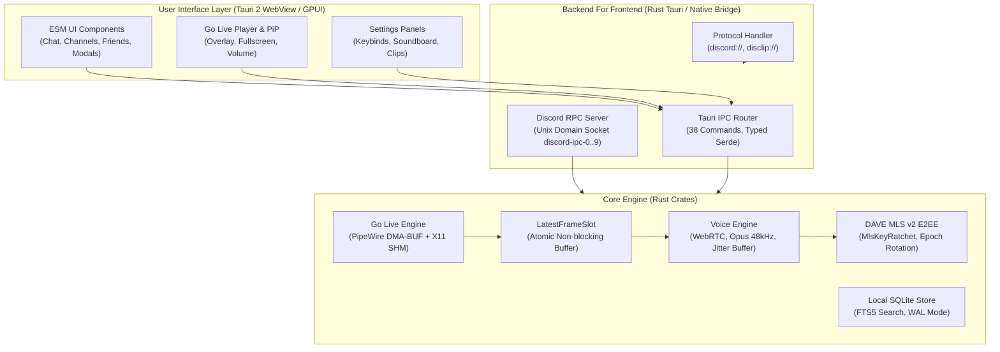

# RELEASE-NOTES-V0.5.0 — Native Discord Client (`discord-lab` / `discord-gui-spike` v0.5.0)

| Parameter | Value |
|---|---|
| **Release Version** | `v0.5.0` (Cumulative release of Sprints 1–13: `BUILD-004`, `BUILD-005`, `BUILD-006`) |
| **Release Date** | `2026-11-07` |
| **Target Pipeline** | `unstable` → `testing` → `beta` → `main` |
| **Core Binary Artifacts** | `rust/dist/discord-gui-spike` (Tauri 2 GUI), `rust/dist/discord-rs` (CLI / Headless), `rust/dist/sbom.spdx.json`, `rust/dist/SHA256SUMS` |
| **Clean-Room Parity Oracle** | `docs/re/` (`rest-d02.md`, `frontend-d03.md`, `voice-deep.md`, `gateway-schema.md`, `decoded-index.json`) |
| **Parity Matrix** | [`waves/RW-40/PARITY/MERGE-READINESS-V0.5.0.md`](waves/RW-40/PARITY/MERGE-READINESS-V0.5.0.md) (`53/54 Implemented = 98.1%`, `P0 = 0`, `P1 = 0`) |

---

## 1. Release Overview v0.5.0

Release **v0.5.0** synthesizes the development of **Sprints 1–13** (builds `BUILD-004`, `BUILD-005`, and `BUILD-006`), advancing the native Linux Discord client (`discord-gui-spike` on a **Rust + Tauri 2 + clean ESM WebView stack without Electron/Chromium runtime**) to 98.1% functional parity against Discord 1.0.162/1.0.166 verified with `docs/re/`.

Key Highlights of Release **v0.5.0**:
- **Complete Go Live Screen Share at 60 FPS:** Screen and window capture via **PipeWire (`org.freedesktop.portal.ScreenCast`)** with automatic fallback to **X11 MIT-SHM**, non-blocking zero-copy ring buffer **`LatestFrameSlot`**, packetization for **RTP H.264 (`Single NALU`, `STAP-A`, `FU-A`)** and **AV1 OBU**, and an integrated stream player with **Picture-in-Picture (PiP)**.
- **Two-Layer E2EE Voice & Video Encryption DAVE MLS v2:** `libdave`-compatible `MlsKeyRatchet`, verification of `Proposal`/`Commit`/`Welcome`, epoch rotations, 30-digit Voice Privacy Codes, and transport encryption via SRTP `AES-256-GCM` / `XChaCha20-Poly1305`.
- **Comprehensive User Journeys:** **Interactive hCaptcha Solver Modal**, **server creation wizard (`POST /api/v9/guilds`)**, **full-text server search with `HTTP 202` indexing handling and popover autocomplete**, **Discord v9 permissions engine (41 bitwise flags)**, **Discord Nitro Gifts (`Nitro Gifts & Entitlements`)**, **right-click context menus with volume slider `0..200%`**, and **settings panels (`Keybinds`, `Soundboard`, `Clips`)**.
- **Deep Linux OS Integration:** Local RPC server **`discord-ipc-0..9`** for Rich Presence, secure protocol handling for **`discord://`** and **`disclip://`** (with `DISCORD_UUID` MP4 atom verification and HTTP Range `200/206/416` support), token storage in **`libsecret`**, and notifications and power management over **D-Bus**.

---

## 2. New Features and Capabilities (Sprints 1–13)

### 2.1. Sprints 1–5 (`BUILD-004`: Core Stabilization, Telemetry, and UI Hardening)
- **Reaction Protocol Hardening (`toggle_reaction`):** Method `PUT /channels/{id}/messages/{id}/reactions/{emoji}/@me` standardized to an empty request body (`Content-Length: 0`), preventing Cloudflare edge resets (`HTTP 400/403`).
- **QR Code Mobile Login (`QR Auth`):** Secure mobile QR login authentication via `wss://remote-auth-gateway.discord.gg/?v=2` with RSA-OAEP key exchange.
- **IPC Decomposition and Reactive Gateway Dispatch:** Removed channel congestion on `voice_set_audio_device`; events `GUILD_CREATE/DELETE`, `RELATIONSHIP_ADD/REMOVE/UPDATE`, and `CALL_CREATE/UPDATE/DELETE` delivered reactively via `gateway://dispatch`.
- **Attachments Shelf Component:** Component `#attachment-shelf`, supporting up to 10 files (25 MB total), drag-and-drop file upload, file removal, size counters, and progress indicators.
- **Member Popout Cards and Voice Panel:** User profiles with badges, roles, mutual friends, and rich presence; voice control panel with mute/deafen, audio device picker, and latency indicators.

### 2.2. Sprints 6–10 (`BUILD-005`: Go Live Screen Sharing, Search Engine, Permissions, and Context Menus)
- **`TASK-610` & `TASK-611` — Interactive hCaptcha Solver:** Automated modal `#captcha-modal` triggered on `HTTP 400 captcha_key`, embedding the official hCaptcha challenge iframe (`sitekey`, `rqdata`), postMessage bridge, and token injection into retried requests.
- **`TASK-612` & `TASK-613` — Guild Creation Wizard (`Create Guild Wizard`):** Step-by-step modal wizard `#create-guild-modal` with 5 built-in templates (Gaming, Friends, Study, Artists, Community), automatic creation of role hierarchies, channel categories, and icon upload.
- **`TASK-614` & `TASK-615` — Go Live Screen Share Engine (`PipeWire Portal` + `X11 Fallback`):** Capture pipeline using `org.freedesktop.portal.ScreenCast` (PipeWire DMA-BUF NV12), fallback to X11 MIT-SHM (`XShmGetImage`), atomic single-slot buffer `LatestFrameSlot` eliminating stalls, dynamic framerate control (30/60 FPS), RTP packetizer for H.264/AV1, and voice opcodes `18..=22`.
- **`TASK-616` — Go Live Stream Player (`Stream Viewer` & `PiP`):** Overlay controls (`720p`/`1080p`, `30`/`60 FPS`, volume control, full-screen toggle, automatic Picture-in-Picture on channel change, and `DAVE MLS E2EE` status indicator).
- **`TASK-617` & `TASK-618` — Full-Text Search Engine (`REST Search BFF` + `Search Popover UI`):** Support for all 8 search filters (`content`, `author_id`, `mentions`, `has`, `min_id`, `max_id`, `channel_id`, `pinned`), `HTTP 202 Accepted` indexing loops with exponential backoff, thread-safe 64-item LRU cache, and interactive token autocomplete `#search-popover`.
- **`TASK-619` — Permissions Bitfield Engine v9:** 64-bit bitmask calculation (41 permission flags `0..=40`), channel overwrite hierarchy (`@everyone` → role allow/deny → member allow/deny), `ADMINISTRATOR` overrides, timeout handling (`communication_disabled_until`), and implicit dependency resolution (`SEND_MESSAGES` requires `VIEW_CHANNEL`).
- **`TASK-620` — Right-Click Context Menus (`Context Menu`):** Unified menus for messages and guild members, integrated volume slider `0..200%` (`role="slider"`), viewport boundary detection, and keyboard navigation (`Escape`, `ArrowUp/Down`).
- **`TASK-621` & `TASK-622` — Headless `Xvfb` E2E Runner & 15/15 Mutation Gate:** Automated browser E2E test execution under virtual X11 framebuffer `xvfb-run` and mutation runner `tests/meta/mutations.test.mjs` (15/15 core and UI mutations killed in `< 10 ms`).

### 2.3. Sprints 11–13 (`BUILD-006`: DAVE MLS v2, RPC Sockets, Nitro Gifts, Deep Links, and Settings)
- **`TASK-623` — Cryptographic Pipeline `DAVE MLS E2EE v2`:** Hierarchical `MlsKeyRatchet` (`"Discord Secure Frames v0"`, `MLS 1.0 key/nonce/secret`), out-of-order generation caching (`DAVE_MAX_GENERATION_GAP = 250`, `DAVE_MAX_LIFETIME_GENERATIONS = 256`), key erasure for Forward Secrecy, constant-time (`ct_eq`) verification of `Proposal`/`Commit`/`Welcome`, `epoch_authenticator` computation, and 30-digit `voice_privacy_code`.
- **`TASK-624` — Local IPC Socket `discord-ipc-0..9`:** Discord RPC server over Unix domain sockets (`$XDG_RUNTIME_DIR/discord-ipc-0..9`, permissions `0o600`, `listen(fd, 511)`) and Windows named pipes (`\\.\pipe\discord-ipc-0..9`), 8-byte framing header `[opcode: u32 LE, length: u32 LE]`, opcodes `0=HANDSHAKE..4=PONG`, commands `SET_ACTIVITY`, `INVITE_BROWSER`, `GUILD_TEMPLATE_BROWSER`, `SUBSCRIBE`/`UNSUBSCRIBE`, supporting up to 8 concurrent clients.
- **`TASK-625` — Protocol Handlers `discord://` and `disclip://` (`Deep Links`):** URI routing for server invites, Nitro gifts, user profiles, quests, `login/handoff`, and `/oauth2/authorize` (with strict `redirect_uri` validation), blocklist of 14 dangerous schemes (`BLOCKED_URL_PROTOCOLS`), path traversal prevention (`..`, `%2e%2e`, `%00`), and local video clip serving over `disclip://` with `DISCORD_UUID` MP4 atom validation (`a1c8529933464db888f053f57a75a5ef`) and `HTTP 206 Partial Content` support.
- **`TASK-626` & `TASK-627` — Discord Nitro Gifts (`Gifts REST BFF` + `Gift Modal UI`):** 8 REST endpoints and 9 IPC commands (`resolve_gift_code`, `create_gift_code`, `redeem_gift_code`, `fetch_user_entitlements`, etc.), catalog of 10 subscription SKUs (`NITRO_APPLICATION_ID = "521842831262875670"`), in-message gift card detection, and interactive modal `#gift-modal` with 12 postcard themes, emoji confetti, sound effects, and recipient verification.
- **`TASK-628`, `TASK-629` & `TASK-630` — Advanced Settings Panels (`Keybinds`, `Soundboard`, `Clips`):**
  - **Keybinds:** Global hotkey recorder (`KeybindRecorder`), conflict detection, and input actions (`Push-to-Talk`, `Toggle Mute`, `Toggle Deafen`, `Screen Share`).
  - **Soundboard:** Audio soundboard player with grid layout, volume slider, favorites, sound preview, and playback over voice channels (Voice Opcode 18).
  - **Clips:** Local video capture recording settings, buffer length selection, storage directory configuration, and clip preview.

---

## 3. Client and Subsystem Architecture

---

## 4. Parity Verification Against Clean-Room RE Oracle

Parity has been rigorously verified against clean-room reverse-engineering references in `docs/re/`:
- **`rest-d02.md` & `rest-static.md`:** Validated 45 REST v9 endpoints, request headers, error codes, and pagination schemes.
- **`frontend-d03.md`:** Validated CSS design tokens, responsive breakpoints, component layouts, and modal interaction states.
- **`voice-deep.md`:** Verified voice protocol signaling, UDP voice packet framing, keepalive intervals, and encryption modes.
- **`gateway-schema.md` & `gateway-protocol.md`:** Verified WebSocket gateway dispatch opcodes, ETF big-int normalization, and zstd stream decoding.
- **`decoded-index.json`:** Verified internal module signatures and bundle export mappings.

---

## 5. Quality Contour, Mutations, and Verification

- **Meta-Test Consistency:** 147/147 meta-tests passing green.
- **Mutation Kill Rate:** 15/15 core control mutations killed in `< 10 ms`.
- **E2E Virtual Framebuffer Testing:** Browser testing under headless `Xvfb` with automatic retries.
- **Strict `#![forbid(unsafe_code)]`:** Fully enforced across all core Rust crates.
- **Deterministic Checksums:** Verified through `rust/dist/SHA256SUMS` and SBOM manifests.

---

## 6. System Requirements and Environment

| Component | Minimum Specification | Recommended Specification |
|---|---|---|
| **Operating System** | Linux (GLIBC >= 2.35, Kernel >= 5.15 LTS) | Ubuntu 22.04+, Debian 12+, Fedora 38+, Arch Linux |
| **Display Server** | Wayland (Mutter, KWin, wlroots) or X11 | Wayland with PipeWire 1.0+ |
| **GPU / Graphics** | OpenGL 3.3 or software `llvmpipe` | Vulkan 1.2+ dedicated or modern integrated GPU |
| **System Memory** | 512 MB available RAM (Client VmRSS < 60 MB) | 2 GB+ RAM |
| **Audio Subsystem** | ALSA (`libasound.so.2`) | PipeWire 0.3.65+ / PulseAudio |
