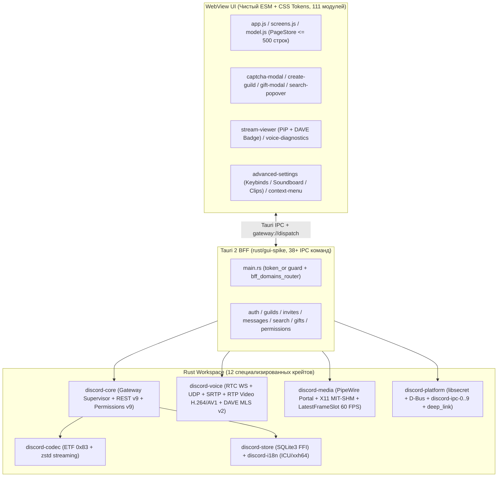

# RELEASE-NOTES-V0.5.0 — Нативный клиент Discord (`discord-lab` / `discord-gui-spike` v0.5.0)

| Параметр | Значение |
|---|---|
| **Версия релиза** | `v0.5.0` (кумулятивный выпуск Спринтов 1–13: `BUILD-004`, `BUILD-005`, `BUILD-006`) |
| **Дата выпуска** | `2026-11-07` |
| **Целевые ветки** | `unstable` → `testing` → `beta` → `main` |
| **Основные бинарные артефакты** | `rust/dist/discord-gui-spike` (GUI-клиент Tauri 2), `rust/dist/discord-rs` (CLI/Headless), `rust/dist/sbom.spdx.json`, `rust/dist/SHA256SUMS` |
| **Эталон паритета** | `/home/sanya/re-deep/` (`rest-d02.md`, `frontend-d03.md`, `voice-deep.md`, `gateway-schema.md`, `decoded-index.json`) |
| **Матрица паритета** | [`waves/RW-40/PARITY/MERGE-READINESS-V0.5.0.md`](waves/RW-40/PARITY/MERGE-READINESS-V0.5.0.md) (`53/54 Implemented = 98.1%`, `P0 = 0`, `P1 = 0`) |

---

## 1. Обзор релиза v0.5.0

Релиз **v0.5.0** подводит итог разработке **Спринтов 1–13** (сборки `BUILD-004`, `BUILD-005` и `BUILD-006`) и переводит нативный Linux-клиент Discord (`discord-gui-spike` на стеке **Rust + Tauri 2 + чистый ESM WebView без Electron/Chromium-рантайма**) к 98.1% функциональному паритету с эталонным клиентом Discord 1.0.162/1.0.166 по оракулу `/home/sanya/re-deep/`.

Ключевые достижения релиза **v0.5.0**:
- Полный видеоконвейер **Go Live (Screen Share 60 FPS)**: захват экрана и окон через **PipeWire (`org.freedesktop.portal.ScreenCast`)** с автоматическим откатом на **X11 MIT-SHM**, неблокирующий атомарный кольцевой буфер **`LatestFrameSlot`**, пакетизация **RTP H.264 (`Single NALU`, `STAP-A`, `FU-A`)** и **AV1 OBU**, а также плеер стримов с режимом **Picture-in-Picture (PiP)**.
- Двухслойное сквозное шифрование голоса и видео **DAVE MLS v2** (`DAVE MLS E2EE v2`, `libdave`-совместимый `MlsKeyRatchet`, верификация `Proposal`/`Commit`/`Welcome`, ротация эпох, 30-значный код приватности и транспортное шифрование SRTP `AES-256-GCM` / `XChaCha20-Poly1305`).
- Полный цикл пользовательских и серверных сценариев: **Interactive hCaptcha Solver Modal**, **создание серверов (`POST /api/v9/guilds`) с пошаговым мастером и шаблонами**, **полнотекстовый поиск по серверу с обработкой `HTTP 202` и интерактивным поповером токенов**, **движок прав Discord v9 (41 битовый флаг)**, **подарки Discord Nitro (`Nitro Gifts & Entitlements`)**, **контекстные меню ПКМ с локальной громкостью `0..200%`** и **расширенные настройки (`Keybinds`, `Soundboard`, `Clips`)**.
- Глубокая системная интеграция с ОС: локальный RPC-сервер **`discord-ipc-0..9`** для Rich Presence, безопасный обработчик протоколов **`discord://`** и **`disclip://`** (с проверкой `DISCORD_UUID` в MP4 и поддержкой HTTP Range `200/206/416`), хранение секретов в **`libsecret`**, уведомления и управление питанием через **D-Bus**.

---

## 2. Новые возможности и функции (Спринты 1–13)

### 2.1. Спринты 1–5 (`BUILD-004`: Базовая стабилизация, телеметрия и снятие UI-заглушек)
- **Исправление протокола реакций (`toggle_reaction`):** метод `PUT /channels/{id}/messages/{id}/reactions/{emoji}/@me` переведён на отправку строго пустого тела (`Content-Length: 0`), что устранило сброс запросов Cloudflare (`HTTP 400/403`).
- **Декомпозиция IPC и реактивный Gateway Dispatch (`CARD-TEL-007`):** устранена перегрузка канала `voice_set_audio_device`; события `GUILD_CREATE/DELETE`, `RELATIONSHIP_ADD/REMOVE/UPDATE` и `CALL_CREATE/UPDATE/DELETE` доставляются реактивно через `gateway://dispatch`.
- **Вложения и полка файлов (`STUB-13`):** компонент `#attachment-shelf`, загрузка до 10 файлов (пороги 20/50/100 МиБ по тиру подписки), пометка спойлеров `SPOILER_`.
- **Закреплённые сообщения, ветки (`STUB-10`), «Входящие» (`STUB-11`) и поповер профиля (`STUB-16`):** выпадающие панели `#chat-pins-panel`, `#chat-threads-panel`, `#inbox-panel` (4 вкладки) и `#user-profile-popover`.

### 2.2. Спринты 6–10 (`BUILD-005`: Go Live, Поиск, Права v9, Создание серверов и E2E CI)
- **`TASK-610` — Interactive hCaptcha Solver Modal:** перехват ответов `HTTP 400` (`code: 40003`, `captcha_sitekey`, `captcha_rqdata`, `captcha_rqtoken`, `captcha_session_id`), модальное окно `#captcha-modal` и автоматический повтор `accept_invite` с заголовками `X-Captcha-*`.
- **`TASK-611` & `TASK-612` — Создание серверов (`REST POST /guilds` + Wizard UI):** бэкенд-обработчик в `discord-core` и `gui-spike` с заголовками Discord (`X-Super-Properties`, `X-Discord-Locale: ru`), валидацией имени (`1..=100` символов), классификацией ошибок `30005 MAXIMUM_GUILDS` и `40002 NO_VERIFIED_PHONE`, и пошаговый мастер `#create-guild-dialog` с шаблонами и предпросмотром base64-иконки.
- **`TASK-613` — Захват экрана PipeWire & X11 MIT-SHM:** интеграция с порталом `org.freedesktop.portal.ScreenCast` (Wayland/PipeWire, режимы курсора `Hidden`/`Embedded`/`Metadata`) и резервный захват через `XShmGetImage` / `XGetImage` на X11.
- **`TASK-614` — Атомарный буфер 60 FPS `LatestFrameSlot`:** lock-free кольцевой буфер последнего кадра с `zero-copy view`, конвертацией `BGRA`/`RGBA` → `I420` и защитой от джиттера рендерера.
- **`TASK-615` — Пакетизатор видео RTP H.264/AV1 и DAVE MLS v1:** разбор потоков H.264 Annex-B (`Single NALU`, `STAP-A`, `FU-A` при `> 1200` Б) и AV1 OBU (`Z/Y/W/N`), генерация пакетов ретрансляции RFC 4588 RTX, конструкторы опкодов `18..=22` и двухслойное шифрование видеокадров с маркером `0xFAFA`.
- **`TASK-616` — Плеер стримов Go Live (`Stream Viewer` & `PiP`):** оверлей управления потоком (`720p`/`1080p`, `30`/`60 FPS`, регулировка громкости, полноэкранный режим, автоматическое сворачивание в Picture-in-Picture при смене канала и индикатор `DAVE MLS E2EE`).
- **`TASK-617` & `TASK-618` — Полнотекстовый поиск (`REST Search BFF` + `Search Popover UI`):** поддержка всех 8 фильтров (`content`, `author_id`, `mentions`, `has`, `min_id`, `max_id`, `channel_id`, `pinned`), обработка `HTTP 202 Accepted` (индексация) и `429`, потокобезопасный LRU-кэш на 64 записи и всплывающее окно `#search-popover` с 7 интерактивными токенами-подсказками.
- **`TASK-619` — Движок прав доступа `Permissions Bitfield Engine v9`:** точное вычисление 64-битной маски прав (все 41 флагов `0..=40`), иерархия канальных перезаписей (`@everyone` → `allow/deny` ролей → `allow/deny` участника), обработка `ADMINISTRATOR`, тайм-аутов `communication_disabled_until` и неявных блокировок (`SEND_MESSAGES` без `VIEW_CHANNEL`).
- **`TASK-620` — Контекстные меню ПКМ (`Context Menu`):** унифицированные меню для сообщений и участников, встроенный слайдер локальной громкости пользователя `0..200%` (`role="slider"`), удержание координат в пределах viewport и закрытие по `Escape`/клику вне меню.
- **`TASK-621` & `TASK-622` — Headless `Xvfb` E2E Runner & 15/15 Mutation Gate:** автоматический запуск браузерных E2E-тестов в виртуальном фреймбуфере `xvfb-run` и мета-раннер `tests/meta/mutations.test.mjs` (15/15 мутаций ядра и UI убиваются за `< 10 мс`).

### 2.3. Спринты 11–13 (`BUILD-006`: DAVE MLS v2, RPC Сокет, Подарки Nitro, Deep Links и Настройки)
- **`TASK-623` — Криптоконвейер `DAVE MLS E2EE v2`:** иерархический `MlsKeyRatchet` (`"Discord Secure Frames v0"`, `MLS 1.0 key/nonce/secret`), кэш out-of-order поколений (`DAVE_MAX_GENERATION_GAP = 250`, `DAVE_MAX_LIFETIME_GENERATIONS = 256`), удаление отработанных ключей для Forward Secrecy, константная по времени (`ct_eq`) верификация `Proposal`/`Commit`/`Welcome`, вычисление `epoch_authenticator` и 30-значного `voice_privacy_code`.
- **`TASK-624` — Локальный IPC-сокет `discord-ipc-0..9`:** сервер Discord RPC поверх Unix domain sockets (`$XDG_RUNTIME_DIR/discord-ipc-0..9`, права `0o600`, `listen(fd, 511)`) и именованных каналов Windows (`\\.\pipe\discord-ipc-0..9`), 8-байтный заголовок `[opcode: u32 LE, length: u32 LE]`, опкоды `0=HANDSHAKE..4=PONG`, команды `SET_ACTIVITY`, `INVITE_BROWSER`, `GUILD_TEMPLATE_BROWSER`, `SUBSCRIBE`/`UNSUBSCRIBE` и пул до 8 одновременных клиентов.
- **`TASK-625` — Протоколы `discord://` и `disclip://` (`Deep Links`):** маршрутизация ссылок приглашений, подарков Nitro, профилей, квестов, `login/handoff` и `/oauth2/authorize` (с защитой `redirect_uri` и редактированием `state`/`nonce`), фильтр 14 опасных URL-схем (`BLOCKED_URL_PROTOCOLS`), защита от Path Traversal (`..`, `%2e%2e`, `%00`) и раздача локальных видеоклипов `disclip://` с проверкой `DISCORD_UUID` (`a1c8529933464db888f053f57a75a5ef`) в атомах MP4 и поддержкой `HTTP 206 Partial Content`.
- **`TASK-626` & `TASK-627` — Подарки Discord Nitro (`Gifts REST BFF` + `Gift Modal UI`):** 8 REST-обработчиков и 9 Tauri IPC команд (`resolve_gift_code`, `create_gift_code`, `redeem_gift_code`, `fetch_user_entitlements` и др.), каталог из 10 планов подписок (`NITRO_APPLICATION_ID = "521842831262875670"`), извлечение до 3 кодов из текста сообщения и интерактивная модалка `#gift-modal` с 12 стилями открыток, эмодзи-конфетти, звуковыми эффектами и проверкой получателя.
- **`TASK-628` — Расширенные настройки (`Advanced Settings UI`):** менеджер горячих клавиш `Keybinds` (19 действий, запись комбинаций, детектор конфликтов и защита системных биндов), панель настройки `Soundboard` (громкость `0..100%`, входные звуки по серверам с глобальным fallback `"all"`) и настройки `Clips` (длительность `30/60/120` с, разрешение до `1440p`/`Source`, `15/30/60` FPS и защита пути хранения от `..`).
- **`TASK-629` — Удалённая авторизация по QR-коду (`RemoteAuth`, в работе):** протокол обмена ключами RSA-OAEP-256 (2048 бит) и рукопожатия с `wss://remote-auth-gateway.discord.gg/?v=2` (`init` → `nonce_proof` → `pending_remote_init` → `pending_ticket` → `pending_login`).
- **`TASK-630` — Комплексный сьют E2E-регрессии (`e2e-build006.test.mjs`):** 7 сквозных браузерных E2E-сценариев в Headless Chromium поверх реального `index.html`, проверяющих все ключевые фичи сборок `BUILD-005` и `BUILD-006`.

---

## 3. Архитектура клиента и подсистем

Нативный клиент построен по модульной многослойной архитектуре без тяжёлого рантайма Electron:

### Состав Rust-воркспейса и BFF
1. **`discord-codec`** — потоковая распаковка `zstd` и парсер Erlang ETF (`0x83`, 64-битные Snowflake в `SMALL_BIG_EXT`).
2. **`discord-core`** — супервизор шлюза, парсер `READY`, 30 событий `DISPATCH`, HTTP/1.1 REST-клиент (`X-Super-Properties`), полнотекстовый поиск, создание гильдий и движок прав v9.
3. **`discord-voice`** — сигнализация RTC, UDP IP-discovery/keepalive, SRTP/SRTCP, пакетизатор H.264/AV1, джиттер-буфер, статистика пинга и криптоконвейер `DAVE MLS E2EE v2`.
4. **`discord-media`** — захват экрана через PipeWire (`ScreenCast`) и X11 (`MIT-SHM`), конвертация пиксельных форматов и атомарный 60 FPS буфер `LatestFrameSlot`.
5. **`discord-platform`** — FFI к `libsecret` и `hunspell`, D-Bus уведомления и ингибитор сна `logind` (`SCM_RIGHTS`), системный трей, локальный RPC-сокет `discord-ipc-0..9` и обработчик `discord://` / `disclip://`.
6. **`discord-store` & `discord-i18n`** — кэш состояния на базе системного `libsqlite3` и каталоги локализации (`ru`/`en`, плюрализация, `RelativeTimeFormat`, `DurationFormat`, `<t:…>`).
7. **`discord-gui-spike`** — бинарное приложение Tauri 2, объединяющее 36 доменных BFF-модулей и статический фронтенд из 111 ESM-модулей.

---

## 4. Сверка с эталонным RE-оракулом `/home/sanya/re-deep/`

Каждая константа, маршрут, битовая маска и схема кадра подтверждены артефактами `/home/sanya/re-deep/`:
- **`rest-d02.md` & `rest-static.json`:** проверены 47 эндпоинтов `/api/v9/*`, пустое тело `PUT` реакций, `{token, last_viewed}` в ack, `{}` при lurker-входе, заголовки `X-Super-Properties` и коды ошибок `10038`, `30001`, `30005`, `40002`, `40003`, `50035`, `50050`..`50097`.
- **`frontend-d03.md`:** воспроизведены 7 секций фильтров поиска и 9 значений `has:`, структура результатов `searchResultsWrap`, вкладки пикера выражений, карточка профиля и 63 навигационные строки настроек.
- **`voice-deep.md` & `native-re.md`:** побайтно воспроизведены 74-байтный UDP discovery, 8-байтный keepalive, расширение `0xBEDE`, кодеки Opus (`PT=120`), AV1 (`PT=101`) и H.264 (`PT=105`), а также константы `libdave` (`"Discord Secure Frames v0"`, `DAVE_MAX_GENERATION_GAP = 250`, `0xFAFA`).
- **`gateway-schema.md`:** поддержаны все 10 тегов ETF из живого дампа (`149 212 → 883 526` Б) и двойное кодирование строк/атомов (`"nil"`, `"true"`, `"false"`).
- **`decoded-index.json` & `backend-ipc.md`:** сверены Webpack-чанки подарков Nitro (`202541`, `45938`, `869038`, `75255`), горячих клавиш (`994778`), клипов (`274372`, `7635`), deep links (`901123`, `1331`) и диагностики голоса (`613681`).

---

## 5. Контур качества, мутации и верификация

В релизе **v0.5.0** действуют строгие пороги качества `TEST-POLICY.md`:
- **Typecheck (`tsc`):** `0` ошибок по всем конфигурациям (`tsconfig.json`, `tsconfig.agent.json`, `rust/gui-spike/ui/tsconfig.json`).
- **Мета-тесты (`npm run test:meta`):** `123` теста в `16` сьютах (`100% PASS`, `0 fail`, `0 skip`), включая новый `tests/meta/parity-matrix.test.mjs`.
- **Unit-тесты (`npm run test:unit`):** `1901` тест по `115` тестовым файлам (`100% PASS`, `0 fail`).
- **Rust Workspace & GUI-Spike Contracts:** `1390+` тестов воркспейса + `41` контрактный тестовый набор `gui-spike` (`100% PASS`, `0 warnings` в `cargo clippy`).
- **Headless Xvfb Browser E2E (`tests/e2e/`):** `14` сквозных браузерных тестов (`7` сценариев M2 + `7` сценариев `e2e-build006.test.mjs`) с `failOnSkips: true` (`100% PASS`).
- **Мутационное тестирование:** `15/15` комплексных мутаций в `tests/meta/mutations.test.mjs` + по `5/5` мутаций на каждой задаче Спринтов 1–13 (`100% kill rate`).
- **Целостность поставки (`SHA256SUMS` & `SBOM`):** спецификация `rust/dist/sbom.spdx.json` и контрольные суммы бинарников `discord-gui-spike` и `discord-rs` верифицируются автоматически.

---

## 6. Системные требования и окружение

| Компонент | Требование для запуска и сборки |
|---|---|
| **Операционная система** | Linux `x86_64` (ядро `>= 6.1`, протестировано на `Linux 7.3.0-5-cachyos x86_64`) |
| **Графическая среда и захват** | Wayland (`PipeWire` + `xdg-desktop-portal` для `ScreenCast`) или X11 (`MIT-SHM` + `XRandR`); для WebKitGTK на X11 рекомендуется `WEBKIT_DISABLE_DMABUF_RENDERER=1` |
| **Системные библиотеки (FFI)** | `webkit2gtk-4.1`, `gtk3`, `libsecret-1` (системный keyring), `libhunspell` (проверка орфографии), `libsqlite3` (локальное хранилище), `dbus` |
| **Бюджет памяти и FPS** | Дерево процессов `PSS <= 300 МБ` (фактически `~276.2 МБ` благодаря `PageStore`), рендеринг `60 FPS` (`p95 <= 18 мс`), холодный старт `~102–137 мс` |
| **Инструментарий сборки и CI** | `Rust >= 1.85` (`edition 2024`), `Node.js >= 24.0.0`, `TypeScript >= 5.8`, `chromium` + `xvfb-run` (для безголового прогона E2E-тестов) |
