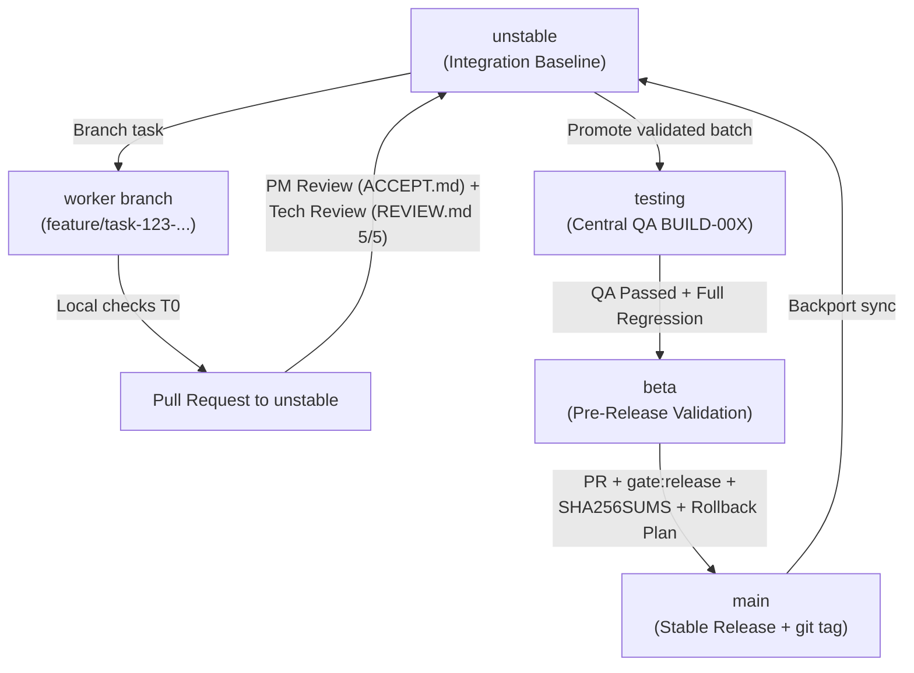

# TEAM.md — Team Structure, Departments, Agent Routing, and Branch Pipeline for `discord-lab`

This document serves as the source of truth for team organization, specialist role assignments, continuous parallel execution (Zero-Idle), model routing (`Antigravity` / Gemini, no `codex`), and the branch pipeline: `worker branch -> unstable -> testing -> beta -> main`.

---

## 1. Department and Role Structure (Specialist Departments)

Each worker is an independent specialist responsible strictly for their assigned task within their department:

| Department / Role | Responsibility Scope and File Boundaries | Primary Worker Verification (`T0`) |
|---|---|---|
| **G1 — Backend (Rust Core & Native BFF)** | `rust/crates/discord-*`, `rust/discord-gpui/src/*.rs` (shared files only with Tech Lead permission), `rust/discord-gpui/tests/*_contract.rs` | `cargo test --test <slice>_contract`, `cargo clippy -D warnings`, `rustfmt --check` |
| **G2 — Frontend (UI Views & A11y)** | `rust/discord-gpui/src/views/**/*.rs`, `tests/unit/*.test.mjs` | `node scripts/test-impact.mjs --run`, `npm run typecheck` |
| **G3 — Design (UX/UI Specs & Tokens)** | `docs/specs/*.md`, `waves/RW-*/DESIGN/*.md`, CSS tokens, responsive breakpoints, WCAG 2.2 AA contrast, and keyboard navigation matrices | `node --test tests/meta/design-breakpoints.test.mjs tests/meta/test-policy.test.mjs` |
| **G4 — QA (Test Automation & Build Verification)** | Centralized functional and regression testing of builds from the `testing` branch, `scripts/test-impact.mjs`, `tests/{meta,unit,smoke,e2e}/`, reports `QA-BUILD-*.md` | Full matrix run: `meta` + `tsc` + `unit` + `smoke` + `cargo test` + `e2e`, filing `P0–P3` defects with reproduction steps |
| **G5 — Voice & Platform** | `rust/crates/discord-voice`, `rust/crates/discord-platform`, streaming opcodes `18..=22`, SRTP, Keyring, D-Bus | `cargo test -p discord-voice -p discord-platform` |
| **G6 — Tech Writer & Parity** | `waves/RW-*/PARITY/MERGE-READINESS-*.md`, `RELEASE-NOTES-*.md`, parity matrices, user and release documentation | `node --test tests/meta/docs-sync.test.mjs tests/meta/plan-sync.test.mjs tests/meta/test-policy.test.mjs` |
| **G7 — Reverse Engineering & Parity Discovery (`G7 RE / REA`)** | Compare features and contracts with clean-room oracle `docs/re/` and running Discord sessions via `rea` tools; document gaps in `waves/RW-*/RE-AUDIT/RE-GAP-*.md` and submit modernization cards to PM in `waves/RW-*/PM/BACKLOG-RE-*.md` | REA MCP calls (`analyze_javascript_application`, `compare_source_to_bundle`, `trace_javascript_semantics`, etc.) + comparison with `docs/re/` |
| **DevOps / Release & Integration** | `scripts/release.sh`, `scripts/ci.sh`, `scripts/gate.mjs`, SBOM, `SHA256SUMS`, branch pipeline `unstable -> testing -> beta -> main` | `bash scripts/release.sh --verify`, `npm run gate:release` |
| **Product Manager (PM)** | Review `RE-GAP-*.md` reports from `G7 RE / REA`, prioritize the backlog (`BACKLOG-RE-*.md`), and verify that PRs meet requirements, user journeys, mockups, and DoD (`ACCEPT.md`) | Scenario verification, completeness of UI/UX states (`empty`, `loading`, `error`, `202`, `429`, `NSFW`), artifact completeness |
| **Technical Reviewer** | Independent review of architecture, security, code quality, error handling, backward compatibility, clean diffs, and verification of 5/5 mutation kill rate (`REVIEW.md`) | Independent test execution, MD5 validation, killing 5/5 mutants on duplicate code |
| **Coordinator / Team Lead** | Backlog decomposition, zero-idle department orchestration, branch pipeline management (`unstable` / `testing` / `beta` / `main`), maintaining `waves/STATE.md` and `waves/db.jsonl` | Gate control `T1–T3`, merging approved PRs, cleaning up completed branches |

---

## 2. Zero-Idle Policy (Continuous Parallel Execution)

1. **Zero Downtime for Any Department or Worker:**
   - No department is left idle waiting for another department to complete work.
   - While G1 Backend and G2 Frontend implement current features, G3 Design prepares specifications for upcoming cards, G4 QA tests the current `testing` build (`BUILD-00X`) or hardens testing infrastructure (`test-impact.mjs`), DevOps validates pre-release `beta` and `SHA256SUMS`, G6 Tech Writer prepares parity matrices and release notes, and reviewers validate completed branches.
2. **Immediate Rotation Upon Task Completion (`worker_done`):**
   - Once a worker signals `worker_done`, the coordinator:
     1. Immediately triggers product and technical review for the completed branch.
     2. Assigns the freed worker/department the next task from the backlog in a **new** worktree branched from `unstable`.
3. **No Uncoordinated Task Reassignment:**
   - Workers strictly adhere to their assigned card and write-scope. Do not pick tasks from other streams without coordinator assignment.

---

## 3. Agent Routing and Model Policy

### 3.1. Prohibition of `codex` and `deepseek`
- Launching workers with `--agent codex` or `deepseek`/`opencode` is strictly prohibited under all circumstances.

### 3.2. Complexity-First Gemini Model & Effort Matrix (`--agent antigravity`)
Queue priority (`P0–P3`) determines **execution order only**. Model and `--effort` are selected strictly by **technical complexity (`Tier S–XL`)**:
- **Tier S (`gemini-3.8-flash-low`, `--effort low`):** Single-line switches, CI/config fixes, design specs & tokens (`G3`), and documentation/parity matrices (`G6`).
- **Tier M (`gemini-3.8-flash-medium` / `flash-high` `--effort medium`, `gemini-4-argon-low` `--effort low`):** UI components, modals, settings (`G2`), PM acceptance checklists (`ACCEPT.md`), DevOps scripts, and lightweight `P2/P3` D-Bus/IPC helpers.
- **Tier L (`gemini-4-argon-medium` `--effort medium` / `gemini-4-argon-high` `--effort high`):** `argon-medium` for standard BFF REST services, Voice/Platform session wiring, and QA contract tests; `argon-high` for complex Gateway/WS state machines, technical mutation reviews (`5/5`), and `G7 RE` protocol tracing.
- **Tier XL (`gemini-4-carbon-high`, `--effort high`; `xhigh` only on architectural escalation):** Exclusively for zero-copy ring buffers, DAVE MLS v1 / SRTP / AES-GCM cryptography, and the `AppState` Tokio<->GPUI async bridge.

### 3.3. Worker Spawning via Orca CLI
All workers operate in isolated Orca worktrees branched from `unstable` and are launched via `orca orchestration worker-start`:

```bash
# 1. Create worktree and branch from latest unstable
orca worktree create \
  --name task-123-voice \
  --base-branch unstable \
  --branch feature/task-123-voice-mixer

# 2. Launch worker terminal with complexity-appropriate model & effort
orca orchestration worker-start \
  --run run_a9411d4ae3c4 \
  --worktree branch:feature/task-123-voice-mixer \
  --agent antigravity \
  --model gemini-4-argon-medium \
  --effort medium
```

---

## 4. Branch Pipeline and Dual Review



1. **Creating Worker Branches:**
   - Tasks start with an analysis of goals, requirements, dependencies, and Definition of Done (DoD).
   - A dedicated branch is created from `unstable` following `<type>/task-<id>-<slug>` (`feature/...`, `bugfix/...`, `qa/...`, `docs/...`).
2. **Local Validation and PR:**
   - Worker runs local tests, build verification, linter (`clippy`), and typecheck.
   - Worker submits a Pull Request to `unstable`.
   - Direct merges into protected branches (`unstable`, `testing`, `beta`, `main`) by workers are forbidden.
3. **Dual Review (PM + Technical Reviewer):**
   - **PM Review (`ACCEPT.md`):** Checks acceptance criteria, UX states (`empty`, `loading`, `error`), and DoD.
   - **Technical Review (`REVIEW.md`):** Inspects architecture, safety, error propagation, test coverage, and executes 5/5 control mutations.
   - Merging into `unstable` requires green CI, PM approval, Technical Reviewer sign-off, zero blocking defects (`P0=0, P1=0`), and clean merge conflicts.
4. **Branch Cleanup:**
   - After merging into `unstable`, worker branches are deleted.
5. **Centralized Builds in `testing` for QA:**
   - QA tests centralized builds in `testing` (`BUILD-00X`), accompanied by a build manifest (`waves/RW-*/BUILDS/BUILD-00X.md`).
   - Defects are logged as `bugfix/task-<id>-<slug>` branches from `unstable`.
6. **Pre-Release in `beta`:**
   - After `QA Passed`, builds advance to `beta` for soak testing, performance verification, and package signing.
7. **Release to `main`:**
   - PR from `beta` to `main`, git release tag created, and changes backported to `unstable`.

---

## 5. The 13 Mandatory Task Statuses

Every task passes through this lifecycle:
1. `Backlog` — Card documented in backlog.
2. `Ready for Development` — Spec approved, DoD defined.
3. `In Progress` — Worker assigned, active branch created.
4. `Ready for Product Review` — Implementation done, PR opened, ready for PM review.
5. `Ready for Technical Review` — PM approved, ready for code and mutation review.
6. `Ready for Merge` — Both reviews passed (`P0=0, P1=0`, 5/5 mutations killed).
7. `Merged to Unstable` — PR merged to `unstable`, worker branch deleted.
8. `In Testing` — Included in `testing` build `BUILD-00X` for centralized QA.
9. `QA Failed` — Defect detected, bugfix branch created.
10. `QA Passed` — All automated and manual test suites passed in `testing`.
11. `In Beta` — Deployed to `beta` for soak testing and performance validation.
12. `Ready for Release` — Beta validation complete, release PR open to `main`.
13. `Released` — Merged to `main`, tagged, backported to `unstable`.

---

## 6. Clean-Room Oracle Workflow (`docs/re/`) and REA Tools

1. **When to Consult `docs/re/` and `rea`:**
   - During feature implementation, spec design, or code review whenever Discord protocol details, payloads, sliders, error codes, sorting orders, or localization behaviors require verification.
2. **Standard Workflow:**
   - **Step 1 (Clean-Room Dump `docs/re/`):** Check relevant references (`README.md`, `rest-d02.md`, `gateway-protocol.md`, `frontend-d03.md`, `native-re.md`, `voice-deep.md`).
   - **Step 2 (Static RE via `rea`):** Decompile and trace dependencies via MCP `rea` tools (`analyze_javascript_application`, `trace_javascript_semantics`, `search_strings`).
   - **Step 3 (Dynamic RE via `rea`):** Inspect running Discord session via CDP (port 9223) or Electron runtime tools if static references are insufficient.
   - **Step 4 (TDD Transfer):** Encode findings in tests (`*_contract.rs` / `*.test.mjs`) and implement functionality matching the oracle.

---

## 7. Worker Memory Ceiling (`WORKER_RAM_LIMIT <= 25 GB`) and Fixed Slot Pool

1. **RAM Ceiling — up to 25 GB RAM (`active = 5`, max `6`):**
   - System has 48 GB RAM (`Swap: 0B`). Total memory consumption across all workers and sub-processes (`cargo`, `rustc`, `node`, `rea`) must remain under **25 GB RAM**.
   - Coordinator maintains a pool of **5 active slots** (`3` dev/review/QA + `2` read-only RE slots).
   - Zero-Idle operates by 1-to-1 rotation: upon task completion, the terminal is released (`worker-release`) and the slot is immediately repurposed for the next queued task.
2. **Terminal Release (`worker-release`):**
   - After each `worker_done`, reclaim freed terminals:
     ```bash
     for ctx in $(orca orchestration worker-list --run <run_id> | awk '/terminal=reclaimable/ {print $1}'); do
       orca orchestration worker-release --dispatch "$ctx"
     done
     ```
   - Verify aggregate RSS across worker processes remains `< 25 GiB`.
