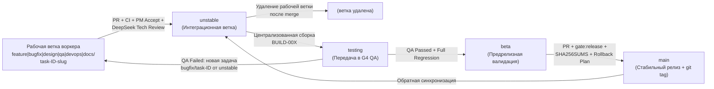

# TEAM.md — структура команды, отделы, маршрутизация агентов и конвейер веток `discord-lab`

Этот документ — источник истины по организации командной разработки, распределению ролей между специалистами, правилам непрерывной параллельной загрузки (Zero-Idle), маршрутизации моделей (`DeepSeek` / `Antigravity`, запрет `codex`) и конвейеру веток `worker branch -> unstable -> testing -> beta -> main`.

---

## 1. Структура отделов и ролей (Specialist Departments)

Каждый воркер является независимым профильным специалистом и отвечает строго за назначенную ему задачу в рамках своего отдела:

| Отдел / Роль | Зона ответственности и файловый контур | Основные проверки воркера (`T0`) |
|---|---|---|
| **G1 — Backend (Rust Core & Tauri BFF)** | `rust/crates/discord-*`, `rust/gui-spike/src/*.rs` (кроме общих файлов без разрешения Tech Lead), `rust/gui-spike/tests/*_contract.rs` | `cargo test --test <slice>_contract --test ipc_wiring_contract`, `cargo clippy -D warnings`, `rustfmt --check` |
| **G2 — Frontend (WebView UI & DOM/A11y)** | `rust/gui-spike/ui/**/*.js`, `rust/gui-spike/ui/**/*.css`, `rust/gui-spike/ui/index.html`, `tests/unit/*.test.mjs` | `node scripts/test-impact.mjs --run`, `npm run typecheck`, `tests/meta/ipc-path.test.mjs`, `tests/meta/test-policy.test.mjs` |
| **G3 — Design (UX/UI Specs & Tokens)** | `docs/specs/*.md`, `waves/RW-*/DESIGN/*.md`, дизайн-токены CSS, адаптивные брейкпоинты, WCAG 2.1 AA контраст и клавиатурные матрицы | `node --test tests/meta/design-breakpoints.test.mjs tests/meta/test-policy.test.mjs` |
| **G4 — QA (Test Automation & Build Verification)** | Централизованное функциональное и регрессионное тестирование сборок из ветки `testing`, `scripts/test-impact.mjs`, `tests/{meta,unit,smoke,e2e}/`, отчёты `QA-BUILD-*.md` | Полный матричный прогон `meta` + `tsc` + `unit` + `smoke` + `cargo test` + `e2e`, фиксация `P0–P3` дефектов с repro |
| **G5 — Voice & Platform** | `rust/crates/discord-voice`, `rust/crates/discord-platform`, `rust/gui-spike/src/voice_devices.rs`, опкоды стриминга `18..=22`, SRTP, Keyring, D-Bus | `cargo test -p discord-voice -p discord-platform`, `--test voice_devices_contract` |
| **G6 — Tech Writer & Parity** | `waves/RW-*/PARITY/MERGE-READINESS-*.md`, `RELEASE-NOTES-*.md`, матрицы паритета (`38/38 IPC`, фичи, тесты), пользовательская и релизная документация | `node --test tests/meta/docs-sync.test.mjs tests/meta/plan-sync.test.mjs tests/meta/test-policy.test.mjs` |
| **G7 — Reverse Engineering & Parity Discovery (`G7 RE / REA`)** | Сравнение функций и контрактов с эталонным дампом `/home/sanya/re-deep/` и живой сессией Discord (CDP `9223` / Electron / ASAR / `.node`) через инструменты `rea`; документирование несовпадений и недостающих частей кода в `waves/RW-*/RE-AUDIT/RE-GAP-*.md` и передача карточек PM в `waves/RW-*/PM/BACKLOG-RE-*.md` | Вызовы MCP `rea` (`analyze_javascript_application`, `compare_source_to_bundle`, `inspect_electron_page`, `trace_javascript_semantics` и др.) + сверка с `/home/sanya/re-deep/` |
| **DevOps / Release & Integration** | `scripts/release.sh`, `scripts/ci.sh`, `scripts/gate.mjs`, SBOM, `SHA256SUMS`, сборка `unstable -> testing -> beta -> main` | `bash scripts/release.sh --verify`, `cargo test -p discord-conformance`, `npm run gate:release` |
| **Product Manager (PM)** | Приёмка отчётов `RE-GAP-*.md` от отдела `G7 RE / REA`, формирование приоритетного бэклога модернизации и новых функций оригинального клиента (`BACKLOG-RE-*.md`), а также проверка соответствия PR требованиям задачи, пользовательским сценариям, макетам и DoD (`ACCEPT.md`) | Сверка сценариев, полноты UI/UX-состояний (`empty`, `loading`, `error`, `202`, `429`, `NSFW`), комплектности артефактов |
| **Technical Reviewer (DeepSeek)** | Независимая проверка архитектуры, безопасности, качества кода, обработки ошибок, совместимости, отсутствия лишних правок и прогон `5/5` мутаций (`REVIEW.md`) | Независимый перезапуск тестов, проверка MD5, уничтожение `5/5` мутантов на копии кода |
| **Coordinator / Team Lead** | Декомпозиция бэклога, оркестрация отделов без простоев, управление ветками `unstable` / `testing` / `beta` / `main`, ведение `waves/STATE.md` и `waves/db.jsonl` | Контроль гейтов `T1–T3`, слияние одобренных PR, удаление отработанных веток |

---

## 2. Правила непрерывной параллельной загрузки (Zero-Idle Policy)

1. **Ни один отдел и ни один воркер не простаивает:**
   - Запрещено оставлять отдел без задач в ожидании завершения работы другого отдела.
   - Пока G1 Backend и G2 Frontend пишут код текущих фич, G3 Design готовит спецификации следующих карточек, G4 QA тестирует текущую сборку `testing` (`BUILD-00X`) или модернизирует тестовую инфраструктуру (`test-impact.mjs`), DevOps проверяет предрелизную сборку `beta` и `SHA256SUMS`, G6 Tech Writer готовит матрицу `MERGE-READINESS` и релиз-ноуты, а пул ревьюеров DeepSeek проверяет готовые ветки.
2. **Немедленная ротация при завершении задачи (`worker_done`):**
   - Как только воркер присылает `worker_done`, координатор:
     1. Немедленно запускает продуктовое и техническое ревью (DeepSeek) для завершённой ветки.
     2. Освободившемуся воркеру/отделу сразу выделяет следующую задачу из бэклога в **новой** рабочей ветке от `unstable` (либо задачу Pass 2 по замечаниям ревью).
3. **Запрет самовольного перераспределения:**
   - Воркер работает строго по назначенной карточке и файлам своего write-scope. Самостоятельно брать чужие задачи или менять распределение задач без решения координатора запрещено.

---

## 3. Маршрутизация агентов и политика моделей (Agent Routing & Cost Policy)

### 3.1. Полный запрет `codex`
- На `codex` исчерпан баланс (`на codex кончились денги`) — **запрещено запускать воркеров с `--agent codex` при любых обстоятельствах**.

### 3.2. Запрет Codex и DeepSeek
- **Codex:** лимиты исчерпаны — использование строго запрещено.
- **DeepSeek:** по указанию пользователя использование модели `deepseek/deepseek-v4.1-flash` полностью исключено. Все задачи, включая техническое ревью, валидацию и мутационные наборы, выполняются на линейке Gemini (`antigravity`).

### 3.3. Использование линейки Antigravity (`--agent antigravity`)
- **`gemini-4-carbon-high` (`--effort high` / `xhigh`):** ТОЛЬКО для самых сложных задач (P0 ядро, zero-copy Ring Buffer, DAVE MLS v1, AppState Tokio↔GPUI).
- **`gemini-4-argon-high` / `medium`:** для валидации, проверок, технического ревью, QA мутаций, а также для стандартных BFF REST сервисов и WebRTC.
- **`gemini-3.8-flash-high` / `medium` / `low`:** для UI компонентов, верстки, модалок, настроек, системного трея и документации.

### 3.4. Шаблон запуска видимого воркера через Orca CLI
Все воркеры создаются как изолированные Orca-worktree от `unstable` и запускаются через `orca orchestration worker-start`:

```bash
# 1. Создание рабочей ветки и worktree от актуальной unstable
orca worktree create \
  --name <type>-task-<id>-<slug> \
  --base-branch unstable \
  --branch <type>/task-<id>-<slug>

# 2. Запуск супервизируемого воркера через Antigravity
orca orchestration worker-start \
  --run <run_id> \
  --worktree branch:<type>/task-<id>-<slug> \
  --task-title "<Отдел>: <Краткое название> (task-<id>)" \
  --spec "<Полное ТЗ: цель, требования, зависимости, write-scope, команды проверки, критерии готовности>" \
  --agent antigravity \
  --model gemini-4-argon-high \
  --effort high \
  --keep-open
```

---

## 4. Жизненный цикл веток и сборок (`worker branch -> unstable -> testing -> beta -> main`)



1. **Создание рабочей ветки:**
   - Каждая новая задача начинается с изучения описания, цели, требований, зависимостей и критериев готовности (DoD).
   - Создаётся новая отдельная ветка от актуальной `unstable` по шаблону `<type>/task-<id>-<slug>` (`feature/task-123-...`, `bugfix/task-124-...`, `design/task-125-...`, `qa/task-126-...`, `devops/task-127-...`, `docs/task-128-...`, `hotfix/task-129-...`).
2. **Локальная валидация и PR в `unstable`:**
   - Воркер выполняет локальные тесты, проверку сборки, линтер (`clippy`/`eslint`), проверку типов (`tsc --noEmit`) и другие проверки проекта.
   - Воркер оформляет Pull Request (`waves/RW-*/PR/PR-XX-task-<id>-<slug>.md`) из своей ветки в `unstable`.
   - **Запрещено:** воркер не имеет права самостоятельно сливать код в общие или защищённые ветки (`unstable`, `testing`, `beta`, `main`).
3. **Продуктовая и техническая приёмка PR:**
   - **PM Review (`ACCEPT.md`):** проверяет соответствие требованиям, пользовательским сценариям, макетам и DoD. При возврате указывает конкретные ошибки, ожидаемый результат и способ проверки.
   - **Technical Review (`REVIEW.md`):** проверяет качество кода, архитектуру, безопасность, тесты, обработку ошибок, совместимость, отсутствие лишних правок и мутации (`5/5`).
   - Слияние в `unstable` выполняется только при наличии: (а) зелёного CI, (б) одобрения PM, (в) одобрения Технического ревьюера, (г) `0` блокирующих замечаний (`P0=0, P1=0`), (д) отсутствия конфликтов.
4. **Удаление рабочей ветки:**
   - После слияния в `unstable` рабочая ветка воркера удаляется. Продолжать разработку новой задачи в старой ветке после её слияния строго запрещено.
5. **Централизованная сборка в `testing` и работа QA:**
   - Передавать изменения в QA напрямую из рабочих веток воркеров запрещено. Прямые коммиты в `testing` запрещены.
   - Интегратор формирует в `testing` сборку `BUILD-00X` только из задач, прошедших в `unstable`, и прикладывает манифест (`waves/RW-*/BUILDS/BUILD-00X.md`): список включённых задач, номер сборки, инструкции по проверке, тестовые данные и известные ограничения.
   - Отдел **G4 QA** фиксирует в отчёте (`waves/RW-*/QUALITY/QA-BUILD-00X-REPORT.md`): версию сборки, окружение, шаги воспроизведения, фактический и ожидаемый результат, логи, скриншоты и критичность дефекта (`P0–P3`).
   - При обнаружении дефекта создаётся отдельная задача на исправление в новой ветке `bugfix/task-<id>-<slug>` от `unstable` -> PR в `unstable` -> следующая сборка `testing`.
6. **Предрелизная проверка в `beta`:**
   - После `QA Passed` и регрессии версия переносится из `testing` в `beta`.
   - В `beta` проверяются: целевое окружение, критические пользовательские сценарии, производительность, `SHA256SUMS`/SBOM и план отката (`BETA-VERIFY-00X-REPORT.md`).
7. **Выпуск в `main` и обратная синхронизация:**
   - Прямые коммиты в `main` запрещены. Из проверенной `beta` создаётся PR в `main`.
   - После выпуска создаётся версия и Git-тег, а все изменения/исправления из `main` синхронизируются обратно в `unstable` (а при `hotfix/*` — в `unstable`, `testing`, `beta`).

---

## 5. Тринадцать обязательных статусов задачи (Task Status Lifecycle)

Все задачи в трекере и отчётах волны (`waves/STATE.md`, `waves/RW-*/`) ведутся строго по 13 статусам без пропуска обязательных этапов:

1. `Backlog` — задача зарегистрирована в пуле и ожидает приоритизации.
2. `Ready for Development` — ТЗ, цель, зависимости, write-scope и критерии готовности (DoD) зафиксированы.
3. `In Progress` — создана рабочая ветка `<type>/task-<id>-<slug>` от `unstable`, воркер ведёт Red/Green TDD.
4. `Ready for Product Review` — воркер завершил локальные проверки, создал PR и передал на проверку PM (или возвращён на `In Progress` при замечаниях PM).
5. `Ready for Technical Review` — PM одобрил соответствие требованиям; PR передан независимому техническому ревьюеру DeepSeek (при замечаниях возвращается в `In Progress`).
6. `Ready for Merge` — получены оба одобрения (PM + Tech Review), CI зелёный, блокирующих замечаний и конфликтов нет.
7. `Merged to Unstable` — PR слит в `unstable`, рабочая ветка воркера удалена.
8. `In Testing` — задача включена в централизованную сборку `BUILD-00X` в ветке `testing` и передана в G4 QA.
9. `QA Failed` — в ходе проверки сборки `testing` выявлен дефект (создаётся отдельная задача `bugfix/task-*` со статуса `Ready for Development`).
10. `QA Passed` — функциональное и регрессионное тестирование в `testing` успешно пройдено.
11. `In Beta` — версия перенесена в ветку `beta`, выполняется предрелизная квалификация, проверка производительности и плана отката.
12. `Ready for Release` — проверка `beta` завершена, открыт релизный PR `beta -> main`.
13. `Released` — код слит в `main`, выставлен релизный тег/версия, выполнена обратная синхронизация с `unstable`.


---

## 6. Протокол работы с эталонным RE-дампом `/home/sanya/re-deep` и инструментами `rea`

1. **Когда использовать `/home/sanya/re-deep` и `rea`:**
   - При разработке новой фичи (`G1 Backend`, `G2 Frontend`, `G5 Voice`), проектировании спецификации (`G3 Design`) или техническом ревью (`DeepSeek Tech Review`), если возникает малейший вопрос о том, как устроена функция в оригинальном клиенте Discord (какие поля принимает/возвращает метод, какие границы у слайдера, какой код ошибки, как работает сортировка или локализация).
2. **Порядок действий специалиста:**
   - **Шаг 1 (Локальный дамп `/home/sanya/re-deep`):** проверить профильные индексы (`README.md`, `decoded-index.json`, `rest-d02.json`, `rest-static.json`, `gateway-protocol.json`, `frontend-d03.json`, `backend-ipc.json`, `voice-deep.json`, `ru-catalog.json`, `decoded/*.js`).
   - **Шаг 2 (Статический RE через `rea`):** при необходимости декомпиляции или трассировки зависимостей вызвать инструменты MCP `rea` (`analyze_javascript_application`, `trace_javascript_semantics`, `trace_application_feature`, `open_binary`, `procedure_pseudo_code`, `search_strings`, `xrefs`) на артефактах из `/home/sanya/re-deep/app-asar`, `/home/sanya/re-deep/decoded` или нативных `.node` модулях.
   - **Шаг 3 (Динамический RE на отдельно запущенном Discord через `rea`):** если статического дампа недостаточно, запустить/подключиться к отдельному экземпляру Discord (CDP порт `9223` / Electron / Frida) и применить runtime-инструменты `rea` (`list_electron_targets`, `inspect_electron_page`, `observe_javascript_runtime`, `reconcile_javascript_runtime`, `capture_electron_scenario`, `instrument_with_frida`, `correlate_static_and_runtime`).
   - **Шаг 4 (Перенос в код по TDD):** зафиксировать найденный оракул (имя чанка, смещение, вход/выход) в тесте (`*_contract.rs` / `*.test.mjs`) и реализовать функцию в точном соответствии с оракулом.


---

## 7. Предел памяти воркеров до 25 GB RAM (`WORKER_RAM_LIMIT <= 25 GB`), защита от OOM Killer и фиксированный пул слотов

1. **Лимит памяти на воркеров — строго до 25 GB RAM (`active = 5`, макс. `6`):**
   - На хосте 48 GB RAM (`Swap: 0B`), при этом **суммарный предел использования памяти всеми воркерами и их подпроцессами (`opencode`, `agy`, `cargo`, `rustc`, `node`, `rea`) составляет до `25 GB RAM`**.
   - Координатор держит фиксированный пул из **5 рабочих слотов** (`3` слота разработки/ревью/QA + `2` лёгких read-only слота отдела `G7 RE / REA`).
   - Правило Zero-Idle работает через **100% загрузку слотов по принципу 1-в-1 (FIFO-ротация)**: когда один воркер завершает работу, его терминал немедленно закрывается (`worker-release`), и ровно в этот освободившийся слот запускается следующая задача или ревью из очереди.
2. **Немедленная очистка завершённых терминалов (`reclaimable -> released`) и проверка лимита 25 GB:**
   - При каждом получении `worker_done` координатор обязан сразу выполнить:
     ```bash
     for ctx in $(orca orchestration worker-list --run <run_id> | awk '/terminal=reclaimable/ {print $1}'); do
       orca orchestration worker-release --dispatch "$ctx"
     done
     ```
   - Перед стартом следующей задачи проверяется суммарный RSS воркеров (`< 25 GiB`), `free -h` и число активных слотов.
