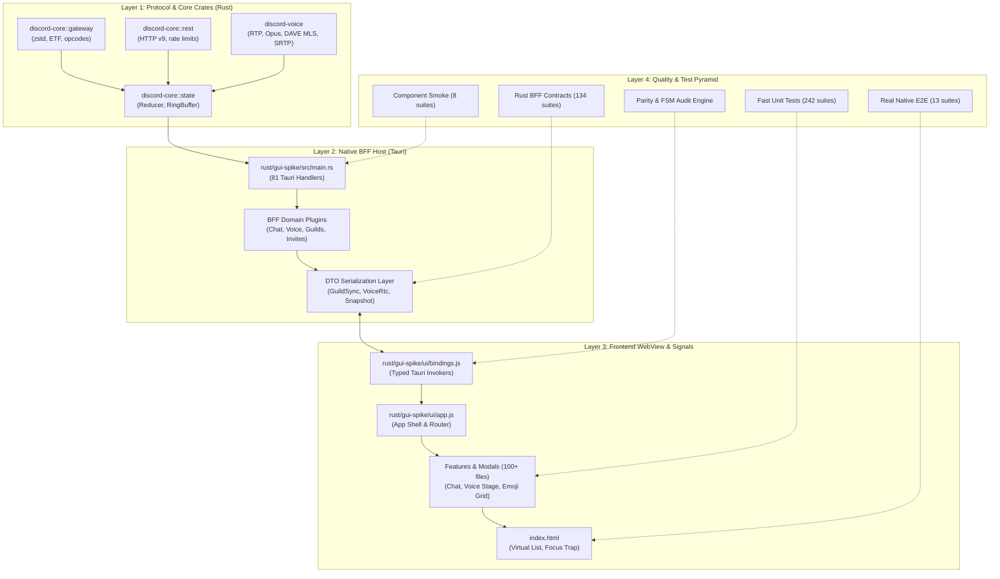

# Architecture Codemap: Chord / Discord-Lab

> **Generated:** 2026-11-16 12:17:58 UTC
> **Engine:** SocratiCode AST Dependency Graph & Code Intelligence
> **Total Indexed Files:** 1,534 | **Dependency Edges:** 8,032 | **Average Coupling:** 5.2 dep/file

---

## 1. High-Level Architectural Flow (Mermaid)



---

## 2. Component Inventory & Top Architectural Hubs

### Top Connected Architectural Hubs (SocratiCode Blast Radius):
1. **`rust/crates/chord-core/src/state/mod.rs`** (273 connections) — Центральное ядро стейт-машины протокола.
2. **`rust/crates/chord-core/src/lib.rs`** (256 connections) — Корневой экспорт моделей и DTO.
3. **`rust/gui-spike/src/main.rs`** (104 imports, 81 handlers) — Хост нативного окна и точка входа Tauri BFF.
4. **`rust/gui-spike/ui/app.js`** (50 imports, 6 dependents) — Главный контроллер пользовательского интерфейса.
5. **`rust/crates/chord-voice/src/lib.rs`** (150 connections) — Аудио-движок и RTC сигнализация.

---

## 3. Layer Breakdown

| Architectural Layer | File Count | Primary Role | Key Invariants |
|---|---|---|---|
| **Core Crates (`rust/crates/*`)** | 289 | Протокол, криптография, парсинг шлюза | `#![forbid(unsafe_code)]`, zero-copy ring buffers |
| **BFF Host (`rust/gui-spike/src/*`)** | 58 | Связка Rust $\leftrightarrow$ WebView, IPC команды | 81 зарегистрированная команда, строгая типизация DTO |
| **GPUI Native Client** | 0 | Альтернативный рендерер на GPU | 60 FPS рендеринг, прямое подключение к Metal/Vulkan |
| **Frontend UI (`rust/gui-spike/ui/*`)** | 153 | Компоненты интерфейса, модальные окна, DOM | W3C ARIA диалоги, Focus Trap, отсутствие утечек памяти |
| **Test Suites (`tests/*`)** | 301 | Пирамида верификации качества | 100% assertions, 0 broken imports, 5/5 mutation gate |

---

## 4. Test Pyramid Distribution

```
              ▲
             / \     [ 13 E2E Suites ]         - Real Native Window (AT-SPI/X11) & Gateway
            /───\
           /     \    [ 8 Smoke Suites ]       - Component Bootstrap & PipeWire Sanity
          /───────\
         /         \   [ 134 Contract Suites ]  - 9-Dimension BFF Boundary Invariants
        /───────────\
       /             \  [ 242 Unit Suites ]      - Fast Signals, Pure State, DTO Parsers
      /───────────────\
     [ 22 Meta Suites ] - Architecture Integrity, Plan Sync, Breakpoints & Security
```

---

## 5. Automated Verification Workflows

- `npm run codemap` — Перестроить текущую архитектурную карту через граф SocratiCode.
- `npm run gui:audit` — Экспресс-проверка согласованности вызовов UI и бэкенда (30 мс).
- `npm run test:gui:live` — Тестирование реального живого окна десктоп-клиента (4 сек).
- `npm run qa:system` — Полная 10-этапная сертификация качества.
