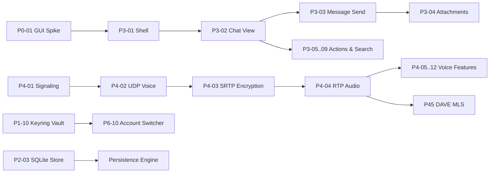

# WAVE-PLAN — Batch Scheduling, Throughput, and Execution Pipeline

Status: Updated following wave RW-36. Task cards are defined in `PLAN.md` (90 total cards); operational state is tracked in `waves/STATE.md` and `STATUS.md`; team roles in `TEAM.md`; process rules in `PROCESS.md` §3.13–§3.15.

## 1. Core Principles

**90 cards do not equal 90 isolated waves.** A wave (batch) groups 3–6 independent task cards under a single frozen contract, delivering an integrated patch and passing a single unified quality gate.

| Metric | Legacy Single-Card Mode | Modern Integrated Batch Mode |
|---|---|---|
| Wave Execution Unit | 1 card | 3–6 independent cards |
| Total Waves for 73 Cards | ~73 iterations | ~18–22 integrated batches |
| Batches per Day | 0.5–1 | 2–3 |
| Accepted Cards per Day | 2–4 | 6–8 |
| Full Workspace Gate | Per individual worker | Once per integrated batch |
| Documentation Updates | After every iteration | Once after formal acceptance |
| Test Execution | Full workspace per worker | Targeted tests per worker, full on batch |
| Active Code WIP | 6 concurrent workers | **2 active code workers** (paired), remaining seats in QA/review/gate |

Wave RW-36 resolved the GUI toolkit spike (Tauri 2 / GPUI, ADR-1) and closed spike cards P0-01 and P0-06. The immediate next phase implements the windowed/paginated data model, followed by UI foundation cards P3-02...P3-16.

## 2. Throughput Estimation Models (Historical Baseline)

Historical estimation baseline:

| Scenario | Cards Accepted / Day | Days to Complete 73 Cards | Operational Context |
|---|---:|---:|---|
| Conservative | 4 | 18–19 | Single batch active, multiple dependency blockers |
| **Planned Baseline** | **6–8** | **10–13** | 2 active code workers + dedicated QA/review pool, 2–3 batches/day |
| Accelerated | 10 | 8–9 | Unblocked dependencies, automated CI validation |

Velocity metrics are calibrated against verified completed batches. The mutation kill rate metric is evaluated alongside baseline validity, surviving mutants, inconclusive runs, and post-review iteration cycles.

## 3. Ready Queue Structure

Task cards with zero external dependencies, ready for immediate assignment:

| ID | Task Card | Depends On | Readiness Justification | Risk Vectors |
|---|---|---|---|---|
| P2-09 | Presence Tracking | P2-02 | Code, P2 fixes, mutation suite, and gate complete | Pending second-round review |
| P2-10 | Voice Channel States | P2-02 | Snapshot `003` + 8 live `VOICE_STATE_UPDATE` captures | Media transport isolated from scope |
| P2-11 | Typing Indicators | P2-04 | Cleanroom oracle with 28 typing events / 10,000 ms TTL | Fixture established in W20 |
| P2-08 | Settings Protobuf Decoder | P2-02 | Opaque Protobuf decoding -> structural settings model | Schema evolution boundaries |
| P1-01 | Complete ETF Codec | P0-02 | Prototype accepted, full wire specification required | Fuzz target boundary limits |
| P1-02 | Strict zstd Stream Decoder | P0-03 | Prototype accepted, streaming decoder required | Sequence continuation tail |
| P0-04 | Conformance Test Harness | — | Crate skeleton established in workspace | Cleanroom fixture availability |
| P0-07 | Legal Framework | — | Documentation-only | Final policy sign-off |
| P3-15 | I18N Runtime Foundation | — | Key hashing, locale resolution, string catalogs | Headless execution, no GUI required |
| P4-01 | Voice Signaling Engine | P1-06 | Headless signaling, cleanroom fixtures | Media transport isolated |
| P7-04 | Extended REST API Surface | P1-07 | Read-only REST endpoints | UI integration detached |
| P8-03 | Automated CI Pipeline | — | Local build and verification scripts | Remote CI runner configuration |

## 4. Batch Execution Plan

### 4.1 Completed Foundational Batches

| Batch | Cards Grouped | Assigned Lanes | Acceptance Gate |
|---|---|---|---|
| **B01 / RW-19–20** | P2-09, P2-10, P2-11 | CORE-1 (voice), CORE-2 (typing); TEST-1, QA-1, REV-1/2 | P2-09 review; voice/typing test suites; batch gate |
| **B02 / RW-21** | P1-01, P1-02, P0-04, P0-07, P2-08 | CORE-1 (ETF), CORE-2 (zstd), CORE-3 (settings), TEST-1, OPS-1 | **Accepted 2026-10-21**; contract freeze, fuzzing, batch gate |
| **B03 / RW-22** | P3-15, P4-01, P7-04, P8-03 | CLIENT-1 (i18n), VOICE-1 (signaling), CORE-3 (API), OPS-1 (CI) | **Accepted 2026-10-21**; headless-only; gate passed |
| **B04 / RW-23** | P4-02, P8-04 | VOICE-1 (UDP), OPS-1 (SBOM) | **Accepted 2026-10-21**; 21 mutants killed, 1 inconclusive |
| **B05 / RW-24** | P7-01 | CLIENT-1 (locale, plural, formatting, markdown), Lead Integration | **Accepted 2026-10-21**; 33 i18n tests, 20/20 mutations killed |

### 4.2 Staged Rolling Pipeline

Development is decoupled into research/specification and implementation stages to avoid coding against unverified external environments:

| Stage | Scope of Work | Deliverables & Gates | Entry Conditions |
|---|---|---|---|
| **A. Audit Queue** | P3 items from `waves/STATE.md`: address test gaps and cleanup debts | Targeted task cards with test IDs, file write-scopes, and mutation tests | Lead confirms backlog scope |
| **B. GUI Spike** | P0-01, P0-06 — **Completed in RW-36** | ADR-1: GUI architecture accepted; 60 fps p95 < 18ms, cold start < 140ms | Completed; windowed data model established |
| **C. UI Foundation -> Chat** | P3-02…P3-16 partitioned into non-overlapping file scopes | Headless view-model tests -> native smoke tests | P0-01 accepted |
| **D. Voice Engine** | P4-05/P4-06/P4-08/P4-09 | Device lifecycle, mute/PTT hotkeys, audio filters, soundboard tests | Audio backend specified, fixture available |
| **E. Media & E2EE** | P5-01…P5-07 and P45-01…P45-03 following dependency DAG | Screen capture, video encode, DAVE MLS key schedule and framing | GUI + media backend specified |
| **F. Finalization** | Remaining P6/P7/P8 cards from `PLAN.md` | Platform integrations, performance, accessibility, release packaging | Core feature acceptance |

## 5. Critical Path

The primary critical chains are:
1. **GUI Foundation:** P0-01 -> P3-01 -> P3-02 -> P3-03 -> P3-04.
2. **Audio Pipeline:** P4-01 -> P4-02 -> P4-03 -> P4-04 -> Advanced Voice Features.

## 6. Dependency Blockers and Resolution Paths

| Dependency Blocker | Impacted Cards | Resolution Path | Impact if Unresolved |
|---|---:|---|---|
| GUI Framework Crates | P0-01, P0-06, P3-01…P3-16, UI-dependent P5/P6/P7 | Confirm toolkit and approve crate dependencies | Headless models functional, graphical window unavailable |
| Audio/Media Backend | P4-05…P4-09, P5-01…P5-07, partial P4.5 | Select audio API (CPAL/PulseAudio/PipeWire) with local mock harness | RTP/crypto operational; hardware capture unavailable |
| Live Verification Accounts | Live smoke tests, P4/P5/P4.5 interop | Dedicated test accounts and test guilds | Conformance verified via local fixtures |
| System Dynamic Libraries | Platform-specific cards via spike | Verify local library presence, ABI compatibility, and offline builds | Fail closed with skip/code 2 |
| Build Tool Concurrency | Cargo compilation and batch integration | Restrict concurrent cargo builds; serialize via workspace lock | Build lock contention |

Resolved Dependencies: Keyring integration, SQLite storage, and D-Bus file descriptor passing were verified and accepted in RW-31, RW-33, and RW-35.

## 7. Test Governance and Execution Controls

- Workers execute only targeted test binaries for assigned modules; full workspace verification runs once per integrated batch.
- Testing budgets: S (6–10), M (10–16), L (16–24), XL (24–32) tests per card (`TEST-PLAN.md` §1.1).
- Equivalence assertions use table-driven tests rather than duplicated test functions.
- Mutation fault models derive from real operational risks; scores require a green baseline; inconclusive runs never count as killed.
- Skips are tracked by explicit ID and reason; tests asserting live operational contracts must fail if required dependencies are absent.
- Surviving mutants trigger new regression tests or explicit backlog items.

## 8. Daily Operational Cycle

1. **Morning Briefing:** Review `waves/STATE.md`, recent entries in `waves/db.jsonl`, and active `PLAN.md`; verify unblocked tasks.
2. **Contract Freezing:** Freeze interfaces and file scopes for the active batch; launch at most 2 parallel coding workers.
3. **Review Pipeline:** Review the previous batch while coding proceeds; address P0/P1/P2 findings test-first.
4. **Integration Gate:** Run the unified batch gate following green implementation; assign 2 independent code reviewers.
5. **Acceptance Synchronization:** On acceptance, update documentation, state ledger, and recompute the ready queue.
6. **Evening Retrospective:** Review KPIs (accepted cards, first-pass gate rate, zero critical defects, mutation scores) and prepare the next queue.

## 9. Success Criteria

- Measured velocity verified across consecutive integrated batches.
- Zero P0/P1 defects on review; all P2 findings resolved prior to acceptance.
- Zero file scope conflicts or redundant full-workspace compilation runs.
- Tracking documents (`STATE.md`, `db.jsonl`, `STATUS.md`, `ROADMAP.md`, `TASKS.md`, `docs/map.md`) kept strictly synchronized.
