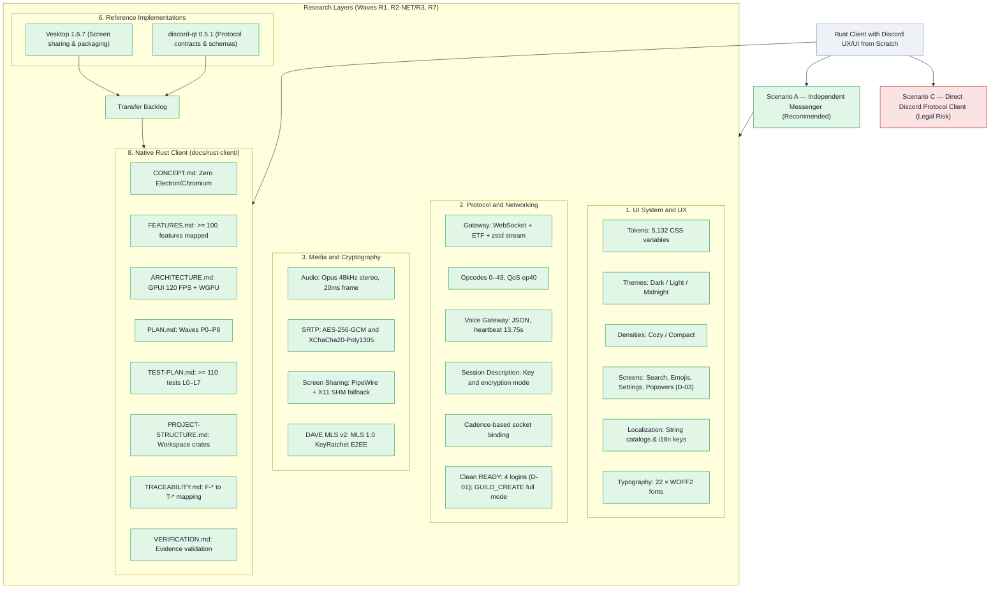
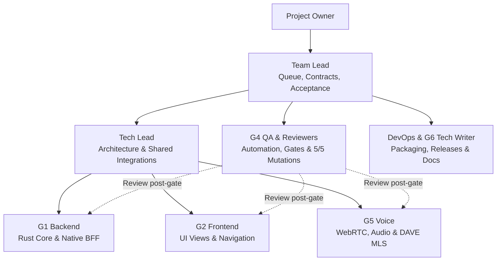

# Master Project Knowledge Graph

Coverage: Goals and user scenarios → research layers (coverage and artifacts) → data sources → blockers.
Status colors: Green — complete, Yellow — partial / in progress, Red — blocker / risk.

Artifact documentation:
- Clean-room Reverse Engineering: `docs/re/` (Index: [`docs/re/README.md`](re/README.md), architecture diagrams: [`docs/re/architecture.md`](re/architecture.md)).
- Rust Client Specifications: [`docs/rust-client/`](rust-client/README.md) — concept, features, architecture, phases P0–P8, test plans.
- Sprint Wave Journal: [`waves/`](../waves/README.md) — event log (`db.jsonl`), recovery checkpoint ([`STATE.md`](../waves/STATE.md)), and artifacts.
- Transfer Backlog: [`docs/feature-backlog.md`](feature-backlog.md).
- Reference Project Analyses: [`docs/vesktop-analysis.md`](vesktop-analysis.md) and [`docs/discord-qt-analysis.md`](discord-qt-analysis.md).

---

## Team and Batch Pipeline Flow

Operational rule: Batches contain 3–6 cards with a frozen contract and unified gate; review executes post-gate in parallel; documentation synchronizes upon task acceptance.

---

## How to Read This Graph

- **Goals & Scenarios:** Scenario A (independent client with Discord UX) is recommended; Scenario C (direct gateway connection under user tokens) carries platform TOS risks.
- **Layers 1–8:** Systematic engineering layers detailing verified findings, clean-room dumps, and native Rust client architecture.
- **Layer 6 (References):** Architecture comparisons with external open-source projects (Vesktop and discord-qt).
- **Transfer Backlog:** Complete inventory of functional capabilities across UI shell, streaming, voice, and data contracts documented in [`docs/feature-backlog.md`](feature-backlog.md).
