# Полная карта проекта (граф)

Охват: цель и сценарии → слои ресёрча (покрытие и артефакты) → источники данных → блокеры.
Все подписи — на русском. Цвет статуса: зелёный — готово, жёлтый — частично, красный — нет/риск.

Файлы (лаборатория `/tmp/opencode/r2-net/`): `map-project.svg` (вектор), `map-project.png`
(растр), генератор — `map-project.py`; канонический `MAP.md` — там же. Эта копия — для GitHub
(Mermaid рендерится прямо в браузере).
Сводные доки лаборатории: `READINESS.md` (готовность), `REPORT.md` (волны), `VOICE-CRYPTO.md`,
`UI-TRACES.md`, `assets-cache/ASSETS.md` (всё в `/tmp/opencode/r2-net/`).
В репозитории: бэклог переноса — `docs/feature-backlog.md`; анализы референсов —
`docs/vesktop-analysis.md` и `docs/discord-qt-analysis.md`.

```mermaid
flowchart TB
  classDef ok fill:#e2f6e7,stroke:#2f9e5f,color:#1b2430
  classDef part fill:#fdf3d8,stroke:#c99700,color:#1b2430
  classDef no fill:#fbe3e3,stroke:#c0392b,color:#1b2430
  classDef neu fill:#eef2f7,stroke:#7d93ab,color:#1b2430

  GOAL["Rust-клиент с UX/UI Discord с нуля"]:::neu
  A["Сценарий A — свой мессенджер (рекомендован)"]:::ok
  C["Сценарий C — клиент к реальному Discord (юридический риск)"]:::no
  GOAL --> A
  GOAL --> C
  A --> LAYERS

  subgraph LAYERS["Слои ресёрча (волны R1–R3)"]
    direction TB
    subgraph S1["1. UI-система и UX"]
      u1["Токены: 5132 CSS-переменные"]:::ok
      u2["Темы: тёмная / светлая"]:::ok
      u3["Плотности: cozy / compact"]:::ok
      u4["Экраны: DM, эмодзи-пикер, поповер профиля"]:::part
      u5["Локализация: ru и языковые пакеты"]:::ok
      u6["Шрифты: 22 × woff2"]:::ok
    end
    subgraph S2["2. Протокол и сеть"]
      p1["Шлюз: WebSocket + ETF + zstd-stream"]:::ok
      p2["Опкоды 0–43, QoS op40"]:::ok
      p3["Голосовой шлюз: JSON, heartbeat 13,75 с"]:::ok
      p4["Session description: ключ и режим шифрования"]:::ok
      p5["Привязка сокетов по каденции"]:::ok
      p6["READY / GUILD_CREATE с нуля"]:::no
    end
    subgraph S3["3. Медиа и крипто"]
      m1["RTP/RTCP: PT, SSRC, TWCC, NACK"]:::ok
      m2["Кодеки: Opus, VP8/VP9, RTX"]:::ok
      m3["Серверы SFU и ротация портов"]:::ok
      m4["Шифр: режимы 0–6, AAD и nonce"]:::ok
      m5["E2EE DAVE/MLS (вне объёма)"]:::no
    end
    subgraph S4["4. Десктоп-интеграции"]
      d1["IPC main-процесса: ~150 каналов"]:::ok
      d2["PTT-хоткеи, Wayland-idle"]:::ok
      d3["Трей, бейджи, клипы"]:::part
      d4["Стриминг Linux со звуком (PipeWire)"]:::no
    end
    subgraph S5["5. Ассеты и ресурсы"]
      a1["Звуки: 15 mp3"]:::ok
      a2["Иконки: 137 svg"]:::ok
      a3["Картинки: 206 png, 429 webp, 60 jpg"]:::ok
      a4["Видео: 13; Rive: 2; wasm: 6"]:::ok
      a5["Манифест: entries.json"]:::ok
    end
    subgraph S6["6. Проект и референсы"]
      r1["discord-lab: main 90c012a, v0.1.0"]:::ok
      r2["Гейты: worker / release / qualify"]:::ok
      r3["Golden-каталоги: только чтение"]:::ok
      r4["Референсы: Vesktop 1.6.7, discord-qt 0.5.1 (GPL — только идеи)"]:::ok
      r5["Бэклог переноса: 41 функция → волны R4/R5/R6/D"]:::ok
    end
  end

  subgraph SRC["Источники данных (копия, только чтение)"]
    s1["Копия Discord (CDP 9223)"]
    s2["Кэш 95 МБ: 4640 записей"]
    s3["Модули app-1.0.162 (.node, web.js)"]
    s4["Снимки pcap медиасессии"]
    s5["CDP-сессии: DOM и UI"]
    s6["asar: desktop-core"]
  end

  subgraph BLK["Блокеры и ограничения"]
    b1["Source maps: нет доступа к сети"]:::part
    b2["READY с нуля: нужен перезапуск"]:::part
    b3["Лицензии ассетов: не распространять"]:::no
    b4["DAVE/MLS: вне объёма A"]:::neu
    b5["Критических блокеров для A нет"]:::ok
  end

  s1 --> S1
  s1 --> S2
  s1 --> S3
  s2 --> S5
  s3 --> S3
  s3 --> S4
  s4 --> S3
  s5 --> S1
  s6 --> S4
  b1 -.-> S1
  b2 -.-> S2
  b3 -.-> S5
  b4 -.-> S3
```

## Как читать

- **Цель → сценарии.** A (свой мессенджер с UX Discord) — рекомендован; C (клиент к реальному
  Discord под пользовательским аккаунтом) технически возможен, но юридически рискован.
- **Слои 1–6** — направления ресёрча; внутри — конкретные находки/артефакты со статусом.
- **Источники** — откуда данные (всё с копии, живой клиент не трогали).
- **Блокеры** — пунктирные стрелки показывают, какой слой задет.
- **Референсы (слой 6)** — внешние проекты для сверки: Vesktop 1.6.7 (оболочка/стриминг, GPL) и
  discord-qt 0.5.1 (контракты, GPL); код не копируется — перенимаются идеи и детали.
- **Бэклог переноса** — полный инвентарь недостающих функций (41 карточка: R4 — оболочка,
  R5 — стриминг/аудио, R6 — платформа, D — данные/контракты) с критериями готовности;
  в репозитории — `docs/feature-backlog.md` (анализы — `docs/vesktop-analysis.md`,
  `docs/discord-qt-analysis.md`).
