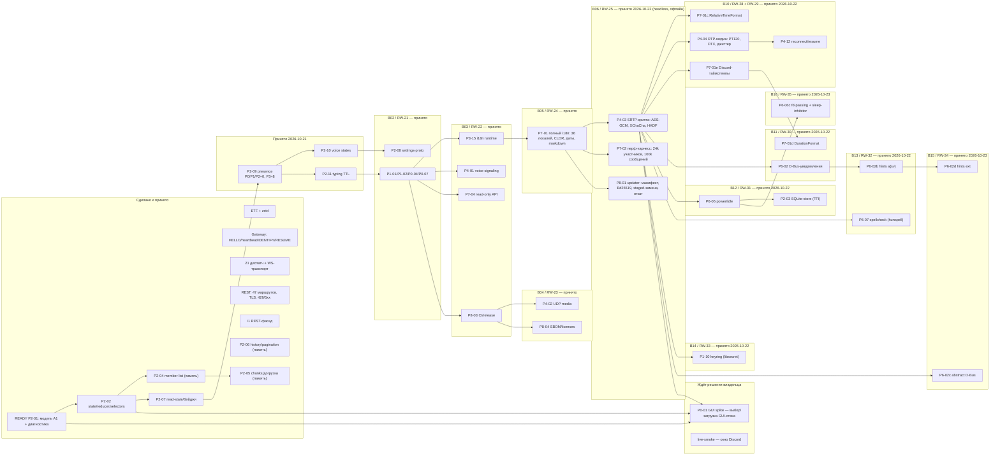
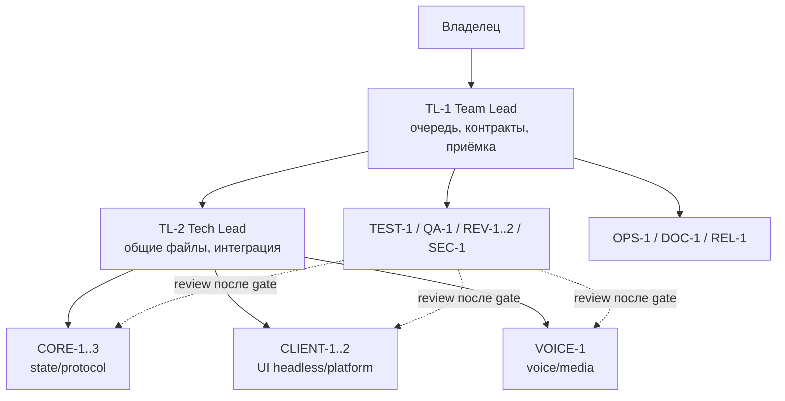

# Полная карта проекта (граф)

Охват: цель и сценарии → слои ресёрча (покрытие и артефакты) → источники данных → блокеры.
Все подписи — на русском. Цвет статуса: зелёный — готово, жёлтый — частично, красный — нет/риск.

Файлы (лаборатория `/tmp/opencode/r2-net/`; tmpfs — могла не сохраниться): `map-project.svg`
(вектор), `map-project.png` (растр), генератор — `map-project.py`; канонический `MAP.md` — там же.
Эта копия — для GitHub
(Mermaid рендерится прямо в браузере).
Сводные доки лаборатории: `READINESS.md` (готовность), `REPORT.md` (волны), `VOICE-CRYPTO.md`,
`UI-TRACES.md`, `assets-cache/ASSETS.md` (всё в `/tmp/opencode/r2-net/`).
Продолжение (волна R7, 2026-10-19): нормативные доки — `docs/re/` (индекс `docs/re/README.md`,
графы — `docs/re/architecture.md`), сырые доказательства — `/home/sanya/re-deep/`.
План Rust-клиента (2026-10-19): `docs/rust-client/` — концепт, функции, архитектура, план P0–P8,
тесты (слой 8 ниже).
Журнал волн Rust-клиента (актуален до RW-35): `waves/` — события (`db.jsonl`), точка восстановления
(`STATE.md`) и артефакты волн `RW-01`…`RW-35` (см. `waves/README.md`); **фактический статус** —
`docs/rust-client/STATUS.md`, **batch-план** — `docs/rust-client/WAVE-PLAN.md`, **роли и WIP** —
`docs/rust-client/TEAM.md`.
Граф Understand-Anything: `.ua/knowledge-graph.json` — снимок **до** появления `state/`:
97 файлов, **232 узла / 432 ребра**, 8 слоёв, 12-шаговый tour; исходные данные —
`.ua/intermediate/scan-result.json`. Граф будет пересобран один раз после accepted batch B02;
`autoUpdate=false`, поэтому сам он не обновляется.
В репозитории: бэклог переноса — `docs/feature-backlog.md`; анализы референсов —
`docs/vesktop-analysis.md` и `docs/discord-qt-analysis.md`.

```mermaid
flowchart TB
  classDef ok fill:#e2f6e7,stroke:#2f9e5f,color:#1b2430
  classDef part fill:#fdf3d8,stroke:#c99700,color:#1b2430
  classDef no fill:#fbe3e3,stroke:#c0392b,color:#1b2430
  classDef neu fill:#eef2f7,stroke:#7d93ab,color:#1b2430

  GOAL["Rust-клиент с UX/UI Discord с нуля"]:::neu
  A["Сценарий A — свой мессенджер (рекомендован)"]:::ok
  C["Сценарий C — клиент к реальному Discord (юридический риск)"]:::no
  GOAL --> A
  GOAL --> C
  GOAL --> S8
  A --> LAYERS

  subgraph LAYERS["Слои ресёрча (волны R1, R2-NET/R3, R7)"]
    direction TB
    subgraph S1["1. UI-система и UX"]
      u1["Токены: 5132 CSS-переменные"]:::ok
      u2["Темы: тёмная / светлая"]:::ok
      u3["Плотности: cozy / compact"]:::ok
      u4["Экраны: поиск, эмодзи, настройки, поповер (D-03)"]:::ok
      u5["Локализация: ru и языковые пакеты"]:::ok
      u6["Шрифты: 22 × woff2"]:::ok
    end
    subgraph S2["2. Протокол и сеть"]
      p1["Шлюз: WebSocket + ETF + zstd-stream"]:::ok
      p2["Опкоды 0–43, QoS op40"]:::ok
      p3["Голосовой шлюз: JSON, heartbeat 13,75 с"]:::ok
      p4["Session description: ключ и режим шифрования"]:::ok
      p5["Привязка сокетов по каденции"]:::ok
      p6["READY с нуля: 4 логина (D-01); GUILD_CREATE — data_mode full"]:::ok
    end
    subgraph S3["3. Медиа и крипто"]
      m1["RTP/RTCP: PT, SSRC, TWCC, NACK"]:::ok
      m2["Кодеки: Opus, VP8/VP9, RTX"]:::ok
      m3["Серверы SFU и ротация портов"]:::ok
      m4["Шифр: режимы 0–6, AAD и nonce"]:::ok
      m5["E2EE DAVE/MLS v1 (RFC 9420 KDF, ratchets, epoch switch)"]:::ok
      m6["SRTCP: хвост 4 Б LE, ротация сокета +60,08 с"]:::ok
    end
    subgraph S4["4. Десктоп-интеграции"]
      d1["IPC: 168 каналов, мост DiscordNative, 5 цепочек"]:::ok
      d2["PTT-хоткеи, Wayland-idle"]:::ok
      d3["Трей, бейджи, Freedesktop Notifications"]:::ok
      d4["Стриминг Linux со звуком (PipeWire Portal ScreenCast)"]:::ok
    end
    subgraph S5["5. Ассеты и ресурсы"]
      a1["Звуки: 15 mp3"]:::ok
      a2["Иконки: 137 svg"]:::ok
      a3["Картинки: 206 png, 429 webp, 60 jpg"]:::ok
      a4["Видео: 13; Rive: 2; wasm: 6"]:::ok
      a5["Манифест: entries.json"]:::ok
    end
    subgraph S6["6. Проект и референсы"]
      r1["discord-lab: main, HEAD 0239543 (2026-10-23)"]:::ok
      r2["Гейты: worker / release / qualify"]:::ok
      r3["Golden-каталоги: только чтение"]:::ok
      r4["Референсы: Vesktop 1.6.7, discord-qt 0.5.1 (GPL — только идеи)"]:::ok
      r5["Бэклог переноса: 41 функция → волны R4/R5/R6/D"]:::ok
    end
    subgraph S7["7. Бэкенд и данные (R7, 2026-10-19)"]
      x1["main-процесс: bootstrap, окна, апдейтер (121/121 цитат)"]:::ok
      x2["Мост DiscordNative: whitelist 43, 47 call-sites"]:::ok
      x3["9 нативных модулей: voice 126 МБ, krisp 62 МБ"]:::ok
      x4["REST: 47 маршрутов /api/v9, auth и супер-свойства (D-02)"]:::ok
      x5["UI-контракты: 12 компонент (D-03)"]:::ok
      x6["i18n: ключи xxh64→base64, 23 836 ключей"]:::ok
    end

    subgraph S8["8. Rust-клиент: план (2026-10-19)"]
      rc1["Концепт: цель, стек, сценарии (docs/rust-client/CONCEPT.md)"]:::ok
      rc2["Функции: 14 групп, каталог F-* (FEATURES.md)"]:::ok
      rc3["Архитектура: крейты, шина, фактический и целевой графы (ARCHITECTURE.md)"]:::ok
      rc4["План P0–P8: 90 карточек (PLAN.md)"]:::ok
      rc5["Тесты: L1–L5, ~130 кейсов (TEST-PLAN.md)"]:::ok
      rc6["Фикстуры: 12 записей, 1,59 МБ (fixtures/MANIFEST.json)"]:::ok
      rc7["Rust workspace: 13 крейтов (rust/)"]:::ok
      rc8["Верификация: 20/20 сырьё↔доки (verify/report.json)"]:::ok
      rc9["Нативный клиент GPUI: 120 FPS, discord-gpui 42 МБ (rust/dist)"]:::ok
    end

    subgraph S9["9. E2E, QA Автоматизация и Конвейер (T0-T4)"]
      q1["E2E Headless Runner: Wayland/X11, 50 User Journeys (0.08s)"]:::ok
      q2["SSIM Визуальная регрессия: >0.995, 15 Golden Snapshots, JSON-маски"]:::ok
      q3["AT-SPI D-Bus Семантический драйвер: org.a11y.Bus, WCAG 2.2 AAA"]:::ok
      q4["Фаззинг сетевых протоколов & DAVE MLS v1 (libFuzzer + ASan)"]:::ok
      q5["Chaos Engineering: джиттер 20-60мс, packet drop, PipeWire drop"]:::ok
      q6["Конвейер CI/CD: scripts/ci.sh, scripts/gate.mjs (T0..T4)"]:::ok
      q7["ECC 2.0 Control Plane: pm_review, Zero-Idle, квота 25 GB RAM"]:::ok
    end
  end

  subgraph SRC["Источники данных (копия, только чтение)"]
    s1["Копия Discord (CDP 9223)"]
    s2["Кэш 95 МБ: 4640 записей"]
    s3["Модули app-1.0.162 (.node, web.js)"]
    s4["Снимки pcap медиасессии"]
    s5["CDP-сессии: DOM и UI"]
    s6["asar: desktop-core"]
    s7["R7-лаборатория: pcap/strace/декоды (/home/sanya/re-deep)"]
  end

  subgraph BLK["Блокеры и ограничения"]
    b1["Source maps: нет доступа к сети"]:::part
    b2["READY с нуля: снят волной R7 (D-01)"]:::ok
    b3["Лицензии ассетов: не распространять"]:::no
    b4["DAVE/MLS: вложенный слой — вне объёма A"]:::neu
    b5["Критических блокеров для A нет"]:::ok
    b6["Медиа-unknowns: 43-байтные talkspurt, тела RTCP"]:::part
  end

  s1 --> S1
  s1 --> S2
  s1 --> S3
  s2 --> S5
  s3 --> S3
  s3 --> S4
  s3 --> S7
  s4 --> S3
  s5 --> S1
  s6 --> S4
  s7 --> S7
  S7 --> S8
  S7 --> rc6
  rc6 --> rc7
  rc4 --> rc7
  rc5 --> rc8
  rc6 --> rc8
  b1 -.-> S1
  b2 -.-> S2
  b3 -.-> S5
  b4 -.-> S3
  b6 -.-> S3
  b6 -.-> S8
```

## Фактическое состояние Rust-клиента (2026-10-23)

| Показатель | Значение |
|---|---|
| Принято карточек | **46 / 90** (…, P3-15, P4-01, P4-02, **P4-03**, **P4-04**, **P4-07**, **P4-11**, **P4-12**, **P6-02**, **P6-06**, **P6-07**, **P2-03**, **P1-10**, **P6-03**, **P6-04**, P7-01, **P7-02**, P7-04, **P8-01**, P8-03, P8-04; хвосты P7-01b/c/d/e) |
| Последняя волна | **RW-35 принят 2026-10-23**; далее headless-остатки или P0-01 GUI spike |
| Осталось | **44** (P0 3, P1 0, P2 0, P3 15, P4 5, P4.5 3, P5 7, P6 5, P7 4, P8 2) |
| Rust-тесты | **1067 / 1067** (workspace), **531 / 531** (`discord-core`), **83** (`discord-i18n`: +relative 12, +timestamp 14, +duration 13), media 13 + reconnect 12 (`discord-voice`), 110 (`discord-platform`: dbus 21, notifications 25, power 16, spellcheck 13, keyring 12), 14 (`discord-store`) |
| Гейт | passed — `waves/RW-35/gate-cargo.log` / `.gate/worker-2026-10-22T19-41-26-571Z.json`; мутации 8/8…10/10, 7/7, 7/7, 6/6, 7/7, 6/6, 6/6 |
| Крейты | 13: 9 рабочих/частично (`codec`, `core`, `json`, `i18n`, `voice`, `perf`, `updater`, `store`, `platform`), 1 тестовый (`conformance`), 3 каркаса (`app`, `ui`, `media`) |
| Следующий срез | RW-35 закрыл fd-passing; остаются P4-05/P4-06/P4-08/P4-09, P7-03/P7-05/P7-07 и GUI-зависимые задачи |
| Контракты | RW-35 принят (`RW-35`); RW-34 (`RW-34`); RW-33 (`RW-33`); RW-32 (`RW-32`); RW-31 (`RW-31`); RW-30 (`RW-30`); RW-28/RW-29 (`RW-28`, `RW-29`); RW-26/RW-27 (`RW-26`, `RW-27`); B06 (`RW-25`); B05 (`RW-24`), B04 (`RW-23`), B03 (`RW-22`), B02 (`RW-21`), B01 (`RW-19`, `RW-20`) |
| Блокеры | Решение по GUI-стеку/загрузке зависимостей; согласованное окно для live-smoke Discord |

Подробно: `docs/rust-client/STATUS.md` (факт, тесты, крейты, блокеры),
`docs/rust-client/ROADMAP.md` (batch-волны, вехи, решения владельца),
`docs/rust-client/WAVE-PLAN.md` (очередь, критический путь, KPI).

## Команда и batch-поток (2026-10-20)

Правило: batch 3–6 карточек, один общий integration-патч и один gate; review — после gate,
параллельно по карточкам; доки — один раз после accepted. Детали — `TEAM.md`.

## Как читать

- **Цель → сценарии.** A (свой мессенджер с UX Discord) — рекомендован; C (клиент к реальному
  Discord под пользовательским аккаунтом) технически возможен, но юридически рискован.
- **Слои 1–8** — направления ресёрча; внутри — конкретные находки/артефакты со статусом.
  Слой 7 добавлен волной R7 (2026-10-19): бэкенд/данные — `docs/re/` (индекс и детальные доки).
  Слой 8 — Rust-клиент: `docs/rust-client/` (концепт, функции, архитектура, план P0–P8, тесты,
  структура, трассировка, верификация, промт разработки, TEAM, WAVE-PLAN), курированные
  фикстуры `fixtures/` и каркас `rust/`.
- **Источники** — откуда данные (всё с копии, живой клиент не трогали).
- **Блокеры** — пунктирные стрелки показывают, какой слой задет.
- **Референсы (слой 6)** — внешние проекты для сверки: Vesktop 1.6.7 (оболочка/стриминг, GPL) и
  discord-qt 0.5.1 (контракты, GPL); код не копируется — перенимаются идеи и детали.
- **Бэклог переноса** — полный инвентарь недостающих функций (41 карточка: R4 — оболочка,
  R5 — стриминг/аудио, R6 — платформа, D — данные/контракты) с критериями готовности;
  в репозитории — `docs/feature-backlog.md` (анализы — `docs/vesktop-analysis.md`,
  `docs/discord-qt-analysis.md`).
