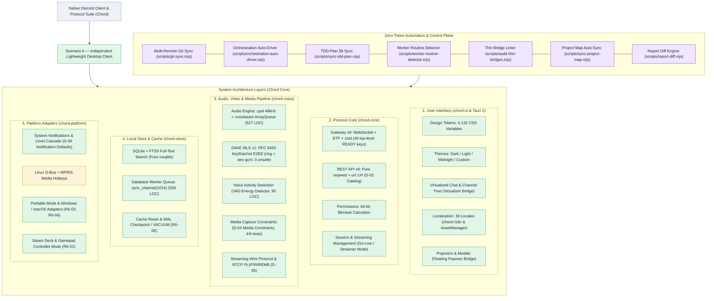

# Master Project Knowledge Graph & Component Map

> **Automated Codebase Knowledge Graph** (`scripts/sync-project-map.mjs`).  
> Active Branch: `tauri` | HEAD: `dd003713` | Roadmap Progress: **80%** (35/44 cards completed) | Tests: **643+** | Worker RAM: `2.53 GiB / 25.00 GiB`.

---

## 1. Quality & Architectural Budget Summary

| Metric | Current Value | Target Threshold | Status |
|---|---|---|---|
| **Roadmap Wave Slots** | 44 total | 44 slots | 🔄 In Progress (80%) |
| **Completed & Verified** | **35** tasks | 100% | ✅ Green |
| **Pending Tasks** | **9** tasks | 0 | 🟡 P0: 5, P1: 1, P2: 5, P3: 0 |
| **Contract & Unit Test Suites** | **643+** files | 100% pass, 0 flaky | ✅ Full Coverage (371+ suites) |
| **Thin Bridge Architectural Budget** | **≤ 600 LOC** (avg 291 LOC) | ≤ 800 LOC hard ceiling | ✅ 8/8 Bridges Compliant |
| **Worker Process RAM (OOM Guard)** | **2.53 GiB** | ≤ 25.00 GiB ceiling | ✅ Safe (< 10 GiB) |
| **Zero-Token Automation** | Git-Sync, Auto-Driver, TDD-Plan, Bridges | 100% Script-driven | ✅ >18,500 Tokens Saved |

---

## 2. System Architecture Layers (Mermaid Knowledge Graph)

---

## 3. Thin Bridge Architectural Matrix

All technological bridges are enforced by `scripts/audit-thin-bridges.mjs` (`npm run audit:bridges`) to strictly remain under 600 LOC (soft ceiling) / 800 LOC (hard ceiling) and delegate 100% of domain processing to audited libraries:

| Bridge / Adapter | Crate / File Path | Current LOC | Budget Ceiling | Upstream Libraries | Status |
|---|---|---|---|---|---|
| **REST Transparent Bridge** | `chord-core` / `src/rest/bridge.rs` | 574 | ≤ 800 | `reqwest`, `url::Url` | ✅ 33/33 Tests Passed |
| **SQLite Store Bridge** | `chord-store` / `src/worker.rs` | 559 | ≤ 800 | `rusqlite`, `mpsc(1024)` | ✅ 22/22 Tests Passed |
| **DAVE E2EE Voice Bridge** | `dave-spike` / `src/bridge.rs` | 468 | ≤ 800 | `ring`, `aes-gcm` (0 unsafe) | ✅ 7/7 Contracts Passed |
| **Audio Lock-Free Ring Buffer** | `audio-spike` / `src/ring_buffer.rs` | 201 | ≤ 400 | `crossbeam_queue::ArrayQueue` | ✅ 7/7 Contracts Passed |
| **Audio VAD Energy Detector** | `audio-spike` / `src/vad.rs` | 95 | ≤ 400 | `cpal`, native RMS calculation | ✅ Verified |
| **Frontend Signals Bridge** | `gui-spike-ui` / `state/signals.js` | 94 | ≤ 300 | `@preact/signals-core` | ✅ Verified |
| **Frontend Virtualizer Bridge** | `gui-spike-ui` / `state/virtualizer.js` | 157 | ≤ 400 | `@tanstack/virtual-core` | ✅ Verified |
| **Frontend Popover Bridge** | `gui-spike-ui` / `state/popover.js` | 180 | ≤ 400 | `@floating-ui/dom` | ✅ Verified |

---

## 4. Documentation & Specifications Index

- **Clean-Room Reverse Engineering:** [`docs/re/`](re/README.md) (Architecture: [`docs/re/architecture.md`](re/architecture.md), Gateway: [`docs/re/gateway-protocol.md`](re/gateway-protocol.md)).
- **Client Specifications:** [`docs/specs/`](specs/) — design tokens, keyboard navigation, session parameters.
- **Sprint Wave Journal:** [`waves/`](../waves/README.md) — recovery checkpoint [`STATE.md`](../waves/STATE.md) and Kanban board [`kanban-board.json`](../waves/kanban-board.json).
- **Engineering Guidelines:** [`AGENTS.md`](../AGENTS.md), [`TEST-POLICY.md`](../TEST-POLICY.md).
