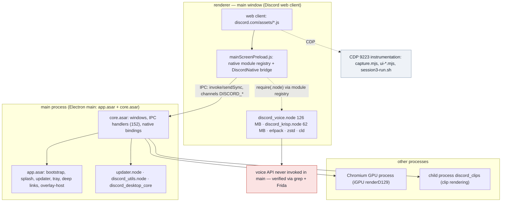
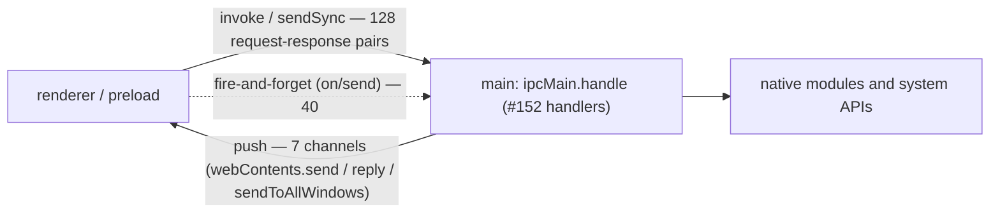
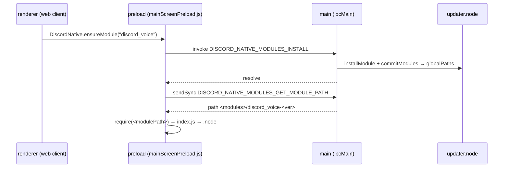
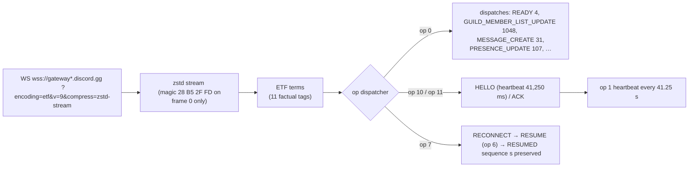
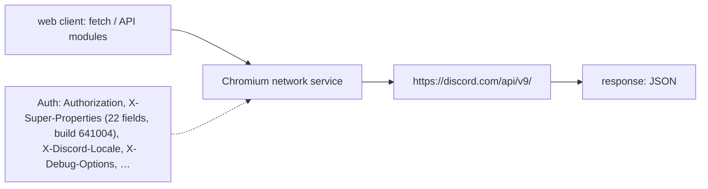

# Discord Desktop Architecture: Processes, Invocations, and Graphs (R7)

Summary Mermaid diagrams based on Wave R7 research (rendered directly in GitHub markdown). Source materials: `main-arch.md` (main process & call chains), `backend-ipc.md` (channels & bridge), `native-re.md` (native modules), `gateway-protocol.md` (gateway), `voice-deep.md` (voice), `rest-d02.md` (REST). Citations and exact offsets are preserved in the respective documents.

## 1. Processes and Module Placement

Key invariant: Native voice/media (`discord_voice`, `discord_krisp`, `discord_erlpack`, `discord_zstd`, `cld`) is loaded by the **renderer preload**, not the main process; the main process contains zero voice API calls (`native-re.md` §7.1).

## 2. IPC: Channels, Prefixes, Volumes

- Channels are named with the `DISCORD_` prefix: in `core` — from enum `IPCEvents` (176 members, 168 channels), in `app` — short names resolved through runtime wrapper `getDiscordIPCEvent`.
- Functional groups (`backend-ipc.md` §2): windows 25, application 21, miscellaneous 14, processes/metrics 12, files 9, tray 9, clipboard 8, power 8, clips 7, notifications 7, splash 6, spellchecker 6, native modules 5, WebAuthn 5, and others.
- Preload whitelist — 43 channels (`RENDERER_IPC_SEND_WHITELIST` / `RENDERER_IPC_INVOKE_WHITELIST`); 47 call-sites compute channel names dynamically at runtime.

## 3. Five Full Call Chains (renderer → main → native)

| # | Channel | Path | Evidence |
|---|---|---|---|
| A | `DISCORD_NOTIFICATIONS_SEND_NOTIFICATION` | renderer → main `#7592` → `discord_notifications.sendNotification`; callback → `DISCORD_NOTIFICATIONS_RECEIVED_RESPONSE` to all windows | On Linux this module is not loaded: mac/win code paths are bypassed, status `unsupported` |
| B | `DISCORD_NATIVE_MODULES_INSTALL` | preload `ensureModule` → main `#216` → `updater.installModule` + `commitModules` → `addGlobalPath(app‑<ver>/modules/<name>‑<ver>)` → `GET_MODULE_PATH` (sync) → `require(<modulePath>)` | Complete chain with citations in `main-arch.md` §3.3 |
| C | `DISCORD_WINDOW_GET_NATIVE_HANDLE` | main `#3386` → `BrowserWindow.getNativeWindowHandle().readInt32LE().toString(10)` | Response is decimal window ID; Wayland 64-bit may truncate to 32-bit integer |
| D | `DISCORD_RENDER_MONTAGE_RECIPE` | main `#7635` → `spawn(discord_clips --render-recipe …)` → `verifyDiscordMP4`; protocol `disclip://` with HTTP Range (206/416) | Clips: rendered strictly via isolated binary module |
| E | `DISCORD_WEBAUTHN_REGISTER_MAC`, `DISCORD_PROCESS_UTILS_GET_SYSTEM_METRICS` | main `#5544` / `#9984` → macOS WebAuthn; system metrics via `discord_utils` | `main-arch.md` §3.6 |

Chain B sequence diagram (native module installation and loading):

## 4. `DiscordNative` Bridge (Renderer Side)

- Native module registry — module `7927` in `mainScreenPreload.js`: `requireModule(name)` with whitelist checks (`^discord_[a-z0-9_-]+$` or `erlpack`), `ensureModule(name)` → `DISCORD_NATIVE_MODULES_INSTALL`, `getModulePath(name)` → sync channel.
- Preload list: `PREMAP_MODULES = ["discord_voice","discord_zstd","discord_cloudsync","discord_media"]` (`discord_premap`), where `cloudsync/media/premap` are absent on disk.
- Total exposed bridge entries: 35 properties; 110 active native calls across voice and krisp (`(0,X.lE)().<method>` — 65 call sites, `native-re.md` §7.3).

## 5. Native Modules and Capabilities

| Module | Size | Loaded In | Core Capabilities |
|---|---:|---|---|
| `discord_voice` | 126.1 MB | renderer (preload) | codecs, 7 encryption modes, DAVE MLS v1, RTC worker; dynamic `dlopen`: pipewire, vulkan, va, cuda, nvenc, EGL/GLES |
| `discord_krisp` | 62.1 MB | renderer (preload) | noise cancellation / VAD; ONNX Runtime 1.14 + OpenBLAS (statically linked), models adjacent to module |
| `discord_utils` | 19.2 MB | main | X11/Wayland idle detection, PulseAudio, system metrics, input task `OnSystemInputEvent` |
| `discord_game_utils` | 11.5 MB | renderer | game integrations / RPC helpers |
| `discord_erlpack` | 7.8 MB | renderer | ETF package (erlpack) |
| `cld.node` | 6.6 MB | renderer | Compact Language Detector (CLD) |
| `updater.node` | 5.8 MB | main | Rust updater: `command`, `installModule`, `commitModules`, `create_shortcut` |
| `discord_zstd` | 0.9 MB | renderer | Zstandard decompressor (including gateway stream) |
| `notificationstate` | 16.8 KB | renderer | Linux notification state stub |

## 6. Gateway: Data Flow

- 7 sockets captured: 4 fresh logins + 3 resumes; `op 7` observed once — server closed socket, client cleanly resumed sequence via `RESUMED s=332` with zero loss.
- Outbound frames binary; lengths: IDENTIFY ≈ 943 B, RESUME 173/176 B, heartbeat 90 B.
- READY: 4 instances (~577 KB ETF terms), `resume_gateway_url` pointing to `us-east1-c/d`.

## 7. Voice: Stack and Transport

- Discovery 74 B (type 1/2, ssrc, ASCII address, port BE), keepalive 8 B (`1337cafe`/`1337f00d`) every 5 s; media socket owned by renderer process.
- Region selection via `RTCLatencyTestManager` (UDP probes): Session 2 — Frankfurt, Session 3 — Stockholm.

## 8. REST: Request Pipeline

- Live capture covers 47 routes and 133 v9 requests, including message delivery, acknowledgments, settings, search (`/messages/search`), billing, and profile updates.
- Voice gateway maintains separate authentication flow (token issued via op 0 Identify), documented in `rest-d02.md` §6.5.

## 9. Document Cross-Reference Map

| Domain | Specification Document |
|---|---|
| Main process, windows, IPC chains, updater | `main-arch.md` (+ `.json`) |
| IPC channels and bridge | `backend-ipc.md` (+ `.json`) |
| Native modules and exports | `native-re.md` (+ `.json`), `native-modules.md` |
| Gateway: ETF/zstd/opcodes/READY | `gateway-protocol.md`, `gateway-schema.md` |
| Voice: signaling and UDP transport | `voice-deep.md` (+ `.json`) |
| REST: routes, payloads, auth | `rest-d02.md` (+ `.json`, `.stats.json`, `.crossref.json`) |
| UI: screens and component contracts | `frontend-d03.md` (+ `.json`) |
| i18n: runtime, keys, pluralization | `i18n-deep.md` (+ `.json`, `i18n-stats.json`) |
