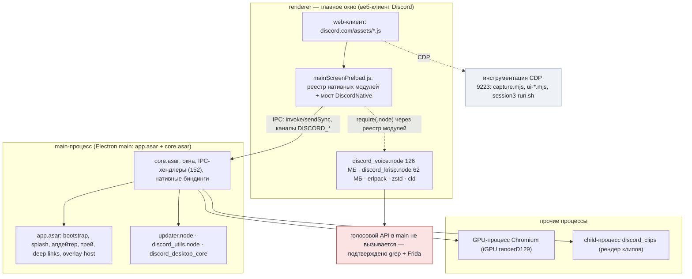
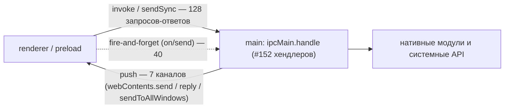
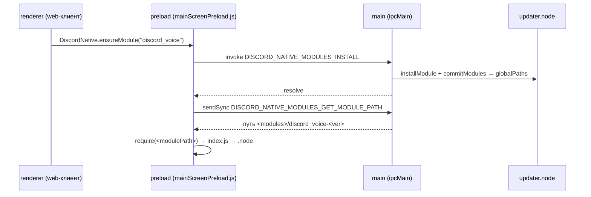
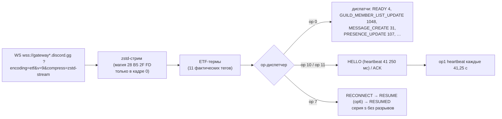
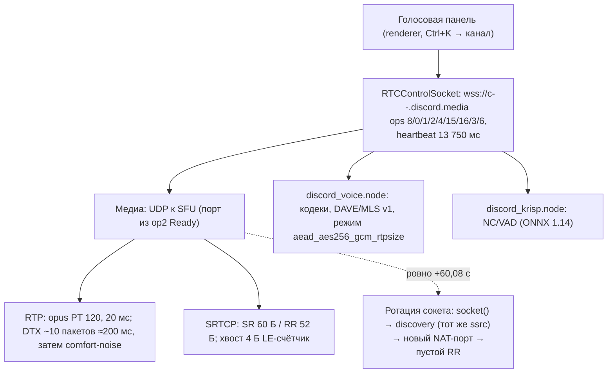
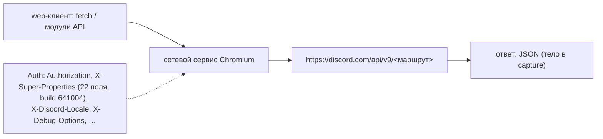

# Архитектура Discord Desktop: процессы, вызовы, графы (R7)

Сводные Mermaid-графы по итогам волны R7 (GitHub рендерит их прямо в браузере). Источник —
детальные документы этого каталога: `main-arch.md` (main-процесс и цепочки), `backend-ipc.md`
(каналы и мост), `native-re.md` (нативные модули), `gateway-protocol.md` (шлюз), `voice-deep.md`
(голос), `rest-d02.md` (REST). Цитаты и смещения — в самих документах.

## 1. Процессы и где живут модули

Ключевое: нативный голос/медиа (`discord_voice`, `discord_krisp`, `discord_erlpack`,
`discord_zstd`, `cld`) грузится **preload'ом рендерера**, а не main-процессом; main не содержит
ни одного вызова голосового API (`native-re.md` §7.1).

## 2. IPC: каналы, префиксация, объёмы

- Каналы именуются с префиксом `DISCORD_`: в `core` — из enum `IPCEvents` (176 членов,
  168 каналов), в `app` — короткие имена через рантайм-обёртку `getDiscordIPCEvent`
  (grep по полному имени в `app.asar` не находит — имя собирается в рантайме).
- Группы (полностью — `backend-ipc.md` §2): окно 25, приложение 21, прочее 14, процессы/метрики 12,
  файлы 9, трей 9, буфер 8, питание 8, клипы 7, уведомления 7, splash 6, орфография 6, нативные
  модули 5, WebAuthn 5 и др.
- Preload-whitelist — 43 канала (`RENDERER_IPC_SEND_WHITELIST` / `RENDERER_IPC_INVOKE_WHITELIST`),
  у **47** call-sites имя канала вычисляется в рантайме.

## 3. Пять полных цепочек вызовов (renderer → main → native)

| # | Канал | Путь | Опора |
|---|---|---|---|
| A | `DISCORD_NOTIFICATIONS_SEND_NOTIFICATION` | renderer → main `#7592` → `discord_notifications.sendNotification`; callback → `DISCORD_NOTIFICATIONS_RECEIVED_RESPONSE` во все окна | На Linux модуль не грузится: обе ветки загрузки (mac/win) не выполняются, статус `unsupported` — цепочка доказана статически |
| B | `DISCORD_NATIVE_MODULES_INSTALL` | preload `ensureModule` → main `#216` → `updater.installModule` + `commitModules` → `addGlobalPath(app‑<ver>/modules/<name>‑<ver>)` → `GET_MODULE_PATH` (sync) → `require(<modulePath>)` | Полная цепочка с цитатами, `main-arch.md` §3.3 |
| C | `DISCORD_WINDOW_GET_NATIVE_HANDLE` | main `#3386` → `BrowserWindow.getNativeWindowHandle().readInt32LE().toString(10)` | Ответ — десятичный id окна; для Wayland 64-бит возможен усечённый id (unknown) |
| D | `DISCORD_RENDER_MONTAGE_RECIPE` | main `#7635` → `spawn(discord_clips --render-recipe …)` → `verifyDiscordMP4`; отдельно протокол `disclip://` с Range (206/416) | Клипы: рендер только через отдельный исполняемый файл модуля |
| E | `DISCORD_WEBAUTHN_REGISTER_MAC`, `DISCORD_PROCESS_UTILS_GET_SYSTEM_METRICS` (короткие) | main `#5544` / `#9984` → macOS WebAuthn; системные метрики через `discord_utils` | `main-arch.md` §3.6 |

Пример цепочки B (установка и подключение нативного модуля):

## 4. Мост `DiscordNative` (renderer-сторона)

- Реестр нативных модулей — модуль `7927` в `mainScreenPreload.js`: `requireModule(name)`
  с проверкой whitelist (`^discord_[a-z0-9_-]+$` или `erlpack`; исключение — `discord_premap`),
  `ensureModule(name)` → `DISCORD_NATIVE_MODULES_INSTALL`, `getModulePath(name)` → sync-канал.
- Предзагрузка: `PREMAP_MODULES = ["discord_voice","discord_zstd","discord_cloudsync","discord_media"]`
  (`discord_premap`), при этом `cloudsync/media/premap` на диске отсутствуют.
- Всего в мост смотрит **35 записей**, реально используется 110 нативных имён из voice/krisp
  (`(0,X.lE)().<метод>` — 65 вызовов, `native-re.md` §7.3).

## 5. Нативные функции: модули и что они несут

| Модуль | Размер | Где грузится | Ключевое (функции/подсистемы) |
|---|---:|---|---|
| `discord_voice` | 126,1 МБ | renderer (preload) | кодеки, 7 режимов шифрования, DAVE/MLS, RTC-воркер; `dlopen`: pipewire, vulkan, va, cuda, nvenc, EGL/GLES |
| `discord_krisp` | 62,1 МБ | renderer (preload) | шумоподавление/VAD; ONNX Runtime 1.14 + OpenBLAS (статически), модели рядом с модулем |
| `discord_utils` | 19,2 МБ | main | X11/Wayland-idle, PulseAudio, системные метрики, таска ввода `OnSystemInputEvent` |
| `discord_game_utils` | 11,5 МБ | renderer | игровые интеграции/RPC-хелперы |
| `discord_erlpack` | 7,8 МБ | renderer | ETF-пакет (erlpack) |
| `cld.node` | 6,6 МБ | renderer | орфография (CLD) |
| `updater.node` | 5,8 МБ | main | Rust-апдейтер: `command`, `installModule`, `commitModules`, `create_shortcut` |
| `discord_zstd` | 0,9 МБ | renderer | zstd (в т.ч. шлюзовый поток) |
| `notificationstate` | 16,8 КБ | renderer | Linux-заглушка состояния уведомлений |

Метрика «функций» в `functions/static/*.csv` — уникальные имена символов после c++filt
(`discord_voice` 69 621, `discord_krisp` 37 001, …); NAPI-свойств у `discord_voice` — 94/94,
Frida-инвентарь дал 110 живых имён (сверка — `native-re.md` §3.3/3.6).

## 6. Шлюз: поток данных

- 7 сокетов в захвате: 4 свежих логина + 3 resume; `op7` встречен 1 раз — сервер закрыл сокет,
  клиент продолжил серию через `RESUMED s=332` без потерь.
- Исходящие кадры бинарные; по длинам: IDENTIFY ≈ 943 Б, RESUME 173/176 Б, heartbeat 90 Б.
- READY: 4 экземпляра (~577 КБ ETF-терм), `resume_gateway_url` с `us-east1-c/d`.

## 7. Голос: стек и транспорт

- Discovery 74 Б (type 1/2, ssrc, ASCII-адрес, порт BE), keepalive 8 Б (`1337cafe`/`1337f00d`)
  каждые 5 с; владелец медиа-сокета — рендерер (`ss`: fd/pid).
- Выбор региона — `RTCLatencyTestManager` (UDP-зонды): сессия 2 — Франкфурт, сессия 3 — Стокгольм.

## 8. REST: поток запроса

- Из живого захвата — 47 маршрутов, 133 запроса v9; покрыты отправка сообщений, ack, настройки,
  поиск (`/messages/search`), billing и прочее; 98% трафика отсеяно как шум.
- Голосовой шлюз имеет свой авторизационный путь (token из op0 Identify) — отдельная схема,
  см. `rest-d02.md` §6.5.

## 9. Карта документов

| Тема | Детальный документ |
|---|---|
| main-процесс, окна, цепочки, апдейтер | `main-arch.md` (+ `.json`) |
| IPC-каналы и мост | `backend-ipc.md` (+ `.json`) |
| Нативные модули и функции | `native-re.md` (+ `.json`), `native-modules.md` |
| Шлюз: ETF/zstd/опкоды/READY | `gateway-protocol.md`, `gateway-schema.md` |
| Голос: сигнализация и UDP | `voice-deep.md` (+ `.json`) |
| REST: маршруты, тела, auth | `rest-d02.md` (+ `.json`, `.stats.json`, `.crossref.json`) |
| UI: экраны и контракты | `frontend-d03.md` (+ `.json`) |
| i18n: рантайм, ключи, плурализация | `i18n-deep.md` (+ `.json`, `i18n-stats.json`) |
