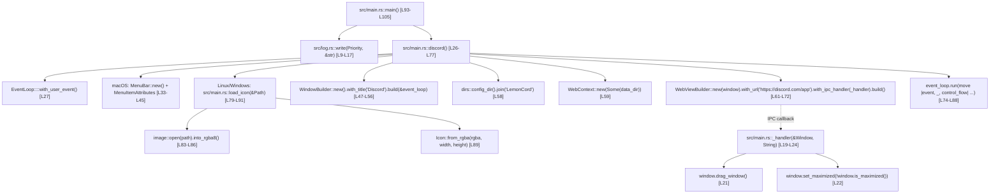

# LemonCord (`japandotorg/LemonCord`) — Полная документация, граф вызовов и карта функций

- **Репозиторий:** `https://github.com/japandotorg/LemonCord`
- **Локальная копия исходного кода:** [`docs/reference-projects/sources/LemonCord/`](file:///home/sanya/orca/project/docs/reference-projects/sources/LemonCord)
- **Версия в `Cargo.toml`:** `0.1.5` (Rust edition `2021`, лицензия `GPL-3.0`)

---

## 1. Назначение и архитектура проекта

**LemonCord** — минималистичный десктопный WebView-враппер вокруг веб-версии `https://discord.com/app`, построенный напрямую на библиотеке `wry` (`0.28.3`) и цикле событий `tao` (реэкспортируемом через `wry::application`). В отличие от `discord-lab` и `Serein`, проект не реализует собственный Rust-стек протокола Discord (Gateway/REST/Voice/WebRTC), а делегирует всю работу штатному веб-клиенту Discord внутри системного WebView (WebKitGTK на Linux, WebView2 на Windows, WKWebView на macOS) с кастомным IPC-перехватчиком для перетаскивания и разворачивания окна.

### Зависимости (`Cargo.toml`)
| Крейт | Версия | Назначение в коде |
|---|---|---|
| `tokio` | `1.28.2` (`full`) | Асинхронный рантайм `#[tokio::main(flavor = "current_thread")]` для точки входа `main` |
| `wry` | `0.28.3` | Создание нативного окна (`WindowBuilder`), контекста хранения (`WebContext`) и системного WebView (`WebViewBuilder`) |
| `dirs` | `5.0.1` | Определение платформенного каталога данных (`dirs::config_dir()` -> `~/.config/LemonCord`) |
| `image` | `0.24.6` | Декодирование PNG-иконки приложения (`assets/Round Icon.png`) в RGBA8 для заголовка окна |
| `colored` | `2.0.0` | Цветной вывод уровней логирования в терминал (`red`, `yellow`, `blue`, `purple`) |
| `strum` | `0.24.1` (`derive`) | Автогенерация `strum::Display` для перечисления приоритетов логов `Priority` |

---

## 2. Полный граф вызовов (Call Graph)

---

## 3. Пофайловая и пофункционная карта кода

### 3.1. [`src/main.rs`](file:///home/sanya/orca/project/docs/reference-projects/sources/LemonCord/src/main.rs)

#### Перечисление `enum UserEvents` ([`src/main.rs#L17`](file:///home/sanya/orca/project/docs/reference-projects/sources/LemonCord/src/main.rs#L17))
- **Состав:** `CloseWindow`
- **Назначение:** Пользовательское событие цикла `EventLoop<UserEvents>`, позволяющее инициировать закрытие окна (`ControlFlow::Exit`) из внутренних обработчиков.

#### Функция `fn _handler(window: &Window, req: String)` ([`src/main.rs#L19-L24`](file:///home/sanya/orca/project/docs/reference-projects/sources/LemonCord/src/main.rs#L19-L24))
- **Сигнатура:** `fn _handler(window: &Window, req: String)`
- **Кто вызывает:** Коллбэк `WebViewBuilder::with_ipc_handler` при вызове `window.ipc.postMessage(...)` из JavaScript в WebView.
- **Что вызывает:**
  - `window.drag_window()` — при `req == "drag_window"`, начинает системное перетаскивание окна за кастомный тайтлбар.
  - `window.is_maximized()` и `window.set_maximized(!window.is_maximized())` — при `req == "fullscreen"`, переключает максимизацию окна.
- **Как реализована:** Прямой `match req.as_str()` на две строковые команды (`"drag_window"`, `"fullscreen"`), остальные сообщения игнорируются (`_ => ()`).

#### Функция `async fn discord() -> wry::Result<()>` ([`src/main.rs#L26-L77`](file:///home/sanya/orca/project/docs/reference-projects/sources/LemonCord/src/main.rs#L26-L77))
- **Сигнатура:** `async fn discord() -> wry::Result<()>`
- **Кто вызывает:** `main()` ([`src/main.rs#L100`](file:///home/sanya/orca/project/docs/reference-projects/sources/LemonCord/src/main.rs#L100)).
- **Что вызывает:**
  1. `EventLoop::<UserEvents>::with_user_event()` — создаёт нативный цикл событий окна.
  2. На `macOS` (`#[cfg(target_os = "macos")]`): создаёт `MenuBar`, добавляет `MenuItem::Quit` с шорткатом `Cmd+Q` (`Accelerator::new(SysMods::Cmd, KeyCode::KeyQ)`).
  3. На `Linux` / `Windows` (`#[cfg(any(target_os = "linux", target_os = "windows"))]`): вызывает `load_icon(Path::new("assets/Round Icon.png"))`.
  4. `WindowBuilder::new()` — задаёт заголовок `"Discord"`, размер `1280x800`, минимальный размер `800x600`, прозрачность `with_transparent(true)` и иконку/меню.
  5. `dirs::config_dir().expect(...).join("LemonCord")` и `WebContext::new(Some(data_dir))` — создаёт постоянный профиль браузера (cookies, `localStorage`, IndexedDB) в `~/.config/LemonCord`.
  6. `WebViewBuilder::new(window)` — конфигурирует WebView:
     - `with_accept_first_mouse(true)`
     - `with_web_context(&mut web_context)`
     - `with_user_agent("Mozilla/5.0 (Macintosh; Intel Mac OS X 10_15_7) AppleWebKit/537.36 (KHTML, like Gecko) Chrome/112.0.0.0 Safari/537.36")` — подменяет User-Agent, чтобы Discord отдавал современную десктопную веб-версию без ограничений браузера.
     - `with_url("https://discord.com/app")`
     - `with_ipc_handler(_handler)`
     - `with_transparent(true)`
     - `with_devtools(cfg!(any(debug_assertions, feature = "devtools")))`
     - `with_back_forward_navigation_gestures(true)`
  7. `event_loop.run(...)` — запускает бесконечный цикл обработки событий `ControlFlow::Wait`:
     - При `Event::WindowEvent { event: WindowEvent::CloseRequested, .. }` или `Event::UserEvent(UserEvents::CloseWindow)` устанавливает `*control_flow = ControlFlow::Exit`.

#### Функция `fn load_icon(path: &Path) -> Icon` ([`src/main.rs#L79-L91`](file:///home/sanya/orca/project/docs/reference-projects/sources/LemonCord/src/main.rs#L79-L91))
- **Сигнатура:** `fn load_icon(path: &Path) -> Icon`
- **Кто вызывает:** `discord()` ([`src/main.rs#L48`](file:///home/sanya/orca/project/docs/reference-projects/sources/LemonCord/src/main.rs#L48)).
- **Что вызывает:** `log::write`, `image::open(path)`, `DynamicImage::into_rgba8()`, `RgbaImage::dimensions()`, `RgbaImage::into_raw()`, `wry::application::window::Icon::from_rgba(rgba, width, height)`.
- **Как работает:** Считывает PNG-файл с диска, декодирует его в плоский буфер RGBA8 (`4 байта на пиксель`) и передаёт в `Icon::from_rgba`.

#### Функция `async fn main()` ([`src/main.rs#L93-L105`](file:///home/sanya/orca/project/docs/reference-projects/sources/LemonCord/src/main.rs#L93-L105))
- **Сигнатура:** `#[tokio::main(flavor = "current_thread")] async fn main()`
- **Что вызывает:** `log::write` и `discord().await`.
- **Как работает:** Логирует старт настроенной сборки (`Debug` или `Release`), вызывает `discord().await` и в случае `Err(error)` выводит текст ошибки с приоритетом `Priority::ERROR`.

---

### 3.2. [`src/log.rs`](file:///home/sanya/orca/project/docs/reference-projects/sources/LemonCord/src/log.rs)

#### Перечисление `pub enum Priority` ([`src/log.rs#L5`](file:///home/sanya/orca/project/docs/reference-projects/sources/LemonCord/src/log.rs#L5))
- **Варианты:** `ERROR`, `WARN`, `INFO`, `DEBUG` (с `#[derive(strum::Display)]`).

#### Функция `pub fn write<T: Display>(priority: Priority, text: T)` ([`src/log.rs#L9-L17`](file:///home/sanya/orca/project/docs/reference-projects/sources/LemonCord/src/log.rs#L9-L17))
- **Сигнатура:** `pub fn write<T: Display>(priority: Priority, text: T)`
- **Кто вызывает:** `main()` и `load_icon()`.
- **Что вызывает:** Методы окраски строк из крейта `colored` (`.red()`, `.yellow()`, `.blue()`, `.purple()`, `.bold()`) и макрос `println!`.
- **Как работает:** Форматирует приоритет в квадратных скобках (`[INFO]: ...`), окрашивает в цвет в зависимости от уровня и печатает в `stdout`.

---

## 4. Что из `LemonCord` применимо к `discord-lab`

1. **Конфигурация `WebContext` и изоляция сессии WebView:** Использование выделенного каталога профиля (`WebContext::new(Some(data_dir))`) предотвращает потерю авторизации и кэша при перезапусках окна.
2. **Точечный IPC-хендлер управления окном (`drag_window`, `fullscreen`):** Минимальный контракт управления безрамочным окном из JS-слоя через `window.drag_window()` и `window.set_maximized(!window.is_maximized())`.
