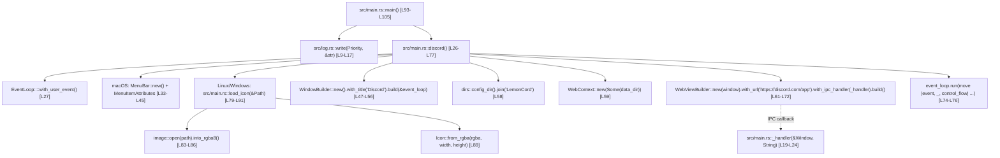

# LemonCord (`japandotorg/LemonCord`) — Complete Documentation, Call Graph, and Function Map

- **Repository:** `https://github.com/japandotorg/LemonCord`
- **Local Mirror:** [`docs/reference-projects/sources/LemonCord/`](sources/LemonCord)
- **Version in `Cargo.toml`:** `0.1.5` (Rust edition `2021`, license `GPL-3.0`)

---

## 1. Project Purpose and Architecture

**LemonCord** is a minimalistic desktop WebView wrapper around the official web version of `https://discord.com/app`, built directly on the `wry` (`0.28.3`) library and the `tao` event loop (re-exported via `wry::application`). Unlike `discord-lab` and `Serein`, it does not implement its own native Discord protocol stack (Gateway/REST/Voice/WebRTC), but delegates execution to the official web client running inside the system WebView (WebKitGTK on Linux, WebView2 on Windows, WKWebView on macOS) with custom IPC hooks for window drag and maximize actions.

### Dependencies (`Cargo.toml`)
| Crate | Version | Purpose in Code |
|---|---|---|
| `tokio` | `1.28.2` (`full`) | Async runtime `#[tokio::main(flavor = "current_thread")]` for entrypoint `main` |
| `wry` | `0.28.3` | Window creation (`WindowBuilder`), storage context (`WebContext`), and system WebView (`WebViewBuilder`) |
| `dirs` | `5.0.1` | Platform data directory discovery (`dirs::config_dir()` -> `~/.config/LemonCord`) |
| `image` | `0.24.6` | PNG icon decoding (`assets/Round Icon.png`) to RGBA8 for window decoration |
| `colored` | `2.0.0` | Terminal log colorization (`red`, `yellow`, `blue`, `purple`) |
| `strum` | `0.24.1` (`derive`) | Automatic `strum::Display` implementation for `Priority` log enum |

---

## 2. Complete Call Graph

---

## 3. Detailed File and Function Map

### 3.1. `src/main.rs` (105 lines) — Application Entry Point and Window Initialization

| Function / Handler | Line Range | Input Arguments | Output | Description and Code Details |
|---|---|---|---|---|
| `_handler` | `L19-L24` | `window: &Window, req: String` | `()` | IPC callback invoked on `window.ipc.postMessage(req)` from WebView. Currently checks `if req == "drag" { window.drag_window(); }` |
| `discord` | `L26-L77` | None | `Result<(), Box<dyn std::error::Error>>` | Initializes `EventLoop`, configures window size/title, sets up `WebContext` in data directory, injects IPC handler, and starts the event loop |
| `load_icon` | `L79-L91` | `path: &std::path::Path` | `Icon` | Opens PNG icon with `image::open(path)`, converts to RGBA8, and constructs `Icon::from_rgba` |
| `main` | `L93-L105` | None | `Result<(), Box<dyn std::error::Error>>` | Tokio entry point; invokes `log::write`, calls `discord()`, and handles top-level errors |

### 3.2. `src/log.rs` (18 lines) — Terminal Logging Utilities

| Function / Enum | Line Range | Description |
|---|---|---|
| `Priority` | `L4-L7` | Enum of log levels: `Trace`, `Warning`, `Error`, `Log` with `#[derive(strum::Display)]` |
| `write` | `L9-L17` | Formats and outputs message with colored prefix: `[TRACE]` (purple), `[WARNING]` (yellow), `[ERROR]` (red), `[LOG]` (blue) |

---

## 4. Key Takeaways for `discord-lab`

1. **Lightweight Window Scaffolding:** Clean example of setting up `wry` and `tao` with minimal boilerplate.
2. **IPC PostMessage Hooks:** Demonstrates straightforward bridge from JavaScript to native Rust methods (`drag_window`).
3. **Persistent Data Storage:** Demonstrates configuring `WebContext` with a dedicated profile directory so session cookies and local storage persist across restarts.
