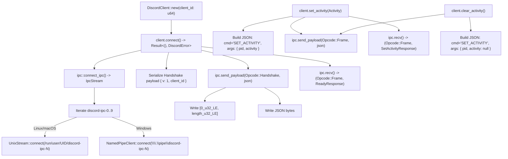

# rust-discord-activity (`0.3.1`) — Complete Documentation, Protocol Specification, and Function Map

- **Crate Version:** `0.3.1` (Author: `valflrt`, Rust edition `2021`, license `MIT OR Apache-2.0`)
- **Documentation:** `https://docs.rs/rust-discord-activity/0.3.1/`
- **Local Mirror:** [`docs/reference-projects/sources/rust-discord-activity-0.3.1/`](sources/rust-discord-activity-0.3.1)

---

## 1. Project Purpose and Protocol Overview

The **`rust-discord-activity`** crate implements the client-side protocol for **Discord Rich Presence IPC** over local platform sockets (`discord-ipc-0..9`), enabling games and desktop applications to report rich statuses (current level, party size, timestamps, custom artwork) to the Discord client.

In `discord-lab`, this is the exact complementary side of our local RPC daemon: while `rust-discord-activity` acts as the *game client connecting to Discord*, `discord-lab` / `discord-platform` acts as the *Discord desktop daemon serving the socket*.

### Protocol Framing (`discord-ipc-X`)
Communication uses an 8-byte framing header preceding a JSON payload:
- `Opcode` (4 bytes, Little-Endian `u32`):
  - `0 = Handshake` (`{"v": 1, "client_id": "..."}`)
  - `1 = Frame` (`{"cmd": "SET_ACTIVITY", "args": {...}, "nonce": "..."}`)
  - `2 = Close`
  - `3 = Ping`
  - `4 = Pong`
- `Length` (4 bytes, Little-Endian `u32`): Payload byte length.
- `Payload`: UTF-8 encoded JSON object.

---

## 2. Complete Call Graph

---

## 3. Function and Type Reference

### 3.1. `src/client.rs` — High-Level Client Interface

| Method | Signature | Description |
|---|---|---|
| `DiscordClient::new` | `pub fn new(client_id: u64) -> Self` | Instantiates client with application identifier |
| `DiscordClient::connect` | `pub fn connect(&mut self) -> Result<(), DiscordError>` | Discovers local socket (`0..9`), opens stream, sends Handshake, awaits Ready |
| `DiscordClient::set_activity` | `pub fn set_activity(&mut self, activity: Activity) -> Result<(), DiscordError>` | Formats and transmits `SET_ACTIVITY` payload with process PID |
| `DiscordClient::clear_activity` | `pub fn clear_activity(&mut self) -> Result<(), DiscordError>` | Clears current status (`activity: null`) |

### 3.2. `src/activity.rs` — Rich Presence Model

| Struct / Builder | Fields | Wire JSON Mapping |
|---|---|---|
| `Activity` | `state, details, timestamps, assets, party, secrets` | `{"state": "...", "details": "...", "timestamps": {...}}` |
| `Timestamps` | `start: Option<u64>, end: Option<u64>` | Formats epoch timestamps for elapsed / remaining timers |
| `Assets` | `large_image, large_text, small_image, small_text` | Art keys configured in Discord Developer Portal |
| `Party` | `id: Option<String>, size: Option<(i32, i32)>` | Party ID and `[current_size, max_size]` |

---

## 4. Key Takeaways for `discord-lab`

1. **Protocol Symmetry:** Provides explicit reference for unit and integration testing of the `discord-ipc-0..9` server in `discord-platform`.
2. **Platform Path Formats:**
   - Linux: `$XDG_RUNTIME_DIR/discord-ipc-N` or `/tmp/discord-ipc-N`.
   - Windows: `\\.\pipe\discord-ipc-N`.
   - macOS: `$TMPDIR/discord-ipc-N`.
3. **Error Handling:** Covers handshake timeouts, closed sockets, and reconnect backoffs.
