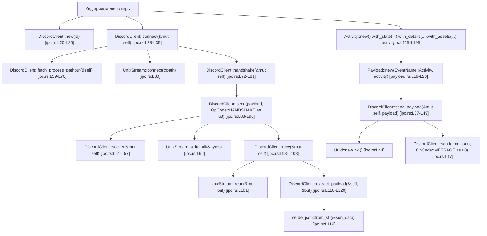

# `rust-discord-activity` (`v0.3.1`) — Полная документация, протокол IPC, граф вызовов и карта функций

- **Документация docs.rs:** `https://docs.rs/rust-discord-activity/latest/rust_discord_activity/struct.DiscordClient.html`
- **Локальная копия исходного кода крейта:** [`docs/reference-projects/sources/rust-discord-activity-0.3.1/`](file:///home/sanya/orca/project/docs/reference-projects/sources/rust-discord-activity-0.3.1)
- **Локальная копия HTML-документации `DiscordClient`:** [`docs/reference-projects/sources/rust_discord_activity_DiscordClient.html`](file:///home/sanya/orca/project/docs/reference-projects/sources/rust_discord_activity_DiscordClient.html)
- **Серверная реализация этого же протокола в `Serein`:** [`Serein/apps/desktop/src/game_activity.rs`](file:///home/sanya/orca/project/docs/reference-projects/sources/Serein/apps/desktop/src/game_activity.rs) и [`Serein/crates/platform/src/game_activity.rs`](file:///home/sanya/orca/project/docs/reference-projects/sources/Serein/crates/platform/src/game_activity.rs)

---

## 1. Назначение и архитектура `rust-discord-activity`

Крейт `rust-discord-activity` реализует клиент локального межпроцессного взаимодействия (**Discord Local RPC / Rich Presence IPC**) для публикации статуса активности приложения/игры (`SET_ACTIVITY`) в запущенный клиент Discord через Unix Domain Socket (`discord-ipc-0`).

### Структура модулей крейта
- [`src/lib.rs`](file:///home/sanya/orca/project/docs/reference-projects/sources/rust-discord-activity-0.3.1/src/lib.rs) — корневой модуль, реэкспортирующий `client::*`, `models::*` и определяющий тип ошибки `pub type Error = Box<dyn std::error::Error>`.
- [`src/client/mod.rs`](file:///home/sanya/orca/project/docs/reference-projects/sources/rust-discord-activity-0.3.1/src/client/mod.rs) — реэкспорт `ipc::*`.
- [`src/client/ipc.rs`](file:///home/sanya/orca/project/docs/reference-projects/sources/rust-discord-activity-0.3.1/src/client/ipc.rs) — структура `DiscordClient` и реализация низкоуровневого бинарного протокола Discord IPC поверх `std::os::unix::net::UnixStream`.
- [`src/models/mod.rs`](file:///home/sanya/orca/project/docs/reference-projects/sources/rust-discord-activity-0.3.1/src/models/mod.rs) — реэкспорт моделей `activity`, `client::payload`, `shared::event`.
- [`src/models/activity.rs`](file:///home/sanya/orca/project/docs/reference-projects/sources/rust-discord-activity-0.3.1/src/models/activity.rs) — модели Rich Presence: `Activity`, `Timestamp`, `Asset`, `Assets`, `Party`, `Secret`, `Button`, `ActivityType`.
- [`src/models/client/payload.rs`](file:///home/sanya/orca/project/docs/reference-projects/sources/rust-discord-activity-0.3.1/src/models/client/payload.rs) — опкоды `OpCode` и обёртка `Payload`.
- [`src/models/shared/event.rs`](file:///home/sanya/orca/project/docs/reference-projects/sources/rust-discord-activity-0.3.1/src/models/shared/event.rs) — перечисление `EventName` (`Activity`).

---

## 2. Спецификация бинарного протокола Discord IPC (Wire Protocol)

Каждое сообщение между внешним приложением (`DiscordClient`) и локальным сокетом Discord (`$XDG_RUNTIME_DIR/discord-ipc-0`..`discord-ipc-9` на Linux/macOS или `\\.\pipe\discord-ipc-0`..`9` на Windows) кодируется бинарным фреймом с 8-байтным заголовком **Little-Endian**:

```text
+-------------------------------+-------------------------------+-------------------------------+
| Offset 0..4 (u32 LE)          | Offset 4..8 (u32 LE)          | Offset 8..8+length            |
| Opcode (0..4)                 | Payload Length in bytes       | UTF-8 JSON Payload            |
+-------------------------------+-------------------------------+-------------------------------+
```

### Таблица опкодов (`OpCode`)
| Opcode (`u32 LE`) | Имя в `rust-discord-activity` | Имя в спецификации Discord RPC | JSON Payload |
|---|---|---|---|
| `0` | `OpCode::HANDSHAKE` | `HANDSHAKE` | `{"v": 1, "client_id": "<application_id>"}` |
| `1` | `OpCode::MESSAGE` | `FRAME` | `{"cmd": "SET_ACTIVITY", "args": {"pid": 12345, "activity": { ... }}, "nonce": "<uuid-v4>"}` |
| `2` | `OpCode::CLOSE` | `CLOSE` | Закрытие сессии |
| `3` | *(в `Serein`)* | `PING` | Пинг фрейма IPC |
| `4` | *(в `Serein`)* | `PONG` | Ответ на пинг |

---

## 3. Полный граф вызовов `rust-discord-activity` (Call Graph)



---

## 4. Пофункционная карта `DiscordClient` и всех моделей

### 4.1. [`src/client/ipc.rs`](file:///home/sanya/orca/project/docs/reference-projects/sources/rust-discord-activity-0.3.1/src/client/ipc.rs) — Структура `DiscordClient`

Поля структуры `DiscordClient<'a>` ([`ipc.rs#L14-L18`](file:///home/sanya/orca/project/docs/reference-projects/sources/rust-discord-activity-0.3.1/src/client/ipc.rs#L14-L18)):
- `id: &'a str` — Application ID (Client ID) приложения Discord.
- `is_connected: bool` — флаг установленного соединения.
- `socket: Option<UnixStream>` — открытый дескриптор Unix-сокета.

#### 1. `pub fn new(id: &'a str) -> Self` ([`ipc.rs#L20-L26`](file:///home/sanya/orca/project/docs/reference-projects/sources/rust-discord-activity-0.3.1/src/client/ipc.rs#L20-L26))
- **Что делает:** Инициализирует неактивный экземпляр `DiscordClient` с `is_connected: false` и `socket: None`.

#### 2. `pub fn connect(&mut self) -> Result<usize, Error>` ([`ipc.rs#L28-L35`](file:///home/sanya/orca/project/docs/reference-projects/sources/rust-discord-activity-0.3.1/src/client/ipc.rs#L28-L35))
- **Что вызывает:**
  1. `self.fetch_process_pathbuf()` — вычисляет путь к сокету `discord-ipc-0`.
  2. `UnixStream::connect(&path)?` — открывает соединение с локальным сокетом Discord.
  3. Сохраняет `self.socket = Some(stream)`.
  4. `self.handshake()?` — отправляет пакет рукопожатия (`OpCode::HANDSHAKE = 0`) и читает ответ `READY`.
  5. Выставляет `self.is_connected = true`.

#### 3. `pub fn send_payload(&mut self, payload: Payload) -> Result<(usize, Value), Error>` ([`ipc.rs#L37-L49`](file:///home/sanya/orca/project/docs/reference-projects/sources/rust-discord-activity-0.3.1/src/client/ipc.rs#L37-L49))
- **Что вызывает:** `std::process::id()`, `Uuid::new_v4()`, `serde_json::json!`, `self.send(payload, OpCode::MESSAGE as u8)`.
- **Как работает:** Формирует JSON-конверт команды Discord RPC:
  ```json
  {
    "cmd": "SET_ACTIVITY",
    "args": {
      "pid": 12345,
      "activity": { ... }
    },
    "nonce": "550e8400-e29b-41d4-a716-446655440000"
  }
  ```
  и передаёт его в `self.send(..., 1)`. Возвращает кортеж `(количество_записанных_байт, json_ответ_от_discord)`.

#### 4. `fn socket(&mut self) -> Result<&mut UnixStream, Error>` ([`ipc.rs#L51-L57`](file:///home/sanya/orca/project/docs/reference-projects/sources/rust-discord-activity-0.3.1/src/client/ipc.rs#L51-L57))
- **Что делает:** Возвращает `&mut UnixStream` из `self.socket.as_mut()`, либо ошибку `"Client not connected to Discord"`, если `connect()` ещё не вызывался.

#### 5. `fn fetch_process_pathbuf(&self) -> PathBuf` ([`ipc.rs#L59-L70`](file:///home/sanya/orca/project/docs/reference-projects/sources/rust-discord-activity-0.3.1/src/client/ipc.rs#L59-L70))
- **Что вызывает:** `std::env::var(env_path)` по списку `["XDG_RUNTIME_DIR", "TMPDIR", "TMP"]`.
- **Как работает:** Перебирает переменные окружения по порядку приоритета, берёт первую найденную директорию и присоединяет к ней имя файла сокета `"discord-ipc-0"`.

#### 6. `fn handshake(&mut self) -> Result<usize, Error>` ([`ipc.rs#L72-L81`](file:///home/sanya/orca/project/docs/reference-projects/sources/rust-discord-activity-0.3.1/src/client/ipc.rs#L72-L81))
- **Что вызывает:** `self.send(json!({ "v": 1, "client_id": self.id }), OpCode::HANDSHAKE as u8)`.
- **Как работает:** Выполняет начальное рукопожатие протокола IPC версии `v=1`.

#### 7. `fn send(&mut self, payload: Value, opcode: u8) -> Result<(usize, Value), Error>` ([`ipc.rs#L83-L96`](file:///home/sanya/orca/project/docs/reference-projects/sources/rust-discord-activity-0.3.1/src/client/ipc.rs#L83-L96))
- **Что вызывает:** `payload.to_string()`, `u32::to_le_bytes()`, `self.socket()?.write_all(&bytes)`, `self.recv()`.
- **Алгоритм упаковки фрейма:**
  1. Сериализует `payload` в строку `payload_str`.
  2. Записывает `(opcode as u32).to_le_bytes()` (4 байта).
  3. Записывает `(payload_str.len() as u32).to_le_bytes()` (4 байта).
  4. Дописывает `payload_str.as_bytes()`.
  5. Отправляет буфер в сокет через `write_all` и синхронно ждёт ответа в `self.recv()`.

#### 8. `fn recv(&mut self) -> Result<Value, Error>` ([`ipc.rs#L98-L108`](file:///home/sanya/orca/project/docs/reference-projects/sources/rust-discord-activity-0.3.1/src/client/ipc.rs#L98-L108))
- **Что вызывает:** `self.socket()?.read(&mut buf)`, `self.extract_payload(&buf[..byte_count])`.
- **Как работает:** Читает до `2048` байт (`[0; 2048]`) из сокета и передаёт прочитанный срез в `extract_payload`.

#### 9. `fn extract_payload(&self, mut data: &[u8]) -> Result<Value, Error>` ([`ipc.rs#L110-L120`](file:///home/sanya/orca/project/docs/reference-projects/sources/rust-discord-activity-0.3.1/src/client/ipc.rs#L110-L120))
- **Что вызывает:** `u32::from_le_bytes`, `std::str::from_utf8`, `serde_json::from_str`.
- **Как работает:**
  1. Читает длину JSON-тела из байтов `4..8`: `let payload_size = u32::from_le_bytes(data[4..8].try_into()?) as usize;`.
  2. Сдвигает срез на 8 байт заголовка (`data = &data[8..]`).
  3. Декодирует `&data[..payload_size]` как UTF-8 и парсит в `serde_json::Value`.

---

### 4.2. [`src/models/activity.rs`](file:///home/sanya/orca/project/docs/reference-projects/sources/rust-discord-activity-0.3.1/src/models/activity.rs) — Модели Rich Presence

| Структура / Enum | Диапазон строк | Конструктор и методы | Поля JSON |
|---|---|---|---|
| `Timestamp` | [`L5-L18`](file:///home/sanya/orca/project/docs/reference-projects/sources/rust-discord-activity-0.3.1/src/models/activity.rs#L5-L18) | `Timestamp::new(start: Option<u128>, end: Option<u128>)` | `start`, `end` (Unix ms) |
| `Asset` | [`L20-L33`](file:///home/sanya/orca/project/docs/reference-projects/sources/rust-discord-activity-0.3.1/src/models/activity.rs#L20-L33) | `Asset::new(image: Option<String>, text: Option<String>)` | Вспомогательная пара `(image, text)` |
| `Assets` | [`L35-L59`](file:///home/sanya/orca/project/docs/reference-projects/sources/rust-discord-activity-0.3.1/src/models/activity.rs#L35-L59) | `Assets::new(large: Option<Asset>, small: Option<Asset>)` | `large_image`, `large_text`, `small_image`, `small_text` |
| `Party<'a>` | [`L61-L74`](file:///home/sanya/orca/project/docs/reference-projects/sources/rust-discord-activity-0.3.1/src/models/activity.rs#L61-L74) | `Party::new(id: Option<&'a str>, size: Option<(u8, u8)>)` | `id`, `size: [current, max]` |
| `Secret<'a>` | [`L76-L91`](file:///home/sanya/orca/project/docs/reference-projects/sources/rust-discord-activity-0.3.1/src/models/activity.rs#L76-L91) | `Secret::new(join, spectate, r#match)` | `join`, `spectate`, `match` |
| `Button<'a>` | [`L93-L106`](file:///home/sanya/orca/project/docs/reference-projects/sources/rust-discord-activity-0.3.1/src/models/activity.rs#L93-L106) | `Button::new(label: &'a str, url: &'a str)` | `label`, `url` (проверяет `Url::parse(url).is_ok()`) |
| `ActivityType` | [`L108-L114`](file:///home/sanya/orca/project/docs/reference-projects/sources/rust-discord-activity-0.3.1/src/models/activity.rs#L108-L114) | `GAME = 0`, `STREAMING = 1`, `LISTENING = 2`, `WATCHING = 3`, `CUSTOM = 4`, `COMPETING = 5` | Сериализуется через `serde_repr` как `u8` |
| `Activity<'a>` | [`L116-L195`](file:///home/sanya/orca/project/docs/reference-projects/sources/rust-discord-activity-0.3.1/src/models/activity.rs#L116-L195) | `Activity::new()`, `.with_state(&str)`, `.with_details(&str)`, `.with_timestamps(Timestamp)`, `.with_party(Party)`, `.with_assets(Assets)`, `.with_secrets(Secret)`, `.with_Buttons(Vec<Button>)`, `.with_instance(bool)`, `.with_activity_type(ActivityType)` | `state`, `details`, `timestamps`, `party`, `assets`, `secrets`, `buttons`, `instance`, `type` |

---

## 5. Как `Serein` реализует серверную сторону для `rust-discord-activity`

В проекте `Serein` реализован **сервер** для клиентов вроде `rust-discord-activity`:
1. [`crates/platform/src/game_activity.rs`](file:///home/sanya/orca/project/docs/reference-projects/sources/Serein/crates/platform/src/game_activity.rs):
   - `Listener::bind()` ([`L296-L312`](file:///home/sanya/orca/project/docs/reference-projects/sources/Serein/crates/platform/src/game_activity.rs#L296-L312)) — создаёт `discord-ipc-0..9` в `XDG_RUNTIME_DIR` с правами `0o600` (только текущий UID) или Named Pipe `\\.\pipe\discord-ipc-0..9` с DACL текущего пользователя на Windows.
2. [`apps/desktop/src/game_activity.rs`](file:///home/sanya/orca/project/docs/reference-projects/sources/Serein/apps/desktop/src/game_activity.rs):
   - `listen()` ([`L256-L350`](file:///home/sanya/orca/project/docs/reference-projects/sources/Serein/apps/desktop/src/game_activity.rs#L256-L350)) — принимает как IPC-сокеты (`serve_ipc`), так и локальные WebSocket-соединения на портах `6463..=6472` (`bind_web` / `serve_web`).
   - `read_frame` / `write_frame` ([`L930-L965`](file:///home/sanya/orca/project/docs/reference-projects/sources/Serein/apps/desktop/src/game_activity.rs#L930-L965)) — читает и пишет тот же 8-байтный заголовок `[opcode: u32 LE, len: u32 LE]`, отвечает `DISPATCH READY` на `opcode 0` (`HANDSHAKE`), обрабатывает `SET_ACTIVITY` на `opcode 1`, резолвит ассеты приложения через `/api/v10/oauth2/applications/{id}/assets` и `/api/v10/applications/{id}/external-assets` и публикует результат в Gateway (`op: 3` Presence Update).
