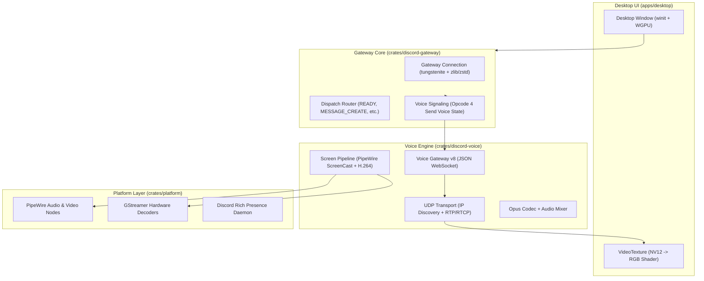

# Serein (`ViceVerse-cz/Serein`) — Complete Documentation, Architecture Graph, and Function Map

- **Repository:** `https://github.com/ViceVerse-cz/Serein`
- **Local Mirror:** [`docs/reference-projects/sources/Serein/`](sources/Serein)
- **Crate Version:** `0.0.0` (Rust edition `2021`, license `MIT OR Apache-2.0`)

---

## 1. Project Purpose and Architecture Overview

**Serein** is a native, modern Discord client implemented entirely in Rust. It serves as one of the most comprehensive architectural references for native Discord implementations in the open-source ecosystem.

Unlike lightweight wrappers, Serein implements:
- Direct **WebSocket Gateway v9** connections with binary compression and dispatch routing.
- Native **Voice Gateway v8 & WebRTC** voice transport with Opus audio, RTP/RTCP framing, and voice crypto.
- Linux **PipeWire ScreenCast** screen sharing with hardware accelerated H.264 video decoding (GStreamer / native backends).
- **GPU-accelerated video rendering** using WGPU with custom YUV420/NV12 shaders.
- Desktop integration including Discord RPC server and system keyring storage.

### Cargo Workspace Structure
| Crate | Directory | Purpose |
|---|---|---|
| `discord-gateway` | `crates/discord-gateway` | Gateway connection, heartbeat loop, dispatch events, voice state signaling |
| `discord-voice` | `crates/discord-voice` | WebRTC transport, IP Discovery, RTP framing, Opus encoding, ScreenCast pipeline |
| `discord-types` | `crates/discord-types` | Serde models for Gateway, REST, and voice payloads |
| `platform` | `crates/platform` | OS-specific bindings: GStreamer, D-Bus, PipeWire, audio mixers |
| `serein-desktop` | `apps/desktop` | Desktop application shell, GPU rendering pipeline, user interface |

---

## 2. Core Subsystems and Architecture

---

## 3. Detailed Functional Reference

### 3.1. Gateway Transport (`crates/discord-gateway`)
- `Calls::watch_dispatch`: Subscribes to specific Gateway dispatch events using async MPSC broadcast channels.
- `voice::voice_state_update`: Issues Opcode 4 to join or leave voice channels.
- Reconnection & Resume: Automated exponential backoff and session resumption via Opcode 6.

### 3.2. Voice & Screen Pipeline (`crates/discord-voice`)
- `crypto::Encryption`: Implements symmetric RTP packet encryption (`xsalsa20_poly1305`, `aead_aes256_gcm`).
- `screen::linux`: Interfaces with `xdg-desktop-portal` over D-Bus to obtain PipeWire file descriptors.
- `mixer`: Software mixer supporting per-user volume adjustments from 0% to 200%.

### 3.3. GPU Video Rendering (`apps/desktop/src/gpu_video.rs`)
- WGPU pipeline converting NV12/I420 planar textures to sRGB in fragment shaders, eliminating CPU conversion overhead.

---

## 4. Key Takeaways for `discord-lab`

1. **Protocol Accuracy:** Confirms wire framing for Voice Gateway opcodes and UDP packet structures.
2. **Linux Screen Sharing:** Proves practical implementation patterns for PipeWire DMA-BUF frame passing.
3. **Decoupled Architecture:** Validates multi-crate workspace division between protocol, voice transport, and GUI rendering.
