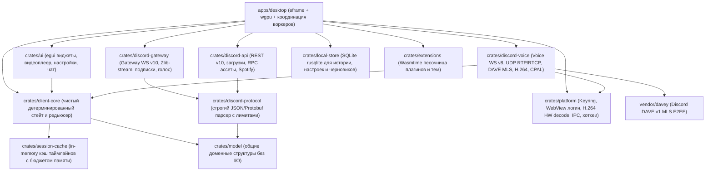

# Serein (`ViceVerse-cz/Serein`) — Полная документация, архитектура, граф вызовов и карта функций

- **Репозиторий:** `https://github.com/ViceVerse-cz/Serein`
- **Локальная копия исходного кода:** [`docs/reference-projects/sources/Serein/`](file:///home/sanya/orca/project/docs/reference-projects/sources/Serein)
- **Оригинальная документация проекта:**
  - [`Serein/docs/architecture.md`](file:///home/sanya/orca/project/docs/reference-projects/sources/Serein/docs/architecture.md)
  - [`Serein/docs/voice.md`](file:///home/sanya/orca/project/docs/reference-projects/sources/Serein/docs/voice.md)
  - [`Serein/crates/discord-voice/README.md`](file:///home/sanya/orca/project/docs/reference-projects/sources/Serein/crates/discord-voice/README.md)

---

## 1. Архитектура и карта крейтов Workspace (`Cargo.toml`)

`Serein` — полнофункциональный нативный клиент Discord на Rust, использующий `egui`/`eframe` + `wgpu` для GPU-рендеринга, `tokio` для сетевого ввода-вывода и изолированные системные потоки (`std::thread`) для реального времени (аудио `cpal`, захват экрана PipeWire/GStreamer/DXGI/ScreenCaptureKit, аппаратный энкодер и декодер H.264).

---

## 2. Полный граф вызовов: Голос, Демонстрация экрана, Видео-кодек и GPU-рендеринг

### 2.1. Входящий видеопоток (Просмотр демки / Камеры -> Декодер -> GPU WGSL Шейдер)

```mermaid
flowchart LR
    WatchStart["apps/desktop/src/watch.rs::Watch::start() [L312]"] --> WatchStream["discord-voice/src/transport.rs::watch_stream() [L1021]"]
    WatchStream --> RunStreamInner["transport.rs::run_stream_inner() [L1044]"]
    RunStreamInner --> SpawnDecoder["video_receive.rs::spawn_decoder(sink) [L484]"]
    RunStreamInner --> UdpRecv["UdpSocket::recv(&mut packet) [L1278]"]
    UdpRecv --> CryptoOpen["crypto.rs::Encryption::open(&packet) [L250]"]
    CryptoOpen --> RestoreRtx["video_receive.rs::Receivers::restore_rtx() [L396]"]
    RestoreRtx --> AssemblerPush["video_receive.rs::Receivers::push() -> Assembler::push() [L159]"]
    AssemblerPush --> DaveDecrypt["davey::DaveSession::decrypt(user, MediaType::VIDEO, &annex_b) [transport.rs:L1314]"]
    DaveDecrypt --> NormalizeSps["video_sps.rs::normalize(&decrypted) [L9]"]
    NormalizeSps --> OfferQueue["video_receive.rs::offer(&decoder_queue, Encoded) [L526]"]
    OfferQueue -. mpsc::sync_channel(8) .-> DecodeLoop["video_receive.rs::decode_loop() (поток 'remote-video') [L711]"]
    DecodeLoop --> BackendDecode["video_receive.rs::Backend::decode() [L647]"]
    BackendDecode --> HwDecode["platform/src/video/live_gst.rs::H264Decoder::decode() [L137]"]
    BackendDecode --> SwFallback["openh264::decoder::Decoder::decode() [video_receive.rs:L666]"]
    HwDecode --> StoreFrame["apps/desktop/src/watch.rs::store_frame(slot, RemoteFrame) [L21]"]
    SwFallback --> StoreFrame
    StoreFrame --> WatchPoll["apps/desktop/src/watch.rs::Watch::poll() [L159]"]
    WatchPoll --> UploadGpu["apps/desktop/src/gpu_video.rs::VideoTexture::upload() [L290]"]
    UploadGpu --> ConverterWrite["gpu_video.rs::Converter::write() -> queue.write_texture() [L227]"]
    ConverterWrite --> WgslShader["gpu_video.rs::fs_nv12 / fs_i420 (YUV->RGB на GPU) [L76-L88]"]
```

### 2.2. Исходящая демонстрация экрана (Захват экрана + Изолированный звук -> Энкодер -> RTP/DAVE)

```mermaid
flowchart LR
    ScreenStart["apps/desktop/src/screen.rs::Screen::start() [L510]"] --> WorkerStart["discord-voice/src/screen.rs::Worker::start(settings) [L124]"]
    WorkerStart --> LinuxRun["screen/linux.rs::run() (поток 'screen-capture') [L80]"]
    WorkerStart --> AudioWorker["screen/audio_linux.rs::Worker::start() (поток 'screen-audio') [L41]"]
    WorkerStart --> EncodeLoop["screen.rs::encode_loop() (поток 'screen-encode') [L267]"]
    LinuxRun --> PortalOpen["screen/portal_linux.rs::Portal::open() + open_remote() [L42, L202]"]
    PortalOpen --> GstCapture["screen/gstreamer.rs::Capture::new() (vah264enc -> vaapih264enc -> nvh264enc -> Software) [L70]"]
    GstCapture -. EncodedFrame / RawFrame .-> RunStream["transport.rs::run_stream() -> run_stream_inner() [L998, L1044]"]
    EncodeLoop --> ScreenEncoder["screen.rs::ScreenEncoder::encode() [L533]"]
    ScreenEncoder -. EncodedFrame .-> RunStream
    AudioWorker --> PulseLoop["screen/audio_linux.rs::run() (pa_stream_set_monitor_stream) [L633]"]
    PulseLoop -. AudioChunk .-> StreamAudioNext["transport.rs::StreamAudio::next() -> opus2::Encoder::encode_float() [L815, L1214]"]
    RunStream --> DaveEncrypt["dave.session.encrypt(MediaType::VIDEO, &frame.data) [L1178]"]
    DaveEncrypt --> Packetize["video.rs::packetize(&ciphertext, sequence, timestamp, ssrc) [L315]"]
    Packetize --> PacerQueue["video.rs::Pacer::queue() + next_batch() [L57, L89]"]
    PacerQueue --> CryptoSeal["crypto.rs::Encryption::seal() / seal_soundshare() [L64, L69]"]
    CryptoSeal --> UdpSend["UdpFailures::send(&socket, &wire) [L118]"]
```

---

## 3. Подробная карта функций ключевых модулей `Serein`

### 3.1. `crates/discord-voice` — Голосовой движок, Видео RTP/RTCP, Захват экрана и DAVE E2EE

#### Файл [`crates/discord-voice/src/lib.rs`](file:///home/sanya/orca/project/docs/reference-projects/sources/Serein/crates/discord-voice/src/lib.rs)
| Символ | Строки | Сигнатура и назначение |
|---|---|---|
| `pub type Frame` | [`L23`](file:///home/sanya/orca/project/docs/reference-projects/sources/Serein/crates/discord-voice/src/lib.rs#L23) | `[f32; 960]` — 20 мс моно PCM при 48 кГц для голосового чата |
| `pub type VideoSink` | [`L27`](file:///home/sanya/orca/project/docs/reference-projects/sources/Serein/crates/discord-voice/src/lib.rs#L27) | `Arc<dyn Fn(RemoteFrame<'_>) + Send + Sync>` — коллбэк доставки декодированного YUV420-кадра (`I420`/`NV12`) |
| `pub struct Controls` | [`L30-L41`](file:///home/sanya/orca/project/docs/reference-projects/sources/Serein/crates/discord-voice/src/lib.rs#L30-L41) | Состояние управления звонком: `muted`, `deafened`, `camera`, `speaking_gate`, `vad_threshold_db` (`-45`), `user_volumes: Arc<[(u64, u16)]>` |
| `pub enum Status` | [`L54-L66`](file:///home/sanya/orca/project/docs/reference-projects/sources/Serein/crates/discord-voice/src/lib.rs#L54-L66) | Фазы: `Connecting`, `Discovering`, `TransportReady`, `Securing`, `WaitingForPeer`, `Ready { privacy_code }`, `Speaking(Vec<Id>)`, `RemoteAudio`, `CameraAvailable(bool)` |

#### Файл [`crates/discord-voice/src/transport.rs`](file:///home/sanya/orca/project/docs/reference-projects/sources/Serein/crates/discord-voice/src/transport.rs)
| Функция / Структура | Строки | Что вызывает и как реализована |
|---|---|---|
| `negotiation_timeout` | [`L37-L58`](file:///home/sanya/orca/project/docs/reference-projects/sources/Serein/crates/discord-voice/src/transport.rs#L37-L58) | Вычисляет дедлайн рукопожатия: если `secured_at` ещё `None` (нет `op: 4`) — `15 с` от старта; после получения `op: 4` — `deadline` ожидания MLS commit/welcome (`30..90 с`). |
| `endpoint` | [`L59-L75`](file:///home/sanya/orca/project/docs/reference-projects/sources/Serein/crates/discord-voice/src/transport.rs#L59-L75) | Проверяет, что хост заканчивается на `.discord.media` или `.discordapp.net`, не содержит пути/query/userinfo, и формирует URL `wss://{host}:{port}/?v=8`. |
| `public_ip` | [`L76-L99`](file:///home/sanya/orca/project/docs/reference-projects/sources/Serein/crates/discord-voice/src/transport.rs#L76-L99) | Защита от SSRF: отклоняет loopback, private, link-local, CGNAT (`100.64.0.0/10`), benchmarking (`198.18.0.0/15`), multicast и documentation IP-адреса из `op: 2`. |
| `UdpFailures::send` | [`L116-L135`](file:///home/sanya/orca/project/docs/reference-projects/sources/Serein/crates/discord-voice/src/transport.rs#L116-L135) | Неблокирующая отправка UDP-пакета через `socket.try_send(packet)`. Временные ошибки сокета (`WouldBlock` и др.) игнорируются до `UDP_OUTAGE = 10 с`, после чего возвращают фатальную ошибку. |
| `udp_keepalive` | [`L148-L157`](file:///home/sanya/orca/project/docs/reference-projects/sources/Serein/crates/discord-voice/src/transport.rs#L148-L157) | Каждые `5 с` (`UDP_KEEPALIVE`) отправляет 8-байтный UDP-пакет `[0x13, 0x37, 0xca, 0xfe, seq_le_0..4]` для удержания NAT-маппинга открытым. |
| `announce_video` | [`L177-L218`](file:///home/sanya/orca/project/docs/reference-projects/sources/Serein/crates/discord-voice/src/transport.rs#L177-L218) | Разбирает `op: 12` (`video_ssrc`, `rtx_ssrc`, массив `streams[]`), регистрирует SSRC и RTX SSRC в `Receivers`, очищает снятые потоки через `retain_user_sources` / `retain_sources`. |
| `discovery` | [`L219-L239`](file:///home/sanya/orca/project/docs/reference-projects/sources/Serein/crates/discord-voice/src/transport.rs#L219-L239) | Парсит 74-байтный ответ IP Discovery от UDP-сервера Discord: проверяет заголовок `[0, 2, 0, 70]`, совпадение `ssrc` в `[4..8]`, извлекает C-строку IP из `[8..72]` и порт `u16::from_be_bytes([72, 73])`. |
| `run` / `run_with_identity` / `run_inner` | [`L241-L783`](file:///home/sanya/orca/project/docs/reference-projects/sources/Serein/crates/discord-voice/src/transport.rs#L241-L783) | Главный цикл голосового звонка (Voice WS v8 + UDP + Opus + Камера + DAVE): • Создаёт `Dave::with_identity`, `opus2::Encoder` (`48 кГц Mono Voip`), `Mixer`, `Receivers`, `Pacer`, `Rate`, `History`, `spawn_decoder`. • Отправляет `op: 0` (`Identify` с `max_dave_protocol_version: 1`, `video: true`). • Обрабатывает `op: 8` (`Hello`), `op: 2` (`Ready` -> отправляет UDP IP Discovery probe `[0, 1, 0, 70, ssrc_be, 0..]` и `op: 12`), после ответа UDP Discovery отправляет `op: 1` (`Select Protocol` с `mode: "aead_xchacha20_poly1305_rtpsize"` и кодеками `opus=120`, `H264=101`, `rtx=102`). • На `op: 4` (`Session Description`) инициализирует `Encryption::new(&key)` и отправляет бинарный `dave.key_package()` (`opcode 26`). • Каждые `20 мс` кодирует микрофон в Opus, шифрует через `dave.session.encrypt_opus`, упаковывает в RTP (`PT=120`) через `crypto.seal`, микширует входящий звук через `mixer.pop_with_volumes(&controls.user_volumes)` и отправляет в `playback`. |
| `StreamAudio::next` | [`L815-L855`](file:///home/sanya/orca/project/docs/reference-projects/sources/Serein/crates/discord-voice/src/transport.rs#L815-L855) | Буферизует стерео-аудио демонстрации экрана (`STREAM_AUDIO_FRAME = 1920` сэмплов = 20 мс стерео 48 кГц, максимум `STREAM_AUDIO_PENDING = 19200` сэмплов = 200 мс), отбрасывает чанки со старым `epoch` или `NaN`/`Infinity`, при паузе `> 100 мс` сбрасывает буфер и флаг `speaking`. |
| `VideoWatch::tick` | [`L918-L972`](file:///home/sanya/orca/project/docs/reference-projects/sources/Serein/crates/discord-voice/src/transport.rs#L918-L972) | Каждые `200 мс` (`PLI_INTERVAL`) проверяет потерянные кадры (`receivers.absorb(lost)`) и зависание видеопотока (`VIDEO_STALL = 2 с`). Если видео встало — вызывает `receivers.require_all_keyframes()` для отправки RTCP PLI всем отправителям. |
| `run_stream` / `watch_stream` / `run_stream_inner` | [`L998-L1449`](file:///home/sanya/orca/project/docs/reference-projects/sources/Serein/crates/discord-voice/src/transport.rs#L998-L1449) | Отдельный цикл медиа-соединения для исходящей (`run_stream`) и входящей (`watch_stream`) демонстрации экрана (`rtc_connection_id` шлюза): • При отправке демки: получает `EncodedFrame` из `video.frames`, шифрует через `dave.session.encrypt(MediaType::VIDEO)`, фрагментирует в RTP через `video::packetize`, ставит в `Pacer`, сохраняет в `History` для NACK/RTX и отправляет звук экрана через `Encryption::seal_soundshare` (с расширением RFC 8285 `[0xbe, 0xde, 0, 1, 0x90, 0x04, 0, 0]`). • При просмотре демки: принимает RTP-пакеты видео (`PT 101` / `RTX 102`) и стерео-звука (`PT 120`), декодирует Opus в стерео -> сводит в моно `[f32; 960]` для `stream_playout`, а видео собирает через `Receivers::push` -> `dave.session.decrypt` -> `video_sps::normalize` -> `video_receive::offer`. |

#### Файл [`crates/discord-voice/src/video_receive.rs`](file:///home/sanya/orca/project/docs/reference-projects/sources/Serein/crates/discord-voice/src/video_receive.rs)
| Функция / Структура | Строки | Что вызывает и как реализована |
|---|---|---|
| `has_parameter_sets` | [`L100-L122`](file:///home/sanya/orca/project/docs/reference-projects/sources/Serein/crates/discord-voice/src/video_receive.rs#L100-L122) | Сканирует Annex-B поток на наличие одновременно SPS (`NAL 7`) и PPS (`NAL 8`) с непустым телом. |
| `is_keyframe` | [`L123-L140`](file:///home/sanya/orca/project/docs/reference-projects/sources/Serein/crates/discord-voice/src/video_receive.rs#L123-L140) | Проверяет, что Annex-B фрейм содержит IDR-срез (`NAL 5`) и полную пару SPS+PPS (`has_parameter_sets`). |
| `Assembler::push` / `push_ordered` / `append` | [`L159-L322`](file:///home/sanya/orca/project/docs/reference-projects/sources/Serein/crates/discord-voice/src/video_receive.rs#L159-L322) | Депакетизатор H.264 по RFC 6184: • Буфер переупорядочивания `reorder: BTreeMap<u16, Reordered>` глубиной до `MAX_REORDER_PACKETS = 32` пакетов. • Обрабатывает одиночные NAL (`1..=23`), агрегированные пакеты `STAP-A` (`24`, до `MAX_STAP_NALUS = 64`) и фрагментированные `FU-A` (`28`). • При потере хотя бы одного RTP sequence number устанавливает `awaiting_keyframe = true`, сбрасывает неполный кадр и не пропускает P-фреймы до прихода нового IDR keyframe. |
| `Receivers::restore_rtx` | [`L396-L405`](file:///home/sanya/orca/project/docs/reference-projects/sources/Serein/crates/discord-voice/src/video_receive.rs#L396-L405) | По RFC 4588 распаковывает пакет ретрансляции RTX (`PT = 102`): извлекает оригинальный 16-битный RTP sequence number из первых 2 байт payload (`u16::from_be_bytes([payload[0], payload[1]])`), удаляет эти 2 байта (`payload.drain(..2)`) и возвращает основной `video_ssrc`. |
| `spawn_decoder` / `offer` / `decode_loop` | [`L484-L840`](file:///home/sanya/orca/project/docs/reference-projects/sources/Serein/crates/discord-voice/src/video_receive.rs#L484-L840) | Запускает выделенный поток `"remote-video"` с каналом `sync_channel(8)`. • `Backend::new` сначала открывает аппаратный декодер `platform::video::live::H264Decoder::new`, а при ошибке или 2 подряд сбоях декодирования (`MAX_HARDWARE_FAILURES = 2`) прозрачно переключается на программный `openh264::decoder::Decoder` и запрашивает новый keyframe через `lost`. |

#### Файл [`crates/discord-voice/src/video.rs`](file:///home/sanya/orca/project/docs/reference-projects/sources/Serein/crates/discord-voice/src/video.rs)
| Функция / Структура | Строки | Что вызывает и как реализована |
|---|---|---|
| `Pacer` | [`L29-L120`](file:///home/sanya/orca/project/docs/reference-projects/sources/Serein/crates/discord-voice/src/video.rs#L29-L120) | Leaky-bucket пейсер исходящих RTP-пакетов видео: бюджет пополняется со скоростью `bitrate * 2` байт/сек (потолок burst `48 КБ`), выдаёт не более `MAX_BURST_PACKETS = 16` пакетов за тик, чтобы не вызывать переполнение UDP-буфера ядра на ключевых кадрах. |
| `Rate` | [`L122-L192`](file:///home/sanya/orca/project/docs/reference-projects/sources/Serein/crates/discord-voice/src/video.rs#L122-L192) | Адаптивный контроллер битрейта по RTCP Receiver Report (`fraction_lost`) и RTCP REMB (`estimate`): снижает битрейт при потерях `> 10%` и плавно повышает на `+8%` раз в секунду при потерях `<= 2%`. |
| `History` | [`L208-L307`](file:///home/sanya/orca/project/docs/reference-projects/sources/Serein/crates/discord-voice/src/video.rs#L208-L307) | Кольцевой буфер отправленных RTP-пакетов (`MAX_HISTORY_PACKETS = 512`, `MAX_HISTORY_BYTES = 768 КБ`, `HISTORY_WINDOW = 1 с`) для обслуживания входящих RTCP NACK (`205`) и отправки RTX-пакетов (`PT = 102` с 2-байтным OSN). |
| `packetize` | [`L315-L366`](file:///home/sanya/orca/project/docs/reference-projects/sources/Serein/crates/discord-voice/src/video.rs#L315-L366) | Разбивает зашифрованный DAVE H.264 кадр по Annex-B старт-кодам (`nalus()`), помещает мелкие NAL (`<= 1200` байт) в одиночные RTP-пакеты, а крупные режет на `FU-A` (`28`) с установкой бита RTP Marker (`0x80`) только на последнем пакете кадра. |

#### Файл [`crates/discord-voice/src/screen.rs`](file:///home/sanya/orca/project/docs/reference-projects/sources/Serein/crates/discord-voice/src/screen.rs) и подмодули [`screen/linux.rs`](file:///home/sanya/orca/project/docs/reference-projects/sources/Serein/crates/discord-voice/src/screen/linux.rs), [`screen/gstreamer.rs`](file:///home/sanya/orca/project/docs/reference-projects/sources/Serein/crates/discord-voice/src/screen/gstreamer.rs), [`screen/audio_linux.rs`](file:///home/sanya/orca/project/docs/reference-projects/sources/Serein/crates/discord-voice/src/screen/audio_linux.rs)
| Функция / Структура | Строки | Что вызывает и как реализована |
|---|---|---|
| `screen::Worker::start` | [`screen.rs:L124-L231`](file:///home/sanya/orca/project/docs/reference-projects/sources/Serein/crates/discord-voice/src/screen.rs#L124-L231) | Запускает пайплайн захвата экрана (`screen-capture`), поток кодирования (`screen-encode`, функция `encode_loop`) и при `settings.audio == true` поток изолированного захвата звука (`screen-audio`). |
| `screen::encode_loop` | [`screen.rs:L267-L440`](file:///home/sanya/orca/project/docs/reference-projects/sources/Serein/crates/discord-voice/src/screen.rs#L267-L440) | Принимает сырые кадры `RawFrame`, генерирует превью для UI (не чаще 1 раза в `200 мс`), конвертирует `BGRA -> I420/NV12` через `convert::bgra_to_yuv420`, кодирует через `ScreenEncoder` и при отсутствии новых кадров от статического экрана повторяет последний кадр раз в секунду (`IDLE_KEYFRAME_INTERVAL = 1 с`), если запрошен keyframe (PLI). |
| `gstreamer::Capture::new` | [`gstreamer.rs:L70-L247`](file:///home/sanya/orca/project/docs/reference-projects/sources/Serein/crates/discord-voice/src/screen/gstreamer.rs#L70-L247) | Строит GStreamer-пайплайн захвата из PipeWire (`pipewiresrc`) или X11 (`ximagesrc`) с автоматическим перебором аппаратных энкодеров (`Mode::Va` `vah264enc` -> `Mode::VaLegacy` `vaapih264enc` -> `Mode::Nvidia` `glupload ! glcolorconvert ! nvh264enc` -> `Mode::NvidiaCopy` -> `Mode::Software`). |
| `audio_linux::run` | [`audio_linux.rs:L633-L806`](file:///home/sanya/orca/project/docs/reference-projects/sources/Serein/crates/discord-voice/src/screen/audio_linux.rs#L633-L806) | Подключается к PulseAudio/PipeWire-Pulse, каждые `500 мс` перечисляет все `pa_sink_input_info`, исключает собственный процесс (`OwnApplication::allows` по PID и имени бинарника, чтобы **никогда не захватывать звук самого звонка и микрофона**), для каждого стороннего приложения создаёт изолированный `pa_stream` с `pa_stream_set_monitor_stream(stream, input.index)` и `PA_STREAM_DONT_MOVE`, микширует их стерео-сэмплы каждые `10 мс` (`960` сэмплов) и отправляет `AudioChunk`. |

---

### 3.2. `apps/desktop` и `crates/platform` — GPU-рендеринг видео (`wgpu`) и Аппаратное декодирование H.264

#### Файл [`apps/desktop/src/gpu_video.rs`](file:///home/sanya/orca/project/docs/reference-projects/sources/Serein/apps/desktop/src/gpu_video.rs)
| Функция / Структура | Строки | Что вызывает и как реализована |
|---|---|---|
| `install` / `Converter::new` | [`L14-L194`](file:///home/sanya/orca/project/docs/reference-projects/sources/Serein/apps/desktop/src/gpu_video.rs#L14-L194) | Компилирует встроенный WGSL-шейдер (`SHADER`: вершинная функция `vs_main` и два фрагментных конвейера `fs_nv12` и `fs_i420`), создаёт `wgpu::RenderPipeline` и `BindGroupLayout` для конвертации YUV420 -> RGBA8 прямо на видеокарте. |
| `VideoTexture::upload` / `upload_gpu` | [`L290-L430`](file:///home/sanya/orca/project/docs/reference-projects/sources/Serein/apps/desktop/src/gpu_video.rs#L290-L430) | Загружает плоскости `Y` (`R8Unorm`) и `UV` (`Rg8Unorm` для `NV12`) либо `Y`, `U`, `V` (`R8Unorm` для `I420`) напрямую в GPU через `queue.write_texture` (всего `1.5 байта на пиксель` вместо `4 байт` RGBA), запускает `RenderPass` шейдера в целевую текстуру `Rgba8UnormSrgb` и регистрирует её в `egui` через `register_native_texture`. |

#### Файлы [`crates/platform/src/video/live_gst.rs`](file:///home/sanya/orca/project/docs/reference-projects/sources/Serein/crates/platform/src/video/live_gst.rs), [`live_windows.rs`](file:///home/sanya/orca/project/docs/reference-projects/sources/Serein/crates/platform/src/video/live_windows.rs), [`live_apple.rs`](file:///home/sanya/orca/project/docs/reference-projects/sources/Serein/crates/platform/src/video/live_apple.rs)
- **`live_gst.rs::H264Decoder::new` (`L33-L136`):** Перебирает аппаратные GStreamer-декодеры H.264 на Linux в порядке `["vah264dec", "vaapih264dec", "nvh264dec", "v4l2slh264dec", "v4l2h264dec"]` в цепочке `appsrc -> h264parse -> decoder -> videoconvert -> capsfilter (NV12/I420) -> appsink`.
- **`live_windows.rs::H264Decoder::new` (`L47-L92`):** Создаёт Media Foundation Transform `CLSID_CMSH264DecoderMFT` с выходом `MFVideoFormat_NV12`.
- **`live_apple.rs::H264Decoder::new` (`L52-L61`):** Использует `VTDecompressionSession` (`VideoToolbox`) с выходом `kCVPixelFormatType_420YpCbCr8BiPlanarVideoRange` (`NV12`).
