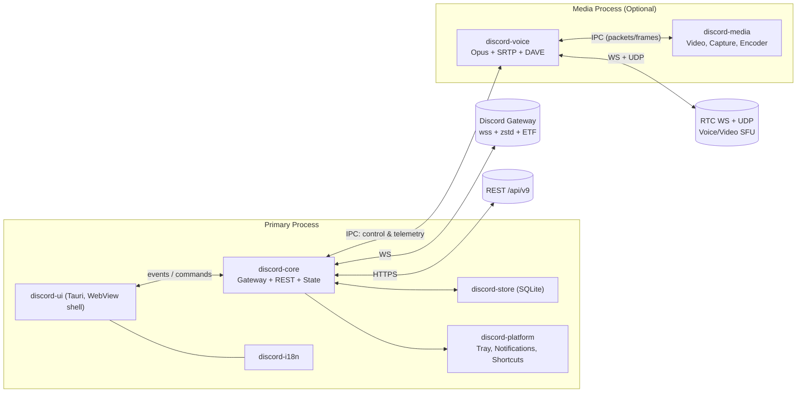
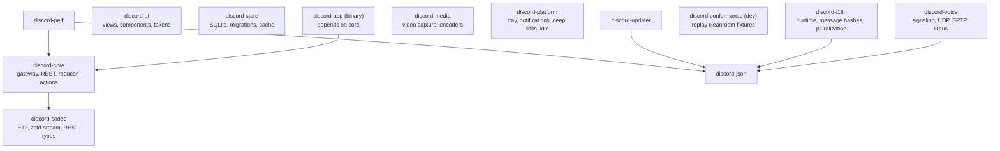
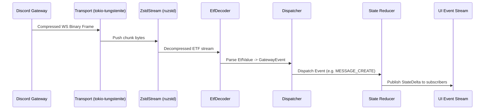
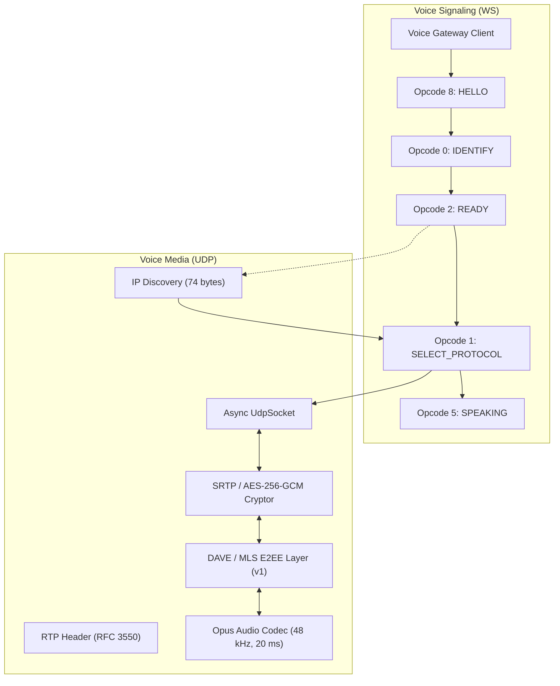
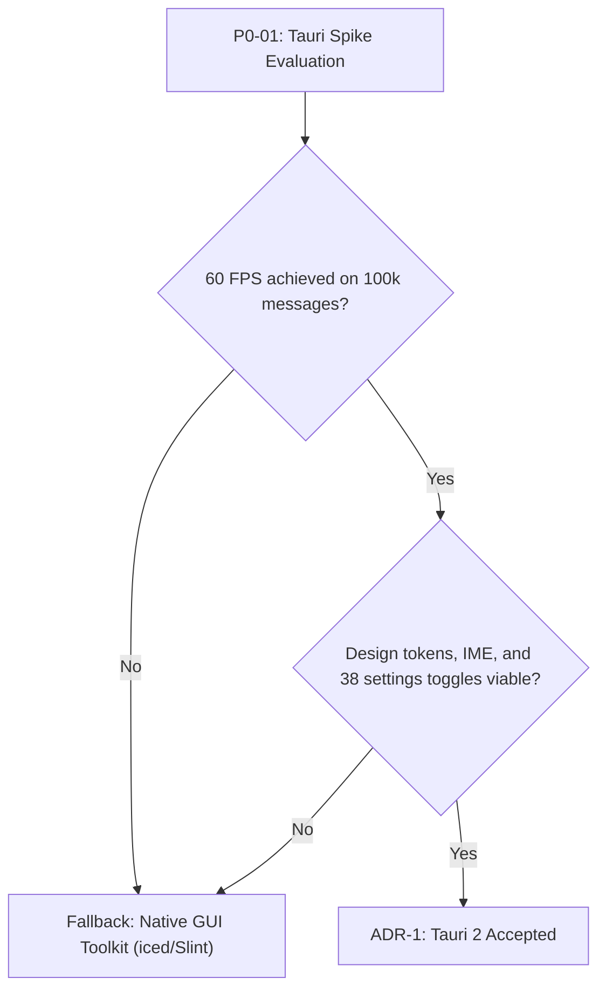

# Rust Client Architecture: Processes, Crates, and Data Flows

This document details the target architecture for the native Discord client: process isolation model, crate decomposition, event-driven task execution, Mermaid topology graphs, offline persistence, replacement of Electron IPC channels with native Rust subsystems, UI toolkit Architectural Decision Records (ADR), and performance budgets. Fact sources: `../re/`.

## 1. Target Application Process Model

- The target architecture employs a **single primary process** (UI + Core). Optionally, a dedicated **media worker process** provides crash isolation for native audio/video codecs and hardware encoders.
- Electron's legacy 168 IPC channels (`../re/backend-ipc.md`) are replaced by an **in-process async bus** (`tokio::broadcast` for global events, `tokio::sync::mpsc` for targeted commands) and modular services within a unified memory space.
- Reactive event pipeline: Remote Server -> Gateway Socket -> Event Dispatcher -> **State Reducer** -> Subscriptions (UI Model, SQLite Cache, Sound/Notification Engine). UI User Actions -> REST Client / Gateway -> **Optimistic State Mutation** -> Server Reconciliation.

## 2. Workspace Crates and Target Architecture

The following diagram illustrates the direct Cargo dependencies verified against workspace manifests:

### Crate Responsibilities

| Crate | Responsibility | Key Dependencies |
|---|---|---|
| `discord-codec` | ETF encoder/decoder, zstd-stream frame reader, REST v9 serializable payload types | `ruzstd`, `serde` |
| `discord-core` | Gateway state machine, REST v9 client, state reducer, action dispatch, sync | `tokio`, `tokio-tungstenite`, `rustls` |
| `discord-store` | SQLite offline persistence, schema migrations, query cache | `sqlite` |
| `discord-voice` | WebRTC voice signaling (opcodes 0..16), UDP socket, SRTP encryption, Opus codec, DAVE/MLS | `tokio`, `aes-gcm`, `opus` |
| `discord-media` | PipeWire/X11 screen capture, NVENC/VA-API hardware video encoding, video player | `ashpd`, `libspa` |
| `discord-platform` | System tray, desktop notifications (D-Bus), global keybindings, idle detection | `zbus`, `libsecret` |
| `discord-i18n` | Custom i18n runtime, xxh64 string hashing, ICU plural rules | `xxhash-rust` |
| `discord-ui` | Tauri frontend assets, design tokens, virtualized message lists, popovers | Web standard DOM |
| `discord-app` | Entry point, CLI argument parsing, runtime supervisor, configuration loader | `tokio` |

## 3. Gateway Event Pipeline

## 4. Voice Subsystem Architecture

## 5. Replacement of Legacy Electron IPC Channels

| Legacy Electron Channel | Original Function | Native Rust Replacement |
|---|---|---|
| `DISCORD_NATIVE_MODULES_*` | dlopen native libraries | In-tree Rust crates (media, voice, platform) |
| `DISCORD_PROCESS_UTILS_*` | Process supervision | `tokio::process`, `sysinfo` |
| `DISCORD_POWER_SAVE_*` | Sleep prevention | D-Bus inhibitors (`org.freedesktop.ScreenSaver`, `login1`) |
| `DISCORD_CLIPBOARD_*` | System clipboard | `arboard` |
| `DISCORD_UTILITY_*` | Tray, badge, deep links | Native D-Bus (`zbus`), `xdg-open` |
| `DISCORD_VOICE_ENGINE_*` | Voice audio processing | `discord-voice` crate |
| `DISCORD_KRISP_*` | Noise cancellation | RNNoise / cleanroom ML inference |

## 6. ADR-1: UI Shell Selection — Tauri 2

Tauri 2 was selected as the desktop UI shell: Rust backend services coupled with system WebView (WebKitGTK on Linux, WebView2 on Windows, WKWebView on macOS). No bundled Chromium binary is shipped.

## 7. Performance Budgets

| Metric | Budget Target |
|---|---|
| Cold start to READY (cache available) | <= 1.5 s |
| Channel open from local cache | <= 100 ms |
| Scroll render time for 25k member list | 60 FPS, <= 16 ms per frame |
| Idle memory consumption (RSS) | <= 300 MB |
| Voice round-trip latency | <= 150 ms (LAN), jitter buffer 40–60 ms |
| Gateway network serialization overhead | <= 37 bytes per message payload |

## 8. Architectural Risks and Mitigation

| Risk | Mitigation |
|---|---|
| WebView virtualization performance limits | Evaluate native Rust GUI toolkits (iced/Slint) if frame drops occur |
| Media process IPC overhead | Maintain unified in-process pipeline; extract to separate worker only on instability |
| DAVE MLS specification evolution | Encapsulate cryptographic envelope behind abstract traits (`openmls`) |
| High memory footprint in massive guilds | Strict member paging limits, LRU channel caching, lazy role resolution |
