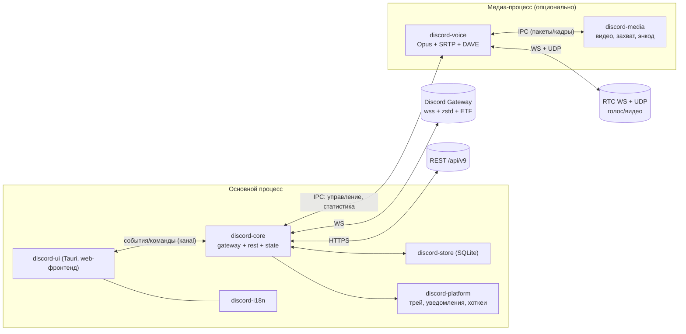
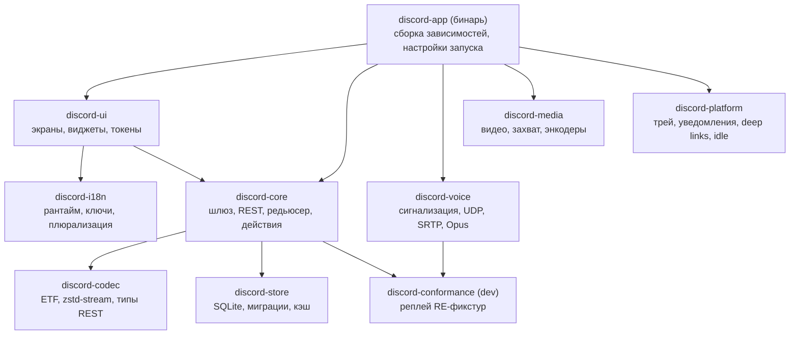
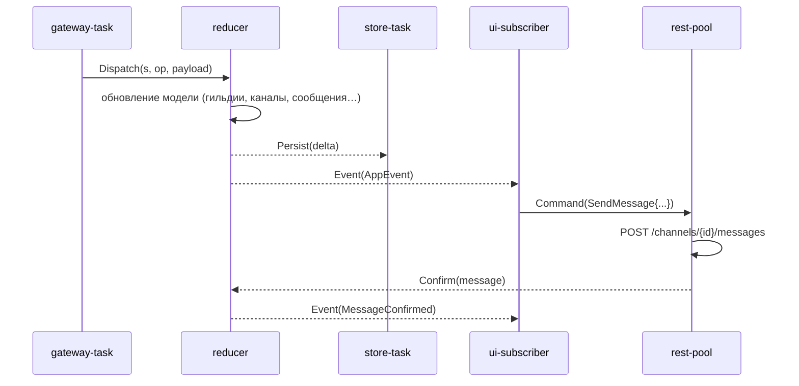
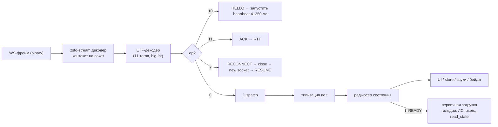
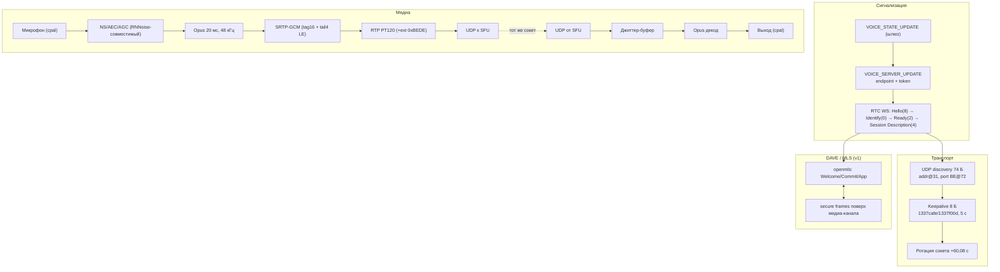
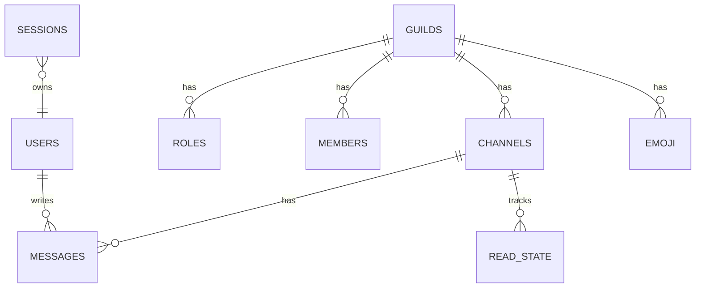
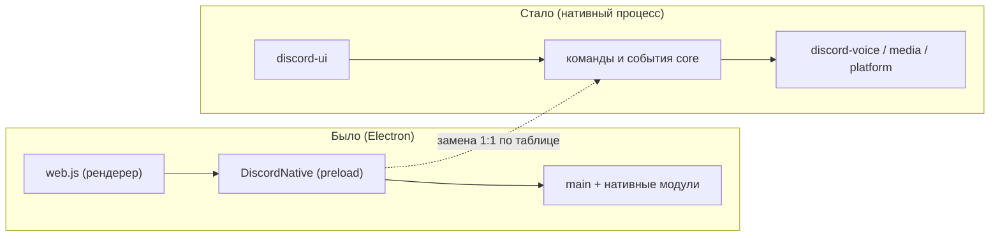
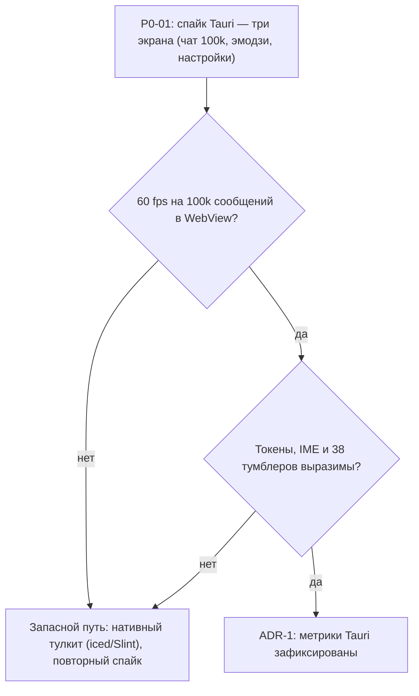

# Архитектура Rust-клиента: процессы, крейты, потоки данных

Документ описывает проектную архитектуру нативного клиента: модель процессов, разбиение на
крейты, задачно-событийную модель, восемь графов (Mermaid), хранилище, замену Electron-IPC
нативными модулями, ADR по UI-тулкиту и бюджеты производительности. Источники фактов — `../re/`.

## 1. Общая модель

- **Один основной процесс** (UI + ядро). Опционально — **медиа-процесс** для изоляции сбоев
  кодеков/энкодеров (по образцу того, что Discord держит `discord_voice.node` в рендерере, но с
  чистым разделением).
- Вместо 168 IPC-каналов Electron (`../re/backend-ipc.md`) — **внутренняя шина**
  (`tokio::broadcast` для событий, `mpsc` для команд) и **сервисы-модули** в одном адресном
  пространстве.
- Событийная модель: сервер → шлюз → диспатчи → **редьюсер состояния** → подписчики (UI, хранилище,
  звуки/уведомления, счётчики). Действия UI → REST/шлюз → **оптимистичное обновление** → подтверждение.

## 2. Крейты (workspace)

Правила зависимостей: `discord-codec` — без I/O; `discord-core` не знает про UI; `discord-voice`
не зависит от состояния — получает параметры сессии из `discord-core`; UI общается только через
типизированные команды/события.

## 3. Задачно-событийная модель ядра

- `gateway-task`: сокет, heartbeat (41,25 с), zstd-декодер, ETF-декодер, seq-tracking, reconnect
  (op7 → RESUME; при неудаче — новый IDENTIFY).
- `rest-pool`: ручной HTTP/1.1 на `tokio` + `tokio-rustls` (без `reqwest`), один запрос на соединение, обработка 429 (Retry-After), метрики; keep-alive — отдельная волна.
- `reducer`: единственный владелец изменяемой модели; чистая функция `(state, event) -> (state, effects)`.
- Эффекты: персист в SQLite, звук, уведомление, обновление заголовка окна/бейджа.
- UI-поток (главный): получает снапшоты/дельты, рендерит, шлёт команды.

## 4. Конвейер шлюза

Проверки конформанса: эталонные zstd+ETF кадры из `gateway/` (см. `TEST-PLAN.md`) прогоняются
через декодер и сверяются с JSON-оракулом.

## 5. Стек голоса

Детали режимов шифрования (0–6), структура хвостового счётчика и AAD — в `../re/voice-deep.md`
§2; при реализации обязателен независимый тест на расшифровку эталонного SRTP-пакета.

## 6. Хранилище и миграции

- Таблицы: `guilds`, `channels`, `roles`, `members` (ленивые страницы), `users`, `messages`
  (индекс `channel_id, id`), `read_state`, `emoji`, `notes`, `settings`, `drafts`, `sessions`.
- Миграции — версионированные SQL-файлы, применяются на старте; WAL; размеры полей — по READY
  (крупная гильдия: 24 229 участников → отдельные страницы member-list).
- Секреты (токен) — **не в БД**: keyring.

## 7. Замена Electron-IPC нативными модулями

По `../re/backend-ipc.md` (168 каналов, whitelist 43) и `../re/main-arch.md` (5 цепочек вызовов):

| Электронный канал (исходно) | Цепочка RE | Замена в Rust |
|---|---|---|
| `DISCORD_WINDOW_*` | рендерер → preload → main → BrowserWindow | окно Tauri (`tao`/`wry`): min-size, фуллскрин, закрытие в трей |
| `DISCORD_NOTIFICATIONS_*` | → main → Notification | `notify-rust`/D-Bus, действия open/reply |
| `DISCORD_NATIVE_MODULES_*` | → main → `require()` | собственные крейты (медиа, NS, spellcheck) |
| `DISCORD_PROCESS_UTILS_*` | → main → child_process | `tokio::process` (клипы), sysinfo |
| `DISCORD_POWER_SAVE_*` | → main → powerSaveBlocker | D-Bus inhibitors (ScreenSaver/Login1) |
| `DISCORD_CLIPBOARD_*` | → main → clipboard | `arboard` |
| `DISCORD_UTILITY_*` | трей, бейдж, deep links | `ksni`, Unity launcher API, `xdg-open`/`zbus` |
| `DISCORD_VOICE_ENGINE_*` (голос) | рендерер ↔ `discord_voice.node` | `discord-voice` (внутри процесса или медиа-IPC) |
| `DISCORD_KRISP_*` (шумодав) | `discord_krisp.node` | RNNoise-совместимый крейт + свой инференс моделей |
| Акселерация GPU | `@discordapp/gpu-helper` + dlopen vulkan/va | `wgpu` (vulkan) + `va-api`/`nvenc` для видео |
| Idle/wayland | `discord-utils`/idle | `ext-idle-notify`/X11 XScreenSaver |
| Автозапуск | main | XDG autostart файл |

## 8. ADR-1: UI-оболочка — `Tauri` (решение владельца, 2026-10-19)

Выбрана оболочка **`Tauri`**: Rust-бэкенд-процесс + фронтенд в системном WebView (Linux —
WebKitGTK, Windows — WebView2, macOS — WKWebView); встроенный Chromium не поставляется.
Спайк P0-01 измеряет метрики трёх экранов на Tauri; для запасного пути сохранены критерии
нативных тулкитов:

| Критерий | Tauri (выбран) | iced | Slint |
|---|---|---|---|
| Виртуализация 100k сообщений | виртуальный скролл (проверить в спайке) | есть (widget::List) | есть (ListView) |
| Кастомные токены/темы (5132 переменные) | CSS-переменные 1:1 | стилизация свойств | дизайн-язык, переменные |
| Анимации 60 fps | композитор WebView (проверить в спайке) | да (wgpu) | да |
| Текстовый ввод/IME/вставка медиа | WebView (проверить IME/Wayland) | хороший | хороший |
| Скорость итераций | высокая (web-стек) | средняя | высокая |
| Размер/зависимости | системный WebView + нативные крейты | wgpu (тяжелее) | мал |
| Роль | **✔ основа** | резерв №1 | резерв №2 |

Спайк: три экрана (чат с 100k сообщений, эмодзи-пикер с 10 категориями, настройки с 38
тумблерами) на Tauri; ADR-1 фиксирует бенчмарки (FPS, RAM, время сборки, старт) и замер
резервного нативного тулкита.

## 9. Бюджеты производительности

| Метрика | Бюджет |
|---|---|
| Холодный старт до READY (кэш есть) | ≤ 1,5 с |
| Открытие канала из кэша | ≤ 100 мс |
| Отрисовка скролла 24k-списка участников | 60 fps, ≤ 16 мс кадр |
| Память в простое | ≤ 300 МБ |
| Голос: сквозная задержка | ≤ 150 мс (LAN), джиттер-буфер 40–60 мс |
| Сетевой оверхед шлюза (idx) | ≤ 37 байт на 1000 сообщений (сеть ×37 от идеала) |

## 10. Риски архитектуры и запасные пути

| Риск | План Б |
|---|---|
| UI-слой (Tauri/WebView) не тянет виртуальный чат | переход на нативный тулкит (iced/Slint) после P0-спайка |
| Медиа-процесс усложняет отладку | начать в одном процессе, вынести в P5 по мере надобности |
| DAVE/MLS задерживается | голос без E2EE там, где канал не требует; E2EE — обязательный гейт для «полного» релиза |
| Пиковый RSS на гигантских гильдиях | агрессивные лимиты member-страниц, LRU, ленивая загрузка эмодзи/ролей |
