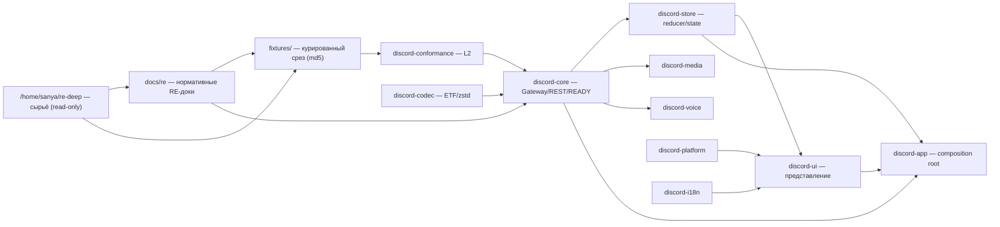
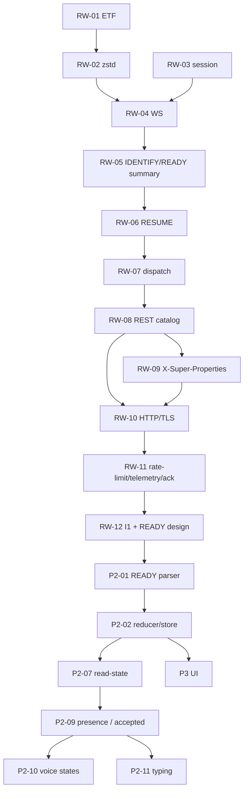

# DEVELOPMENT-PROMPT — нативный Rust-клиент discord-lab

> **Актуальный статус (2026-10-21):** приняты RW-01…RW-21 (25/90); B02 (P2-08 settings,
> P1-01 ETF, P1-02 zstd, P0-04 conformance, P0-07 legal) принят; следующий batch B03/RW-22;
> введён batch-конвейер (`TEAM.md`, `WAVE-PLAN.md`).
> Факт — `STATUS.md`, следующий план — `ROADMAP.md`/`WAVE-PLAN.md`, журнал —
> `../../waves/STATE.md`. Разделы §9 и матрица W12 ниже — **архив волны RW-12**; для новой
> работы брать `WAVE-PLAN.md` и замороженный TZ batch B01.

**Редакция:** 2026-10-21, снимок после B02 (RW-21 accepted); B01/B02 закрыты.
**Назначение:** готовый промт для AI-координатора и воркеров, которые продолжают разработку
Rust-клиента в этом репозитории. Это не замена контрактам: при конфликте действует порядок
`PROCESS.md` → `docs/rust-client/PLAN.md` / `TEST-PLAN.md` → `TASKS.md` → `AGENTS.md`.
**Главный принцип:** ни одного выдуманного поля, маршрута, опкода или экрана. Каждый тип и тест
опирается на `docs/re/`, курированную фикстуру из `fixtures/` или явно помечен как синтетический.

---

## 0. Что прочитать до первой строки кода

Ты работаешь в `/home/sanya/orca/project` (git-репозиторий `discord-lab`). Сначала выполни:

```sh
cd /home/sanya/orca/project
git status --short
git diff --stat
sed -n '1,240p' PROCESS.md
sed -n '1,220p' docs/rust-client/TEAM.md
sed -n '1,220p' docs/rust-client/WAVE-PLAN.md
sed -n '1,180p' docs/rust-client/PLAN.md
sed -n '1,300p' docs/rust-client/TEST-PLAN.md
sed -n '1,220p' docs/rust-client/ARCHITECTURE.md
cat waves/STATE.md
cat waves/TASK-TREE-RUST.md
jq -r '[.ts,.event,.wave,.card,(.summary//"")]|@tsv' waves/db.jsonl
```

Обязательно перепроверь фактическое состояние, а не только документы. В batch воркер запускает
только targeted-тесты; полный прогон и `clippy` — у integration/QA:

```sh
cd /home/sanya/orca/project/rust
cargo test --offline -p discord-core --test <свой_тест>
# полный набор — только в integration-лейне:
cargo test --offline --workspace
cargo fmt --check
cargo clippy --offline --workspace --all-targets -- -D warnings
```

Последний проектный гейт запускает **только интегратор/Team Lead**:

```sh
cd /home/sanya/orca/project
npm run gate:worker
```

Если документ и фактический прогон расходятся, источником истины для состояния является
фактический прогон + `git diff`, а для контракта — `PROCESS.md` / `PLAN.md` / `TEST-PLAN.md`.
Расхождение не замалчивай: запиши его в отчёт и предложи правку координатору.

---

## 1. Цель продукта и границы

Цель — полноценный нативный графический Discord-подобный клиент на Rust:

- без Electron и встроенного Chromium;
- сеть, Gateway, REST, медиа и тяжёлый парсинг — вне UI-потока;
- состояние — типизированные события и reducer/store, а не прямые мутации UI из сети;
- поведение и модели подтверждены RE-документами и фикстурами;
- всё неподтверждённое изолировано за интерфейсом, mock/stub или feature-флагом.

Текущий архитектурный ориентир — Tauri (системный WebView) из `docs/rust-client/ARCHITECTURE.md`
(ADR-1). Это **предложение**, а не разрешённая зависимость: GUI-крейтов нет в офлайн-кэше.
До решения владельца можно развивать только не-GUI части: парсеры, store/reducer, модели,
сетевые адаптеры, тесты и mock-состояния.

### Жёсткие запреты

- Не делать запросов к Discord, не подключаться к живому Gateway, не запускать/attach/spawn
  Discord, не использовать Frida/CDP без отдельного окна, согласованного координатором.
- Не извлекать, не логировать и не сохранять токены, cookies, пароли, email, session_id,
  `user_settings_proto`, `analytics_token`, `qos_token`, `auth_session_id_hash`.
- `logs/`, `functions/`, `evidence/`, `/home/sanya/re-deep` — только чтение. Никаких записей,
  переименований, «нормализации» golden-данных.
- Не устанавливать пакеты, не менять `Cargo.toml` / `Cargo.lock` / `package.json` без
  письменного разрешения владельца через координатора.
- Не делать `git commit`, `push`, `reset`, `checkout`, destructive-операции. Коммиты — L1.
- Не редактировать чужие тесты, чужие модули, общие контракты и журналы волн без назначения.
- Не «зеленить» тест правкой теста под реализацию. Если контракт в тесте неверен — остановись,
  зафиксируй `red-contract-fix` и спроси координатора.

---

## 2. Актуальный снимок (2026-10-20)

| Метрика | Факт | Доказательство |
|---|---:|---|
| Rust-воркспейс | **580 тестов, 0 failed** | `cargo test --offline --workspace` |
| `discord-core` | **524 теста** | тот же прогон |
| fmt | чисто | `cargo fmt --all -- --check` |
| clippy | чисто | `cargo clippy --offline --workspace --all-targets -- -D warnings` |
| Последний gate | **passed** (typecheck/meta/unit/smoke) | `waves/RW-21/gate-worker-b02.json` |
| Принято карточек | **25/90** | B02: `P2-08`, `P1-01`, `P1-02`, `P0-04`, `P0-07`; `TASKS.md` §RW |
| В работе | **B03/RW-22** (next) | `WAVE-PLAN.md`, `waves/STATE.md` |
| Следующий batch | **B03**: P3-15, P4-01, P7-04, P8-03 | `WAVE-PLAN.md`, `waves/STATE.md` |
| P2-01 | **принят**: A1, 40 top-level ключей, 7 диагностических кейсов; review round 3 — «принято» | `waves/reviews/review-p2-01-round3.md`, `rust/.../ready/` |
| Legacy `ready_data` | **удалён** из сборки и публичного API (P-4) | `rust/.../src/lib.rs`, diff |
| UI | каркасы 14–54 строк, окна нет | `waves/GUI-AUDIT.md` |

Текущая незакоммиченная работа: RW-10…RW-21, I1, P2-01, P2-02, P2-04…P2-11, B01/B02 accepted,
удаление legacy `ready_data` и правки доков. Перед началом batch Team Lead проверяет `git status`, файловую матрицу и
`waves/STATE.md`, а не память.

---

## 3. Карта проекта

### 3.1 Слои



### 3.2 Крейты

| Крейт | Роль | Фактическое состояние |
|---|---|---|
| `discord-codec` | ETF (11 тегов, big-int), zstd-stream | реализовано, принято RW-01/RW-02 |
| `discord-core` | Gateway WS, heartbeat, IDENTIFY, READY-сводка, RESUME, dispatch router, REST-каталог/заголовки/ретраи, HTTP/1.1/TLS, rate-limit, telemetry, ack, I1-фасад | основной зрелый крейт; READY-модель P2-01 ещё не принята |
| `discord-conformance` | L2-загрузка фикстур | каркас/2 теста, расширять по TEST-PLAN |
| `discord-store` | типизированное состояние и reducer P2-02 | каркас, 1 тест |
| `discord-ui` | представление, экраны, виртуализация | каркас, 1 тест; GUI-тулкита нет |
| `discord-app` | composition root, запуск окна | `main.rs`-заглушка |
| `discord-platform` | ОС-интеграции, keyring, tray | каркас; keyring заблокирован |
| `discord-voice` | voice signaling/RTP/SRTP | каркас; RE есть, реализации нет |
| `discord-media` | медиа-пайплайн | каркас |
| `discord-i18n` | ключи/локализация | каркас, 2 теста |

### 3.3 `discord-core`: что уже есть

- `gateway.rs` — сессия HELLO/heartbeat/RTT/zombie, виртуальные часы.
- `ws.rs` — WS-транспорт (`ws://`/`wss://`), пайп zstd→термы→сессия, события dispatch.
- `identify.rs` — op2 IDENTIFY, честные `X-Super-Properties`-поля, capability.
- `ready.rs` — текущая `ReadySummary` (только счётчики), не модель P2-01.
- `dispatch.rs` — 21 тип op0, raw для неизвестных.
- `resume.rs` — op6, `ResumeState`, `plan_reconnect`, порог 30 000 мс.
- `rest/routes.rs` — 47 маршрутов, `render_path`.
- `rest/headers.rs` — 6 auth-заголовков и классы кодов.
- `rest/http1.rs` — ручной HTTP/1.1, CL/chunked, лимиты, anti-smuggling.
- `rest/transport.rs` — Endpoint, TCP/TLS, SAN, connect/read/write timeouts.
- `rest/rate_limit.rs` — 429/5xx/401, `Retry-After`, JSON-поля, политика повторов.
- `rest/telemetry.rs` — блок `science`/`beaker`/`track`.
- `rest/ack.rs` — target/body ack с токеном.
- `rest/client.rs` — I1 `ApiClient` (auth + транспорт + телеметрия + ретраи), 16 тестов.
- `ready/` — **принятый A1** (`P2-01`): `error.rs`, `value.rs`, `snapshot.rs`, `guild.rs`,
  `social.rs`, `read_state.rs`; подключён к `lib.rs`; 40 top-level ключей, диагностика,
  redacted `Debug`, 7 регрессионных кейсов review.
- `ready_data.rs` — **удалён** (P-4); единственная модель READY — `ready::Ready`.

### 3.4 UI-архитектура (целевая)

```text
UI thread (Tauri/iced/egui — после ADR)
  ├─ читает только snapshot состояния
  ├─ отправляет типизированные UiCommand
  └─ не делает I/O, не парсит READY, не ходит в SQLite

Core runtime (tokio)
  ├─ GatewaySession / RestClient / Media / Voice
  ├─ bounded mpsc events -> reducer
  ├─ cancellation token на окно/сессию
  └─ таймауты, reconnect, rate-limit, явные ошибки

Reducer/store
  ├─ pure (State, Event) -> (State, Effects)
  ├─ индексы и join users↔members
  └─ snapshot для UI, без секретов

CPU pool (rayon/blocking thread, после разрешения)
  └─ тяжёлый ETF/JSON/protobuf/медиа-парсинг
```

Состояния интерфейса обязательны: `Connecting`, `Ready`, `Reconnecting`, `RateLimited`,
`IncompleteReady`, `Stale`, `Error`; у каждого — проверяемый сценарий и причина.

---

## 4. Волны: что реально сделано

| Волна | Карточка | Реализовано | Статус / доказательство |
|---|---|---|---|
| RW-01 | P0-02 | ETF: 11 тегов, big-int «знак до цифр», round-trip, fuzz-lite | принято; `waves/RW-01/`, `discord-codec/src/etf.rs` |
| RW-02 | P0-03 | zstd-stream: магия только в кадре 0, окно 64 КиБ, реальные 137 кадров | принято; `waves/RW-02/`, `zstd.rs` |
| RW-03 | P1-03 | сессия Gateway: HELLO, heartbeat 41 250, ACK/RTT, zombie | принято; `waves/RW-03/`, `gateway.rs` |
| RW-04 | P1-03 | WS-транспорт, пайп zstd→термы→сессия, стаб-сервер | принято; `waves/RW-04/`, `ws.rs` |
| RW-05 | P1-04 | IDENTIFY op2, READY-сводка, реальные поля веб-клиента | принято; `waves/RW-05/`, `identify.rs` |
| RW-06 | P1-05 | RESUME op6, реконнект, op9 `d`, непрерывный `s` | принято; `waves/RW-06/`, `resume.rs` |
| RW-07 | P1-06 | dispatch router: 21 тип op0, raw + счётчик | принято; `waves/RW-07/`, `dispatch.rs` |
| RW-08 | P1-07 | REST-каталог 47 маршрутов, 6 заголовков, коды, ретраи | принято; `waves/RW-08/`, `rest/routes.rs` |
| RW-09 | P1-08 | base64 вручную, X-Super-Properties 22 поля, честная идентичность/UUID | принято; `waves/RW-09/`, `rest/base64.rs` |
| RW-10 | P1-07 infra | HTTP/1.1 framing, TCP/TLS, SAN, лимиты, anti-smuggling, таймауты | **принято 2026-10-20**; P0/P1/P2 нет, P3 N1–N9 — backlog; `waves/RW-10/`, `review-rw-10-11-round2.md` |
| RW-11 | P1-09/P1-11/P1-12 | rate-limit 429/5xx/401, telemetry-off, ack/read-state | **принято 2026-10-20**; P0/P1/P2 нет, P3 — backlog; `waves/RW-11/`, `review-rw-10-11-round2.md` |
| RW-12 | P2-01 + I1 | I1 `ApiClient`; A1 READY, 40 top-level ключей, диагностика, 7 review-кейсов | **принято 2026-10-20**: I1 — «Принято» (`review-i1.md`); P2-01 — round 3 «принято» (`review-p2-01-round3.md`); core 233, workspace 275; `ready_data` удалён |
| RW-13 | P2-02 | state/reducer/selectors, READY/SUPPLEMENTAL/RESUMED, stale-политика | **принято 2026-10-20**; review round 1 — P1/P2, закрыты red-first; core 275, workspace 317 |
| RW-14 | P2-06 | memory history/pagination, generation/stale, Live > Page | **принято 2026-10-20**; review P2-1 root re-exports закрыт red-first; core 295, workspace 337 |
| RW-15 | P2-04 | memory member list, ops, duplicate/out-of-range | **принято 2026-10-20**; review P2-1 duplicate-index закрыт red-first; core 335, workspace 377 |
| RW-16 | P2-05 | memory chunks, merge members, not_found | **принято 2026-10-20**; review P2-1 duplicate-index закрыт red-first; core 378, workspace 420 |
| RW-17 | P2-07 | memory read-state/бейджи, mentions, ack-point | **принято 2026-10-20**; review P2-1 channel fallback закрыт red-first; core 418, workspace 460; mutation 7/7 |
| RW-18 | P2-09 | memory presence, scopes, activities, member-list/chunk presences | **принят** 2026-10-21, P0/P1/P2=0, P3=8 backlog; 54 теста, 13/13 мутаций, gate passed; core 473, workspace 515 |

Отдельно: `waves/GUI-AUDIT.md` — аудит офлайн-зависимостей и GUI-каркасов (не волна плана).
Он подтверждает: Tauri/iced/egui/winit/wry/tao в офлайн-кэше отсутствуют; UI-крейты — каркасы.

### 4.1 Граф волн и зависимостей



---

## 5. Сверка карты, кода и документации: известные расхождения

Это не «мелкие ниты», а места, где нельзя слепо доверять документам.

| # | Где | Что написано / ожидается | Факт | Что делать |
|---:|---|---|---|---|
| 1 | `STATUS.md` / `docs/map.md` | P2-09 принят? | **да:** 2026-10-21, P0/P1/P2=0, 54 теста, 13/13 мутаций, gate passed | считать accepted; P3=8 — backlog |
| 2 | `.ua/knowledge-graph.json` | граф актуален | снимок до `state/`; 232 узла/432 ребра, `autoUpdate=false` | пересобрать один раз после accepted B02 |
| 3 | `TASKS.md` §RW | строки RW-19/RW-20/RW-21 | B01/B02 приняты; RW-21 — accepted | синхронизировано 2026-10-21 |
| 4 | `rust/.../rest/transport.rs` | зависимость `httparse` | `httparse` пока не используется | использовать или убрать отдельным решением (P3) |
| 5 | `waves/GUI-AUDIT.md` | GUI-тулкиты отсутствуют офлайн | UI-крейты — каркасы, окна нет | не начинать P0-01/P3 до решения владельца |
| 6 | `Cargo.lock` / `Cargo.toml` | keyring/SQLite/GUI | зависимостей нет | ждать разрешения владельца |

Карта `docs/map.md` и `docs/rust-client/README.md` обновлены 2026-10-21: `RW-01…RW-21`,
25/90 accepted, **580/580** тестов (ядро 524). Если числа снова разойдутся — источник истины
фактический `cargo test --offline`, а не документ.

Правило: после каждой принятой волны координатор обновляет `TASKS.md`, `waves/STATE.md`,
`waves/db.jsonl` и, если затронут план, `docs/map.md` / `docs/rust-client/README.md`.
До приёмки эти документы могут отставать; в отчёте это фиксируется явно.

---

## 6. Откуда брать данные по функциям

### 6.1 Нормативные документы

| Документ | Что брать |
|---|---|
| `docs/re/README.md` | индекс RE, покрытие, границы достоверности |
| `docs/re/gateway-protocol.md` | опкоды, ETF, heartbeat, IDENTIFY, READY, resume |
| `docs/re/gateway-schema.md` / `.json` | поля dispatch-событий, READY, вложенные объекты |
| `docs/re/rest-d02.md` | REST v9, 47 маршрутов, auth, X-Super-Properties, коды |
| `docs/re/frontend-d03.md` | UI-контракты, экраны, компоненты |
| `docs/re/voice-deep.md` | voice gateway, RTP/SRTP, кодеки |
| `docs/re/i18n-deep.md` | ключи, локали, плюрализация |
| `docs/re/architecture.md` | графы устройства Discord |
| `docs/re/backend-ipc.md`, `main-arch.md`, `native-re.md` | main-процесс, IPC, нативные модули |

### 6.2 Сырьё `/home/sanya/re-deep` (только чтение)

| Путь | Назначение |
|---|---|
| `/home/sanya/re-deep/README.md` | индекс лаборатории, методы, санитизация |
| `/home/sanya/re-deep/capture-ready.jsonl` | реальные READY-кадры (2,4 МБ) |
| `/home/sanya/re-deep/gw-proto/msgs-*.jsonl` | декодированные Gateway-сообщения, 21 тип |
| `/home/sanya/re-deep/gateway/` | снимки Gateway/сессий, если сохранены |
| `/home/sanya/re-deep/d02-snapshot/` | снимок REST-заголовков/запросов (X-Super-Properties и др.) |
| `/home/sanya/re-deep/app-asar/`, `asar-extract/` | распакованный asar, JS-бандлы, IPC |
| `/home/sanya/re-deep/cache-*.json` | кэш запросов/ассетов |
| `/home/sanya/re-deep/backend-ipc.*`, `functions/` | IPC-каналы и функции |
| `/home/sanya/re-deep/*.pcap`, `*strace*` | голос/сеть, если нужна voice-волна |

Курированный срез в репозитории: `fixtures/` + `fixtures/MANIFEST.json` (источник, md5,
`usedBy`). Для READY главный оракул — `fixtures/gateway/by-type/002-READY.json`
(md5 `a1a8fd5662be88108dd25ac619a377f2`) и `fixtures/gateway/ready-stats.json`
(md5 `972065245b4f215b76314fbd7e89b573`).

### 6.3 READY: независимые числа

```sh
cd /home/sanya/orca/project
jq -c '{top:(.d|keys|length),guilds:(.d.guilds|length),
 channels:([.d.guilds[].channels|length]|add),
 roles:([.d.guilds[].roles|length]|add),
 emojis:([.d.guilds[]|(.emojis//[])|length]|add),
 stickers:([.d.guilds[]|(.stickers//[])|length]|add),
 private:(.d.private_channels|length), users:(.d.users|length),
 rels:(.d.relationships|length), rs:(.d.read_state.entries|length),
 ugs:(.d.user_guild_settings.entries|length),
 overrides:([.d.user_guild_settings.entries[].channel_overrides//[]|length]|add),
 sessions:(.d.sessions|length), mm:(.d.merged_members|map(length)),
 user_keys:(.d.user|keys|length)}' fixtures/gateway/by-type/002-READY.json
```

Ожидаемо:
`top=40, guilds=7, channels=272, roles=132, emojis=363, stickers=51, private=17,
users=146, rels=60, rs=157, ugs=58, overrides=1328, sessions=1, mm=[1,1,1,1,1,1,1],
user_keys=32`.
`member_count` крупной гильдии — **24 228** (не 24 229: это разные снапшоты;
`VERIFICATION.md` §2.1).

Правила провенанса:

- каждый новый тип/поле — ссылка на `docs/re/...` + фикстуру/`jq`-команду;
- синтетический кейс помечается «синтетика» и не выдаётся за capture;
- ID — `u64`; отрицательные/строковые ID в типизированной модели невалидны;
- `ready-stats.json` не содержит `users`/`sessions` — их считать по `002-READY.json`;
- `presences`/`voice_states`/`threads`/полного `members` в READY нет.

---

## 7. Strict TDD: обязательный цикл

### 7.1 Один кейс — один red

```sh
cd /home/sanya/orca/project/rust
set -o pipefail
cargo test --offline -p discord-core --test <test-file> -- --exact <case_name> \
  2>&1 | tee /home/sanya/orca/project/waves/<ID>/reports/<case>-red.log
echo "# EXIT=$?" | tee -a /home/sanya/orca/project/waves/<ID>/reports/<case>-red.log
md5sum crates/discord-core/tests/<test-file>.rs
cp crates/discord-core/tests/<test-file>.rs \
   /home/sanya/orca/project/waves/<ID>/reports/<test-file>.red.rs
```

Требования к red:

- тест падает **до** продуктового кода по ожидаемой причине, а не из-за опечатки;
- в логе есть команда, exit code (`# EXIT=101` или иной), md5 теста;
- red-копия совпадает с финальным тестом (md5);
- если тест был изменён после red — red переснимается, старый лог сохраняется как `*-prev`.

### 7.2 Минимальная реализация

- только файлы из ТЗ; сначала самое простое, что делает тест зелёным;
- без «архитектуры на будущее», без новых зависимостей;
- ошибки не глотать: либо вариант ошибки/счётчик/диагностика, либо явный комментарий,
  почему best-effort;
- входные данные ограничивать по размеру/глубине/количеству; паника на недоверенном входе —
  дефект.

### 7.3 Green и проверки

```sh
cd /home/sanya/orca/project/rust
cargo test --offline -p discord-core --test <test-file>
cargo test --offline
cargo fmt --check
cargo clippy --offline --workspace --all-targets -- -D warnings
```

Координатор после слияния:

```sh
cd /home/sanya/orca/project
npm run gate:worker
node docs/rust-client/verify/verify-re.mjs
node --test tests/meta/rust-client-sync.test.mjs tests/meta/waves-sync.test.mjs
```

Воркер **не** запускает `gate:worker`, не коммитит и не пушит.

### 7.4 Дисциплина параллелизма

- Один файл — один писатель. Если два процесса пишут в один файл (урок W10a), второй процесс
  останавливается; используйте worktree/отдельные копии только с явным назначением.
- Уникальные имена red-артефактов (ID кейса + md5 + mtime), исходный red не перезаписывается.
- Тесты запрещено менять после red. Если контракт изменён — новый red и явная запись об этом.

### 7.5 Оракул и мутации

- Оракул — внешний артефакт (`jq`, `md5`, `openssl verify`, реальный JSONL), а не текущая
  реализация.
- Для парсеров и политик — минимум 2–3 мутации: испортить поле, границу, дубликат, тип;
  тест обязан поймать.
- Флаки не замалчивать: повторять с сохранением обоих логов.

---

## 8. Обязательные агенты волны

На каждую существенную волну запускаются **одновременно**:

| Роль | Доступ | Задача | Выход |
|---|---|---|---|
| A. Протокольная сверка | только чтение | типы/поля/опкоды/READY/REST против `docs/re` и `fixtures` | расхождения, пробелы, точные ссылки |
| B. Тестовая стратегия | только чтение | минимальные red-first кейсы, оракулы, границы, мутации | список тестов и ожиданий |
| C. Code review | только чтение, не автор кода | API/ownership, гонки, отмена, async, лимиты, ошибки, границы | findings Blocker/High/Medium/Low: файл, строка, риск, сценарий, правка |
| D. Performance/concurrency | только чтение | блокировки GUI, async-границы, копирования, очереди, утечки | findings + замеры/сценарии |
| E. Refactor worker | только выделенные файлы, после green+review | локальный неповеденческий рефакторинг | до/после md5 тестов, тесты/fmt/clippy/gate |

Координатор не пишет продуктовый код, если кусок можно отдать воркеру. Он делает только:
заморозку контракта, назначение файлов, интеграцию, разбор review, приёмку, журнал.

### 8.1 Шаблон промта агента A

```text
Ты — агент протокольной сверки, только чтение. Не меняй файлы.
Проверь <типы/модули/волну> против docs/re/<...>, fixtures/<...>, VERIFICATION.md
и /home/sanya/re-deep (read-only). Для каждого расхождения: файл:строка, что подтверждено,
что в коде, чем проверено (jq/md5/openssl), рекомендуемая правка. Отдельно перечисли
неподтверждённые поля и предложи, как их изолировать. Не запускай сеть/Discord.
```

### 8.2 Шаблон промта агента B

```text
Ты — агент тестовой стратегии, только чтение. Код не меняй.
Для <карточки> по docs/re и fixtures составь минимальные red-first кейсы:
ID, вход, ожидаемый результат, независимый оракул (команда), границы/мутации,
что именно должно упасть до реализации. Проверь, что ожидания не подогнаны под текущий код.
```

### 8.3 Шаблон промта агента C

```text
Ты — независимый code reviewer, не автор проверяемого кода. Только чтение.
Проверь git diff <файлы> на: Rust API/ownership, блокировки/гонки/отмену/lifecycle,
async/await и блокирование GUI, безопасность парсинга и лимиты, обработку ошибок,
соответствие RE-контрактам и границам файлов. Findings строго:
Blocker/High/Medium/Low — файл:строка, риск, воспроизводимый сценарий, правка.
Не меняй код. Не запускай сеть/Discord.
```

### 8.4 Шаблон промта агента D

```text
Ты — агент производительности и конкурентности, только чтение.
Найди места, где сеть/FS/SQLite/медиа/тяжёлый парсинг могут блокировать GUI runtime;
неправильные async-границы; лишние копирования; неограниченные очереди; утечки задач/состояния.
Для каждого: файл:строка, сценарий, оценка, правка. Не меняй код.
```

### 8.5 Шаблон промта агента E

```text
Ты — рефакторинг-воркер. Работай только после green и review, только в файлах:
<список>. Не меняй поведение и тесты. До и после: md5 тестов, релевантные cargo test,
fmt, clippy. Отчёт: что и зачем, до/после, тесты, риски. Не коммить.
```

---

## 9. Матрица ближайшей работы

> **Архив.** Разделы 9.1–9.2 описывают уже завершённые RW-10/RW-11/RW-12 и оставлены как
> история контрактов. Актуальная матрица следующей волны — `ROADMAP.md` §1 (RW-13/P2-02).

### 9.1 Закрытие RW-10/RW-11 (закрыто 2026-10-20)

| ID | Зависимость | Агент | Разрешённые файлы | Red-кейсы | Оракул | DoD |
|---|---|---|---|---|---|---|
| N10 | RW-10 green | координатор + reviewer | `rest/http1.rs`, `rest/transport.rs`, `tests/rest_http1.rs`, `tests/rest_transport.rs`, `waves/RW-10/report.md` | лимит chunk-line/trailers, TE+CL, TE в запросе, read/write/DNS-таймаут | `docs/re/rest-d02.md` §4 (фрейминг) + RFC 9112; локальный TLS-стаб | ниты закрыты, red/green, отчёт, повторное ревью |
| N11 | RW-11 green | координатор + reviewer | `rest/rate_limit.rs`, `rest/telemetry.rs`, `rest/ack.rs`, их тесты, `waves/RW-11/report.md` | 429/5xx/401, порядок ретраев, телеметрия до сети | `rest-d02.md`; review | отчёт, вердикт, журнал |

После этого координатор обновляет `TASKS.md` RW-10/RW-11, `waves/STATE.md`, `waves/db.jsonl`
событиями `review`/`accepted` и только затем считает P1-09/P1-11/P1-12 закрытыми.

### 9.2 P2-01 READY parser (A1)

**Статус: P2-01 принят 2026-10-20.** A1 реализован полностью, не каркас:

- `src/ready.rs` — `Ready`, `ReadySummary`, `TOP_LEVEL_KEYS`, ошибки;
- `src/ready/snapshot.rs` — `Ready::parse`/`from_dispatch`, слияние гильдий/каналов,
  `merged_members` по сырым индексам, redacted `Debug`;
- `src/ready/{guild,social,read_state,value,error}.rs` — парсеры, диагностика
  `malformed`/`ignored`/`duplicates`/`unknown_top_level`;
- `ready_data.rs` **удалён** из API и сборки (P-4);
- 40 top-level ключей, 7/272/132/363/51/17/146/60, read_state 157/128949, UGS 58/734,
  1328 overrides, merged 7×1, `member_count=24228`;
- тесты: W12a 14 + W12b 13 + W12c 11 + review 7; red-final 0/7, green 7/7;
- ревью: round 1 «не принято» → fixes → round 3 **«принято»**, P0/P1/P2 = 0
  (`waves/reviews/review-p2-01-round3.md`).

Матрица W12a/W12b/W12c ниже — **архив**; фактические отчёты — `waves/RW-12/reports/`.

- `src/ready/value.rs` — помощники `get/kind/text/integer/unsigned/boolean/items/object/...`;
- `src/ready/error.rs` — `ReadyError`, `ReadyDiagnostics` (`malformed`, `ignored`,
  `duplicates`, `unknown_top_level`);
- `src/ready.rs` — реэкспорт, `Ready`, `from_dispatch`, `parse`, redacted `Debug`;
- `src/lib.rs` — подключить `ready`, убрать `ready_data` из публичного API;
- `tests/support/ready_fixture.rs` — JSON→`EtfValue` адаптер для синтетики;
- стартовые заглушки `snapshot.rs`/`guild.rs`/`social.rs`/`read_state.rs`, которые
  компилируются и дают red всем трём воркерам.

**Воркеры (одновременно, пересечений нет):**

| ID | Зависимость | Агент | Разрешённые файлы | Red-кейсы | Оракул | DoD |
|---|---|---|---|---|---|---|
| W12a | заморозка A1 | воркер | `src/ready/snapshot.rs`, `src/ready/guild.rs`, `tests/ready_core.rs` | A1–A14 из `DESIGN-P2-01.md` §5.1 | `002-READY.json` jq; `gateway-protocol.md:163-213`; `VERIFICATION.md` §2.1 | 40 ключей, 7/272/132/363/51, крупная гильдия 24 228, `from_dispatch`, redacted Debug, red/green/отчёт |
| W12b | заморозка A1 | воркер | `src/ready/social.rs`, `tests/ready_social.rs` | B1–B11 §5.2 | `002-READY.json` jq; `gateway-schema.md:171-239,284-293` | 146 users, 17 ЛС, 60 связей, 1 сессия, 7×1 merged, partial/дедуп, отчёт |
| W12c | заморозка A1 | воркер | `src/ready/read_state.rs`, `tests/ready_read_state.rs` | C1–C11 §5.3 | `002-READY.json` jq; `gateway-schema.md:241-282` | 157/128949/false, 58/734/false/1328, optional, дедуп, отчёт |
| P2-review | W12a+b+c green | reviewer | только чтение | — | diff + design | findings, вердикт |

**Контракт A1 кратко:**

- `Ready::parse(d)` — только payload `d`; `from_dispatch(frame)` — полный op0-кадр
  (`op=0`, `t="READY"`, `d` — map).
- 40 top-level ключей; 21 типизируется, остальные сохраняются в `raw`.
- Fatal только: `d` отсутствует (`Missing`); не-map `d` → `from_dispatch` `NotReady`,
  `Ready::parse` `WrongType`; `d.guilds` не list, `d.user.id` отсутствует/невалиден,
  `d.session_id` отсутствует/не строка.
- Текстовые поля принимают `Str` и `Atom`, кроме `nil`/`true`/`false`.
- Битые элементы коллекций — skip + `diagnostics.malformed`; неверный тип необязательной
  коллекции/поля — пусто/дефолт + `ignored` (путь с `d.`); неизвестные top-level — в
  `unknown_top_level`.
- Дубликаты — last wins, позиция первого, запись в `duplicates`.
- `merged_members[i]` → гильдия по **сырому** индексу; расхождение длин и явный `[]` —
  `malformed`; для дубликата гильдии побеждает группа последнего вхождения.
- `user_settings_proto` — opaque base64-строка; `email`/`phone` не типизировать.
- `Ready`/`Session` Debug не печатает `session_id`, `user_settings_proto`, `raw`.
- `raw()` содержит секреты — не логировать.
- ID `u64`; `-1467272931325252608` — невалидный ID, не «отрицательный snowflake».

**Запрещено в P2-01:** reducer, join users↔members, HashMap-индексы, SQLite, REST, UI,
presence/voice, декод settings-proto, op37/member-list.

### 9.3 После P2-01 (актуально)

1. **P2-02** — reducer/store: `(State, Event) -> (State, Effects)`, слияние
   READY/READY_SUPPLEMENTAL/RESUMED, индексы, join; отдельные тесты на fixture.
   Research → заморозка TZ → W13a/W13b/W13c (`ROADMAP.md` §1).
2. **P2-06** — история/пагинация в памяти; SQLite-вариант — после P2-03.
3. **P2-04/P2-05** — участники, op37-подписки, chunk-догрузка.
4. **P2-09** — presence принят; P2-10/P2-11 (B01) и P2-08 (B02) приняты.
5. **P3** — UI: сначала headless-модели, затем окно; только после решения по GUI-тулкиту.
   Следующий batch B03: P3-15, P4-01, P7-04, P8-03.
6. P1-10 keyring, P2-03 SQLite, JSON-REST — после разрешения зависимостей.

### 9.4 Блокеры, которые нельзя обойти кодом

| Блокер | Что нужно | Что можно делать сейчас |
|---|---|---|
| GUI-тулкит не в офлайн-кэше | выбор Tauri/iced/egui + разрешение на загрузку | модели/store/reducer, mock-UI, тесты |
| `keyring`/`rusqlite`/`libsqlite3-sys` отсутствуют | разрешение владельца | интерфейсы + in-memory stub |
| `serde`/`ryu` отсутствуют, `serde_json` неполон | разрешение или ручной JSON-парсер | не начинать общий JSON-REST |
| живой Discord | отдельное окно и разрешение | L1–L3, loopback-стабы, L4 не в CI |

---

## 10. GUI и асинхронность: критерии приёмки

Любая UI-работа принимается только если:

- UI-поток не делает синхронных сетевых запросов, чтения больших файлов, декомпрессии,
  тяжёлого ETF/JSON/protobuf-парсинга, SQLite-операций и криптографии;
- сеть/FS/медиа — tokio-задачи с `CancellationToken`/`JoinHandle`, таймаутами и закрытием
  по закрытию окна;
- очереди событий ограничены (bounded channel); переполнение — явная политика
  (drop-old / backpressure / error), а не тихий рост;
- CPU-bound — отдельный пул/поток, не `async fn`, который блокирует runtime;
- Gateway/REST/UI обновляются типизированными событиями через reducer/store;
- есть состояния `Connecting/Ready/Reconnecting/RateLimited/IncompleteReady/Stale/Error`;
- ошибки сети, 429, reconnect, неполный READY и устаревшие события имеют проверяемые
  тестовые сценарии;
- закрытие окна отменяет задачи, закрывает сокеты, не оставляет таймеров и слушателей.

Текущий `discord-ui` — каркас. Не выдавать «окно» за готовое, пока нет реального event loop,
store и тестов на состояния.

---

## 11. Тесты: L1–L5, smoke и e2e

| Уровень | Где | Что | В CI |
|---|---|---|---|
| L1 Unit | рядом с кодом / `tests/*` | чистые функции, границы, ошибки | да |
| L2 Conformance | `discord-conformance` / fixtures | байты RE → структуры, jq/md5-оракул | да |
| L3 Integration | `tests/` + loopback-стабы | WS/REST/TLS-цепочки, reconnect, 429 | да |
| L4 E2E smoke | ручной чек-лист | вход, чат, голос на живом Discord | **нет**, только с разрешения |
| L5 Fuzz | `cargo-fuzz`/мутаторы | ETF/zstd/RTP/SRTP/protobuf без паник | ночной |

### 11.1 Offline smoke (можно делать сейчас)

1. `cargo build --offline --workspace`.
2. `cargo test --offline --workspace` — **515/515**, 0 failed (`discord-core` — 473).
3. Поднять loopback REST-стаб, проверить 200/204/429/5xx/timeout.
4. Поднять WS-стаб, проверить HELLO → IDENTIFY → READY → dispatch → RESUME.
5. READY-фикстура → `Ready::parse` → числа из §6.3.
6. Reducer: `Ready` + `READY_SUPPLEMENTAL` + `RESUMED` без потерь/дублей.
7. Отмена: закрыть «окно»/токен → задачи завершились, сокеты закрыты, ошибок нет.
8. `cargo fmt --check`, `clippy -D warnings`, `npm run gate:worker`.

### 11.2 Live E2E (запрещено без окна владельца)

Только по чек-листу `smoke.md`, с отдельным тестовым аккаунтом, без логирования секретов,
с фиксацией: что проверено, какой артефакт, какие данные редактированы. Живой Discord не
является частью CI и не заменяет L1–L3.

---

## 12. Отчётность и приёмка

### 12.1 Отчёт воркера (PROCESS §4.2)

```text
- сделано: ...
- red: <команда> → <результат до реализации>, # EXIT=..., md5 теста, копия;
- green: <команда> → <результат>;
- gate:worker: <вердикт> (если запускал координатор);
- файлы: ...
- оракулы: ...
- риски/вопросы: ...
```

### 12.2 Итог итерации (обязательный формат)

В конце каждой итерации координатор выдаёт:

1. **Агенты:** кто реально запущен, статус, ссылка на сессию/артефакт.
2. **Изменения:** по каждому воркеру, файлы, что именно сделано.
3. **Review:** findings по Blocker/High/Medium/Low и решение по каждому.
4. **Прогоны:** red/green, `cargo test`, `fmt`, `clippy`, `gate`, числа.
5. **Файлы:** список изменённых; доказательство отсутствия пересечений.
6. **Состояние волны:** `TASKS.md`, `waves/STATE.md`, `waves/db.jsonl` — что обновлено.
7. **Ограничения:** что не подтверждено, что заблокировано, следующий блокирующий шаг.

Приёмка — только координатор после независимого ревью. Отчёт воркера не равен приёмке.

### 12.3 Definition of Done волны

- [ ] red-лог с командой/exit/md5/red-копией;
- [ ] минимальная реализация, тест не менялся после red (или red переснят);
- [ ] green по своим тестам;
- [ ] `cargo test --offline` — 0 failed;
- [ ] `cargo fmt --check` и `clippy -D warnings` — чисто;
- [ ] `gate:worker` — passed (координатор);
- [ ] границы файлов соблюдены, `Cargo.*`/fixtures/golden не тронуты;
- [ ] независимое ревью, findings закрыты red-first;
- [ ] отчёт, red/green-копии, `TASKS.md`, `STATE.md`, `db.jsonl` обновлены;
- [ ] секреты не попали в код/логи/тесты (`Debug` redacted, grep чистый).

---

## 13. Анти-паттерны (сразу отклонять)

- Выдуманный endpoint/поле/опкод «по аналогии» без `docs/re`/фикстуры.
- `serde`/GUI/DB/keyring, добавленные «по пути» без разрешения.
- `unwrap()`/`expect()` на сетевом/пользовательском вводе.
- Бесконечные `Vec`/`HashMap`/`mpsc::unbounded` на входе из сети.
- `async fn`, внутри которой синхронный парсинг 577 КБ или `std::fs`.
- Логирование `session_id`, токенов, `raw`, `user_settings_proto`.
- Правка теста, чтобы он позеленел; «временно» отключённый тест.
- Отчёт «сделано» без red-лога и без независимого ревью.
- Запись в `logs/`, `functions/`, `evidence/`, `/home/sanya/re-deep`.
- Коммит/пуш воркером.
- Запуск живого Discord/Gateway «для проверки».

---

## 14. Ближайший порядок действий (актуально на 2026-10-20)

1. **P2-10/P2-11 / voice + typing:** read-only research `VOICE_STATE_UPDATE`, timers,
   channel status и `TYPING_START`;
   отделить подтверждённый capture от неизвестного.
2. **Заморозить** DESIGN/TZ следующей волны; границы — memory-only, без SQLite/UI/сети
   и новых зависимостей.
3. **Запустить воркеров одновременно** (types / reducer / selectors), red-first.
4. После green — независимое ревью, `accepted`, гейт, обновление `waves/db.jsonl`,
   `STATE.md`, `STATUS.md`, `ROADMAP.md`.
5. B02 принят; следующий batch B03 (P3-15/P4-01/P7-04/P8-03).
6. UI — только после решения владельца по GUI-тулкиту (P0-01/P3).
7. Каждая волна завершается отчётом §12.2 и обновлением журнала; коммит/пуш — координатор.

---

## Приложение A. Компактный чек-лист координатора

```text
[ ] прочитал PROCESS/PLAN/TEST-PLAN/TASKS/STATE/diff
[ ] перепроверил cargo test/fmt/clippy
[ ] заморозил контракт и файловую матрицу
[ ] запустил A/B/C/D/E параллельно (где применимо)
[ ] воркеры не пересекаются файлами
[ ] red-логи/копии на месте
[ ] green + fmt + clippy + gate
[ ] независимый review, findings закрыты
[ ] отчёт, TASKS/STATE/db.jsonl
[ ] нет секретов, сети, live Discord, коммитов
[ ] озвучен следующий блокирующий шаг
```

## Приложение B. Быстрая проверка READY-фикстуры

```sh
cd /home/sanya/orca/project
md5sum fixtures/gateway/by-type/002-READY.json   # a1a8fd5662be88108dd25ac619a377f2
md5sum fixtures/gateway/ready-stats.json         # 972065245b4f215b76314fbd7e89b573
jq '[.d.guilds[].id] | length' fixtures/gateway/by-type/002-READY.json  # 7
```

Если числа не совпали — не «подгоняй» тест: сначала выясни, какая фикстура/снапшот
используется, и зафиксируй расхождение в отчёте.
