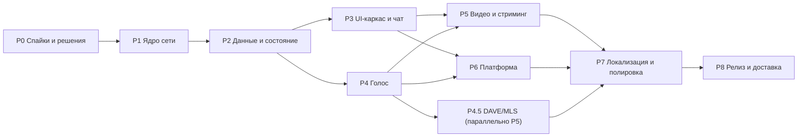

# План разработки Rust-клиента: волны P0–P8

План разбивает создание клиента на волны с тест-первыми карточками. Каждая карточка: **ID** →
задача → DoD → тесты (ID из `TEST-PLAN.md`) → зависимости → размер (S/M/L/XL). Общий принцип —
**strict TDD**: сначала тест (red), затем минимальная реализация (green); конформанс с фикстурами
RE обязателен на каждом уровне. Источники задач — `FEATURES.md`, `../feature-backlog.md`
(R4/R5/R6/D), `../re/`.

> **Как читать с 2026-10-20:** 90 карточек — это не 90 отдельных волн. Рабочая единица —
> batch из 3–6 карточек с одним контрактом и одним gate; календарь, ready-queue и KPI — в
> `WAVE-PLAN.md`. Волновая карта P0–P8 ниже задаёт зависимости, а не последовательность запуска.

## Волновая карта

## Гейты (общие для каждой волны)

1. `cargo test` зелёный; конформанс-тесты против RE-фикстур проходят.
2. `cargo clippy -- -D warnings`, `cargo fmt --check`.
3. Ни одного секрета в логах/дампах (сканер в CI, как `sanitize-jsonl.mjs`).
4. Red-first след: в истории коммитов тест появляется/падает до реализации.
5. Бюджеты производительности из `ARCHITECTURE.md` §9 не деградировали (бенчмарки).

## Сквозной контур качества (Q-01…Q-14)

Каждая волна проходит один и тот же контур; отклонение фиксируется решением TL. Карточки
`Q-*` не входят в счётчик 90 — это уровни приёмки, а не продуктовые фичи.

| ID | Проверка | Артефакт / критерий |
|---|---|---|
| Q-01 | Red-first след | тест падает до реализации; red-лог в `waves/<ID>/` |
| Q-02 | Targeted-тесты модуля | только свои тест-бинарники; зелёный прогон |
| Q-03 | Конформанс с RE-оракулом | независимый артефакт/jq/md5, не текущая реализация |
| Q-04 | Mutation-тестирование | catch rate, survivors/INCONCLUSIVE разобраны |
| Q-05 | Независимое code-review | P0/P1 = 0; P2 закрыты или осознанно отложены |
| Q-06 | Безопасность | секреты, FFI, supply chain, минимальные capabilities |
| Q-07 | Производительность | бюджеты ARCHITECTURE §9 не деградировали |
| Q-08 | Skip-aware | пропуск с причиной; skip не считается pass |
| Q-09 | Restore продукта | md5 после мутаций совпадает с исходным |
| Q-10 | Синхронность доков | `tests/meta/*` зелёные, README/PLAN/TEST-PLAN согласованы |
| Q-11 | Формат/линт/типы | `fmt`, `clippy -D warnings`, `tsc` — 0 |
| Q-12 | Отчёт по шаблону | PROCESS §4.2: сделано, red/green, gate, md5, риски |
| Q-13 | Журнал волн | `waves/db.jsonl` append-only + `waves/STATE.md` |
| Q-14 | Приёмка TL | решение по рискам, обновление счётчика и доков один раз |

## P0 — Спайки и решения (цель: снять технологические риски)

| ID | Задача | DoD | Тесты | Завис. | Размер |
|---|---|---|---|---|---|
| P0-01 | Спайк UI-оболочки (Tauri) | 3 экрана (чат 100k, эмодзи-пикер, настройки) на Tauri; ADR-1 с числами FPS/RAM/сборки; замер резервного нативного тулкита | T-UI-01 | — | L |
| P0-02 | Прототип ETF-кодека | round-trip всех 11 тегов, big-int по спецификации, snowflake-строки | T-ENC-01…03 | — | M |
| P0-03 | Прототип zstd-stream декодера | поток с магией только в кадре 0; кадры 2+ без магии | T-ENC-04 | — | S |
| P0-04 | Скелет конформанс-харнесса | `discord-conformance`: загрузка фикстур из `/home/sanya/re-deep`, запуск из `cargo test` | T-HARN-01…03 | — | M |
| P0-05 | Спайк хранения секретов | keyring на Linux (Secret Service/KWallet), headless-фолбэк | T-SEC-01 | — | S |
| P0-06 | Спайк виртуализации 24k | список 24 229 участников из данных READY: 60 fps | T-UI-02 | P0-01 | M |
| P0-07 | Ревизия правовой рамки | README клиента: ToS, телеметрия off, честный отпечаток | — | — | S |

## P1 — Ядро сети (шлюз, REST, сессия)

| ID | Задача | DoD | Тесты | Завис. | Размер |
|---|---|---|---|---|---|
| P1-01 | ETF-кодек (полный) | все теги + big-int + map/list вложенность; fuzz без паник | T-ENC-01…03, T-ENC-05 | P0-02 | M |
| P1-02 | zstd-поток шлюза | декодер кадров в реальном времени, буферизация | T-ENC-04 | P0-03 | S |
| P1-03 | WS-клиент шлюза | connect, HELLO, heartbeat 41250 мс, ACK, RTT | T-GW-01…03 | P1-02 | M |
| P1-04 | Идентификация | op2 IDENTIFY: поля, свойства, первый READY | T-GW-02, T-GW-04 | P1-03 | M |
| P1-05 | Resume/реконнект | op6 + op7; бесперебойный `s`; тест «разрыв на 3 с» | T-GW-05…07 | P1-04 | M |
| P1-06 | Роутер диспатчей | 21 наблюдаемый тип → типизированные события; неизвестные — в raw-лог | T-GW-08, T-DATA-01 | P1-04 | M |
| P1-07 | REST-клиент | base v9, 6 заголовков, коды, ретраи, таймауты | T-REST-01…03 | — | M |
| P1-08 | Супер-свойства | генератор X-Super-Properties (22 поля), конфигурируемо, политика «честные значения» | T-REST-04 | P1-07 | S |
| P1-09 | Rate-limit и ошибки | 429 → Retry-After; 5xx → бэкофф; 401 → сессия протухла | T-REST-05, T-REST-06 | P1-07 | S |
| P1-10 | Хранилище токена | keyring + вход/выход/смена; скан логов | T-SEC-01…03 | P0-05 | S |
| P1-11 | Телеметрия off | science/beaker/beacon не отправляются (тест сетевого стаба) | T-SEC-04 | P1-07 | S |
| P1-12 | Ack/read-state API | ack {token,last_viewed}; батч-подтверждения | T-REST-07 | P1-07 | S |

## P2 — Данные и состояние

| ID | Задача | DoD | Тесты | Завис. | Размер |
|---|---|---|---|---|---|
| P2-01 | Парсер READY | 40 ключей, гильдии/каналы/роли/эмодзи/стикеры, ЛС, users, read_state (157), relationships (60) | T-DATA-01…03 | P1-06 | L |
| P2-02 | Модель состояния | редьюсер (state,event)→(state,effects); детерминизм по фикстурам | T-DATA-04 | P2-01 | L |
| P2-03 | SQLite-схема + миграции | таблицы из ARCHITECTURE §6; WAL; перезапуск без потерь | T-DATA-05 | — | M |
| P2-04 | Ленивые списки участников | op37-подписки [[0,99]], GUILD_MEMBER_LIST_UPDATE ops sync/insert/update/delete | T-DATA-06, T-GW-09 | P2-02 | L |
| P2-05 | Чанки и догрузка | GUILD_MEMBERS_CHUNK, запросы пресенсов для видимого диапазона | T-DATA-07 | P2-04 | M |
| P2-06 | История и пагинация | GET /messages лимиты; бесшовный скролл; кэш сообщений | T-DATA-08, T-REST-08 | P2-03, P1-07 | L |
| P2-07 | Read-state и бейджи | непрочитанное/mentions; MESSAGE_ACK синхронизация мультиустройств | T-DATA-09 | P2-04 | M |
| P2-08 | Настройки (settings-proto) | декодер протобуфа полей настроек → модель | T-DATA-10 | P2-02 | M |
| P2-09 | Присутствие | статусы, activities, обновления PRESENCE_UPDATE | T-DATA-11 | P2-02 | M |
| P2-10 | Голосовые статусы | участники голосовых каналов, таймеры звонков | T-DATA-12 | P2-02 | S |
| P2-11 | Typing/уведомления состояния | TYPING_START таймауты; счётчики непрочитанного | T-DATA-13 | P2-04 | S |

## P3 — UI-каркас и чат

| ID | Задача | DoD | Тесты | Завис. | Размер |
|---|---|---|---|---|---|
| P3-01 | Каркас окна и навигация | окно, разделители, гильд-рейл, дерево каналов, ЛС-список | T-UI-03…05 | P0-01, P2-02 | L |
| P3-02 | Чат-вью | виртуализация, группировка, день-разделители, embeds, редактирование inline | T-UI-06, T-UI-07 | P3-01, P2-06 | XL |
| P3-03 | Отправка сообщений | composer, Enter, markdown-разметка, меншены/эмодзи, оптимистичная отправка | T-MSG-01, T-MSG-02 | P3-02 | L |
| P3-04 | Вложения | drag&drop, upload с прогрессом, превью, плеер изображений/видео | T-MSG-03, T-MEDIA-06 | P3-03 | L |
| P3-05 | Реакции | пикер, счётчики, кто поставил; список реакций | T-MSG-04 | P3-02 | M |
| P3-06 | Меню сообщения | контекстное меню, правка/удаление/копирование/ответ | T-MSG-05 | P3-02 | M |
| P3-07 | Ответы и треды | reply-цитаты, панель треда, THREAD_LIST_SYNC | T-MSG-06, T-MSG-07 | P3-02 | L |
| P3-08 | Список участников | виртуализация, группы роль/статус, поиск по участникам | T-UI-08 | P0-06, P2-04 | L |
| P3-09 | Поиск-оверлей | 7 фильтров, сортировка, результаты, прыжок к сообщению | T-SRCH-01…03 | P3-02, P1-07 | L |
| P3-10 | Эмодзи-пикер | 3 вкладки, 10 категорий, частые, поиск | T-UI-09 | P3-03 | M |
| P3-11 | QuickSwitcher | Ctrl+K, fuzzy по каналам/ЛС/гильдиям | T-UI-10 | P3-01 | S |
| P3-12 | Компоненты (12 контрактов) | кнопки/инпуты/меню/поповеры/модалки/тумблеры/слайдеры/аватары/бейджи/скроллеры/тултипы | T-UI-11…14 | P0-01 | L |
| P3-13 | Токены и темы | dark/light, cozy/compact, дизайн-токены из 5132 переменных | T-UI-15 | P3-12 | M |
| P3-14 | Звуки и шорткаты | 15 звуков событий; Ctrl+F/E, Esc, стрелки | T-UI-16, T-UI-17 | P3-01 | S |
| P3-15 | I18N-рантайм (база) | ключ xxh64→base64[0..6], выбор локали, en+ru, rich-разметка базово | T-I18N-01…03 | — | M |
| P3-16 | Настройки UI | категории, «Голос и видео» (каркас), язык, уведомления | T-UI-18 | P3-12 | M |

## P4 — Голос

| ID | Задача | DoD | Тесты | Завис. | Размер |
|---|---|---|---|---|---|
| P4-01 | Сигнализация RTC | op0/1/2/4, выбор региона, VOICE_SERVER_UPDATE→endpoint | T-VOICE-01…03 | P1-06 | L |
| P4-02 | UDP-транспорт | discovery 74 Б (порт BE@72), keepalive 5 с, ротация +60 с | T-VOICE-04…06 | P4-01 | M |
| P4-03 | SRTP-крипта | режимы aes256-gcm/xchacha, tag16, tail4 LE, AAD; Юнит на эталонные байты | T-VOICE-07, T-VOICE-08 | P4-02 | L |
| P4-04 | Opus-конвейер | encode/decode 48 кГц, RTP PT120, джиттер-буфер, DTX/CN | T-VOICE-09…11 | P4-03 | L |
| P4-05 | Устройства и PTT | выбор in/out, hot-plug, 38 тумблеров, глобальный хоткей PTT | T-VOICE-12…14 | P4-04 | L |
| P4-06 | Mute/deafen/speaking | управление собой, индикаторы, событийная модель | T-VOICE-15 | P4-04 | M |
| P4-07 | Статистика | RTT, потери/джиттер из RTCP (свой парсер), окно статистики | T-VOICE-16 | P4-04 | M |
| P4-08 | Шумоподавление | RNNoise-совместимое, уровни, отключаемо | T-VOICE-17 | P4-04 | M |
| P4-09 | Soundboard | SOUNDBOARD_SOUNDS, воспроизведение в канал | T-VOICE-18 | P4-04 | S |
| P4-10 | Кириллица имён/ролей в голосе | корректные строки из voice state | — | P4-06 | S |
| P4-11 | Регионы/латентность | UDP-зонды, ранжирование, ручной выбор | T-VOICE-19 | P4-01 | M |
| P4-12 | Устойчивость | сеть/смена устройств/свернутое окно; авто-rejoin | T-VOICE-20 | P4-04 | M |

## P4.5 — DAVE/MLS (параллельно P5)

| ID | Задача | DoD | Тесты | Завис. | Размер |
|---|---|---|---|---|---|
| P45-01 | MLS-фрейминг | Welcome/Commit/App поверх медиа-канала, пороговые версии | T-VOICE-21 | P4-04 | L |
| P45-02 | Интеграция openmls | групповые ключи на канал, ротация участников | T-VOICE-22 | P45-01 | L |
| P45-03 | Интероп-тест | два собственных клиента слышат друг друга под E2EE; состояние op4 v1 | T-VOICE-23 | P45-02 | L |

## P5 — Видео и стриминг

| ID | Задача | DoD | Тесты | Завис. | Размер |
|---|---|---|---|---|---|
| P5-01 | Захват экрана | PipeWire (Wayland)/X11, окно/монитор/регион, превью | T-MEDIA-01 | P0-01 | L |
| P5-02 | Видео-энкод | H.264/AV1 через vaapi/vulkan; ключевые кадры, битрейт | T-MEDIA-02 | P5-01 | L |
| P5-03 | RTP-видео | rid/quality (SP-потоки), mux опционально, rtx | T-MEDIA-03 | P5-02, P4-03 | L |
| P5-04 | Go Live | streams[{type:video,rid:100,quality:100}], зрители, качество | T-MEDIA-04 | P5-03 | M |
| P5-05 | Камера | v4l2, локальное превью, микрофон отдельно | T-MEDIA-05 | P5-02 | M |
| P5-06 | Системный звук | PipeWire monitor/venmic-аналог | T-MEDIA-07 | P5-01 | M |
| P5-07 | Декод видео зрителей | участники-видео, рисуются в звонке/попауте | T-MEDIA-08 | P5-04 | L |

## P6 — Платформа

| ID | Задача | DoD | Тесты | Завис. | Размер |
|---|---|---|---|---|---|
| P6-01 | Трей и фоновый режим | иконка, меню, закрытие в трей, мигание | T-SYS-01 | P3-01 | M |
| P6-02 | Уведомления | D-Bus notify, действия, DND; Linux — своя реализация | T-SYS-02 | P6-01 | M |
| P6-03 | Бейдж и автозапуск | Unity badge, XDG autostart, старт свёрнутым | T-SYS-03 | P6-01 | S |
| P6-04 | Deep links | discord://, single-instance, маршрутизация | T-SYS-04 | P6-01 | M |
| P6-05 | Буфер и вставка медиа | текст/картинки, paste→upload | T-SYS-05 | P3-04 | S |
| P6-06 | Питание и idle | ингибиторы в звонке; idle→статус (Wayland/X11) | T-SYS-06 | P4-06 | M |
| P6-07 | Spellcheck | hunspell, подчёркивание, замена | T-SYS-07 | P3-03 | M |
| P6-08 | Выразительность | стикеры, GIF, опросы, кастомный статус | T-MSG-08…10 | P3-02 | M |
| P6-09 | Сессии/мультиокна | SESSIONS_REPLACE, попауты каналов/видео | T-SYS-08 | P3-01 | M |
| P6-10 | Смена/выход аккаунта | очистка кэшей, переподключение | T-SYS-09 | P1-10 | S |

## P7 — Локализация и полировка

| ID | Задача | DoD | Тесты | Завис. | Размер |
|---|---|---|---|---|---|
| P7-01 | Полный I18N | 36 локалей (31 каталог есть), плурализация CLDR+`=N`, 23 правила, fallback | T-I18N-04…08 | P3-15 | L |
| P7-02 | Производительность | 24k членов, 100k сообщений, холодный старт ≤1,5 с на референсе | T-HARN-04, T-UI-19 | P3, P4 | L |
| P7-03 | Доступность | фокус, роли, скринридер-база по компонентам | T-UI-20 | P3-12 | M |
| P7-04 | Полнота API | quests/entitlements/library/promotions (отображение), saved messages | T-REST-09 | P1-07 | M |
| P7-05 | Клипы/мультиокна/хвосты | F-MEDIA-07, F-SYS-11…12 | T-SYS-10 | P6 | M |
| P7-06 | WebAuthn/MFA-ключи | регистрация/аутентификация ключей | T-SEC-05 | P1-10 | M |
| P7-07 | Полировка UX | анимации, пустые состояния, ошибки, скелетоны | T-UI-21 | P3 | M |

## P8 — Релиз и доставка

| ID | Задача | DoD | Тесты | Завис. | Размер |
|---|---|---|---|---|---|
| P8-01 | Свой updater | манифест+Ed25519, staged-замена, откат | T-SYS-11 | P7 | L |
| P8-02 | Пакеты | Flatpak, AppImage, deb; иконки/desktop-файл | T-HARN-05 | P7 | M |
| P8-03 | CI | сборка×тесты×clippy×deny×бенчмарки; релизные артефакты | T-HARN-06 | — | M |
| P8-04 | Воспроизводимость и лицензии | `cargo deny` чист; SBOM | T-HARN-07 | P8-03 | S |
| P8-05 | Кроссплатформа | Windows/macOS: аудио, трей, хоткеи (после Linux) | T-SYS-12 | P7 | XL |

## Соответствие прежним бэклогам

| Прежний пункт (`../feature-backlog.md`) | Где в плане |
|---|---|
| R4 — платформенные интеграции (трей/уведомления/deep links/updater) | P6, P8 |
| R5 — стриминг видео/звука (venmic, GPU, AV1) | P5, P6-08 |
| R6 — голосовая инженерка (звонки) | P4 |
| D-01…D-03 (закрыты волной R7) | входные данные P1–P3 |
| D-04…D-08 (открыты) | P4 (D-04/05/07), P5 (D-06/08) — см. статусы в `../feature-backlog.md` |

## Риск-план (сокращённый)

| Риск | Триггер | Реакция |
|---|---|---|
| UI-оболочка не тянет (Tauri/WebView) | провал T-UI-01/02 | нативный резерв (iced/Slint), повторный спайк |
| DAVE/MLS не сходится | T-VOICE-23 красный к концу P4.5 | выпуск «E2EE-бета», гейт полного релиза не снимается |
| 43-байтные talkspurt и закрытые тела RTCP | P4-07/08 | помечены как unknown; собственный расчёт статистики из заголовков |
| Блокировки/429 на живом аккаунте | P1-09 | тесты только на стабах; живой аккаунт — ручной smoke |
| Юридический | всегда | лицензия/README, свои ассеты, телеметрия off |
