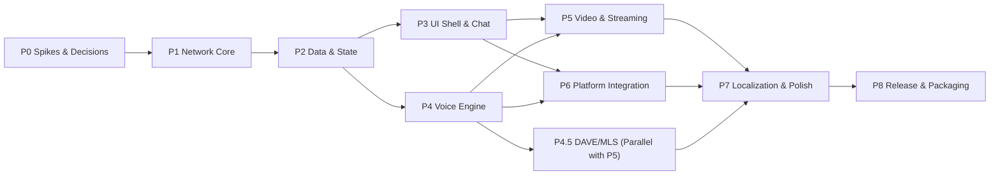

# Rust Client Development Plan: Waves P0–P8

The plan decomposes client development into iterative waves structured around test-first task cards. Each card defines: **ID** -> Task description -> DoD (Definition of Done) -> Verification Tests (IDs from `TEST-PLAN.md`) -> Dependencies -> Size (S/M/L/XL). The core engineering principle is **strict TDD**: test first (red), then minimal implementation (green); cleanroom conformance against fixtures is mandatory at every level. Task sources include `FEATURES.md`, `../feature-backlog.md` (R4/R5/R6/D), and `../re/`.

> **Note on Execution:** 90 cards do not represent 90 isolated waves. The operational unit is a batch of 3–6 cards with a frozen contract and a single integrated gate; scheduling, ready queue, and KPIs are defined in `WAVE-PLAN.md`. The wave map below defines architectural dependencies rather than strict chronological execution order.

## Wave Dependency Map

## Quality Gates (Universal across all waves)

1. `cargo test` is green; conformance tests against cleanroom fixtures pass.
2. `cargo clippy -- -D warnings` and `cargo fmt --check` pass cleanly.
3. Zero credentials or sensitive data in logs/dumps (automated CI scanning).
4. Red-first verification: test committed or verified failing prior to green implementation.
5. Performance budgets from `ARCHITECTURE.md` §9 do not regress (benchmarking).

## Quality Contour (Q-01…Q-14)

Each wave executes through this standardized quality contour; exceptions require explicit Lead sign-off. `Q-*` stages represent verification gates rather than individual product feature cards.

| ID | Quality Verification Gate | Artifact / Acceptance Criteria |
|---|---|---|
| Q-01 | Red-first trace | Test fails before implementation; red log saved in `waves/<ID>/` |
| Q-02 | Targeted module tests | Targeted test binaries pass cleanly with zero unrelated runs |
| Q-03 | Cleanroom oracle conformance | Verified against independent oracle/jq/sha256 rather than current code |
| Q-04 | Mutation testing | Catch rate >= 80%, surviving mutants and INCONCLUSIVE triaged |
| Q-05 | Independent code review | Zero P0/P1 defects; P2 resolved or explicitly backlogged |
| Q-06 | Security & boundaries | Credential redaction, safe FFI, verified supply chain, minimal capabilities |
| Q-07 | Performance budgets | Memory and frame rate budgets in ARCHITECTURE §9 maintained |
| Q-08 | Skip-aware isolation | Environmental skips logged with reason; skips never count as passes |
| Q-09 | Clean restoration | Codebase sha256 restored exactly after mutation injection |
| Q-10 | Documentation synchronization | Meta-tests `tests/meta/*` green; README/PLAN/TEST-PLAN aligned |
| Q-11 | Formatting, linter, types | Clean `cargo fmt`, `clippy -D warnings`, `tsc` typecheck |
| Q-12 | Structured wave report | PROCESS §4.2 format: summary, red/green, gate, sha256, residual risks |
| Q-13 | Wave history ledger | Append-only event in `waves/db.jsonl` + updated `waves/STATE.md` |
| Q-14 | Lead acceptance | Risk sign-off, single consolidated documentation update |

## P0 — Spikes & Decisions (Goal: Mitigate architectural and technology risks)

| ID | Task | DoD | Tests | Dependencies | Size |
|---|---|---|---|---|---|
| P0-01 | UI Shell Spike (Tauri/GPUI) | 3 screens (100k chat, emoji picker, settings); ADR-1 with FPS/RAM/build metrics; evaluate native fallback | T-UI-01 | — | L |
| P0-02 | ETF Codec Prototype | Full round-trip of 11 wire tags, big-int specification, snowflake string IDs | T-ENC-01…03 | — | M |
| P0-03 | zstd Stream Decoder Prototype | Continuous stream decoder with magic header only in frame 0; frame 2+ without magic | T-ENC-04 | — | S |
| P0-04 | Conformance Harness Skeleton | `discord-conformance`: load cleanroom fixtures from `clean-room-oracle/`, execute in `cargo test` | T-HARN-01…03 | — | M |
| P0-05 | Credential Storage Spike | Linux Keyring (Secret Service / KWallet), headless encrypted fallback | T-SEC-01 | — | S |
| P0-06 | 24k Member Virtualization Spike | Render 24,229 members from READY capture: maintain 60 fps scroll | T-UI-02 | P0-01 | M |
| P0-07 | Legal Framework Review | Client README: ToS disclaimers, telemetry disabled by default, honest fingerprint | — | — | S |

## P1 — Network Core (Gateway, REST, Session)

| ID | Task | DoD | Tests | Dependencies | Size |
|---|---|---|---|---|---|
| P1-01 | Complete ETF Codec | All tags + big-int + nested map/list support; fuzz target with zero panics | T-ENC-01…03, T-ENC-05 | P0-02 | M |
| P1-02 | Gateway zstd Stream | Real-time frame decompressor, bounded circular buffers | T-ENC-04 | P0-03 | S |
| P1-03 | Gateway WebSocket Client | Connect lifecycle, HELLO, 41,250 ms heartbeat, ACK handling, RTT tracking | T-GW-01…03 | P1-02 | M |
| P1-04 | Session Identification | Opcode 2 IDENTIFY: handshake fields, client properties, initial READY reception | T-GW-02, T-GW-04 | P1-03 | M |
| P1-05 | Resume & Reconnect | Opcode 6 RESUME + opcode 7 RECONNECT; gapless sequence `s`; 3s disconnect recovery | T-GW-05…07 | P1-04 | M |
| P1-06 | Dispatch Event Router | 21 observed event types mapped to typed Rust enums; unhandled events preserved in raw logs | T-GW-08, T-DATA-01 | P1-04 | M |
| P1-07 | REST Client Foundation | Base v9 API, 6 canonical headers, status code parsing, backoff retries, timeouts | T-REST-01…03 | — | M |
| P1-08 | Super Properties Generator | Generates 22-field `X-Super-Properties` payload; configurable; honest client policy | T-REST-04 | P1-07 | S |
| P1-09 | Rate Limiting & Error Policies | HTTP 429 respects `Retry-After`; 5xx backoff; 401 session expiration handling | T-REST-05, T-REST-06 | P1-07 | S |
| P1-10 | Secure Token Storage | Keyring integration + login/logout/switch flows; memory sanitization; secret scanning | T-SEC-01…03 | P0-05 | S |
| P1-11 | Telemetry Opt-Out | Zero requests dispatched to `/science`, `/beaker`, or `/beacon` endpoints | T-SEC-04 | P1-07 | S |
| P1-12 | Message Acknowledgement API | Endpoint `ack` {token, last_viewed}; batched read state updates | T-REST-07 | P1-07 | S |

## P2 — Data & State Management

| ID | Task | DoD | Tests | Dependencies | Size |
|---|---|---|---|---|---|
| P2-01 | READY Event Parser | 40 top-level keys parsed: guilds, channels, roles, emojis, stickers, DMs, users, read_state, relationships | T-DATA-01…03 | P1-06 | L |
| P2-02 | State Container & Reducer | Deterministic state machine: (state, event) -> (state, effects); fixture validated | T-DATA-04 | P2-01 | L |
| P2-03 | SQLite Schema & Migrations | Relational tables from ARCHITECTURE §6; WAL mode; lossless restart | T-DATA-05 | — | M |
| P2-04 | Lazy Member List Subscriptions | Opcode 37 lazy subscriptions `[[0, 99]]`; GUILD_MEMBER_LIST_UPDATE ops (SYNC, INSERT, UPDATE, DELETE) | T-DATA-06, T-GW-09 | P2-02 | L |
| P2-05 | Member Chunking | GUILD_MEMBERS_CHUNK handling, on-demand presence retrieval for visible viewport | T-DATA-07 | P2-04 | M |
| P2-06 | Message History & Pagination | GET `/messages` pagination bounds; infinite scroll backfill; message cache | T-DATA-08, T-REST-08 | P2-03, P1-07 | L |
| P2-07 | Read State & Mention Badges | Unread calculation and mention tracking; multi-client MESSAGE_ACK sync | T-DATA-09 | P2-04 | M |
| P2-08 | User Settings Protobuf Decoder | Protobuf decoder for Discord user settings payload -> typed settings struct | T-DATA-10 | P2-02 | M |
| P2-09 | Presence Tracking | User presence statuses, activities, custom status, PRESENCE_UPDATE handler | T-DATA-11 | P2-02 | M |
| P2-10 | Voice Channel States | Voice channel participant rosters, active call duration timers | T-DATA-12 | P2-02 | S |
| P2-11 | Typing Indicators & Notifications | TYPING_START timeout handling; unread badge counters | T-DATA-13 | P2-04 | S |

## P3 — UI Shell & Chat

| ID | Task | DoD | Tests | Dependencies | Size |
|---|---|---|---|---|---|
| P3-01 | Application Window & Shell | Window frame, splitters, server rail, channel tree, direct messages roster | T-UI-03…05 | P0-01, P2-02 | L |
| P3-02 | Chat Message View | Virtualized list, message grouping, date dividers, rich embeds, inline editing | T-UI-06, T-UI-07 | P3-01, P2-06 | XL |
| P3-03 | Message Composer | Composer text area, Enter to send, Markdown rendering, mentions/emojis, optimistic UI | T-MSG-01, T-MSG-02 | P3-02 | L |
| P3-04 | Attachments Handling | Drag-and-drop file upload with progress bar, image/video preview players | T-MSG-03, T-MEDIA-06 | P3-03 | L |
| P3-05 | Reactions Engine | Reaction picker, count badges, user reaction list modal | T-MSG-04 | P3-02 | M |
| P3-06 | Message Context Menu | Context menu actions: edit, delete, copy text, quote reply, pin | T-MSG-05 | P3-02 | M |
| P3-07 | Thread Replies & Sidebars | Quote replies, thread side panel, THREAD_LIST_SYNC integration | T-MSG-06, T-MSG-07 | P3-02 | L |
| P3-08 | Member Roster Panel | Virtualized list, role-based grouping, online/offline sorting, member search | T-UI-08 | P0-06, P2-04 | L |
| P3-09 | Search Overlay Panel | 7 search filter tokens, sorting, result list, jump to message context | T-SRCH-01…03 | P3-02, P1-07 | L |
| P3-10 | Emoji Picker Modal | 3 tabs (emojis, stickers, GIFs), 10 categories, frequently used, search filter | T-UI-09 | P3-03 | M |
| P3-11 | Quick Switcher (Ctrl+K) | Global QuickSwitcher, fuzzy search over channels, DMs, and servers | T-UI-10 | P3-01 | S |
| P3-12 | UI Design System Components | 12 core components: buttons, inputs, menus, popovers, modals, switches, sliders, avatars, badges, scrollbars, tooltips | T-UI-11…14 | P0-01 | L |
| P3-13 | Theme Tokens & Modes | Dark/light themes, compact/cozy density, CSS tokens mapped from 5,132 design variables | T-UI-15 | P3-12 | M |
| P3-14 | Sound Effects & Shortcuts | 15 event audio cues; global keyboard shortcuts (Ctrl+F, Ctrl+E, Esc, arrow navigation) | T-UI-16, T-UI-17 | P3-01 | S |
| P3-15 | I18N Runtime Foundation | Translation lookup by xxh64 -> base64[0..6] key, locale switcher, en-US + ru catalogs | T-I18N-01…03 | — | M |
| P3-16 | Settings Interface | Settings categories dialog, Voice & Video tab, Language tab, Notifications tab | T-UI-18 | P3-12 | M |

## P4 — Voice Engine

| ID | Task | DoD | Tests | Dependencies | Size |
|---|---|---|---|---|---|
| P4-01 | RTC Signaling Protocol | Voice opcodes 0/1/2/4, voice region selection, VOICE_SERVER_UPDATE -> endpoint connection | T-VOICE-01…03 | P1-06 | L |
| P4-02 | UDP Voice Transport | IP discovery (74-byte packet, port BE@72), 5-second keepalive, 60-second port rotation | T-VOICE-04…06 | P4-01 | M |
| P4-03 | SRTP Audio Encryption | Modes AES-256-GCM and XChaCha20-Poly1305, 16-byte tag, 4-byte LE tail; test vectors | T-VOICE-07, T-VOICE-08 | P4-02 | L |
| P4-04 | Opus Audio Pipeline | 48 kHz Opus encoder/decoder, RTP PT120 formatting, adaptive jitter buffer, DTX | T-VOICE-09…11 | P4-03 | L |
| P4-05 | Audio Devices & PTT | Input/output device enumeration, hotplug detection, volume sliders, global Push-to-Talk hotkey | T-VOICE-12…14 | P4-04 | L |
| P4-06 | Mute, Deafen & Speaking | Self mute/deafen states, speaking state indicators, voice event callbacks | T-VOICE-15 | P4-04 | M |
| P4-07 | RTCP Diagnostics & Metrics | RTT estimation, packet loss/jitter parsing from RTCP packets, diagnostics overlay | T-VOICE-16 | P4-04 | M |
| P4-08 | Noise Suppression | RNNoise-compatible noise cancellation filter with intensity presets | T-VOICE-17 | P4-04 | M |
| P4-09 | Soundboard Integration | SOUNDBOARD_SOUNDS dispatch, soundboard audio mixing into voice stream | T-VOICE-18 | P4-04 | S |
| P4-10 | Unicode Usernames in Voice | Proper rendering of Cyrillic and international names in voice call overlays | — | P4-06 | S |
| P4-11 | Region Latency Probing | UDP latency probes across voice regions, optimal region selection | T-VOICE-19 | P4-01 | M |
| P4-12 | Voice Connection Resilience | Automatic voice reconnect on network loss, device disconnect, or window sleep | T-VOICE-20 | P4-04 | M |

## P4.5 — DAVE / MLS (Parallel with P5)

| ID | Task | DoD | Tests | Dependencies | Size |
|---|---|---|---|---|---|
| P45-01 | MLS Framing Layer | Welcome, Commit, and Application messages over voice media channel; protocol versioning | T-VOICE-21 | P4-04 | L |
| P45-02 | OpenMLS Integration | Group key generation per channel, participant key rotation on join/leave | T-VOICE-22 | P45-01 | L |
| P45-03 | E2EE Interoperability Test | Loopback and cross-client audio encrypted under MLS; voice opcode 4 version 1 | T-VOICE-23 | P45-02 | L |

## P5 — Video & Screen Streaming

| ID | Task | DoD | Tests | Dependencies | Size |
|---|---|---|---|---|---|
| P5-01 | Screen Capture Engine | PipeWire (Wayland) and X11 capture, window/monitor selection, live preview | T-MEDIA-01 | P0-01 | L |
| P5-02 | Hardware Video Encoder | H.264/AV1 hardware encoding via VA-API / Vulkan; keyframe management, dynamic bitrate | T-MEDIA-02 | P5-01 | L |
| P5-03 | RTP Video Packetizer | RID/quality stream multiplexing, RTX retransmissions | T-MEDIA-03 | P5-02, P4-03 | L |
| P5-04 | Go Live Stream Broadcasting | Stream announcements `streams[{type: video, rid: 100}]`, viewer count tracking | T-MEDIA-04 | P5-03 | M |
| P5-05 | Webcam Capture Pipeline | V4L2 webcam capture, local preview pane, audio-video synchronization | T-MEDIA-05 | P5-02 | M |
| P5-06 | System Audio Loopback | Desktop audio loopback via PipeWire monitor source | T-MEDIA-07 | P5-01 | M |
| P5-07 | Inbound Video Decoding | Multiple participant video stream decoding and rendering in call layout | T-MEDIA-08 | P5-04 | L |

## P6 — Platform Integration

| ID | Task | DoD | Tests | Dependencies | Size |
|---|---|---|---|---|---|
| P6-01 | System Tray & Background Mode | Tray icon, context menu, minimize to tray, unread indicator flash | T-SYS-01 | P3-01 | M |
| P6-02 | Native Desktop Notifications | D-Bus Desktop Notifications specification (`org.freedesktop.Notifications`), actions, DND mode | T-SYS-02 | P6-01 | M |
| P6-03 | Application Badges & Autostart | Desktop launcher unread badges, XDG autostart entry, `--start-minimized` flag | T-SYS-03 | P6-01 | S |
| P6-04 | Deep Link Protocol Handler | `discord://` URI scheme registration, single-instance IPC forwarding | T-SYS-04 | P6-01 | M |
| P6-05 | Clipboard Media Integration | Paste images/files directly into composer, clipboard upload | T-SYS-05 | P3-04 | S |
| P6-06 | Power Management & Idle Detection | System sleep inhibitor while in voice call; idle state detection (Wayland/X11) | T-SYS-06 | P4-06 | M |
| P6-07 | Native Spellchecking | Hunspell FFI integration, wavy red underlines, spellcheck correction popup | T-SYS-07 | P3-03 | M |
| P6-08 | Rich Expression Elements | Custom stickers, GIF search, native polls engine, custom status editor | T-MSG-08…10 | P3-02 | M |
| P6-09 | Multi-Window Popouts | Detachable video/stream windows, channel popout windows | T-SYS-08 | P3-01 | M |
| P6-10 | Account Switcher & Logout | Cache purging on logout, instant multi-account switcher | T-SYS-09 | P1-10 | S |

## P7 — Localization & Polish

| ID | Task | DoD | Tests | Dependencies | Size |
|---|---|---|---|---|---|
| P7-01 | Complete Internationalization (I18N) | 36 language catalogs, CLDR pluralization rules (`=N`, zero, one, two, few, many, other) | T-I18N-04…08 | P3-15 | L |
| P7-02 | Performance & Memory Hardening | 24k member render, 100k messages scrolling, cold startup <= 1.5s on benchmark machine | T-HARN-04, T-UI-19 | P3, P4 | L |
| P7-03 | Accessibility Compliance (A11y) | Keyboard navigation, ARIA roles, AT-SPI screen reader accessibility audit | T-UI-20 | P3-12 | M |
| P7-04 | Extended REST API Surface | Quests, entitlements, library games catalog, saved messages | T-REST-09 | P1-07 | M |
| P7-05 | Media Clips & Window Popouts | In-game clip recordings, popout player state sync | T-SYS-10 | P6 | M |
| P7-06 | WebAuthn & Security Keys | Hardware security key (FIDO2) registration and authentication for 2FA | T-SEC-05 | P1-10 | M |
| P7-07 | UX Polish & Animations | Smooth transition animations, empty states, error fallbacks, skeleton screens | T-UI-21 | P3 | M |

## P8 — Release & Packaging

| ID | Task | DoD | Tests | Dependencies | Size |
|---|---|---|---|---|---|
| P8-01 | In-App Auto-Updater | Ed25519 signature verification, staged binary replacement, automatic rollback | T-SYS-11 | P7 | L |
| P8-02 | Package Distribution Formats | Flatpak manifest, AppImage bundle, Debian `.deb`, Arch PKGBUILD, desktop entry | T-HARN-05 | P7 | M |
| P8-03 | Automated CI/CD Pipeline | Full multi-stage build: test, clippy, deny, benchmark, artifact generation | T-HARN-06 | — | M |
| P8-04 | SBOM & License Compliance | `cargo-deny` clean audit; automated Software Bill of Materials (SBOM) | T-HARN-07 | P8-03 | S |
| P8-05 | Multi-Platform Portability | Windows and macOS platform backends: audio devices, tray, global hotkeys | T-SYS-12 | P7 | XL |

## Backlog Mapping

| Previous Backlog Area (`../feature-backlog.md`) | Plan Wave Location |
|---|---|
| R4 — Platform integrations (tray, notifications, deep links, updater) | P6, P8 |
| R5 — Video & Audio Streaming (PipeWire, GPU, AV1) | P5, P6-08 |
| R6 — Voice Engineering (calls, signaling, jitter) | P4 |
| D-01…D-03 (Closed in Wave R7) | Baseline inputs for P1–P3 |
| D-04…D-08 (Open research items) | P4 (D-04/05/07), P5 (D-06/08) |

## Risk Mitigation Matrix

| Identified Risk | Trigger Condition | Mitigation Strategy |
|---|---|---|
| UI shell performance ceiling | Failure of T-UI-01 or T-UI-02 benchmarks | Migrate to pure native GPU renderer (GPUI / WGPU) |
| DAVE / MLS protocol divergence | T-VOICE-23 fails during P4.5 | Release labeled as "E2EE Beta"; preserve standard SRTP fallback |
| RTCP opaque payload structures | P4-07 / P4-08 diagnostics mismatch | Compute loss/jitter statistics from standard RTP/RTCP headers |
| Account rate limiting / 429 | P1-09 testing | Test exclusively against mock servers; live accounts used only for manual smoke tests |
| Proprietary asset infringement | Always | Cleanroom open-source assets, custom icons, telemetry disabled |
