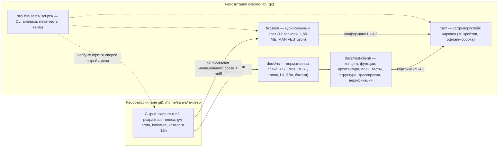

# Строение объединённого проекта (RE + Rust-клиент)

Структура, в которой результаты обратной разработки Discord **соединены** с планом и каркасом
Rust-клиента в один проект. Зафиксирована волной RC (карточки RC-07/RC-08, `TASKS.md` §RC).

## 1. Три опоры

| Опора | Где живёт | В git | Роль |
|---|---|---|---|
| **Лаборатория** | `/home/sanya/re-deep` (1,7 ГБ, 22 072 файла) | нет | Единственное место сырья: захваты, pcap, strace, дампы, каталоги локалей |
| **Репозиторий** | этот git-репозиторий | да | Нормативная спека (`docs/`), курированные фикстуры (`fixtures/`), каркас (`rust/`), инструменты (`src/`, `bin/`, `tests/`) |
| **План-пакет** | `docs/rust-client/` | да | Концепт, функции, архитектура, P0–P8, тесты, структура, трассировка, верификация |



## 2. Дерево

```
discord-lab/                         (git-репозиторий)
├─ docs/
│  ├─ map.md                         карта проекта, слои 1–8 (Mermaid)
│  ├─ re/                            спека R7: 26 файлов + JSON-доказательства
│  ├─ rust-client/                   пакет плана Rust-клиента
│  │  ├─ CONCEPT.md  FEATURES.md  ARCHITECTURE.md  PLAN.md  TEST-PLAN.md
│  │  ├─ PROJECT-STRUCTURE.md        (этот файл)
│  │  ├─ TRACEABILITY.md             функции → спека → фикстуры → тесты
│  │  ├─ VERIFICATION.md             журнал сверки сырья с документами
│  │  └─ verify/
│  │     ├─ verify-re.mjs            оракул: 20 автоматических проверок
│  │     └─ report.json              машинный отчёт последнего прогона
│  └─ feature-backlog.md             карточки R4/R5/R6/D (41)
├─ fixtures/                         курированные конформанс-фикстуры (git)
│  ├─ MANIFEST.json                  провенанс: источник, md5, назначение, тесты
│  ├─ tools/make-fixtures.mjs        сборщик: копирование + санитизация + манифест
│  ├─ gateway/{by-type/×164, ready-stats, summary}
│  ├─ gw-proto/{facts-frozen, msgs-run2-…-13072}
│  ├─ rest/rest-static.json
│  ├─ i18n/i18n-stats.json
│  └─ voice/{rtc*-frames, rtc*-summary, session3.timing}
├─ rust/                             каркас нативного клиента (P0)
│  ├─ Cargo.toml                     workspace: crates/*
│  └─ crates/{discord-codec, -core, -store, -voice, -media,
│             -platform, -i18n, -ui, -app, -conformance}
├─ waves/                            журнал волн: db.jsonl + STATE.md + логи RW-01…RW-07
├─ src/ bin/ scripts/ tests/         CLI discord-lab + мета-тесты + гейты
└─ logs/ functions/ evidence/        golden: только чтение

/home/sanya/re-deep/                 лаборатория (вне git)
├─ capture-run2.jsonl  9,4 МБ        санитизированный захват WS/REST
├─ gateway/ 164×by-type, схема       декод шлюза (D-01)
├─ gw-proto/ 1544 кадра, facts       ETF/zstd-разбор (7 сокетов)
├─ d02-snapshot/                     снимки REST D-02 (md5-провенанс)
├─ rest-static.json 904 эндпоинта    реестр веб-бандла
├─ voice/ pcap, strace, RTC, движок  голос: сигнализация + UDP + ротация
├─ i18n-* / ru|en-catalog / locale-*  локали: 36 кодов, включено 31
├─ native-re.json 9 модулей          нативные .node + md5/sha256
├─ backend-ipc.json 168 каналов      бэкенд main-процесса
├─ ui*/ decoded/                     UI-трассы и декоды экранов
├─ flatpak-hits/ nm/ cc-text/        статические находки по сборке
└─ README.md                         индекс лаборатории
```

## 3. Правила раскладки

1. **Сырьё — только в лаборатории.** Никакие новые захваты/pcap/дампы в git не попадают;
   в репозитории допустимы лишь JSON-сводки доказательств (`docs/re/*.json`).
2. **Нормативные выводы — в `docs/`** с ссылкой на артефакт-источник (файл + строка/поле).
   Числа в документах обязаны воспроизводиться из сырья (см. `verify-re.mjs`).
3. **Тестовый срез — в `fixtures/`**: только санитизированные файлы, только с записью
   в `MANIFEST.json` (источник, размер, md5, назначение, T-ID). Бюджет — единицы МБ.
   Сборка — `fixtures/tools/make-fixtures.mjs`: вырезает значения чувствительных ключей
   (`analytics_token`, `session_id` и др. → `REDACTED`) и сканирует набор на токены.
4. **Код — в `rust/`** (каркас и развитие по P0–P8). Крейты не пересекают границы из
   `ARCHITECTURE.md` §2; UI-оболочка — Tauri (ADR-1; спайк P0-01 уточняет метрики).
5. **Golden-каталоги** (`logs/`, `functions/`, `evidence/`) — только чтение, вне волн.
6. **Секреты не сохраняются нигде**: токены/сессии → `REDACTED`, публичные IP → `<PUB_IP>`,
   бинарные исходящие WS-кадры → sha256 (`docs/re/README.md`).
7. **Журнал волн — `waves/`** (в git): `db.jsonl` (append-only события схемы v1), `STATE.md`
   (где остановились), артефакты `RW-XX/` (ТЗ, red/green, отчёт, копии тестов). Бинарники,
   сборки и сырьё — не в журнал (лаборатория `/home/sanya/re-deep/` или `/tmp`-черновики).

## 4. Проверки (как убедиться, что всё сходится)

```sh
node docs/rust-client/verify/verify-re.mjs --write   # 20 сверок сырьё↔доки (код 0/1/2)
node fixtures/tools/make-fixtures.mjs                # пересборка фикстур (копирование + санитизация)
cd rust && cargo test --offline                      # каркас: 10 крейтов, офлайн
npm run check                                        # Node-тесты + мета-контроль
npm run gate:worker                                  # гейт воркера (перед отчётом)
```

- `verify-re.mjs` — оракул расхождений: md5 снапшотов, счётчики READY, кадры gw-proto,
  ETF-теги, REST, i18n, IPC, нативные модули, RTC-опы, санитизация, целостность `fixtures/`.
- `tests/meta/rust-client-sync.test.mjs` — стережёт структуру пакета, фикстуры и каркас
  (краснеет при расползании).
- `docs/rust-client/VERIFICATION.md` — журнал прогона и разбор расхождений.

## 5. Дальше

- P0-02: зависимости воркспейса (tokio/winit/zstd/keyring…) — с проверкой сети/лицензий.
- P0-05: перенос трассировочной матрицы в Rust-репозиторий (F→T на уровне функций).
- RC-07/RC-08 закрыты этим пакетом; новые артефакты RE добавлять по правилам §3.
