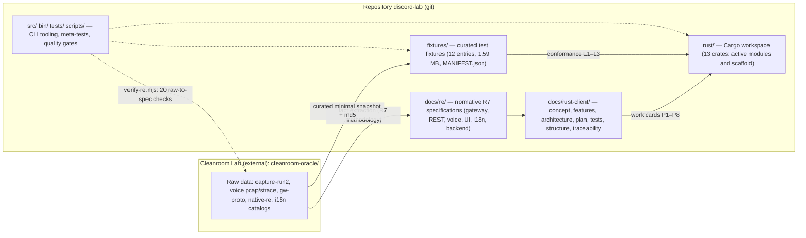

# Unified Project Structure (RE + Rust Client)

This document describes the unified structure uniting cleanroom reverse engineering artifacts with the implementation plan and Rust client workspace. Established in wave RC (cards RC-07/RC-08, `TASKS.md` §RC).

## 1. Three Pillars

| Pillar | Location | Tracked in Git | Role |
|---|---|---|---|
| **Cleanroom Lab** | `cleanroom-oracle/` | No | Authoritative raw evidence: network captures, pcap, strace, dumps, locale catalogs |
| **Repository** | Git repository root | Yes | Normative specs (`docs/`), curated fixtures (`fixtures/`), crate scaffold (`rust/`), tooling (`src/`, `bin/`, `tests/`) |
| **Plan Package** | `docs/rust-client/` | Yes | Concept, features, architecture, P0–P8 waves, tests, structure, traceability, verification |



## 2. Directory Tree

```
discord-lab/                         (git repository)
├─ docs/
│  ├─ map.md                         project knowledge map, layers 1–8 (Mermaid)
│  ├─ re/                            R7 specifications: 26 files + JSON evidence bundles
│  ├─ rust-client/                   Rust client plan package
│  │  ├─ CONCEPT.md  FEATURES.md  ARCHITECTURE.md  PLAN.md  TEST-PLAN.md
│  │  ├─ PROJECT-STRUCTURE.md        (this document)
│  │  ├─ TRACEABILITY.md             features -> specs -> fixtures -> tests
│  │  ├─ VERIFICATION.md             raw-to-doc verification ledger
│  │  └─ verify/
│  │     ├─ verify-re.mjs            oracle: 20 automated verifications
│  │     └─ report.json              machine-readable report of latest run
│  └─ feature-backlog.md             feature transfer cards R4/R5/R6/D (41)
├─ fixtures/                         curated conformance fixtures (git)
│  ├─ MANIFEST.json                  provenance: source, md5, purpose, tests
│  ├─ tools/make-fixtures.mjs        builder: copy + sanitize + manifest update
│  ├─ gateway/{by-type/x164, ready-stats, summary}
│  ├─ gw-proto/{facts-frozen, msgs-run2-…-13072}
│  ├─ rest/rest-static.json
│  ├─ i18n/i18n-stats.json
│  └─ voice/{rtc*-frames, rtc*-summary, session3.timing}
├─ rust/                             native client: workspace of 13 crates
│  ├─ Cargo.toml                     workspace: crates/*
│  └─ crates/{discord-app, -codec, -core, -json, -store, -voice, -media,
│             -platform, -i18n, -ui, -conformance, -perf, -updater}
├─ waves/                            wave journal: db.jsonl + STATE.md + logs RW-01…RW-35
├─ src/ bin/ scripts/ tests/         CLI tools + meta-tests + quality gates
└─ logs/ functions/ evidence/        golden data: read-only

cleanroom-oracle/                    cleanroom lab (external)
├─ capture-run2.jsonl  9.4 MB        sanitized WS/REST traffic trace
├─ gateway/ 164x by-type, schema     Gateway schema decode (D-01)
├─ gw-proto/ 1544 frames, facts      ETF/zstd protocol analysis (7 sockets)
├─ d02-snapshot/                     REST D-02 snapshots (md5 provenance)
├─ rest-static.json 904 endpoints    web bundle route registry
├─ voice/ pcap, strace, RTC          voice: signaling + UDP + socket rotation
├─ i18n-* / ru|en-catalog            locale catalogs: 36 codes, 31 active
├─ native-re.json 9 modules          native .node binaries + md5/sha256
├─ backend-ipc.json 168 channels     Electron main process IPC map
├─ ui*/ decoded/                     UI traces and screen decodes
├─ flatpak-hits/ nm/ cc-text/        static build findings
└─ README.md                         lab index
```

## 3. Storage and Workflow Rules

1. **Raw data stays in cleanroom lab.** No raw network captures/pcap dumps are committed to git; repository contains only curated JSON evidence summaries (`docs/re/*.json`).
2. **Normative specifications live in `docs/`** with references to source artifacts (file + offset/field). Numerical figures in docs must reproduce from raw data (see `verify-re.mjs`).
3. **Test fixtures reside in `fixtures/`**: only sanitized files with entries in `MANIFEST.json` (source, size, md5, purpose, T-ID). Maximum total budget: single-digit megabytes. Fixture generator — `fixtures/tools/make-fixtures.mjs`: redacts sensitive credentials (`analytics_token`, `session_id` -> `REDACTED`) and verifies token absence.
4. **Implementation code lives in `rust/`** (scaffold and progression across P0–P8). Crates strictly respect boundaries in `ARCHITECTURE.md` §2; UI shell is Tauri 2 (ADR-1).
5. **Golden directories** (`logs/`, `functions/`, `evidence/`) remain read-only.
6. **Zero secret persistence**: session tokens -> `REDACTED`, public IPs -> `<PUB_IP>`, outbound binary frames -> sha256 (`docs/re/README.md`).
7. **Wave journal lives in `waves/`** (in git): `db.jsonl` (append-only v1 schema events), `STATE.md` (progress checkpoint), and artifacts in `RW-XX/` (task specs, red/green logs, reports, test copies). Binaries and raw dumps are never stored in the journal.

## 4. Verification Commands

```sh
node docs/rust-client/verify/verify-re.mjs --write   # 20 raw-to-doc verification checks
node fixtures/tools/make-fixtures.mjs                # rebuild fixtures (copy + sanitize)
cd rust && cargo test --offline --workspace         # test workspace of 13 crates offline
npm run check                                        # Node tests + meta-control
npm run gate:worker                                  # worker quality gate (pre-report)
```

- `verify-re.mjs` — deviation oracle: snapshot md5, READY counters, gw-proto frames, ETF tags, REST routes, i18n metrics, IPC channels, native modules, RTC opcodes, sanitization, `fixtures/` integrity.
- `tests/meta/rust-client-sync.test.mjs` — guards plan package structure, fixtures, and workspace scaffold.
- `docs/rust-client/VERIFICATION.md` — verification execution log and deviation analysis.

## 5. Next Steps

- Track subsequent phases in `STATUS.md`, `TASKS.md`, and `WAVE-PLAN.md`; keyring and SQLite store are complete.
- GUI stack and remaining headless work cards are detailed in `ROADMAP.md` and `WAVE-PLAN.md`.
- Milestone RC-07/RC-08 is completed by this documentation package; future reverse engineering artifacts must follow §3 rules.
