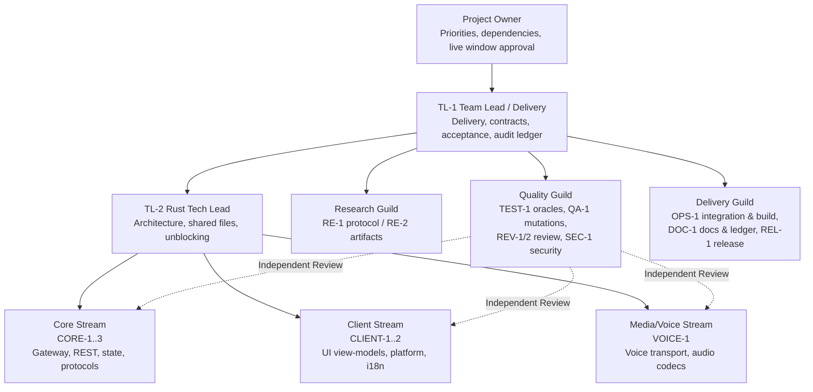
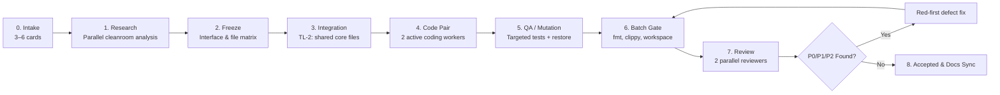

# TEAM — Rust Client Engineering Department Structure and Playbook

Status: Active engineering operating model. Supplements `PROCESS.md` §2/§3.13–§3.15. The core objective is **predictable engineering throughput**: 2–3 integrated batch waves per day, 6–8 accepted task cards per day, zero P0/P1 defects, and zero file contention. During active coding phases, exactly **two parallel code workers** operate concurrently (one per card in an active pair); remaining seats are dedicated to research, QA, code review, gate validation, and documentation.

## 1. Operating Model

- **Integrated Batch Wave:** 3–6 independent task cards executed under one frozen contract. We do not dispatch isolated one-card waves.
- **Role Seats:** Distinct functional responsibilities. An individual agent may fulfill multiple seats across sequential batches, but an author never reviews their own code, and security reviews are never performed by the author of a live execution path.
- **Strict File Ownership:** Primary concurrency rule: two agents never modify the same file. Shared core files (`state/types.rs`, `state/reducer.rs`, `state/mod.rs`, `src/lib.rs`, `PLAN.md`, `STATUS.md`, `ROADMAP.md`, `TASKS.md`, `docs/map.md`, `waves/*`) are modified exclusively by Team Lead / Tech Lead.
- **Contract Before Code:** Interfaces, data models, error paths, and test IDs are frozen before authoring the first line of production code.
- **Staged Pipeline:** Batches overlap across stages: while Batch B(n) is in coding, Batch B(n-1) undergoes gate validation and review, and Batch B(n-2) completes acceptance and documentation.

## 2. Organization Chart



## 3. Department Seats & Mandates

| Seat | Role | Mandate | Write Scope | Prohibited Actions |
|---|---|---|---|---|
| TL-1 | Team Lead / Delivery | Queue management, batch planning, acceptance, gate sign-off, release | Shared docs, `waves/*`, integration decisions | Does not review own code |
| TL-2 | Rust Tech Lead | Architecture, shared core files patch, conflict resolution, unblocking | `state/types.rs`, `reducer.rs`, `mod.rs`, `lib.rs`, scaffolding | Does not accept cards unilaterally |
| RE-1 | Protocol Research | Protocol reverse engineering, field verification, oracle commands | Research documentation, read-only artifacts | Does not write production code |
| RE-2 | Artifact/Fixture Research | Fixture curation, provenance, md5/sha256 validation | Fixture files and manifests | Does not modify cleanroom goldens |
| CORE-1..3 | Core Module Workers | State reducers, parsers, selectors, network adapters | Assigned modules and targeted tests | Must not edit shared files or docs |
| CLIENT-1..2 | Client Module Workers | UI view-models, i18n runtimes, platform adapters | Assigned client modules and tests | Must not launch live GUI without window |
| VOICE-1 | Media/Voice Worker | Voice signaling, RTP/RTCP handling, audio codecs | Voice modules and tests | Must not invent wire formats |
| TEST-1 | Test/Oracle Engineer | Independent tests, test vectors, oracle verification | Test suites and fixture assertions | Never adapts tests to match flawed code |
| QA-1 | Mutation/QA Engineer | Fault injection, mutation ledger, restore verification | Mutation scripts and execution logs | Never alters contract to pass mutants |
| REV-1/2 | Independent Reviewers | P0/P1/P2/P3 classification, boundary verification | Review reports and verdicts | Does not modify code during review |
| SEC-1 | Security Reviewer | Secret redaction, untrusted input, FFI boundaries | Security review audits | Does not review own authored code |
| OPS-1 | Integration & Build | Batch consolidation, cargo build locks, `gate:worker` | Integration scripts and gate logs | Does not modify author business logic |
| DOC-1 | Documentation & Ledger | `STATE`, `STATUS`, `ROADMAP`, `TASKS`, `map.md`, `db.jsonl` | Documentation and audit logs | Does not update docs during red phase |
| REL-1 | Release Engineer | `gate:release`, qualification checks, package verification | Packaging manifests and release notes | Does not publish without Lead sign-off |

## 4. Lifecycle RACI Matrix

`R` = Responsible, `A` = Accountable, `C` = Consulted, `I` = Informed.

| Task Phase | TL-1 | TL-2 | RE | Worker | TEST/QA | REV | OPS/DOC |
|---|---|---|---|---|---|---|---|
| Batch selection & file matrix | A/R | C | I | I | I | I | I |
| Cleanroom research & oracle definition | A | C | R | I | C | I | I |
| Contract and interface freeze | A/R | C | C | I | C | I | I |
| Shared core integration patch | A | R | I | I | I | I | I |
| Module RED -> GREEN implementation | A | C | I | R | C | I | I |
| Targeted logs and task report | A | I | I | R | C | I | I |
| Mutation fault injection & restore | A | C | I | C | R | I | I |
| Unified batch gate execution | A | C | I | I | R | I | R |
| Independent code review | A | C | I | I | C | R | I |
| Resolving P0/P1/P2 test-first | A/R | C | C | R | C | C | I |
| Acceptance, ledger, and docs sync | A/R | I | I | I | I | C | R |

## 5. Wave Execution Pipeline



### 5.1 Pipeline Overlap

```text
Timeline ->
Batch B01:  research -> freeze -> integration -> code -> QA -> gate -> review -> accepted
Batch B02:                 research -> freeze -> integration -> code -> QA -> gate -> review -> accepted
Batch B03:                                  research -> freeze -> integration -> code -> QA -> gate -> review
```

Rule: Do not wait for complete acceptance of the prior batch if the contract for the subsequent batch is frozen and their file write-scopes are completely disjoint.

## 6. Work-in-Progress (WIP) and Resource Controls

- During coding: **at most 2 active coding workers** in parallel (one per card in the active pair).
- At most **2 batches active simultaneously**: one in coding, one in gate/review.
- Shared `target-dir`: **never run concurrent cargo commands simultaneously**. All builds serialize through workspace locks or sequential slots.
- Individual workers run fast targeted tests; the full `gate:worker` runs once per integrated batch.
- Documentation and state ledgers are updated once per batch following formal acceptance.

## 7. Worker Playbook for Parallel Execution

1. Study assigned task specification and file write-scope; confirm zero overlap with peers.
2. Never touch shared files or peer tests. Request new exports through TL-2.
3. Strict TDD: execute targeted test in red state; capture command, non-zero exit code, and log.
4. Minimal implementation to green; run targeted test again; capture green log.
5. Do not run full workspace gate or edit tracking documentation.
6. If blocked for >15 minutes, escalate to Lead with exact command and error output.
7. Return structured report (`PROCESS.md` §4.2): summary, red log, green log, targeted tests, sha256 checksums, residual risks.
8. Never commit to shared branches; never touch golden fixtures; never make unauthorized network requests.

## 8. Department KPIs

| Metric | Target | Measurement Ledger |
|---|---|---|
| Accepted Cards / Day | 6–8 | `waves/STATE.md` |
| Integrated Batches / Day | 2–3 | `waves/STATE.md` |
| First-Pass Batch Gate Rate | >= 70% | `.gate/*.json` |
| Unresolved Criticals on Review (P0/P1) | 0 | `waves/reviews/*` |
| Unresolved P2 Defects at Acceptance | 0 | `waves/reviews/*` |
| Mutation Kill Rate | >= 90% (100% on critical branches) | `waves/<batch>/MUTATIONS.md` |
| Test Count per Card | S (6–10), M (10–16), L (16–24), XL (24–32) | `TEST-PLAN.md` §1.1 |
| Blocked Cards in Queue | <= 10% | `waves/STATE.md` |
