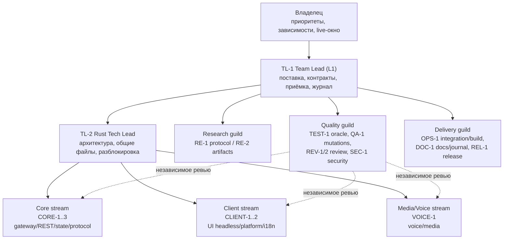
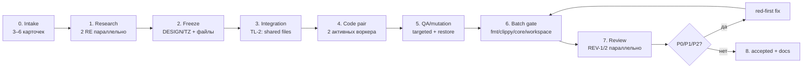

# TEAM — отдел разработки Rust-клиента

Статус: введён 2026-10-20 после RW-18. Это операционная надстройка к `PROCESS.md` §2/§3.13–§3.15.
Цель — не «больше агентов», а **предсказуемая пропускная способность**: 2–3 batch-волны в день,
6–8 принятых карточек в день, P0/P1 = 0 и отсутствие гонок за файлы. В кодовой фазе
одновременно работают **два активных воркера** — по одному на карточку пары; остальные seats
заняты research, QA, review, gate и docs и не конкурируют за `target-dir` и shared-файлы.

## 1. Модель

- **Batch-волна** — 3–6 независимых карточек. Не одна карточка на волну.
- **Seat** — роль в отделе. Один агент может занимать несколько seats в разных batch, но
  автор карточки не ревьюит её, а security-ревью не делает автор live-пути.
- **File ownership** — главный закон параллелизма: два агента никогда не пишут один файл.
  Общие файлы (`state/types.rs`, `state/reducer.rs`, `state/mod.rs`, `src/lib.rs`, `PLAN.md`,
  `STATUS.md`, `ROADMAP.md`, `TASKS.md`, `docs/map.md`, `waves/*`) принадлежат Team Lead/Tech Lead.
- **Contract before code** — DESIGN/TZ, сигнатуры, ключи состояния, диагностические пути и
  test ID замораживаются до первой строки продукта.
- **Pipeline** — batch-ы перекрываются: пока B(n) пишется, B(n−1) проходит gate/ревью, B(n−2)
  принимается и документируется. Это ускоряет поток сильнее, чем увеличение числа кодеров.

## 2. Организационная схема



## 3. Посадочные места (seats)

| Seat | Роль | Мандат | Пишет | Не делает |
| --- | --- | --- | --- | --- |
| TL-1 | Team Lead / Delivery | очередь, batch-план, ТЗ, контракты, приёмка, финальный gate, журнал, выпуск | общие доки, `waves/*`, integration-решения | не ревьюит свой код |
| TL-2 | Rust Tech Lead | архитектура, integration-патч общих файлов, разрешение конфликтов, разблокировка | `state/types.rs`, `reducer.rs`, `mod.rs`, `lib.rs`, каркасы | не принимает карточку единолично |
| RE-1 | Protocol research | gateway/REST/voice/typing, подтверждённые поля, oracle-команды | research-доки, read-only артефакты | не пишет продукт |
| RE-2 | Artifact/fixture research | фикстуры, provenance, md5, независимые выборки | research/fixture-доки | не «нормализует» golden |
| CORE-1..3 | Core module workers | state/parsers/reducer/selectors/net | свои модули и их тесты | не трогает shared-файлы, чужие тесты, доки |
| CLIENT-1..2 | Client module workers | UI-модели, i18n, platform-адаптеры | свои модули и их тесты | не запускает GUI/live без окна |
| VOICE-1 | Media/Voice worker | voice signaling, media-контракты | свои модули и их тесты | не изобретает wire без capture |
| TEST-1 | Test/oracle engineer | независимые тесты, фикстуры, test budget, проверка контракта | тесты/фикстуры в своём наборе | не «зеленит» тест под код |
| QA-1 | Mutation/QA engineer | мутации, флейки, restore по md5, batch-прогоны | mutation-логи/скрипты | не меняет контракт под мутант |
| REV-1/2 | Independent reviewers | P0/P1/P2/P3, границы, red-first, безопасность | только review-артефакты | не правит код во время ревью |
| SEC-1 | Security reviewer | секреты, недоверенный ввод, live-пути, отмена/таймауты | security-review | не совмещает с авторством |
| OPS-1 | Integration/build | сведение batch, cargo, `gate:worker`, артефакты | integration-скрипты/логи | не переписывает логику авторов |
| DOC-1 | Docs/journal | `STATE`/`STATUS`/`ROADMAP`/`TASKS`/`map`/`db.jsonl` после accepted | доки и журнал | не обновляет доки в red-фазе |
| REL-1 | Release/qualification | `gate:release`/`gate:qualify`, kit, qualification, откат | release-артефакты | не выпускает без приёмки |

Не каждый seat — отдельный процесс в каждой волне. Например, в маленьком batch TL-1 может
быть OPS-1, а TEST-1 — REV-2, но **автор/ревьюер** и **автор/security** не совпадают.

## 4. RACI по жизненному циклу карточки

`R` — делает, `A` — отвечает, `C` — консультирует, `I` — информируется.

| Этап | TL-1 | TL-2 | RE | Worker | TEST/QA | REV | OPS/DOC |
| --- | --- | --- | --- | --- | --- | --- | --- |
| Выбор batch и файловая матрица | A/R | C | I | I | I | I | I |
| Research и oracle | A | C | R | I | C | I | I |
| DESIGN/TZ freeze | A/R | C | C | I | C | I | I |
| Integration-патч общих файлов | A | R | I | I | I | I | I |
| Модульный red → green | A | C | I | R | C | I | I |
| Targeted-логи и отчёт | A | I | I | R | C | I | I |
| Мутации и restore | A | C | I | C | R | I | I |
| Batch gate | A | C | I | I | R | I | R |
| Независимое ревью | A | C | I | I | C | R | I |
| Закрытие P0/P1/P2 red-first | A/R | C | C | R | C | C | I |
| `accepted`, журнал, доки | A/R | I | I | I | I | C | R |

## 5. Конвейер batch-волны



Таймбоксы — ориентиры, не обещания: intake 10 мин, research 20–30, freeze 15, integration 20,
code 45–90, QA 20, gate 15, review 20–30, fix 20, accept/docs 10. Batch может идти 2–4 часа;
поток из трёх перекрывающихся batch даёт 2–3 batch/день.

### 5.1 Пайплайн, а не очередь

```text
время →
B01:  research → freeze → integration → code → QA → gate → review → accepted
B02:                 research → freeze → integration → code → QA → gate → review → accepted
B03:                                  research → freeze → integration → code → QA → gate → review
```

Правило: **не ждать полного accepted предыдущего batch**, если контракт следующего уже
заморожен и файлы не пересекаются. Ждать нужно только реальную зависимость (API/тип/фикстуру).

### 5.2 Кодовая пара и подволны a/b/c

Одна карточка = один активный воркер. Две карточки batch идут **парой**; каждая карточка
проходит три подволны, и только после green пары стартует следующая:

```text
a: W19 types/parser  ∥ W20 types/parser     → I0 scaffolding
b: W19 reducer       ∥ W20 reducer          → I1 API patch
c: W19 selectors     ∥ W20 selectors        → QA/mutations
```

- `I0` — TL-2 объявляет новые модули и store-поля, чтобы parser-тесты вообще компилировались.
- `I1` — **единый общий API-патч**: `EventPayload`, routes, `apply`/`apply_frame_at`,
  `MESSAGE_CREATE` hook, `ReadySupplemental`, re-exports. Воркеры его не трогают.
- После `c` — один batch gate, затем два ревьюера параллельно; review не блокирует следующую
  пару, если её файлы не пересекаются.
- Третий кодовый воркер не запускается «для скорости»: он создаёт конфликт `target-dir` и
  shared-файлов. Скорость даёт перекрытие code/QA/review, а не шесть одновременных компиляций.

## 6. WIP, запуск агентов и cargo

- В кодовой фазе — **2 активных кодовых воркера** (по одному на карточку пары), не 6. Pool
  seats (CORE/CLIENT/VOICE/TEST/QA/REV) шире, но code WIP ограничен парой.
- В работе не более **2 batch**: один в code, один в gate/review; полностью параллельный
  третий batch — только после завершения одного.
- Фоновых агентов запускать **не более 2 одновременно**; следующий стартует после завершения
  одного. Это ограничение провайдера, а не процесса. При стабильном лимите можно поднять до 3–4,
  но не «взрывом».
- Один общий `target-dir`: **не запускать несколько cargo одновременно**. Cargo-команды идут
  через integration/QA-лейн или последовательные слоты; иначе агенты блокируют друг друга.
- Воркер не запускает полный `gate:worker`; он сдаёт targeted red/green. Полный gate — один раз
  на batch.
- Документы и журнал не обновляются в red-фазе; только после accepted.

## 7. Playbook воркера (параллельная работа)

1. Прочитай своё ТЗ и список файлов в нём; проверь, что твои файлы не пересекаются с соседями.
2. Не редактируй shared-файлы и чужие тесты. Нужен новый экспорт — заявка TL-2, не сам.
3. Сначала тест: запусти targeted red, сохрани команду, exit code и лог.
4. Минимальный green; снова targeted; сохрани лог.
5. Не запускай полный workspace/clippy/gate и не обновляй доки.
6. Если 10–15 минут нет прогресса — эскалируй Team Lead с точной командой и ошибкой.
7. Отчёт по PROCESS.md §4.2: batch, red, green, targeted, файлы+md5, риски, следующий шаг.
8. Не коммить, не пушить, не трогать golden, не ходить в сеть.
9. Если нашёл дефект в чужом модуле — опиши, не правь; это отдельная карточка/ревью.
10. Если тест «зелёный» только после правки ожидания — остановись и оформи
    `TEST-CORRECTIONS.md`, а не подгоняй.

### 7.1 Сообщение о передаче

```text
batch: RW-NN / card: P2-xx
seat: CORE-2
files: <точные пути>
red: <команда> → exit 101, <лог>
green: <команда> → N/N, exit 0, <лог>
targeted: <лог/число>
blocked: <нет/что именно>
next: <TL-2 интеграция / QA / review>
```

## 8. Team Lead: что делает и чего не делает

Делает:
- держит ready-queue и rolling plan на 2 batch вперёд;
- выбирает batch по зависимостям и file matrix;
- замораживает контракт и назначает владельцев shared-файлов;
- запускает не более 2 фоновых агентов и перезапускает упавших по одному;
- сводит integration-патч, запускает batch gate;
- принимает только после P0/P1/P2=0 и зелёного gate;
- один раз обновляет `STATE`/`STATUS`/`ROADMAP`/`TASKS`/`map`/`db.jsonl`;
- ведёт KPI и backlog P3.

Не делает:
- не пишет модульный код вместо воркера (кроме integration);
- не ревьюит свой код;
- не обновляет доки до accepted;
- не запускает 3–6 фоновых агентов «в надежде, что хватит лимита»;
- не тащит P3 в текущий batch.

## 9. Эскалации

| Триггер | Кому | Действие |
| --- | --- | --- |
| Пересечение файлов | TL-1 | остановить одного, переразбить batch; не мержить вручную |
| Неясный контракт/поле | TL-2 + RE | research; неизвестное — интерфейс/`Effect`/stub, не выдумывать |
| Нет оракула | RE + TEST-1 | синтетический кейс с явной пометкой или blocked |
| P0/P1 на ревью | TL-1 | стоп batch, red-first, повторный gate |
| P2 на ревью | автор + TL-2 | red-first в этом же batch |
| P3 | TL-1 | backlog с ID, не блокирует accepted |
| Нужна зависимость/сеть/live | владелец | запрос через TL-1; до разрешения — stub/skip |
| Rate limit агента | TL-1 | подождать, перезапустить один критический агент, не дублировать |

## 10. KPI отдела

| Метрика | Цель | Где |
| --- | --- | --- |
| Принятые карточки/день | 6–8 | `waves/STATE.md` |
| Batch-волны/день | 2–3 | `waves/STATE.md` |
| First-pass batch gate | ≥ 70 % | `.gate/*.json` |
| P0/P1 на ревью | 0 | `waves/reviews/*` |
| P2 до accepted | 0 | `waves/reviews/*` |
| Mutation catch rate | ≥ 90 % (критические ветви — 100 %) | `waves/<batch>/MUTATIONS.md` |
| Tests/card | S 6–10, M 10–16, L 16–24, XL 24–32 | `TEST-PLAN.md` §1.1 |
| Blocked cards | ≤ 10 % ready-queue | `waves/STATE.md` |

## 11. Текущая активация (2026-10-21)

| Batch | Карточки | Состав | Статус |
| --- | --- | --- | --- |
| B01 / RW-19–20 | P2-09 (accept), P2-10, P2-11 | TL-1, TL-2, RE-1/2, CORE-1 (voice), CORE-2 (typing), TEST-1, QA-1, REV-1/2 | **принят 2026-10-21** |
| B02 / RW-21 | P1-01, P1-02, P0-04, P0-07, P2-08 | TL-2, CORE-3, TEST-1, OPS-1 | **принят 2026-10-21**, P0/P1/P2=0 |
| B03 / RW-22 | P3-15, P4-01, P7-04, P8-03 | CLIENT-1, VOICE-1, TEST-1, OPS-1 | **next**; P4-01 — только headless signaling |

### 11.1 B01 по подволнам

| Подволна | W19 / CORE-1 (P2-10) | W20 / CORE-2 (P2-11) | Integration |
| --- | --- | --- | --- |
| a | `state/voice/{types,parser}` + `voice_state_types` (v01–v06) | `state/typing/{types,parser}` + `typing_types` (t01–t05) | I0: модули, store-поля, READY snapshot |
| b | `voice/{reducer}` + v07–v11 | `typing/{reducer}` + t06–t10 | I1: EventPayload/routes/apply/from_frame_at |
| c | `voice/{selectors}` + v12–v15 | `typing/{selectors}` + t11–t15 | QA/mutations; gate |

P2-09 accept — отдельная review-лейна REV-1 + TL-1, не третий кодовый воркер. P2-08
перенесён в B02, чтобы не запускать третьего code worker в B01.

| Проверка B01 | Владелец | Артефакт |
| --- | --- | --- |
| 15 voice + 15 typing targeted | CORE-1/2, TEST-1 | `waves/RW-19`, `waves/RW-20` |
| Мутации 5–8 на карточку, restore md5 | QA-1 | `waves/B01/MUTATIONS.md` |
| Один batch gate (fmt/clippy/workspace/npm) | OPS-1 + TL-2 | `.gate/worker-*.json` |
| Два ревьюера параллельно | REV-1/2 | `waves/reviews/review-p2-10.md`, `review-p2-11.md` |
| P2-09 round 2 | REV-1 | `waves/reviews/review-p2-09-round2.md` |
| Доки/журнал один раз | TL-1/DOC-1 | `STATE`, `db.jsonl`, `STATUS`, `map` |

Файловые матрицы и точные сигнатуры — `waves/B01/BATCH-TZ.md`, `waves/RW-19/TZ-P2-10.md`,
`waves/RW-20/TZ-P2-11.md`. Если W19/W20 пересекаются по общему файлу, приоритет у TL-2;
воркер не «договаривается» правкой.

Остальные batch — в `WAVE-PLAN.md`; UI/SQLite/keyring/live ждут решения владельца.
