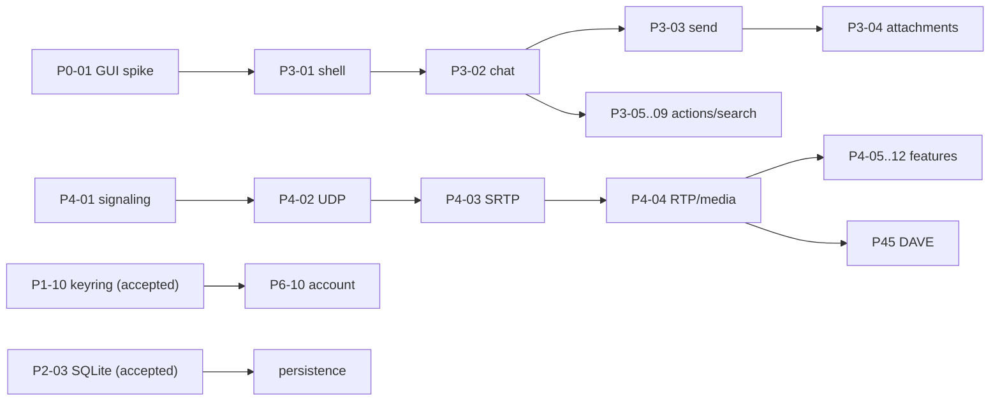

# WAVE-PLAN — batch-план и пропускная способность

Статус: обновлён 2026-10-23 после RW-36. Источник карточек — `PLAN.md` (90), факт —
`waves/STATE.md` и `STATUS.md`, роли — `TEAM.md`, процесс — `PROCESS.md` §3.13–§3.15.
**Принято 48/90; осталось 42. RW-36/B07 закрыл GUI-спайк (P0-01/P0-06), RW-37 — оконную
модель данных (ADR-1: PSS 393,9 → 276,2 МБ ≤300).** Следующий шаг — P3-01 (каркас окна и
навигация), затем P3-02 (чат-вью). Старые расчёты скорости ниже — исторические гипотезы, не прогноз.

## 1. Главное

**90 карточек — это не 90 волн.** Волна (batch) содержит 3–6 независимых карточек, один
замороженный контракт, один integration-патч и один общий gate.

| Показатель | Было | Стало |
| --- | --- | --- |
| Единица волны | 1 карточка | 3–6 карточек |
| Волн на 73 карточки | ~73 | ~18–22 |
| Batch-волн в день | 0,5–1 | 2–3 |
| Принятых карточек в день | 2–4 | 6–8 |
| Полный gate | у каждого воркера | один раз на batch |
| Обновление доков | после каждой итерации | один раз после accepted |
| Тесты | полный workspace у каждого | targeted у воркера, full на batch |
| Кодовый WIP | 6 воркеров | **2 активных воркера** (пара), остальные seats — QA/review/gate |

RW-36 выбрал GUI-тулкит (Tauri 2, ADR-1) и закрыл спайк P0-01/P0-06. Следующий шаг —
оконная/постраничная модель данных (закрыть PSS > 300 МБ), затем UI foundation P3-02…P3-16.
После UI — медиа/audio backend (P4.5/P5). Не объявлять готовность карточек, которым нужны
live Discord или новые системные библиотеки, без согласованного окна/решения владельца.

## 2. Расчёт (историческая оценка)

Исходная оценка от 2026-10-20: 90 карточек, принято 17, осталось 73. Она superseded текущим
фактом 46/90 из `waves/STATE.md`; категории и даты ниже не отражают текущую ready queue.

| Сценарий (исторический) | Карточек/день | Дней на 73 | Комментарий |
| --- | ---: | ---: | --- |
| Консервативный | 4 | 18–19 | только 2 batch в работе, много блокеров |
| **Плановый** | **6–8** | **10–13** | 2 активных кодовых воркера + QA/review pool, 2–3 batch/день |
| Агрессивный | 10 | 8–9 | 6+ seats, нет блокеров, stable provider |

Ранее предполагалось ускорение за счёт перекрытия стадий и общего batch gate. На практике
RW-28…35 показали повторные red/green/mutation циклы после ревью, поэтому % mutation catch rate
сам по себе не является KPI качества; учитывать валидность baseline, survivors, inconclusive и
время повторного цикла.

## 3. Ready-queue на 2026-10-20 (история)

Это карточки, которые не ждут внешних решений. Они запускаются первыми.

| ID | Карточка | Зависит от | Почему готова | Риск |
| --- | --- | --- | --- | --- |
| P2-09 | presence, accept | P2-02 | код, P2-фиксы, мутации, gate готовы | ждёт review round 2 |
| P2-10 | voice states | P2-02 | snapshot `003` + 8 live `VOICE_STATE_UPDATE` | DM/voice transport вне scope |
| P2-11 | typing | P2-04 | oracle 28 START / TTL 10 000 мс | fixture создаётся в W20 |
| P2-08 | settings-proto | P2-02 | opaque protobuf → structural model | schema не подтверждена |
| P1-01 | ETF full | P0-02 | прототип принят, нужен полный контракт | fuzz/границы |
| P1-02 | zstd stream strict | P0-03 | прототип принят, нужен строгий stream | s=113 хвост |
| P0-04 | conformance harness | — | скелет крейта есть | lab-only фикстуры |
| P0-07 | legal framework | — | docs-only | нужен владелец для формулировок |
| P3-15 | i18n runtime | — | ключ/локаль/строки | нет GUI |
| P4-01 | voice signaling | P1-06 | headless, RE-фикстуры | без voice transport |
| P7-04 | API completeness | P1-07 | read-only REST | без UI |
| P8-03 | CI | — | scripts/checks | без remote/CI-раннера |

## 4. Batch-план

### 4.1 Детально (ready, без внешних решений)

| Batch | Карточки | Лейны | Ворота |
| --- | --- | --- | --- |
| **B01 / RW-19–20** | P2-09 (accept), P2-10, P2-11 | CORE-1 voice, CORE-2 typing; TEST-1, QA-1, REV-1/2 | P2-09 review; voice/typing 15+15; batch gate |
| **B02 / RW-21** | P1-01, P1-02, P0-04, P0-07, P2-08 | CORE-1 ETF full, CORE-2 zstd strict, CORE-3 settings, TEST-1, OPS-1 | **принято 2026-10-21**; contract freeze, fuzz, batch gate |
| **B03 / RW-22** | P3-15, P4-01, P7-04, P8-03 | CLIENT-1 i18n, VOICE-1 signaling, CORE-3 API, OPS-1 CI | **принято 2026-10-21**; headless-only; gate passed |
| **B04 / RW-23** | P4-02, P8-04 | VOICE-1 UDP, OPS-1 SBOM | **принято 2026-10-21**; 21 caught + 1 inconclusive |
| **B05 / RW-24** | P7-01 | CLIENT-1 locale/plural/format/markdown, integration TL | **принято 2026-10-21**; 33 i18n, 20/20 mutations |

B01 и B02 можно вести с перекрытием: пока B01 в review, B02 в research/freeze. Не запускать
оба полных gate одновременно. B01 держит **двух** активных кодовых воркеров; P2-08 перенесён
в B02, чтобы не запускать третьего.

### 4.2 Rolling plan после RW-35

План разбит на исследование/решения и реализацию, чтобы не кодировать под неподтверждённую среду.
Нумерация batch ниже — ориентир по зависимостям, не фиксация календаря.

| Этап | Карточки/работа | Результат / gate | Стартовое условие |
| --- | --- | --- | --- |
| **A. Очередь аудита** | P3 из `waves/STATE.md` §7: в первую очередь RW-30…35 тестовые пробелы и API/cleanup долги | отдельные маленькие карточки с test ID, файлами, oracle и mutation; не смешивать с новой фичей | TL подтверждает актуальность backlog; не дублировать незакоммиченные RW-35 f11/f13 изменения до их ревью/приёмки |
| **B. GUI spike** | P0-01, P0-06 — **выполнено RW-36** | ADR-1: Tauri 2 принят; 60 fps p95 18 мс, cold start 102–137 мс, cold build 29,56 с; **PSS 394 МБ > 300 МБ** → оконная модель | закрыто; follow-up — оконная/постраничная модель данных |
| **C. UI foundation → chat** | P3-02…P3-16 группами по непересекающимся файлам; приоритет зависимости из `PLAN.md` | headless view-model tests → native smoke; не объявлять UI готовым по одному unit gate | P0-01 принят; для live smoke отдельно согласовано окно |
| **D. Audio/voice remainder** | P4-05/P4-06/P4-08/P4-09 — статусы и точные названия сверить с `PLAN.md` перед ТЗ | сначала backend spike и oracle/fixture; затем device lifecycle, mute/PTT, audio quality и soundboard targeted tests | выбран audio backend, доступна тестовая система/фикстура; P4-04 RTP не считать Opus implementation |
| **E. Media/DAVE** | P5-01…P5-07 и P45-01…P45-03 по dependency graph | capture/encode/interop — отдельные checkpoints; DAVE не начинать до протокольного oracle и security review | GUI + media backend + разрешённые зависимости; живой interop только по согласованному окну |
| **F. Завершение** | остаток P6/P7/P8 по `PLAN.md` и актуальному `STATUS.md` | сначала закрыть внешний UI/инфраструктурный блокер, затем оставить perf/accessibility/release в отдельных batch | после пересборки ready queue на основании accepted A–E |

Волны RW-28…35 подтверждают, что расширения и исправления после независимого ревью могут
добавлять тесты, новые мутации и повторные логи. Поэтому размер batch определяется не только
карточками, но и изоляцией тестовых файлов, внешней средой и числом владельцев общих ресурсов.
Не обещать «2–3 batch/день» до измерения минимум двух следующих batch по фактическому циклу
red → green → mutation → review → accepted.

## 5. Критический путь

Самые длинные цепочки: **GUI → P3-01 → P3-02 → P3-03 → P3-04** и
**P4-01 → P4-02 → P4-03 → P4-04 → оставшиеся voice features**. P4-04 принят как RTP/media;
не считать его реализацией Opus. Перед запуском любого якобы headless остатка сверить карточку,
зависимости и статус в текущем `PLAN.md`/`STATUS.md`.

## 6. Blockers и что они открывают

| Блокер | Карточки | Что нужно от владельца | Если не решён |
| --- | ---: | --- | --- |
| GUI-крейты | P0-01, P0-06, P3-01…P3-16, GUI-зависимые P5/P6/P7 | выбрать тулкит и разрешить недостающие зависимости/загрузку | headless-модели есть, пользовательского окна нет |
| Audio/media backend | P4-05…P4-09, P5-01…P5-07, часть P4.5 | выбрать API и определить воспроизводимый локальный oracle | RTP/crypto готовы частично; устройства/кодеки/capture не закрыты |
| Live Discord/interoperability | live-smoke, P4/P5/P4.5 interop | отдельное окно владельца и тестовый аккаунт/канал | фикстуры/loopback не доказывают interop |
| Внешние системные библиотеки | по каждой карточке через spike | проверить локальное наличие, ABI/версию, лицензии, сборку/offline | не вводить новую зависимость до решения владельца |
| Провайдер/длинные гейты | cargo и batch integration | не более двух фоновых запусков, один cargo за раз | очередь с повторным запуском после освобождения слота |

**Уже снято:** keyring, SQLite и D-Bus fd-passing приняты в RW-31/33/35. Не планировать их
как открытые blocker-ы. Главный blocker теперь — GUI-тулкит; следующий — конкретный аудио/media
backend. Live smoke остаётся отдельным условием только для live-контрактов.

## 7. Управление тестами

- Воркер запускает только targeted-тесты своего модуля; полный workspace — на batch.
- Бюджет: S 6–10, M 10–16, L 16–24, XL 24–32 теста на карточку (`TEST-PLAN.md` §1.1).
- Одинаковые границы — таблицей, а не 10 копий; фикстуры — через общий `tests/support`.
- Мутации выводятся из рисков, имеют связь mutant → test ID; score без валидного baseline не
  публикуется. `INCONCLUSIVE` не считается убитым, equivalent отдельно обоснован.
- Проверять skip по ID/причине, а не подстрочными эвристиками; live-флаг с ошибкой среды должен
  падать, когда это live assertion.
- Из ревью и mutation survivors создаются регрессионные тесты либо конкретные backlog IDs;
  P3 не теряется в отчёте. Полный метод — `TEST-PLAN.md` §1.2 и `PROCESS.md` §4.2–§4.3.
- Генератор/fixture builder входит в matrix; два прогона, детерминированные хеши, provenance oracle.

## 8. Ежедневный цикл Team Lead

1. Утром: `waves/STATE.md` §1/§5/§7, последние 5 событий `db.jsonl`, актуальный `PLAN.md`;
   проверить blocker-ы и хвосты после ревью, не читать исторические планы как статус.
2. Заморозить контракты и файловые матрицы; запустить максимум 2 фоновых агента.
3. Пока идёт code — проверить review предыдущего batch; P0/P1/P2 — red-first.
4. После green — один batch gate; затем параллельно 2 ревьюера.
5. После accepted — один раз обновить доки/журнал, пересобрать ready-queue.
6. Вечером: KPI (accepted/day, first-pass gate, P0/P1/P2, valid KILLED/survivor/inconclusive,
   повторные циклы и flaky tests) и план на завтра.

## 9. Что считается успехом

- измеренная скорость по двум последовательным batch; целевую скорость не задавать до факта;
- P0/P1 = 0 на каждом ревью; P2 закрыт до accepted;
- нет гонок за файлы и дублей полного gate;
- unimplemented work планируется по зависимостям и проверяемым oracle, а не по старой оценке дней;
- после каждой волны обновлены `STATE`, `db.jsonl`, `STATUS`, `ROADMAP`, `TASKS`, `map`.
