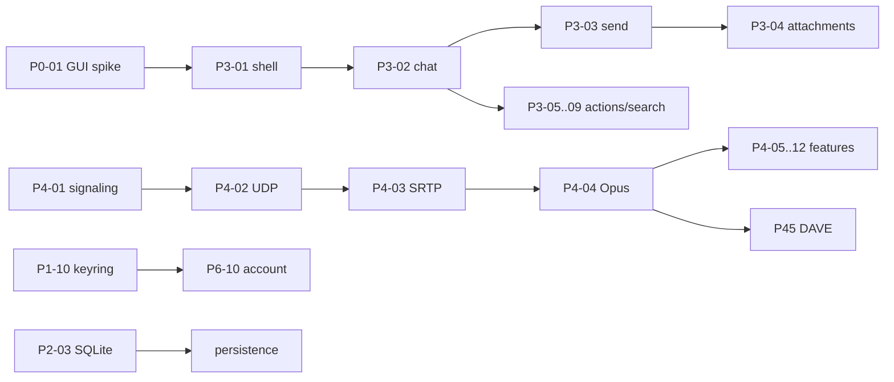

# WAVE-PLAN — batch-план и пропускная способность

Статус: введён 2026-10-20; обновлён 2026-10-21 после B03. Заменяет «одна карточка = одна
волна». Источник карточек — `PLAN.md` (90), факт — `STATUS.md`, роли — `TEAM.md`, процесс —
`PROCESS.md` §3.13–§3.15. **Сейчас: 29/90 принято, 61 осталось; B03/RW-22 принят.**
§3 ниже — историческая ready-queue на 2026-10-20, актуальный факт — `STATUS.md`.

## 1. Главное

**90 карточек — это не 90 волн.** Волна (batch) содержит 3–6 независимых карточек, один
замороженный контракт, один integration-патч и один общий gate.

| Показатель | Было | Стало |
| --- | --- | --- |
| Единица волны | 1 карточка | 3–6 карточек |
| Волн на 73 карточки | ~73 | ~18–22 |
| Batch-волн в день | 0,5–1 | 2–3 |
| Принятых карточек в день | 2–4 | 6–8 |
| Полный gate | у каждого воркера | один раз на batch |
| Обновление доков | после каждой итерации | один раз после accepted |
| Тесты | полный workspace у каждого | targeted у воркера, full на batch |
| Кодовый WIP | 6 воркеров | **2 активных воркера** (пара), остальные seats — QA/review/gate |

Целевой срок для 61 оставшейся карточки — **10–13 рабочих дней** после снятия блокеров
(6–8 карточек/день + 20–25 % на ревью/переделку). Без снятия блокеров верхняя граница ниже:
сейчас к запуску готовы ~12 карточек, остальные ждут GUI/SQLite/keyring/live-решения.
Пара воркеров работает подволнами a/b/c (types/parser → reducer → selectors); это даёт
предсказуемый green и не создаёт гонок за `target-dir`/shared-файлы.

## 2. Расчёт

Исходно: 90 карточек, принято 17, осталось 73 (P0 5, P1 3, P2 5, P3 16, P4 12, P4.5 3,
P5 7, P6 10, P7 7, P8 5). P2-09 реализован, но до accepted считается в остатке.

| Сценарий | Карточек/день | Дней на 73 | Комментарий |
| --- | ---: | ---: | --- |
| Консервативный | 4 | 18–19 | только 2 batch в работе, много блокеров |
| **Плановый** | **6–8** | **10–13** | 2 активных кодовых воркера + QA/review pool, 2–3 batch/день |
| Агрессивный | 10 | 8–9 | 6+ seats, нет блокеров, stable provider |

Почему не «90 волн в день»: волна — это единица приёмки с ревью и gate. Ускорение даёт не
уменьшение проверок, а их **однократность на batch**, перекрытие стадий и устранение гонок за
файлы. Качество контролируется P0/P1/P2 и mutation catch rate, а не количеством прогонов.

## 3. Ready-queue на 2026-10-20

Это карточки, которые не ждут внешних решений. Они запускаются первыми.

| ID | Карточка | Зависит от | Почему готова | Риск |
| --- | --- | --- | --- | --- |
| P2-09 | presence, accept | P2-02 | код, P2-фиксы, мутации, gate готовы | ждёт review round 2 |
| P2-10 | voice states | P2-02 | snapshot `003` + 8 live `VOICE_STATE_UPDATE` | DM/voice transport вне scope |
| P2-11 | typing | P2-04 | oracle 28 START / TTL 10 000 мс | fixture создаётся в W20 |
| P2-08 | settings-proto | P2-02 | opaque protobuf → structural model | schema не подтверждена |
| P1-01 | ETF full | P0-02 | прототип принят, нужен полный контракт | fuzz/границы |
| P1-02 | zstd stream strict | P0-03 | прототип принят, нужен строгий stream | s=113 хвост |
| P0-04 | conformance harness | — | скелет крейта есть | lab-only фикстуры |
| P0-07 | legal framework | — | docs-only | нужен владелец для формулировок |
| P3-15 | i18n runtime | — | ключ/локаль/строки | нет GUI |
| P4-01 | voice signaling | P1-06 | headless, RE-фикстуры | без voice transport |
| P7-04 | API completeness | P1-07 | read-only REST | без UI |
| P8-03 | CI | — | scripts/checks | без remote/CI-раннера |

## 4. Batch-план

### 4.1 Детально (ready, без внешних решений)

| Batch | Карточки | Лейны | Ворота |
| --- | --- | --- | --- |
| **B01 / RW-19–20** | P2-09 (accept), P2-10, P2-11 | CORE-1 voice, CORE-2 typing; TEST-1, QA-1, REV-1/2 | P2-09 review; voice/typing 15+15; batch gate |
| **B02 / RW-21** | P1-01, P1-02, P0-04, P0-07, P2-08 | CORE-1 ETF full, CORE-2 zstd strict, CORE-3 settings, TEST-1, OPS-1 | **принято 2026-10-21**; contract freeze, fuzz, batch gate |
| **B03 / RW-22** | P3-15, P4-01, P7-04, P8-03 | CLIENT-1 i18n, VOICE-1 signaling, CORE-3 API, OPS-1 CI | **принято 2026-10-21**; headless-only; gate passed |
| **B04 / RW-23** | P4-02, P8-04 | VOICE-1 UDP, OPS-1 SBOM | **принято 2026-10-21**; 21 caught + 1 inconclusive |
| **B05 / RW-24** | P7-01 | CLIENT-1 locale/plural/format/markdown, integration TL | **принято 2026-10-21**; 33 i18n, 20/20 mutations |

B01 и B02 можно вести с перекрытием: пока B01 в review, B02 в research/freeze. Не запускать
оба полных gate одновременно. B01 держит **двух** активных кодовых воркеров; P2-08 перенесён
в B02, чтобы не запускать третьего.

### 4.2 Rolling plan (после решений владельца)

Детально фиксируются только 2 batch вперёд; остальное — очередь по зависимостям, чтобы не
переписывать план после каждого решения.

> **Факт на 2026-10-21:** B04 (P4-02/P8-04) и B05 (P7-01) закрыты вне исходной очереди.
> Следующий batch — **B06 / решения** (GUI/keyring/SQLite); строки ниже с прежними номерами
> B04–B18 — исходная очередь, их нумерация сдвигается после решения владельца. `P7-01` и
> `P4-02` из неё уже выполнены.

| Очередь | Карточки | Открывает | Условие |
| --- | --- | --- | --- |
| **B04 / решения** | P0-01, P1-10, P2-03 | GUI, keyring, SQLite | владелец разрешает зависимости |
| **B05 / UI foundation** | P0-06, P3-01, P3-12, P3-13 | окно, навигация, компоненты, темы | P0-01 accepted |
| **B06 / UI chat** | P3-02, P3-11, P3-14, P3-16 | чат-вью, QuickSwitcher, звуки, настройки | P3-01/P3-12 |
| **B07 / chat actions** | P3-03, P3-05, P3-06, P3-07, P3-08 | composer, реакции, меню, треды, участники | P3-02 |
| **B08 / attachments+search** | P3-04, P3-09, P3-10, P6-01 | вложения, поиск, эмодзи, трей | P3-03/P3-02 |
| **B09 / platform** | P6-02…P6-09, P7-01 | уведомления, idle, сессии, i18n | P3/P6-01/P3-15 |
| **B10 / voice transport** | P4-02, P4-11 | UDP, регионы | P4-01 |
| **B11 / voice crypto** | P4-03 | SRTP | P4-02 |
| **B12 / voice pipeline** | P4-04 | Opus/RTP | P4-03 |
| **B13 / voice features** | P4-05…P4-10, P4-12, P45-01 | устройства, PTT, mute, NS, soundboard | P4-04 |
| **B14 / media capture** | P5-01, P5-06 | screen/system audio | P0-01 |
| **B15 / media encode** | P5-02, P5-05 | H.264/AV1, camera | P5-01 |
| **B16 / media publish** | P5-03, P5-04, P5-07 | RTP-video, Go Live, decode | P5-02/P4-03 |
| **B17 / DAVE** | P45-02, P45-03 | MLS/openmls/interop | P45-01 |
| **B18 / perf+release** | P7-02, P7-03, P7-05…P7-07, P8-01…P8-05 | полировка, updater, пакеты, CI | предыдущие |

Порядок B04–B18 — не жёсткий календарь: он показывает зависимости и то, какие batch можно
поднять одновременно. После каждого accepted Team Lead пересобирает ready-queue.

## 5. Критический путь

Самые длинные цепочки: **GUI → P3-01 → P3-02 → P3-03 → P3-04** и
**P4-01 → P4-02 → P4-03 → P4-04 → P4-05…P4-12**. Их нельзя ускорить параллелизмом больше,
чем на ширину одного batch; зато P2/P1/P0-04/P0-07/P3-15 можно закрыть до GUI.

## 6. Blockers и что они открывают

| Блокер | Карточки | Что нужно от владельца | Если не решён |
| --- | ---: | --- | --- |
| GUI-крейты | P0-01, P0-06, P3-01…P3-16, P5-01, P5-05, P6-01… | разрешить `tauri`/`iced`/`egui` + загрузку | headless-модели, окна нет |
| SQLite | P2-03, P2-06 persistence | `rusqlite`/`libsqlite3-sys` + системный SQLite | memory-only |
| keyring | P1-10, P6-10, P7-06 | `keyring` + Secret Service/KWallet | токен in-memory |
| live Discord | live-smoke, P4/P5 interop | окно и аккаунт | фикстуры/loopback |
| provider rate limit | все фоновые | не более 2 запусков | очередь, перезапуск по одному |

**Вывод:** главный тормоз сейчас — не число воркеров, а четыре внешних решения. B04
(P4-02/P8-04) и B05 (P7-01) закрыты без GUI/SQLite/keyring; следующий **B06** — GUI/keyring/
SQLite — требует решения владельца. После GUI-решения открываются 16 P3 + 2 P0 + 2 P5 + 8 P6 —
самый большой прирост пропускной способности.

## 7. Управление тестами

- Воркер запускает только targeted-тесты своего модуля; полный workspace — на batch.
- Бюджет: S 6–10, M 10–16, L 16–24, XL 24–32 теста на карточку (`TEST-PLAN.md` §1.1).
- Одинаковые границы — таблицей, а не 10 копий; фикстуры — через общий `tests/support`.
- Мутации: 3–5 для S, 5–8 для M, 8–12 для L/XL; критическая ветвь — 100 %.
- P3-замечания не блокируют accepted; они идут в backlog с ID.

## 8. Ежедневный цикл Team Lead

1. Утром: `waves/STATE.md`, `db.jsonl`, ready-queue; выбрать 2 batch.
2. Заморозить контракты и файловые матрицы; запустить максимум 2 фоновых агента.
3. Пока идёт code — проверить review предыдущего batch; P0/P1/P2 — red-first.
4. После green — один batch gate; затем параллельно 2 ревьюера.
5. После accepted — один раз обновить доки/журнал, пересобрать ready-queue.
6. Вечером: KPI (accepted/day, first-pass gate, P0/P1/P2, mutations) и план на завтра.

## 9. Что считается успехом

- 2–3 batch/день и 6–8 accepted cards/day на плановом участке;
- P0/P1 = 0 на каждом ревью; P2 закрыт до accepted;
- нет гонок за файлы и дублей полного gate;
- 61 карточка закрыта за 10–13 рабочих дней после снятия блокеров, а не за 61 волну;
- после каждой волны обновлены `STATE`, `db.jsonl`, `STATUS`, `ROADMAP`, `TASKS`, `map`.
