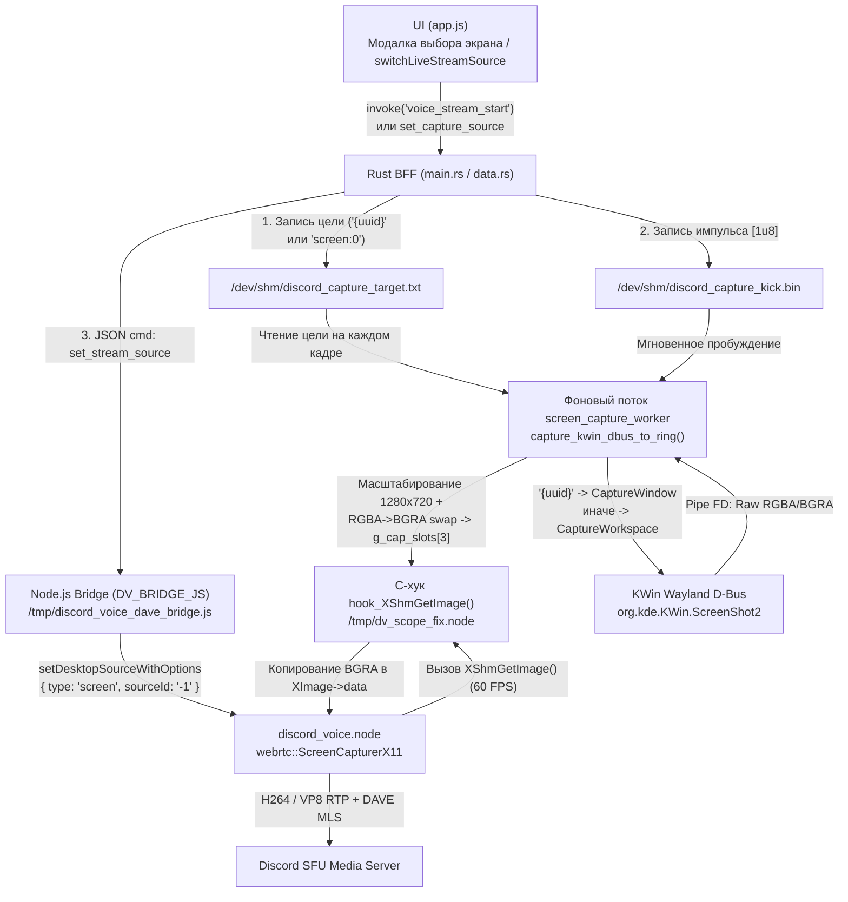
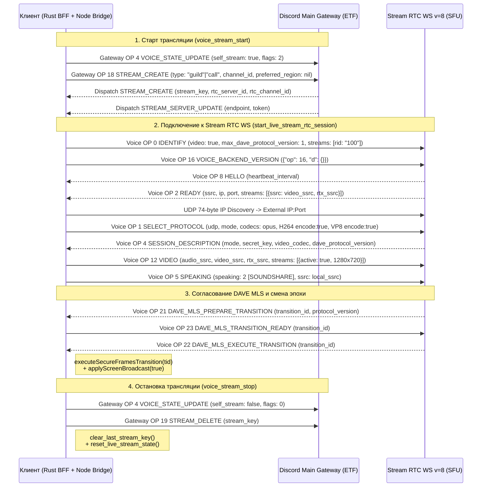

# Руководство по архитектуре, сигнализации и отладке Wayland-стриминга (`docs/specs/STREAM-WAYLAND-GUIDE.md`)

- **Задача**: `TASK-790` (`G6 Tech Writer` / `G5 Voice & Platform` / `G1 Backend`)
- **Связанные задачи**: `TASK-761`, `TASK-775`, `TASK-776`, `TASK-777`, `TASK-778`, `TASK-779`
- **Ключевые модули**:
  - [`rust/crates/discord-core/src/ws.rs`](file:///home/sanya/orca/project/rust/crates/discord-core/src/ws.rs) — нативный C-аддон `DV_SCOPE_FIX_C` (`/tmp/dv_scope_fix.node`), JS-раннер `DV_BRIDGE_JS` (`/tmp/discord_voice_dave_bridge.js`), сигнализация Gateway (`OP 4/18/19/20/22`) и Voice WS `v=8` (`OP 0/1/2/4/5/12/15/16/21/22/24`).
  - [`rust/gui-spike/src/data.rs`](file:///home/sanya/orca/project/rust/gui-spike/src/data.rs) — управление состоянием стрима (`reset_live_stream_state`), перечисление окон KWin (`query_kwin_active_windows`) и горячая смена цели захвата (`set_system_audio_device("set_capture_source")`).
  - [`rust/gui-spike/src/main.rs`](file:///home/sanya/orca/project/rust/gui-spike/src/main.rs) — Tauri IPC-команды `voice_stream_start`, `voice_stream_stop`, `voice_stream_watch`, `voice_stream_set_paused`.
  - [`rust/gui-spike/ui/app.js`](file:///home/sanya/orca/project/rust/gui-spike/ui/app.js) — UI-компоненты Stage Viewer (`#live-stream-stage-viewer`), плавающего PiP-превью (`#live-stream-pip-preview`) и переключения источника на лету (`switchLiveStreamSource`).

---

## 1. Архитектура захвата в Wayland: `ScreenCapturerX11` (`sourceId: '-1'`) + KWin `ScreenShot2` D-Bus Hook + `/dev/shm/discord_capture_target.txt`

### 1.1. Коренная причина сбоя стандартного WebRTC-захвата в Linux Wayland

Нативный модуль [`discord_voice.node`](file:///home/sanya/orca/project/rust/crates/discord-core/src/ws.rs#L2892) запускается в дочернем процессе Node.js с переменной окружения `XDG_SESSION_TYPE=x11` (для активации синхронного X11-захватчика внутри WebRTC и обхода блокирующих портальных диалогов при каждом переключении окна).

Внутри `discord_voice.node` вызов `SetScreenshareSourceLinux` создаёт один из двух классов WebRTC:
1. При `type: "window"` (`type: 2`) создаётся `webrtc::WindowCapturerX11`. В сессии KDE Plasma Wayland окна нативных Wayland-приложений не имеют собственных X11 XID-идентификаторов, а в качестве идентификатора окна используется UUID KWin вида `{6ad0aefd-103b-4fa1-b650-3e016c818a00}`. Попытка передать этот UUID или `"0"` в `SelectSource` приводит к ошибке парсинга XID (`0`), отказу `SelectSource(0)` и сбросу захватчика в `nullptr`:
   ```text
   (local_user.cpp:938): Screenshare: SetScreenshareSourceLinux with id: {6ad0aefd-103b-4fa1-b650-3e016c818a00}, type: 2
   (window_capturer_x11.cc:255): WindowCapturerX11::CreateRawWindowCapturer creates DesktopCapturer of type WindowCapturerX11
   (screenshare_helper.cpp:203): Screenshare: Failed to select source: 0
   (local_user.cpp:1182): SetDesktopScreenshare: (nil)
   (local_user.cpp:1145): SetScreenshare: (nil)
   ```
2. При `type: "screen"` и `sourceId: "0"` в отсутствии полноценной таблицы XRandR-мониторов `webrtc::ScreenCapturerX11::SelectSource(0)` также может возвращать `false`, переводя захватчик в `(nil)`, из-за чего видеоэнкодер не получает ни одного кадра (`packets sent: 0, bytes sent: 0`), а у зрителей в официальном клиенте Discord отображается бесконечная загрузка трансляции.

### 1.2. Архитектурное решение: инвариант `kFullDesktopScreenId = -1` и подмена `XShmGetImage`

В кодовой базе Linux WebRTC константа `webrtc::kFullDesktopScreenId` равна **`-1`**. Вызов `ScreenCapturerX11::SelectSource(-1)` безусловно возвращает `true` без обращения к списку XRandR-мониторов и переводит WebRTC в цикл захвата полного экрана через расширение MIT-SHM (`XShmGetImage`).

Поэтому архитектура захвата разделена на два независимых уровня:
1. **Контур управления WebRTC (`DV_BRIDGE_JS`)**: при старте стрима (`applyScreenBroadcast(true)`) и при любой горячей смене источника (`cmd === "set_stream_source"`) в `conn.setDesktopSourceWithOptions` **всегда** передаются неизменные параметры `type: "screen"` и `sourceId: "-1"` (при отключённых платформенных хуках `useVideoHook: false`, `useGraphicsCapture: false`, `useQuartzCapturer: false`, `allowScreenCaptureKit: false`, `hdrCaptureMode: "never"`). При этом `clearDesktopSource()` вызывается **только** при полной остановке стрима (`applyScreenBroadcast(false)`).
2. **Контур фактического захвата кадров (`DV_SCOPE_FIX_C` -> `/tmp/dv_scope_fix.node`)**: нативный C-модуль перехватывает `XShmQueryVersion` и `XShmGetImage` в адресном пространстве процесса, а фоновый поток `screen_capture_worker` со скоростью 60 FPS запрашивает изображение у композитора KDE KWin по D-Bus (`org.kde.KWin.ScreenShot2`), ориентируясь на содержимое файла `/dev/shm/discord_capture_target.txt`.



### 1.3. Пролог-патчинг XShm и кольцевой буфер в `/tmp/dv_scope_fix.node`

При инициализации `napi_register_module_v1` ([`ws.rs:2803-2880`](file:///home/sanya/orca/project/rust/crates/discord-core/src/ws.rs#L2803-L2880)) модуль `/tmp/dv_scope_fix.node`:
1. Предзагружает в `RTLD_GLOBAL` библиотеки `libffmpeg.so`, `libopenh264-2.7.0-linux64.8.so`, `libturbojpeg.so.0`, `libX11.so.6`, `libXext.so.6`, `libgio-2.0.so.0` и регистрирует путь к OpenH264 через `ff_libopenh264_set_library_path` / `ff_libopenh264_load_library`.
2. Патчит машинный пролог (`patch_prologue`, 12-байтный `movabs rax, <hook>; jmp rax`) функций:
   - `XShmQueryVersion` → `hook_XShmQueryVersion` (всегда сообщает WebRTC о наличии поддержки XShm v1.1 без shared pixmaps).
   - `XShmGetImage` → `hook_XShmGetImage` (обновляет атомарную метку времени `g_last_capture_req_ms = monotonic_ms()` и копирует последний готовый кадр из тройного кольцевого буфера `g_cap_slots[CAP_RING_SLOTS]` по индексу `g_cap_active_slot` в буфер `image->data`). Если первый кадр от KWin ещё не получен, `hook_XShmGetImage` генерирует плавный градиентный кадр-заполнитель, чтобы энкодер WebRTC стартовал немедленно без ошибок чтения.
3. Запускает два фоновых потока `pthread`:
   - `screen_capture_worker` — захват локального экрана/окна через KWin D-Bus в `g_cap_slots[3]` и генерация JPEG-миниатюры предпросмотра `/dev/shm/discord_live_preview_thumb.jpg` (отдаётся локальным HTTP-сервером `http://127.0.0.1:49281/preview.jpg`).
   - `remote_jpeg_encode_worker` — сжатие входящих кадров чужого стрима (`js_push_remote_frame` -> `g_rem_slots[3]`) в `/dev/shm/discord_remote_stream_frame.jpg` + метаданные `/dev/shm/discord_remote_stream_meta.bin` (`seq`, `width`, `height`, `fps`).

### 1.4. Маршрутизация целей захвата через `/dev/shm/discord_capture_target.txt` и KWin `ScreenShot2`

В функции [`capture_kwin_dbus_to_ring`](file:///home/sanya/orca/project/rust/crates/discord-core/src/ws.rs#L2292-L2437) на каждой итерации цикла захвата:
1. **Проверка импульса `/dev/shm/discord_capture_kick.bin`**:
   - Если файл существует, он немедленно удаляется (`unlink`), обновляется `g_last_capture_req_ms`, а текущий кадр принудительно сохраняется в `/dev/shm/discord_live_preview_thumb.jpg`.
2. **Чтение и нормализация `/dev/shm/discord_capture_target.txt`**:
   - Читается первая строка файла в `target_buf`.
   - Если в строке присутствует пара фигурных скобок `{...}` (например, `{6ad0aefd-103b-4fa1-b650-3e016c818a00}` или строка с префиксом `windows:{6ad0aefd-103b-4fa1-b650-3e016c818a00}:YouTube - Brave`), подстрока `{uuid}` сдвигается в начало `target_buf`.
3. **Выбор метода D-Bus `org.kde.KWin.ScreenShot2`** (объект `/org/kde/KWin/ScreenShot2`, шина `org.kde.KWin`):
   - Если `target_buf[0] == '{'`, вызывается метод **`CaptureWindow`** с сигнатурой `(sa{sv}h)`:
     - аргумент 1 (`s`): UUID окна `{...}`;
     - аргумент 2 (`a{sv}`): `{"include-cursor": true, "native-resolution": false}`;
     - аргумент 3 (`h`): индекс `0` в `GUnixFDList`, указывающий на write-конец неблокирующего pipe (`pfd[1]` с буфером 1 МБ).
   - Во всех остальных случаях (`"0"`, `"screen:0"`, `"screen"`, пустой файл) вызывается метод **`CaptureWorkspace`** с сигнатурой `(a{sv}h)` для захвата всего активного рабочего пространства.
4. **Цветокоррекция `RGBA ↔ BGRA` и масштабирование**:
   - Параллельный поток `kwin_pipe_reader_thread` вычитывает сырой буфер пикселей из `pfd[0]`, пока D-Bus возвращает словарь метаданных `(a{sv})` с полями `width`, `height`, `stride`, `format`.
   - KWin `ScreenShot2` передаёт буфер в формате `QImage::Format_RGBA8888` / `Format_RGBX8888` (`src_format` равен `16`, `17`, `18` или `0`), тогда как `XImage` в WebRTC `ScreenCapturerX11` ожидает порядок байтов `BGRA` (`0xAARRGGBB` в 32-битном little-endian слове).
   - При `need_swap = (src_format == 16 || src_format == 17 || src_format == 18 || src_format == 0)` выполняется побитовая перестановка каналов Red и Blue с сохранением Green и Alpha:
     ```c
     uint32_t swapped = ((px & 0x000000FFU) << 16) | ((px & 0x00FF0000U) >> 16) | (px & 0xFF00FF00U);
     ```
   - Кадр приводится к целевому разрешению `1280x720` и публикуется атомарной операцией `__atomic_store_n(&g_cap_active_slot, slot_idx, __ATOMIC_RELEASE)`.

| Тип цели в UI | Пример входной строки в `set_capture_source` | Запись в `/dev/shm/discord_capture_target.txt` | Метод D-Bus `org.kde.KWin.ScreenShot2` | Параметры `setDesktopSourceWithOptions` в WebRTC |
|---|---|---|---|---|
| Весь экран | `screens:screen:0:Экран 1` или `screen:0` | `screen:0` | `CaptureWorkspace(a{sv}, h)` | `type: "screen", sourceId: "-1"` |
| Отдельное окно (с вкладкой) | `windows:{6ad0aefd-103b-4fa1-b650-3e016c818a00}:YouTube` | `{6ad0aefd-103b-4fa1-b650-3e016c818a00}` | `CaptureWindow("{6ad0...}", a{sv}, h)` | `type: "screen", sourceId: "-1"` |
| Отдельное окно (прямой UUID) | `{9f8e7d6c-5b4a-3210-fedc-ba9876543210}` | `{9f8e7d6c-5b4a-3210-fedc-ba9876543210}` | `CaptureWindow("{9f8e...}", a{sv}, h)` | `type: "screen", sourceId: "-1"` |

---

## 2. Протокол сигнализации: Gateway `OP 18/19` и Voice `OP 1/12/16/22`

Трансляция экрана («Go Live») в Discord использует двойную сигнализацию:
1. **Основной шлюз (Main Gateway, ETF / `wetf`)** управляет жизненным циклом стрима в канале, отображением бейджа «В ЭФИРЕ» (`LIVE`) у участников и выделением выделенного медиа-сервера (`STREAM_SERVER_UPDATE`).
2. **Стрим-шлюз (Stream RTC WebSocket `wss://{endpoint}/?v=8`, JSON + Binary DAVE)** управляет согласованием UDP/SRTP, видеокодеков (`H264`/`VP8`), SSRC потоков и сквозным шифрованием DAVE MLS v1.



### 2.1. Опкоды основного шлюза (Main Gateway: `OP 18`, `OP 19` и сопутствующие `OP 4/20/22`)

Все исходящие пакеты основного шлюза кодируются в бинарный формат Erlang External Term Format (`ETF`) через `discord_codec::etf::encode` ([`ws.rs:1176-1469`](file:///home/sanya/orca/project/rust/crates/discord-core/src/ws.rs#L1176-L1469)). Для совместимости с парсером `wetf` (`null: "atom"`) на стороне Discord значения `null` обязательно кодируются как `EtfValue::Atom("nil")`, а булевы поля — как `EtfValue::Atom("true" | "false")`.

#### 1. `Gateway OP 18 STREAM_CREATE` (Создание трансляции)
- **Функции**: [`queue_live_stream_create`](file:///home/sanya/orca/project/rust/crates/discord-core/src/ws.rs#L1342-L1381) и автоматическая отправка при переходе `self_stream: true` в [`queue_live_voice_state_ext`](file:///home/sanya/orca/project/rust/crates/discord-core/src/ws.rs#L1264-L1305).
- **Назначение**: инициирует сессию `Go Live` в голосовом канале гильдии (`type: "guild"`) или в личном/групповом звонке (`type: "call"`).
- **Формат `stream_key`**:
  - Для гильдии: `guild:{guild_id}:{channel_id}:{user_id}` (4 сегмента; `server_id` берётся из индекса `1`, а `channel_id` — строго из индекса `2`).
  - Для личного звонка: `call:{channel_id}:{user_id}` (3 сегмента; `channel_id` берётся из индекса `1`).
- **Структура полезной нагрузки (в терминах JSON/ETF)**:
  ```json
  {
    "op": 18,
    "d": {
      "type": "guild",
      "guild_id": "132049582910394857",
      "channel_id": "987654321098765432",
      "preferred_region": null
    }
  }
  ```
  *(В ETF при `type: "call"` поле `guild_id` передаётся как `Atom("nil")`, `preferred_region` всегда `Atom("nil")`).*
- **Синхронно с `OP 18`** отправляется `Gateway OP 4 VOICE_STATE_UPDATE` с полями `"self_stream": true` и `"flags": 2`. В [`data::connect_or_update_live_voice_ext`](file:///home/sanya/orca/project/rust/gui-spike/src/data.rs) изменение флага `self_stream` (`stream_or_video_changed = true`) обходит 120-мс таймер коалесценции, чтобы статус «В ЭФИРЕ» загорался мгновенно.

#### 2. `Gateway OP 19 STREAM_DELETE` (Остановка или закрытие трансляции)
- **Функции**: [`queue_live_stream_delete`](file:///home/sanya/orca/project/rust/crates/discord-core/src/ws.rs#L1412-L1443), вызывается из `voice_stream_stop`, `voice_disconnect` ([`main.rs:1510-1553`](file:///home/sanya/orca/project/rust/gui-spike/src/main.rs#L1510-L1553)) и из `queue_live_voice_state_ext` при `self_stream: false`.
- **Назначение**: завершает собственную трансляцию вещателя (снимая плашку «В ЭФИРЕ» у всех участников канала) либо отключает зрителя от просмотра чужого стрима.
- **Структура полезной нагрузки**:
  ```json
  {
    "op": 19,
    "d": {
      "stream_key": "guild:132049582910394857:987654321098765432:112233445566778899"
    }
  }
  ```
- **Критический инвариант перезапуска стрима**:
  При вызове `queue_live_stream_delete` и `voice_stream_stop` обязательно выполняются:
  1. [`clear_last_stream_key()`](file:///home/sanya/orca/project/rust/crates/discord-core/src/ws.rs#L1330-L1337) — очищает кеш `LAST_STREAM_KEY`, иначе повторный запуск стрима в том же канале будет подавлен проверкой `prev_stream_key != Some(skey)`.
  2. [`data::reset_live_stream_state()`](file:///home/sanya/orca/project/rust/gui-spike/src/data.rs) — сбрасывает `LOCAL_SELF_STREAM` в `false`, очищает `stream_launched_token = None` и останавливает дочерний процесс стрим-воркера через `stop_live_stream_rtc_session()`.

#### 3. Сопутствующие опкоды основного шлюза (`OP 20` и `OP 22`)
- **`Gateway OP 20 STREAM_WATCH`** ([`queue_live_stream_watch`](file:///home/sanya/orca/project/rust/crates/discord-core/src/ws.rs#L1385-L1407)): `{"op": 20, "d": {"stream_key": "..."}}` — запрос на подключение зрителя к чужому стриму.
- **`Gateway OP 22 STREAM_SET_PAUSED`** ([`queue_live_stream_set_paused`](file:///home/sanya/orca/project/rust/crates/discord-core/src/ws.rs#L1447-L1469)): `{"op": 22, "d": {"stream_key": "...", "paused": true|false}}` — постановка собственной трансляции на паузу или снятие с паузы.

---

### 2.2. Опкоды голосового и стрим-шлюза (Voice WS `v=8`: `OP 1`, `OP 12`, `OP 16`, `OP 22`)

После получения от основного шлюза событий `STREAM_CREATE` и `STREAM_SERVER_UPDATE` функция [`start_live_stream_rtc_session`](file:///home/sanya/orca/project/rust/crates/discord-core/src/ws.rs#L4240-L4357) открывает второе WebSocket-соединение `wss://{endpoint}/?v=8` в потоке `stream-rtc-session` и спавнит выделенный процесс `node /tmp/discord_voice_dave_bridge.js` с `DV_CONTEXT="stream"`.

> [!IMPORTANT]
> **Изоляция микрофона в стрим-воркере (`ws.rs:5192-5217`)**: процесс с `DV_CONTEXT="stream"` никогда не подключается к физическому микрофону пользователя (`PULSE_SOURCE` устанавливается либо в `{default_sink}.monitor` при наличии системного аудио-монитора, либо в `__discord_stream_no_mic__`), чтобы WebRTC Audio Device Module стрим-сессии не перехватывал и не глушил микрофон основного голосового соединения.

#### 1. `Voice OP 16 VOICE_BACKEND_VERSION` (Запрос версии медиа-бэкенда)
- **Место в коде**: [`ws.rs:5325`](file:///home/sanya/orca/project/rust/crates/discord-core/src/ws.rs#L5325).
- **Момент отправки**: немедленно вслед за `Voice OP 0 IDENTIFY` при установке WebSocket-соединения `v=8`.
- **Полезная нагрузка**:
  ```json
  {"op": 16, "d": {}}
  ```
- **Назначение**: запрашивает у медиа-сервера Discord (SFU) версию голосового/видео бэкенда и воркера (`voice`, `rtc_worker`), завершая стандартную последовательность рукопожатия официального клиента.

#### 2. `Voice OP 1 SELECT_PROTOCOL` (Выбор протокола, адреса и видеокодеков)
- **Место в коде**: [`ws.rs:5576-5580`](file:///home/sanya/orca/project/rust/crates/discord-core/src/ws.rs#L5576-L5580) (pure-Rust) и [`ws.rs:5997-6018`](file:///home/sanya/orca/project/rust/crates/discord-core/src/ws.rs#L5997-L6018) (нативный мост `discord_voice.node`).
- **Момент отправки**: после приёма `Voice OP 2 READY` (из которого извлекаются `local_ssrc`, а также назначенные сервером `sfu_video_ssrc` и `sfu_rtx_ssrc` из массива `d.streams`) и завершения 74-байтового UDP IP Discovery.
- **Полезная нагрузка**:
  ```json
  {
    "op": 1,
    "d": {
      "protocol": "udp",
      "address": "203.0.113.42",
      "port": 54321,
      "mode": "aead_aes256_gcm_rtpsize",
      "data": {
        "address": "203.0.113.42",
        "port": 54321,
        "mode": "aead_aes256_gcm_rtpsize"
      },
      "codecs": [
        { "name": "opus", "type": "audio", "priority": 1000, "payload_type": 120 },
        { "name": "H264", "type": "video", "priority": 1000, "payload_type": 105, "rtx_payload_type": 106, "encode": true, "decode": true },
        { "name": "VP8",  "type": "video", "priority": 2000, "payload_type": 107, "rtx_payload_type": 108, "encode": true, "decode": true },
        { "name": "AV1",  "type": "video", "priority": 3000, "payload_type": 101, "rtx_payload_type": 102, "encode": false, "decode": true }
      ]
    }
  }
  ```
- **Ключевое требование паритета кодеков**:
  Флаг `encode: can_encode` (`true` для вещателя, определяется как `!is_stream_conn || is_self_broadcaster` с фоллбэком на `LAST_VOICE_STATE_CACHE`) **обязан быть включён одновременно и для `H264` (PT 105 / RTX 106), и для `VP8` (PT 107 / RTX 108)**. Если SFU-сервер или клиент зрителя выбирает `VP8` либо `H264` в ответном `Voice OP 4 SESSION_DESCRIPTION`, `DV_BRIDGE_JS` ([`ws.rs:3645-3677`](file:///home/sanya/orca/project/rust/crates/discord-core/src/ws.rs#L3645-L3677)) автоматически конфигурирует `videoEncoder` под согласованный кодек.

#### 3. `Voice OP 12 VIDEO` (Анонс и привязка видеопотоков SSRC / Simulcast)
- **Место в коде**:
  - Исходящий `OP 12` (TX после `OP 4 SESSION_DESCRIPTION`): [`ws.rs:5653-5674`](file:///home/sanya/orca/project/rust/crates/discord-core/src/ws.rs#L5653-L5674).
  - Входящий `OP 12` (RX от других участников): [`ws.rs:5889-5948`](file:///home/sanya/orca/project/rust/crates/discord-core/src/ws.rs#L5889-L5948).
- **Режим вещателя (`is_self_broadcaster == true`)**:
  Использует серверные `sfu_video_ssrc` и `sfu_rtx_ssrc` из `OP 2 READY` (или `local_ssrc + 1` / `local_ssrc + 2`, если сервер не прислал `d.streams`) и отправляет `OP 12 VIDEO` с активным дескриптором потока, а сразу за ним — `OP 5 SPEAKING` с битом `speaking: 2` (`SOUNDSHARE`):
  ```json
  {
    "op": 12,
    "d": {
      "audio_ssrc": 9208,
      "video_ssrc": 9209,
      "rtx_ssrc": 9210,
      "streams": [
        {
          "type": "video",
          "rid": "100",
          "ssrc": 9209,
          "active": true,
          "quality": 100,
          "rtx_ssrc": 9210,
          "max_bitrate": 2500000,
          "max_framerate": 30,
          "max_resolution": { "type": "fixed", "width": 1280, "height": 720 }
        }
      ]
    }
  }
  ```
- **Режим зрителя (`is_self_broadcaster == false`)**:
  Отправляет `{"op": 12, "d": {"audio_ssrc": local_ssrc, "video_ssrc": 0, "rtx_ssrc": 0, "streams": []}}` и запрашивает видеопоток у SFU через `Voice OP 15 MEDIA_SINK_WANTS`:
  ```json
  {"op": 15, "d": {"any": 100, "9209": 100}}
  ```
- **Обработка входящего `OP 12 VIDEO`**:
  Извлекает `user_id`, `audio_ssrc` и `video_ssrc` (включая вложенный массив `d.streams`), передаёт в нативный мост команду `{"cmd": "merge_user", "userId": "...", "ssrc": ..., "videoSsrc": ...}` (которая вызывает `conn.mergeUsers`, `conn.setDisableLocalVideo(uid, false)` и подписывает `setVideoOutputSink`), а также отправляет `OP 15 MEDIA_SINK_WANTS` для нового `video_ssrc`.

#### 4. `Voice OP 22 DAVE_MLS_EXECUTE_TRANSITION` (Переключение эпохи сквозного шифрования DAVE)
- **Место в коде**: [`ws.rs:4936-4945`](file:///home/sanya/orca/project/rust/crates/discord-core/src/ws.rs#L4936-L4945), [`ws.rs:5765-5781`](file:///home/sanya/orca/project/rust/crates/discord-core/src/ws.rs#L5765-L5781) и обработчик в `DV_BRIDGE_JS` [`ws.rs:3766-3782`](file:///home/sanya/orca/project/rust/crates/discord-core/src/ws.rs#L3766-L3782).
- **Контекст протокола DAVE (Discord Audio & Video End-to-End Encryption)**:
  Когда к каналу или стриму подключается/отключается участник, SFU инициирует смену криптографической эпохи MLS:
  - Бинарные пакеты `OP 25` (`ExternalSenderPackage`), `OP 27` (`Proposals`) -> клиент отвечает бинарным `OP 28` (`CommitWelcome`).
  - Сервер рассылает бинарные `OP 29` (`AnnounceCommitTransition`) или `OP 30` (`Welcome`) и JSON `OP 21 DAVE_MLS_PREPARE_TRANSITION` (`{"op": 21, "d": {"transition_id": tid, "protocol_version": 1}}`).
  - Клиент подготавливает новые ключи (`conn.prepareSecureFramesTransition`) и при `tid != 0` отправляет подтверждение `Voice OP 23 DAVE_MLS_TRANSITION_READY` (`{"op": 23, "d": {"transition_id": tid}}`).
  - Сервер присылает команду фиксации перехода **`Voice OP 22 DAVE_MLS_EXECUTE_TRANSITION`**:
    ```json
    {"op": 22, "d": {"transition_id": 14}}
    ```
- **Действия при получении `Voice OP 22`**:
  1. В нативный мост отправляется `{"cmd": "dave_execute_transition", "transitionId": tid}`.
  2. Мост вызывает `conn.executeSecureFramesTransition(tid)`, переключая SRTP/DAVE-рачет шифрования на новую эпоху.
  3. Немедленно вызываются `flushMergedUsersToConn(true)`, перепривязка `bindVideoSinkId(sid)` для всех активных видео-синков и, если процесс является вещателем (`isSelfBroadcaster`), повторно вызывается **`applyScreenBroadcast(true)`**. Это гарантирует, что после входа нового зрителя в стрим и ротации ключей DAVE MLS вещание видеокадров продолжается без замирания картинки.

#### Сводная таблица опкодов стриминга

| Шлюз | Опкод | Имя | Направление | Назначение |
|---|---|---|---|---|
| **Main Gateway** | `OP 4` | `VOICE_STATE_UPDATE` | Client → Server | Включение/выключение `self_stream: true/false` и `flags: 2/0` |
| **Main Gateway** | `OP 18` | `STREAM_CREATE` | Client → Server | Создание трансляции (`type: "guild" \| "call"`, `channel_id`) |
| **Main Gateway** | `OP 19` | `STREAM_DELETE` | Client → Server | Завершение стрима или прекращение просмотра (`stream_key`) + сброс `LAST_STREAM_KEY` |
| **Main Gateway** | `OP 20` | `STREAM_WATCH` | Client → Server | Подключение зрителя к чужому стриму (`stream_key`) |
| **Main Gateway** | `OP 22` | `STREAM_SET_PAUSED` | Client → Server | Постановка стрима на паузу / возобновление (`stream_key`, `paused`) |
| **Voice WS v8** | `OP 0` | `IDENTIFY` | Client → Server | Аутентификация на SFU с `video: true`, `max_dave_protocol_version: 1`, `streams` |
| **Voice WS v8** | `OP 16` | `VOICE_BACKEND_VERSION` | Client → Server | Запрос версии медиа-сервера `{"op": 16, "d": {}}` сразу после `OP 0` |
| **Voice WS v8** | `OP 2` | `READY` | Server → Client | Выделение `ssrc`, `ip:port` и серверных `video_ssrc` / `rtx_ssrc` в `d.streams` |
| **Voice WS v8** | `OP 1` | `SELECT_PROTOCOL` | Client → Server | Передача внешнего UDP `address:port`, режима шифрования и кодеков (`H264` + `VP8` `encode: true`) |
| **Voice WS v8** | `OP 4` | `SESSION_DESCRIPTION` | Server → Client | Ключ `secret_key`, выбранный `video_codec`, `dave_protocol_version` |
| **Voice WS v8** | `OP 12` | `VIDEO` | Двунаправленный | Анонс активных SSRC и разрешения `1280x720` вещателем / приём SSRC пиров |
| **Voice WS v8** | `OP 15` | `MEDIA_SINK_WANTS` | Двунаправленный | Запрос качества видеопотока (`{"any": 100, "<video_ssrc>": 100}`) |
| **Voice WS v8** | `OP 21` | `DAVE_PREPARE_TRANSITION` | Server → Client | Подготовка к ротации ключей эпохи DAVE MLS (`transition_id`) |
| **Voice WS v8** | `OP 22` | `DAVE_EXECUTE_TRANSITION` | Server → Client | Активация подготовленного перехода DAVE MLS + реапплай `applyScreenBroadcast(true)` |
| **Voice WS v8** | `OP 23` | `DAVE_TRANSITION_READY` | Client → Server | Подтверждение готовности клиента к переходу `transition_id` |

---

## 3. Отладка и диагностика через `/tmp/dv_stream_logs/`

### 3.1. Расположение логов и артефактов времени выполнения

При запуске `discord_voice.node` скрипт [`DV_BRIDGE_JS`](file:///home/sanya/orca/project/rust/crates/discord-core/src/ws.rs#L2900-L2904) разделяет каталоги логов и данных в зависимости от переменной окружения `DV_CONTEXT`:

| Компонент | Переменная `DV_CONTEXT` | Каталог логов WebRTC | Каталог данных | Локальный HTTP-сервер кадров |
|---|---|---|---|---|
| Основной голосовой канал | не задана (`default`) | `/tmp/dv_logs/` | `/tmp/dv_data/` | — |
| Воркер трансляции (Broadcaster / Viewer) | `DV_CONTEXT="stream"` | **`/tmp/dv_stream_logs/`** | `/tmp/dv_stream_data/` | `http://127.0.0.1:49281` |

Внутри `/tmp/dv_stream_logs/` создаются файлы:
- `discord-webrtc_0` (и `discord-webrtc_1` при превышении `maxLogBytes: 5_000_000`) — журнал текущей (или последней активной) сессии стрим-воркера.
- `discord-last-webrtc_0` — журнал предыдущей сессии стрим-воркера (сохраняется при перезапуске воркера).

Разделяемые файлы в `/dev/shm/`:
- `/dev/shm/discord_capture_target.txt` — текущая цель захвата (`{uuid}` окна KWin или `screen:0`).
- `/dev/shm/discord_capture_kick.bin` — однобайтовый триггер внеочередного захвата (удаляется воркером сразу после чтения).
- `/dev/shm/discord_live_preview_thumb.jpg` — JPEG-кадр локального предпросмотра своего стрима (обновляется каждые 8 кадров или по `kick.bin`).
- `/dev/shm/discord_remote_stream_frame.jpg` и `/dev/shm/discord_remote_stream_meta.bin` — последний декодированный кадр и 24-байтовый заголовок (`seq: u64`, `width: u32`, `height: u32`, `fps: u32`, `reserved: u32`) при просмотре чужого стрима.

---

### 3.2. Пошаговая методика отладки

#### Шаг 1. Проверка запуска стрим-воркера и инициализации аппаратных кодеков GPU
Убедитесь, что процесс стрим-воркера запущен и успешно определил аппаратные энкодеры (NVIDIA NVENC / AMD VAAPI / OpenH264):
```sh
ps aux | grep discord_voice_dave_bridge.js
grep -iE "GPU probe|video_linux_interop|Create connection" /tmp/dv_stream_logs/discord-webrtc_0
```
**Ожидаемый вывод в `/tmp/dv_stream_logs/discord-webrtc_0`**:
```text
INFO [video_linux_interop::encode::ffi] GPU probe results: GpuEncoderInfo { nvidia_support: GpuEncoderSupport { h264: true, h265: true, av1: true }, amd_support: GpuEncoderSupport { h264: true, ... } }
(voice_connection.cpp:728): Create connection to <SFU_IP>:<PORT> with ssrc: <AUDIO_SSRC>
```

#### Шаг 2. Проверка выбора источника захвата (`ScreenCapturerX11` и отсутствие сброса в `nil`)
Проверьте секцию `Screenshare` в логах стрим-воркера:
```sh
grep -iE "Screenshare|SetDesktopScreenshare|SetScreenshare|Set Video Broadcast|Capturer" /tmp/dv_stream_logs/discord-webrtc_0
```
- **Признак ошибки (сброс захватчика в `nil`)**:
  ```text
  (local_user.cpp:938): Screenshare: SetScreenshareSourceLinux with id: {6ad0aefd-...}, type: 2
  (screenshare_helper.cpp:203): Screenshare: Failed to select source: 0
  (local_user.cpp:1182): SetDesktopScreenshare: (nil)
  ```
  *Причина*: в `conn.setDesktopSourceWithOptions` был передан `type: "window"` или `sourceId` отличный от `"-1"`.
- **Признак нормальной работы**:
  В логах отсутствуют строки `Failed to select source` и `SetDesktopScreenshare: (nil)` (при активном вещании), присутствует `Set Video Broadcast 1`, а захватчик инициализирован с `id: -1, type: 1` (`ScreenCapturerX11`).

#### Шаг 3. Проверка цели захвата `/dev/shm/discord_capture_target.txt` и отклика KWin `ScreenShot2`
1. Проверьте текущую записанную цель захвата и свежесть превью-кадра:
   ```sh
   cat /dev/shm/discord_capture_target.txt && echo ""
   ls -la --time-style=full-iso /dev/shm/discord_live_preview_thumb.jpg
   curl -sI http://127.0.0.1:49281/preview.jpg
   ```
   Если `curl -sI http://127.0.0.1:49281/preview.jpg` возвращает `HTTP/1.1 200 OK` и `Content-Length` > 1000 байт, значит C-хук `capture_kwin_dbus_to_ring` успешно получает кадры от KWin и сжимает их через `libturbojpeg`.
2. Для проверки горячей смены источника вручную во время активного стрима запишите в `/dev/shm/discord_capture_target.txt` новое значение и создайте файл-триггер:
   ```sh
   # Переключение на захват всего рабочего стола:
   printf "screen:0" > /dev/shm/discord_capture_target.txt
   printf "\x01" > /dev/shm/discord_capture_kick.bin

   # Переключение на конкретное окно KWin по его UUID:
   printf "{92664f9a-5355-4be5-946a-37368160ae43}" > /dev/shm/discord_capture_target.txt
   printf "\x01" > /dev/shm/discord_capture_kick.bin
   ```

#### Шаг 4. Проверка кодирования и отправки RTP-видеопакетов на SFU
1. В стандартном выводе приложения (`[VOICE-RTC]`) каждые 3 секунды печатается телеметрия `BCAST_VIDEO_STATS` из `conn.getFilteredStats`:
   ```text
   [VOICE-RTC] Native event: {"ev":"log","msg":"BCAST_VIDEO_STATS codec=H264 inFps=60 encFps=60 framesEnc=180 framesSent=180 pkts=1420 bytes=1245800 dropQ=0 dropRate=0"}
   ```
   Убедитесь, что `inFps > 0`, `encFps > 0`, `framesSent > 0` и `bytes > 0`.
2. В `/tmp/dv_stream_logs/discord-webrtc_0` проверьте транспортную статистику `[stream] Transport stats` и оценку пропускной способности `REMB`:
   ```sh
   grep -E "\[stream\] (Transport|Outbound|Inbound) stats|Received REMB|Received receiver count" /tmp/dv_stream_logs/discord-webrtc_0 | tail -n 25
   ```
   В исправной трансляции `packets sent` и `bytes sent` монотонно растут, а при подключении зрителя появляется `Received receiver count for ssrc: <VIDEO_SSRC>: 1` и `Received REMB for ssrcs: <VIDEO_SSRC>: 4200000 [bps]`.

#### Шаг 5. Проверка приёма чужого стрима и переходов DAVE MLS
При просмотре чужой трансляции проверьте в `/tmp/dv_stream_logs/discord-webrtc_0`:
```sh
grep -iE "VideoReceiveStream2|RemoteUser delivering first video frame|decryptor|key ratchet|Frame size changed" /tmp/dv_stream_logs/discord-webrtc_0 | tail -n 30
```
**Ожидаемые записи при успешном декодировании**:
```text
(connection.cpp:877): Setting decryptor key ratchet for user: 384299970632876032, protocol version: 1
(decryptor.cpp:175): Decrypted audio: 1, video: 45. Failed audio: 0, video: 0
(remote_user.cpp:716): RemoteUser delivering first video frame from 384299970632876032, ssrc: 264
(video_adapter.cc:285): Frame size changed: scaled 0 / out 1 / in 1 Changes: 1 Input: 1280x704
```
Также проверьте локальный эндпоинт отдачи кадров для Stage Viewer / PiP:
```sh
curl -sI http://127.0.0.1:49281/frame.jpg
```
Ответ должен содержать заголовки `X-Frame-Seq`, `X-Frame-Width`, `X-Frame-Height` и `X-Stream-Fps`.

---

### 3.3. Сводная таблица неисправностей и способов устранения (Troubleshooting)

| Симптом | Диагностический признак в `/tmp/dv_stream_logs/` или `/dev/shm/` | Причина и способ устранения |
|---|---|---|
| У зрителей в официальном клиенте горит «В ЭФИРЕ», но при входе в стрим — вечная загрузка и `bytes sent: 0` | В `discord-webrtc_0`: `Screenshare: Failed to select source: 0` и `SetDesktopScreenshare: (nil)` | В `setDesktopSourceWithOptions` передан `sourceId: "0"` или UUID окна вместо `"-1"`. Проверить контракт `type: "screen", sourceId: "-1"` в `applyScreenBroadcast` и `set_stream_source` (`tests/unit/stream_broadcaster_handshake_and_source.test.mjs`). |
| При переключении окна во время стрима картинка замирает или пропадает | В `set_stream_source` вызывался `clearDesktopSource()` либо не записался `/dev/shm/discord_capture_target.txt` | Проверить, что `set_stream_source` не вызывает `clearDesktopSource()`, а `data.rs` записывает чистый `{uuid}` в `/dev/shm/discord_capture_target.txt` и `[1u8]` в `/dev/shm/discord_capture_kick.bin`. |
| Инвертированы красный и синий цвета (синие лица / красное небо) на трансляции | В `capture_kwin_dbus_to_ring` не сработал `need_swap` для формата `QImage` от KWin | Проверить условие `need_swap = (src_format == 16 \|\| src_format == 17 \|\| src_format == 18 \|\| src_format == 0)` и формулу побитового свопа `R ↔ B` (`tests/unit/screen_color_and_window_target.test.mjs`). |
| После остановки стрима повторное нажатие «Демонстрация экрана» в том же канале не запускает эфир | В логах шлюза не отправляется повторный `Gateway OP 18 STREAM_CREATE` | Не был очищен кеш `LAST_STREAM_KEY`. Проверить вызов `discord_core::ws::clear_last_stream_key()` и `data::reset_live_stream_state()` в `voice_stream_stop` (`tests/unit/stream_restart_lifecycle.test.mjs`). |
| Закрытие большого окна просмотра (Stage Viewer) крестиком `✕` полностью обрывает собственную трансляцию | В `app.js` обработчик `closeStageBtn` вызывал `closeStageViewer(true)` вместо `closeStageViewer(false)` | Для вещателя (`isSelfStream`) крестик `✕` и клавиша `Escape` должны вызывать `closeStageViewer(false)` (сворачивание в плавающий `#live-stream-pip-preview`), а полную остановку выполняет только кнопка «Прекратить стрим» (`stopStageBtn` -> `closeStageViewer(true)`). |

---

## 4. Автоматизированная верификация контрактов

Для проверки всех инвариантов архитектуры Wayland-стриминга, сигнализации и UI жизненного цикла выполните целевой набор модульных и регрессионных тестов:

```sh
node --test \
  tests/unit/screen_color_and_window_target.test.mjs \
  tests/unit/stream-signaling-parity.test.mjs \
  tests/unit/stream_broadcaster_handshake_and_source.test.mjs \
  tests/unit/stream_restart_lifecycle.test.mjs \
  tests/unit/stream_viewer_close_and_source_switch.test.mjs \
  tests/unit/stream-regression-task779.test.mjs
```
