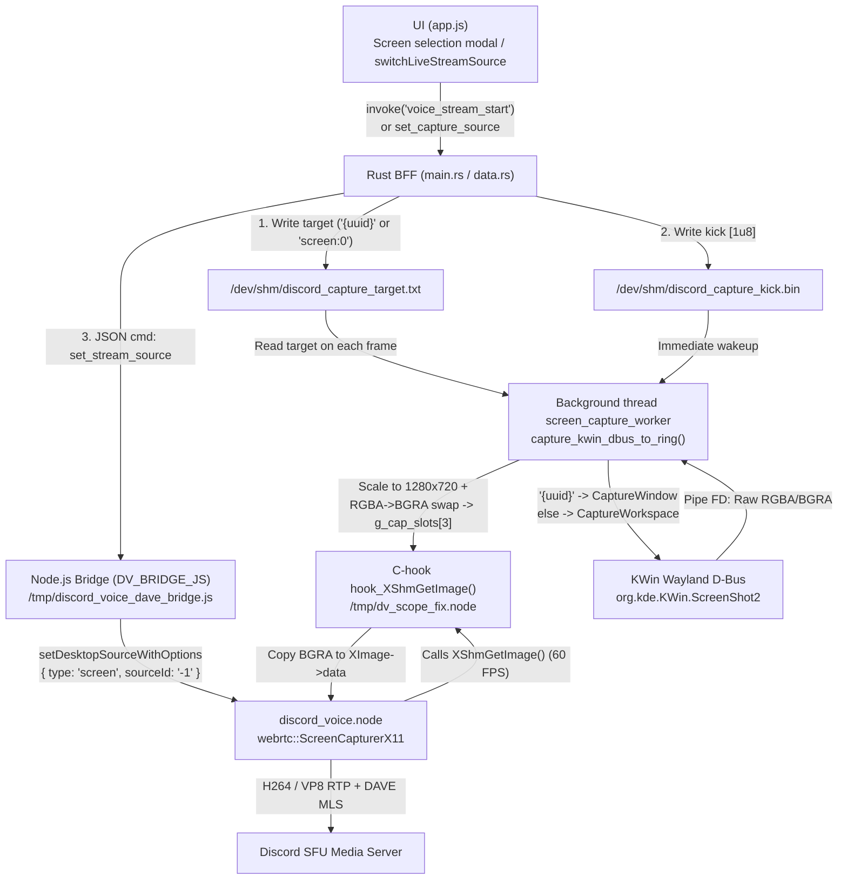
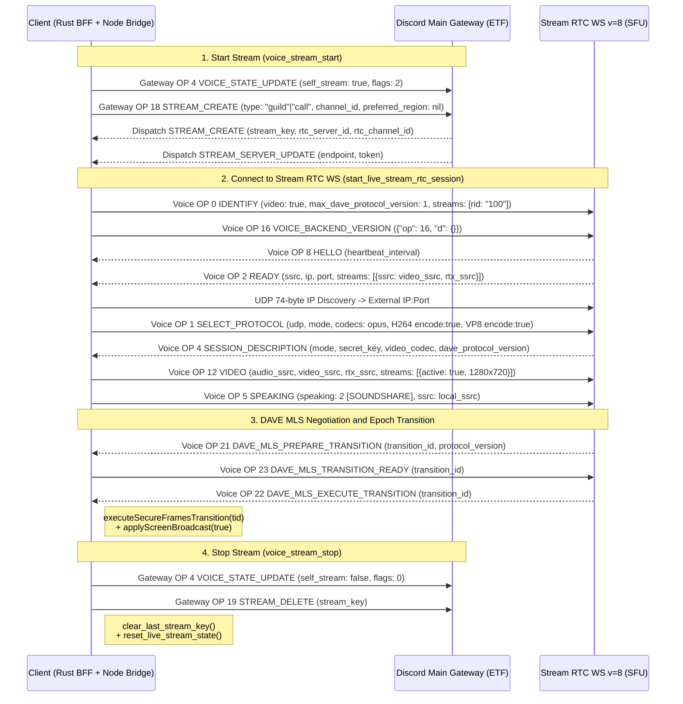

# Wayland Streaming Architecture, Signaling, and Debugging Guide (`docs/specs/STREAM-WAYLAND-GUIDE.md`)

- **Task**: `TASK-790` (`G6 Tech Writer` / `G5 Voice & Platform` / `G1 Backend`)
- **Related Tasks**: `TASK-761`, `TASK-775`, `TASK-776`, `TASK-777`, `TASK-778`, `TASK-779`
- **Key Modules**:
  - [`rust/crates/chord-core/src/ws.rs`](rust/crates/chord-core/src/ws.rs) — native C addon `DV_SCOPE_FIX_C` (`/tmp/dv_scope_fix.node`), JS runner `DV_BRIDGE_JS` (`/tmp/discord_voice_dave_bridge.js`), Gateway signaling (`OP 4/18/19/20/22`), and Voice WS `v=8` (`OP 0/1/2/4/5/12/15/16/21/22/24`).
  - [`rust/gui-spike/src/data.rs`](rust/gui-spike/src/data.rs) — stream state management (`reset_live_stream_state`), KWin window enumeration (`query_kwin_active_windows`), and on-the-fly capture target updates (`set_system_audio_device("set_capture_source")`).
  - [`rust/gui-spike/src/main.rs`](rust/gui-spike/src/main.rs) — Tauri IPC commands `voice_stream_start`, `voice_stream_stop`, `voice_stream_watch`, `voice_stream_set_paused`.
  - [`rust/gui-spike/ui/app.js`](rust/gui-spike/ui/app.js) — UI components for Stage Viewer (`#live-stream-stage-viewer`), floating PiP preview (`#live-stream-pip-preview`), and hot-switching capture targets (`switchLiveStreamSource`).

---

## 1. Wayland Capture Architecture: `ScreenCapturerX11` (`sourceId: '-1'`) + KWin `ScreenShot2` D-Bus Hook + `/dev/shm/discord_capture_target.txt`

### 1.1. Root Cause of Standard WebRTC Capture Failures in Linux Wayland

The native module [`discord_voice.node`](rust/crates/chord-core/src/ws.rs#L2892) launches inside a child Node.js process with the environment variable `XDG_SESSION_TYPE=x11` (to activate the synchronous X11 capturer within WebRTC and bypass blocking portal prompts on every window change).

Within `discord_voice.node`, the `SetScreenshareSourceLinux` invocation instantiates one of two WebRTC classes:
1. With `type: "window"` (`type: 2`), `webrtc::WindowCapturerX11` is instantiated. In a KDE Plasma Wayland session, native Wayland application windows lack X11 XID handles, using KWin UUIDs such as `{6ad0aefd-103b-4fa1-b650-3e016c818a00}` instead. Passing this UUID or `"0"` to `SelectSource` causes an XID parse error (`0`), failing `SelectSource(0)` and resetting the capturer pointer to `nullptr`:
   ```text
   (local_user.cpp:938): Screenshare: SetScreenshareSourceLinux with id: {6ad0aefd-103b-4fa1-b650-3e016c818a00}, type: 2
   (window_capturer_x11.cc:255): WindowCapturerX11::CreateRawWindowCapturer creates DesktopCapturer of type WindowCapturerX11
   (screenshare_helper.cpp:203): Screenshare: Failed to select source: 0
   (local_user.cpp:1182): SetDesktopScreenshare: (nil)
   (local_user.cpp:1145): SetScreenshare: (nil)
   ```
2. With `type: "screen"` and `sourceId: "0"`, without a complete XRandR monitor table, `webrtc::ScreenCapturerX11::SelectSource(0)` may also return `false`, setting the capturer to `(nil)`. The video encoder then receives zero frames (`packets sent: 0, bytes sent: 0`), leaving viewers in the official Discord client stuck in an infinite loading spinner.

### 1.2. Architectural Solution: Invariant `kFullDesktopScreenId = -1` and `XShmGetImage` Interception

In the Linux WebRTC codebase, `webrtc::kFullDesktopScreenId` is defined as **`-1`**. Calling `ScreenCapturerX11::SelectSource(-1)` unconditionally returns `true` without querying XRandR monitors, switching WebRTC into a full-desktop capture loop via the MIT-SHM extension (`XShmGetImage`).

The capture architecture is therefore partitioned into two decoupled tiers:
1. **WebRTC Control Plane (`DV_BRIDGE_JS`)**: At stream start (`applyScreenBroadcast(true)`) and during any on-the-fly target switch (`cmd === "set_stream_source"`), `conn.setDesktopSourceWithOptions` is **always** invoked with fixed parameters `type: "screen"` and `sourceId: "-1"` (with platform hooks disabled: `useVideoHook: false`, `useGraphicsCapture: false`, `useQuartzCapturer: false`, `allowScreenCaptureKit: false`, `hdrCaptureMode: "never"`). `clearDesktopSource()` is invoked **strictly** upon stream termination (`applyScreenBroadcast(false)`).
2. **Frame Capture Plane (`DV_SCOPE_FIX_C` -> `/tmp/dv_scope_fix.node`)**: The native C module intercepts `XShmQueryVersion` and `XShmGetImage` within the process address space. A background thread `screen_capture_worker` at 60 FPS queries frame data from KDE KWin via D-Bus (`org.kde.KWin.ScreenShot2`), guided by `/dev/shm/discord_capture_target.txt`.



### 1.3. XShm Prologue Patching and Ring Buffer in `/tmp/dv_scope_fix.node`

Upon initialization in `napi_register_module_v1` ([`ws.rs:2803-2880`](rust/crates/chord-core/src/ws.rs#L2803-L2880)), the `/tmp/dv_scope_fix.node` module:
1. Preloads shared libraries into `RTLD_GLOBAL`: `libffmpeg.so`, `libopenh264-2.7.0-linux64.8.so`, `libturbojpeg.so.0`, `libX11.so.6`, `libXext.so.6`, `libgio-2.0.so.0`, and configures the OpenH264 library path via `ff_libopenh264_set_library_path` / `ff_libopenh264_load_library`.
2. Patches the machine code prologue (`patch_prologue`, 12-byte `movabs rax, <hook>; jmp rax`) for:
   - `XShmQueryVersion` → `hook_XShmQueryVersion` (always reports XShm v1.1 support without shared pixmaps).
   - `XShmGetImage` → `hook_XShmGetImage` (updates atomic timestamp `g_last_capture_req_ms = monotonic_ms()` and copies the latest frame from the triple ring buffer `g_cap_slots[CAP_RING_SLOTS]` at index `g_cap_active_slot` into `image->data`). If the first frame from KWin has not yet arrived, `hook_XShmGetImage` renders a placeholder gradient frame so the WebRTC encoder starts immediately without read faults.
3. Launches two background `pthread` workers:
   - `screen_capture_worker` — captures local screen/window via KWin D-Bus into `g_cap_slots[3]` and generates preview thumbnail `/dev/shm/discord_live_preview_thumb.jpg` (served by local HTTP server at `http://127.0.0.1:49281/preview.jpg`).
   - `remote_jpeg_encode_worker` — compresses inbound peer stream frames (`js_push_remote_frame` -> `g_rem_slots[3]`) into `/dev/shm/discord_remote_stream_frame.jpg` + metadata `/dev/shm/discord_remote_stream_meta.bin` (`seq`, `width`, `height`, `fps`).

### 1.4. Capture Target Routing via `/dev/shm/discord_capture_target.txt` and KWin `ScreenShot2`

In [`capture_kwin_dbus_to_ring`](rust/crates/chord-core/src/ws.rs#L2292-L2437), on every capture cycle iteration:
1. **Impulse Trigger Check `/dev/shm/discord_capture_kick.bin`**:
   - If present, unlinked immediately, `g_last_capture_req_ms` is updated, and current frame is written to `/dev/shm/discord_live_preview_thumb.jpg`.
2. **Read and Normalize `/dev/shm/discord_capture_target.txt`**:
   - First line read into `target_buf`.
   - If line contains curly braces `{...}` (e.g. `{6ad0aefd-103b-4fa1-b650-3e016c818a00}` or `windows:{6ad0...}:YouTube`), the `{uuid}` substring is normalized to the beginning of `target_buf`.
3. **Dispatch D-Bus Method `org.kde.KWin.ScreenShot2`** (object `/org/kde/KWin/ScreenShot2`, bus `org.kde.KWin`):
   - If `target_buf[0] == '{'`, calls **`CaptureWindow`** with signature `(sa{sv}h)`:
     - arg 1 (`s`): window UUID `{...}`;
     - arg 2 (`a{sv}`): `{"include-cursor": true, "native-resolution": false}`;
     - arg 3 (`h`): index `0` in `GUnixFDList` referencing the write end of a non-blocking pipe (`pfd[1]` with 1 MB buffer).
   - In all other cases (`"0"`, `"screen:0"`, `"screen"`, empty file), calls **`CaptureWorkspace`** with signature `(a{sv}h)` to capture the full active workspace.
4. **Color Correction `RGBA ↔ BGRA` and Scaling**:
   - Background thread `kwin_pipe_reader_thread` reads raw pixel buffer from `pfd[0]` while D-Bus returns metadata dictionary `(a{sv})` (`width`, `height`, `stride`, `format`).
   - KWin `ScreenShot2` outputs in format `QImage::Format_RGBA8888` / `Format_RGBX8888` (`src_format` is `16`, `17`, `18`, or `0`), while `XImage` in WebRTC `ScreenCapturerX11` expects `BGRA` byte order (`0xAARRGGBB` in 32-bit little-endian words).
   - When `need_swap = (src_format == 16 || src_format == 17 || src_format == 18 || src_format == 0)`, a bitwise Red-Blue swap is applied preserving Green and Alpha:
     ```c
     uint32_t swapped = ((px & 0x000000FFU) << 16) | ((px & 0x00FF0000U) >> 16) | (px & 0xFF00FF00U);
     ```
   - Frame scaled to `1280x720` and published atomically via `__atomic_store_n(&g_cap_active_slot, slot_idx, __ATOMIC_RELEASE)`.

| UI Target Type | Example Input String in `set_capture_source` | Written to `/dev/shm/discord_capture_target.txt` | D-Bus Method `org.kde.KWin.ScreenShot2` | WebRTC `setDesktopSourceWithOptions` Parameters |
|---|---|---|---|---|
| Full Screen | `screens:screen:0:Screen 1` or `screen:0` | `screen:0` | `CaptureWorkspace(a{sv}, h)` | `type: "screen", sourceId: "-1"` |
| Specific Window (with title) | `windows:{6ad0aefd-103b-4fa1-b650-3e016c818a00}:YouTube` | `{6ad0aefd-103b-4fa1-b650-3e016c818a00}` | `CaptureWindow("{6ad0...}", a{sv}, h)` | `type: "screen", sourceId: "-1"` |
| Specific Window (raw UUID) | `{9f8e7d6c-5b4a-3210-fedc-ba9876543210}` | `{9f8e7d6c-5b4a-3210-fedc-ba9876543210}` | `CaptureWindow("{9f8e...}", a{sv}, h)` | `type: "screen", sourceId: "-1"` |

---

## 2. Signaling Protocol: Gateway `OP 18/19` and Voice `OP 1/12/16/22`

Discord "Go Live" screen sharing relies on dual-channel signaling:
1. **Main Gateway (ETF / `wetf`)**: Manages the stream lifecycle within the channel, renders the `LIVE` badge, and allocates the media server (`STREAM_SERVER_UPDATE`).
2. **Stream Gateway (Stream RTC WebSocket `wss://{endpoint}/?v=8`, JSON + Binary DAVE)**: Manages UDP/SRTP negotiation, video codecs (`H264`/`VP8`), stream SSRCs, and DAVE MLS v1 end-to-end encryption.



### 2.1. Main Gateway Opcodes: `OP 18`, `OP 19`, and Related `OP 4/20/22`

All outbound packets to the main gateway are encoded into Erlang External Term Format (`ETF`) via `discord_codec::etf::encode` ([`ws.rs:1176-1469`](rust/crates/chord-core/src/ws.rs#L1176-L1469)). For compatibility with `wetf` (`null: "atom"`), `null` values must be encoded as `EtfValue::Atom("nil")`, and boolean fields as `EtfValue::Atom("true" | "false")`.

#### 1. `Gateway OP 18 STREAM_CREATE`
- **Functions**: [`queue_live_stream_create`](rust/crates/chord-core/src/ws.rs#L1342-L1381) and auto-dispatch upon `self_stream: true` in [`queue_live_voice_state_ext`](rust/crates/chord-core/src/ws.rs#L1264-L1305).
- **Purpose**: Initiates a `Go Live` session in a guild voice channel (`type: "guild"`) or direct call (`type: "call"`).
- **Format of `stream_key`**:
  - Guild: `guild:{guild_id}:{channel_id}:{user_id}` (4 segments; `server_id` at index `1`, `channel_id` at index `2`).
  - Direct call: `call:{channel_id}:{user_id}` (3 segments; `channel_id` at index `1`).
- **Payload Schema**:
  ```json
  {
    "op": 18,
    "d": {
      "type": "guild",
      "guild_id": "132049582910394857",
      "channel_id": "987654321098765432",
      "preferred_region": null
    }
  }
  ```
- Dispatched concurrently with `Gateway OP 4 VOICE_STATE_UPDATE` with `"self_stream": true` and `"flags": 2`.

#### 2. `Gateway OP 19 STREAM_DELETE`
- **Functions**: [`queue_live_stream_delete`](rust/crates/chord-core/src/ws.rs#L1412-L1443), called from `voice_stream_stop`, `voice_disconnect` ([`main.rs:1510-1553`](rust/gui-spike/src/main.rs#L1510-L1553)) and `queue_live_voice_state_ext` on `self_stream: false`.
- **Purpose**: Stops broadcaster's stream or disconnects a viewer.
- **Payload Schema**:
  ```json
  {
    "op": 19,
    "d": {
      "stream_key": "guild:132049582910394857:987654321098765432:112233445566778899"
    }
  }
  ```
- **Stream Restart Invariants**:
  When invoking `queue_live_stream_delete` and `voice_stream_stop`:
  1. [`clear_last_stream_key()`](rust/crates/chord-core/src/ws.rs#L1330-L1337) clears cached `LAST_STREAM_KEY`.
  2. [`data::reset_live_stream_state()`](rust/gui-spike/src/data.rs) resets `LOCAL_SELF_STREAM` to `false`, clears `stream_launched_token = None`, and terminates child stream worker via `stop_live_stream_rtc_session()`.

#### 3. Related Gateway Opcodes (`OP 20` and `OP 22`)
- **`Gateway OP 20 STREAM_WATCH`** ([`queue_live_stream_watch`](rust/crates/chord-core/src/ws.rs#L1385-L1407)): `{"op": 20, "d": {"stream_key": "..."}}`.
- **`Gateway OP 22 STREAM_SET_PAUSED`** ([`queue_live_stream_set_paused`](rust/crates/chord-core/src/ws.rs#L1447-L1469)): `{"op": 22, "d": {"stream_key": "...", "paused": true|false}}`.

---

### 2.2. Voice & Stream Gateway Opcodes (Voice WS `v=8`: `OP 1`, `OP 12`, `OP 16`, `OP 22`)

Upon receiving `STREAM_CREATE` and `STREAM_SERVER_UPDATE`, [`start_live_stream_rtc_session`](rust/crates/chord-core/src/ws.rs#L4240-L4357) establishes a second WebSocket connection `wss://{endpoint}/?v=8` and spawns `node /tmp/discord_voice_dave_bridge.js` with `DV_CONTEXT="stream"`.

> [!IMPORTANT]
> **Microphone Isolation in Stream Worker (`ws.rs:5192-5217`)**: The `DV_CONTEXT="stream"` process never connects to the physical microphone (`PULSE_SOURCE` set to `{default_sink}.monitor` or `__discord_stream_no_mic__`), preventing the stream ADM from muting or hijacking the main voice audio channel.

#### 1. `Voice OP 16 VOICE_BACKEND_VERSION`
- **Location**: [`ws.rs:5325`](rust/crates/chord-core/src/ws.rs#L5325).
- **Timing**: Dispatched immediately after `Voice OP 0 IDENTIFY`.
- **Payload**: `{"op": 16, "d": {}}`.

#### 2. `Voice OP 1 SELECT_PROTOCOL`
- **Location**: [`ws.rs:5576-5580`](rust/crates/chord-core/src/ws.rs#L5576-L5580) and [`ws.rs:5997-6018`](rust/crates/chord-core/src/ws.rs#L5997-L6018).
- **Timing**: Following `Voice OP 2 READY` and 74-byte UDP IP Discovery.
- **Payload**:
  ```json
  {
    "op": 1,
    "d": {
      "protocol": "udp",
      "address": "203.0.113.42",
      "port": 54321,
      "mode": "aead_aes256_gcm_rtpsize",
      "data": {
        "address": "203.0.113.42",
        "port": 54321,
        "mode": "aead_aes256_gcm_rtpsize"
      },
      "codecs": [
        { "name": "opus", "type": "audio", "priority": 1000, "payload_type": 120 },
        { "name": "H264", "type": "video", "priority": 1000, "payload_type": 105, "rtx_payload_type": 106, "encode": true, "decode": true },
        { "name": "VP8",  "type": "video", "priority": 2000, "payload_type": 107, "rtx_payload_type": 108, "encode": true, "decode": true },
        { "name": "AV1",  "type": "video", "priority": 3000, "payload_type": 101, "rtx_payload_type": 102, "encode": false, "decode": true }
      ]
    }
  }
  ```
- **Codec Parity Requirement**: Both `H264` (PT 105) and `VP8` (PT 107) must advertise `encode: true`.

#### 3. `Voice OP 12 VIDEO`
- **Location**:
  - Outbound TX: [`ws.rs:5653-5674`](rust/crates/chord-core/src/ws.rs#L5653-L5674).
  - Inbound RX: [`ws.rs:5889-5948`](rust/crates/chord-core/src/ws.rs#L5889-L5948).
- **Broadcaster Mode (`is_self_broadcaster == true`)**:
  ```json
  {
    "op": 12,
    "d": {
      "audio_ssrc": 9208,
      "video_ssrc": 9209,
      "rtx_ssrc": 9210,
      "streams": [
        {
          "type": "video",
          "rid": "100",
          "ssrc": 9209,
          "active": true,
          "quality": 100,
          "rtx_ssrc": 9210,
          "max_bitrate": 2500000,
          "max_framerate": 30,
          "max_resolution": { "type": "fixed", "width": 1280, "height": 720 }
        }
      ]
    }
  }
  ```
  Followed immediately by `OP 5 SPEAKING` with bit `speaking: 2` (`SOUNDSHARE`).
- **Viewer Mode (`is_self_broadcaster == false`)**:
  Sends `OP 12` with empty streams array and queries SFU via `Voice OP 15 MEDIA_SINK_WANTS`:
  ```json
  {"op": 15, "d": {"any": 100, "9209": 100}}
  ```

#### 4. `Voice OP 22 DAVE_MLS_EXECUTE_TRANSITION`
- **Location**: [`ws.rs:4936-4945`](rust/crates/chord-core/src/ws.rs#L4936-L4945), [`ws.rs:5765-5781`](rust/crates/chord-core/src/ws.rs#L5765-L5781), handler in [`ws.rs:3766-3782`](rust/crates/chord-core/src/ws.rs#L3766-L3782).
- When receiving `Voice OP 22`:
  1. Sends `{"cmd": "dave_execute_transition", "transitionId": tid}` to native bridge.
  2. Bridge calls `conn.executeSecureFramesTransition(tid)`.
  3. Re-applies `flushMergedUsersToConn(true)`, rebinds `bindVideoSinkId(sid)`, and if broadcaster, re-invokes **`applyScreenBroadcast(true)`** ensuring uninterrupted streaming upon new viewer joins.

#### Streaming Opcodes Reference Table

| Gateway | Opcode | Name | Direction | Purpose |
|---|---|---|---|---|
| **Main Gateway** | `OP 4` | `VOICE_STATE_UPDATE` | Client → Server | Toggles `self_stream: true/false` and `flags: 2/0` |
| **Main Gateway** | `OP 18` | `STREAM_CREATE` | Client → Server | Initiates stream (`type: "guild" \| "call"`, `channel_id`) |
| **Main Gateway** | `OP 19` | `STREAM_DELETE` | Client → Server | Terminates stream or stops watching (`stream_key`) |
| **Main Gateway** | `OP 20` | `STREAM_WATCH` | Client → Server | Viewer connects to remote stream (`stream_key`) |
| **Main Gateway** | `OP 22` | `STREAM_SET_PAUSED` | Client → Server | Pause / unpause active stream (`stream_key`, `paused`) |
| **Voice WS v8** | `OP 0` | `IDENTIFY` | Client → Server | SFU authentication with `video: true`, `streams` |
| **Voice WS v8** | `OP 16` | `VOICE_BACKEND_VERSION` | Client → Server | Queries media backend version `{"op": 16, "d": {}}` |
| **Voice WS v8** | `OP 2` | `READY` | Server → Client | Allocates `ssrc`, `ip:port`, and server stream SSRCs |
| **Voice WS v8** | `OP 1` | `SELECT_PROTOCOL` | Client → Server | Submits external UDP endpoint, encryption mode, codecs |
| **Voice WS v8** | `OP 4` | `SESSION_DESCRIPTION` | Server → Client | Cryptographic `secret_key`, negotiated `video_codec` |
| **Voice WS v8** | `OP 12` | `VIDEO` | Bidirectional | Stream descriptor broadcast and peer SSRC advertisement |
| **Voice WS v8** | `OP 15` | `MEDIA_SINK_WANTS` | Bidirectional | Requests video stream quality tier |
| **Voice WS v8** | `OP 21` | `DAVE_PREPARE_TRANSITION` | Server → Client | Prepares DAVE MLS epoch key rotation (`transition_id`) |
| **Voice WS v8** | `OP 22` | `DAVE_EXECUTE_TRANSITION` | Server → Client | Commits DAVE MLS transition + `applyScreenBroadcast(true)` |
| **Voice WS v8** | `OP 23` | `DAVE_TRANSITION_READY` | Client → Server | Acknowledges transition preparation readiness |

---

## 3. Debugging and Diagnostics via `/tmp/dv_stream_logs/`

### 3.1. Log File and Runtime Artifact Layout

When launching `discord_voice.node`, [`DV_BRIDGE_JS`](rust/crates/chord-core/src/ws.rs#L2900-L2904) partitions log and data directories based on `DV_CONTEXT`:

| Component | `DV_CONTEXT` | WebRTC Log Directory | Data Directory | Local HTTP Frame Server |
|---|---|---|---|---|
| Main Voice Channel | unset (`default`) | `/tmp/dv_logs/` | `/tmp/dv_data/` | — |
| Stream Worker (Broadcaster / Viewer) | `DV_CONTEXT="stream"` | **`/tmp/dv_stream_logs/`** | `/tmp/dv_stream_data/` | `http://127.0.0.1:49281` |

Files generated inside `/tmp/dv_stream_logs/`:
- `discord-webrtc_0` — log file for current/active stream worker session.
- `discord-last-webrtc_0` — log file for previous session.

Shared memory files in `/dev/shm/`:
- `/dev/shm/discord_capture_target.txt` — active capture target (`{uuid}` or `screen:0`).
- `/dev/shm/discord_capture_kick.bin` — 1-byte capture trigger.
- `/dev/shm/discord_live_preview_thumb.jpg` — local preview JPEG thumbnail.
- `/dev/shm/discord_remote_stream_frame.jpg` and `/dev/shm/discord_remote_stream_meta.bin` — latest decoded remote frame and 24-byte header (`seq: u64`, `width: u32`, `height: u32`, `fps: u32`, `reserved: u32`).

---

### 3.2. Step-by-Step Troubleshooting Procedure

#### Step 1. Verify Stream Worker Launch and GPU Encoder Detection
Ensure stream worker process is active and detected hardware encoders:
```sh
ps aux | grep discord_voice_dave_bridge.js
grep -iE "GPU probe|video_linux_interop|Create connection" /tmp/dv_stream_logs/discord-webrtc_0
```

#### Step 2. Verify Capture Source Selection (`ScreenCapturerX11` & Nil Check)
Check the `Screenshare` section in the stream worker log:
```sh
grep -iE "Screenshare|SetDesktopScreenshare|SetScreenshare|Set Video Broadcast|Capturer" /tmp/dv_stream_logs/discord-webrtc_0
```
- **Defect Symptom (`nil` capturer reset)**:
  `Screenshare: Failed to select source: 0` and `SetDesktopScreenshare: (nil)`.
  *Resolution*: Verify `type: "screen", sourceId: "-1"` in `conn.setDesktopSourceWithOptions`.
- **Healthy Execution**:
  Zero instances of `Failed to select source`. `Set Video Broadcast 1` present with `ScreenCapturerX11`.

#### Step 3. Verify `/dev/shm/discord_capture_target.txt` and KWin Response
1. Check current capture target and preview freshness:
   ```sh
   cat /dev/shm/discord_capture_target.txt && echo ""
   ls -la --time-style=full-iso /dev/shm/discord_live_preview_thumb.jpg
   curl -sI http://127.0.0.1:49281/preview.jpg
   ```
2. Manually test dynamic source switching:
   ```sh
   # Switch to full desktop:
   printf "screen:0" > /dev/shm/discord_capture_target.txt
   printf "\x01" > /dev/shm/discord_capture_kick.bin

   # Switch to specific KWin window UUID:
   printf "{92664f9a-5355-4be5-946a-37368160ae43}" > /dev/shm/discord_capture_target.txt
   printf "\x01" > /dev/shm/discord_capture_kick.bin
   ```

#### Step 4. Verify Video RTP Encoding and Transmission to SFU
1. Observe `BCAST_VIDEO_STATS` telemetry in application stdout:
   ```text
   [VOICE-RTC] Native event: {"ev":"log","msg":"BCAST_VIDEO_STATS codec=H264 inFps=60 encFps=60 framesEnc=180 framesSent=180 pkts=1420 bytes=1245800 dropQ=0 dropRate=0"}
   ```
2. Check transport stats in `/tmp/dv_stream_logs/discord-webrtc_0`:
   ```sh
   grep -E "\[stream\] (Transport|Outbound|Inbound) stats|Received REMB|Received receiver count" /tmp/dv_stream_logs/discord-webrtc_0 | tail -n 25
   ```

#### Step 5. Verify Remote Stream Decoding and DAVE Transitions
When viewing peer stream:
```sh
grep -iE "VideoReceiveStream2|RemoteUser delivering first video frame|decryptor|key ratchet|Frame size changed" /tmp/dv_stream_logs/discord-webrtc_0 | tail -n 30
```
Check local frame endpoint for Stage Viewer:
```sh
curl -sI http://127.0.0.1:49281/frame.jpg
```

---

### 3.3. Troubleshooting Matrix

| Symptom | Indicator in Logs or `/dev/shm/` | Root Cause and Remediation |
|---|---|---|
| Viewers see `LIVE` badge, but opening stream results in infinite loading and `bytes sent: 0` | In `discord-webrtc_0`: `Screenshare: Failed to select source: 0` and `SetDesktopScreenshare: (nil)` | `sourceId: "0"` or window UUID passed instead of `"-1"`. Enforce `type: "screen", sourceId: "-1"` in `applyScreenBroadcast` and `set_stream_source` (`tests/unit/stream_broadcaster_handshake_and_source.test.mjs`). |
| Stream freezes when switching window | In `set_stream_source`, `clearDesktopSource()` was erroneously invoked | Ensure `set_stream_source` does not call `clearDesktopSource()`, and writes `{uuid}` to `/dev/shm/discord_capture_target.txt` and `[1u8]` to `discord_capture_kick.bin`. |
| Inverted Red and Blue colors (blue faces, red skies) | In `capture_kwin_dbus_to_ring`, `need_swap` missed KWin `QImage` format | Verify `need_swap = (src_format == 16 \|\| src_format == 17 \|\| src_format == 18 \|\| src_format == 0)` and bitwise swap `R ↔ B` (`tests/unit/screen_color_and_window_target.test.mjs`). |
| Clicking "Share Screen" again in the same channel after stopping does not start | Gateway does not dispatch `OP 18 STREAM_CREATE` | `LAST_STREAM_KEY` was not cleared. Verify `clear_last_stream_key()` and `data::reset_live_stream_state()` on stream stop (`tests/unit/stream_restart_lifecycle.test.mjs`). |
| Closing Stage Viewer with `✕` terminates own stream | `closeStageBtn` invoked `closeStageViewer(true)` instead of `closeStageViewer(false)` | For broadcaster (`isSelfStream`), `✕` and `Escape` must invoke `closeStageViewer(false)` (minimizing to floating PiP), while complete stop is reserved for `stopStageBtn` (`closeStageViewer(true)`). |

---

## 4. Automated Contract Verification

To verify all invariants across Wayland streaming architecture, signaling, and UI lifecycle:

```sh
node --test \
  tests/unit/screen_color_and_window_target.test.mjs \
  tests/unit/stream-signaling-parity.test.mjs \
  tests/unit/stream_broadcaster_handshake_and_source.test.mjs \
  tests/unit/stream_restart_lifecycle.test.mjs \
  tests/unit/stream_viewer_close_and_source_switch.test.mjs \
  tests/unit/stream-regression-task779.test.mjs
```
