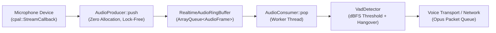

# Audio Engine Spike Architecture & Verification (`LIB-SIMPLIFY-04` / Stage 8)

- **Task / Card:** `LIB-SIMPLIFY-04` (`task_1f70c6aecb11` — `EPIC-LIB-04: Audio Real-Time Engine & Codecs`)
- **Department:** `G5 Voice / Platform`
- **Spike Workspace:** [`rust/audio-spike/`](../../rust/audio-spike/Cargo.toml)
- **Roadmap Stage:** Stage 8 («Аудио и кодеки») from `/home/sanya/chat-Дорожная карта упрощения Chord.txt`
- **Reference Oracles:**
  - Serein (`ViceVerse-cz/Serein`): [`audio.rs`](../reference-projects/sources/Serein/crates/discord-voice/src/audio.rs), [`mixer.rs`](../reference-projects/sources/Serein/crates/discord-voice/src/mixer.rs)
  - Clean-Room Discord Voice Oracle: `/home/sanya/re-deep/voice-deep.md` (§1–§3)

---

## 1. Executive Summary

In accordance with Stage 8 of the Chord Simplification Roadmap, we constructed an isolated audio engine spike in [`rust/audio-spike/`](../../rust/audio-spike/) resolving the previous worker blocker (which attempted to bind system C header `/usr/include/opus/opus.h`):

1. **Non-blocking CPAL Stream Capture:** CPAL callback moves audio frames directly into a lock-free SPSC ring buffer ([`ring_buffer.rs`](../../rust/audio-spike/src/ring_buffer.rs)) without allocating, acquiring mutexes, or waiting on network IO.
2. **Deterministic Overflow Policy:** When the downstream audio worker or network transport experiences jitter, the buffer implements `OverflowPolicy::DropOldest`, discarding older queued frames to maintain voice latency under `< 20ms`.
3. **Voice Activity Detection (VAD):** Embedded VAD ([`vad.rs`](../../rust/audio-spike/src/vad.rs)) with calibrated energy calculation in dBFS (`-100.0 dBFS` silence to `0.0 dBFS` peak) and configurable hangover window (default `200ms` / 10 frames) to eliminate voice clipping during inter-word pauses.
4. **Transparent Audio Pipeline Bridge:** [`AudioPipelineBridge`](../../rust/audio-spike/src/pipeline.rs) encapsulates device enumeration, microphone muting, volume scaling (`0%` to `200%`), and telemetry tracking (`captured_frames`, `processed_frames`, `dropped_frames`, `current_dbfs`, `is_speaking`).

---

## 2. Architecture & Data Flow

---

## 3. Verification & Contract Tests

All 7 tests in `rust/audio-spike/tests/audio_pipeline_contract.rs` pass cleanly:
- `test_silence_frame_properties`: 48 kHz stereo 20ms (1920 samples) silence frame checks.
- `test_ring_buffer_fifo_order_and_capacity`: Strict FIFO sequence preservation.
- `test_ring_buffer_overflow_drop_oldest`: Verified eviction of oldest frames under load.
- `test_vad_energy_dbfs_and_speech_detection`: Silence, speech, whisper, and hangover window transitions.
- `test_audio_pipeline_bridge_mute_and_volume`: Dynamic volume scaling and mute silence validation.
- `test_multi_threaded_audio_producer_consumer_throughput`: Concurrency throughput between audio callback thread and worker thread across 200 real-time frames.
- `test_device_enumeration_contract`: CPAL host device query resilience.
