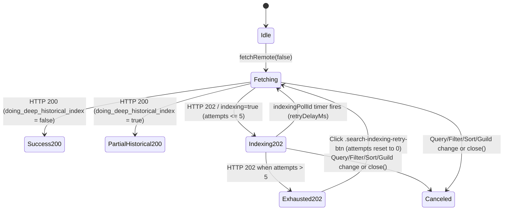

# M-13 — Спецификация дизайна поиска: HTTP 202 Indexing, NSFW Gating и чипы фильтров (G3 Design)

> **Статус:** G3 Design — Нормативная спецификация (Wave RW-40, Pass 2)
> **Модуль:** M-13 — Search UI (`SEARCH-202-NSFW-SPEC`)
> **Зависимости:** `waves/RW-40/SEARCH-202-NSFW-RE.md`, `waves/RW-40/reference-oracle-REA.md` (§2 `STUB-14` M-13), `waves/RW-40/THEME-SPEC.md`, `rust/gui-spike/ui/tokens.css`, `rust/gui-spike/ui/index.html`, `rust/gui-spike/ui/features/search.js`, `rust/gui-spike/ui/features/search-overlay.js`, `rust/gui-spike/ui/components/chat.css`, `rust/gui-spike/src/search.rs`
> **Затрагиваемые файлы при будущей имплементации (G4 TDD / G5 Code):**
> - `rust/gui-spike/ui/features/search.js`
> - `rust/gui-spike/ui/features/search-overlay.js`
> - `rust/gui-spike/ui/components/chat.css`
> - `rust/gui-spike/ui/index.html`
> - `rust/gui-spike/src/search.rs`

---

## 0. Метаданные, конвенции трассируемости и инварианты

### 0.1. Легенда тегов происхождения (`[D]` / `[S]` / `[T]` / `[L]` / `[F]` / `[A]`)

Каждое требование, константа протокола, строка локализации, структура DOM и CSS-правило в документе помечены тегом происхождения:

| Тег | Расшифровка | Источник |
|---|---|---|
| `[D]` | **Decoded RE Bundle** | Декодированные веб-бандлы Discord Desktop (`82a5af57ee11dcd5_0`, `b9e153f9dfaafc9f_0`, `4d2a64cb5df5fc4e_0`, `effc40ce4f2aa27c_0`) и каталоги локализации (`en-catalog.json`, `ru-catalog.json`), сверенные в `waves/RW-40/SEARCH-202-NSFW-RE.md` и `waves/RW-40/reference-oracle-REA.md` (§2). |
| `[S]` | **Stylesheet Bundle** | CSS-правила и геометрия вёрстки поискового попапа, чипов и инфо-баннеров Discord Desktop. |
| `[T]` | **Design Tokens (`tokens.css`)** | Вендоринг дизайн-токенов `rust/gui-spike/ui/tokens.css` (источник: `waves/RW-39/DESIGN/tokens.css`, md5 `62fffb9cb8bdd3429cd45160a77a2525`) и палитра `waves/RW-40/THEME-SPEC.md`. |
| `[L]` | **Live Runtime** | Наблюдения `logs/` / `evidence/` и `reference-oracle/ui8/*` для REST-эндпоинтов `/api/v9/guilds/{id}/messages/search` и `/api/v9/channels/{id}/messages/search`. |
| `[F]` | **Frozen Repo Contract** | Замороженные инварианты репозитория: `rust/gui-spike/ui/features/search.js`, `rust/gui-spike/ui/features/search-overlay.js`, `rust/gui-spike/ui/components/chat.css`, `rust/gui-spike/src/search.rs`, `tests/unit/search-remote-real-index.test.mjs`, `tests/unit/gui-spike-features.test.mjs`, `rust/gui-spike/tests/search_contract.rs`. |
| `[A]` | **Architecture Adaptation** | Адаптация под легковесную Vanilla JS + Tauri архитектуру `rust/gui-spike` без React/Flux, а также выводы без live-подтверждения (`SEARCH-202-NSFW-RE.md` §9). |

### 0.2. Жёсткие ограничения совместимости (`[F]`, `[T]`)

1. **Стопроцентная привязка к существующим токенам `rust/gui-spike/ui/tokens.css` (`[T]`):**
   - Каждая CSS-переменная в этой спецификации **обязана** существовать в `rust/gui-spike/ui/tokens.css`.
   - Запрещены любые сырые цвета (`#hex`, `rgb()`, `rgba()`, `hsl()`, `hsla()`) в CSS-блоках.
   - Для поверхностей используются существующие `var(--bg-app)`, `var(--surface-1)`, `var(--surface-2)`, `var(--surface-3)`, `var(--surface-4)`, `var(--surface-input)`; для текста — `var(--text-strong)`, `var(--text)`, `var(--text-subtle)`, `var(--text-muted)`, `var(--text-on-accent)`, `var(--text-on-danger)`, `var(--text-on-warning)`; для акцентов и статусов — `var(--accent)`, `var(--accent-hover)`, `var(--accent-active)`, `var(--accent-soft)`, `var(--warning)`, `var(--danger)`, `var(--danger-text)`, `var(--danger-fill)`, `var(--danger-fill-hover)`.
   - Токен `--text-faint` (`#81828a`), который в `tokens.css:86` разрешён только на `--bg-app`/`--bg-chat`, в панели поиска на `--surface-2` (`#242429`, контраст $4.04:1 < 4.5:1$) и `--surface-3` (`#28282d`, контраст $3.84:1 < 4.5:1$) **не используется**: для `.search-section-title` и `.search-section-note` нормируется `var(--text-muted)` (`#96979e`, контраст $5.37:1$ на `--surface-2` и $5.09:1$ на `--surface-3`).
2. **Контрастность WCAG 2.2 AA (`[T]`):**
   - Основной текст (`var(--text-strong)` `#fbfbfb`, `var(--text)` `#efeff1`) на поверхностях `var(--surface-1)`..`var(--surface-3)` (`#202024`..`#28282d`) имеет контраст $11.9:1 \dots 16.5:1$ (норма $\ge 4.5:1$).
   - Вторичный текст (`var(--text-subtle)` `#abacb2`, `var(--text-muted)` `#96979e`) на `var(--surface-2)` / `var(--surface-3)` имеет контраст $4.7:1 \dots 8.3:1$.
   - Текст на предупреждающем бейдже (`var(--text-on-warning)` `#121214`) на фоне `var(--warning)` (`#fdb833`) имеет контраст $10.76:1$.
   - Текст на деструктивной кнопке и бейдже `18+` (`var(--text-on-danger)` `#ffffff`) на фоне `var(--danger-fill)` (`#cf3a3f`) имеет контраст $4.85:1$ (в отличие от `--danger` `#da3e44`, который предназначен только для иконок/рамок non-text $\ge 3:1$).
   - Текст на акцентной кнопке (`var(--text-on-accent)` `#ffffff`) на фоне `var(--accent)` (`#5865f2`) имеет контраст $4.61:1$.
3. **Сохранение замороженных селекторов и контрактов (`[F]`):**
   - Обязательно сохраняются существующие селекторы и атрибуты из `rust/gui-spike/ui/index.html`, `rust/gui-spike/ui/features/search-overlay.js` и `rust/gui-spike/ui/components/chat.css`:
     - `header#chat-header.chat-header`, `search.search-field[role="search"]`, `input#chat-search.search-input[type="search"][placeholder="Поиск"][aria-label="Поиск сообщений"]`
     - `aside.search-overlay[role="search"][aria-label="Поиск сообщений"][data-open][aria-hidden]`
     - `header.search-overlay-head`, `input.search-overlay-input.search-input[type="search"][aria-label="Запрос поиска сообщений"][placeholder="Поиск"]`, `button.icon-btn.search-close`
     - `div.search-sections`, `section.search-section[data-key][data-scope]` (7 секций `SEARCH_SECTIONS`: `from`, `in`, `has`, `mentions`, `date`, `author`, `pinned`), `.search-section-title`, `.search-control`, `.search-switch`, `.search-options`, `.search-option`, `.search-section-note`
     - `div.search-sort[data-scope="server"]`, `button.search-sort-trigger`, `div.search-sort-menu[role="menu"]`, `button.search-sort-item[role="menuitemradio"][data-sort]` (`new`, `old`, `recent`)
     - `p.search-status[aria-live="polite"][data-state]`
     - `div.search-results`, `button.search-result`, `.search-result-head`, `.search-result-text`, `button.search-more`, `p.search-empty`, `p.search-footnote.visually-hidden`
   - Поведение `createSearchOverlay()` в `rust/gui-spike/ui/features/search-overlay.js` и `buildSearchQuery()` / `snowflakeFromTimestamp()` / `searchDateBounds(date)` в `rust/gui-spike/ui/features/search.js` расширяется обратно совместимо (с сохранением строковой сигнатуры `searchDateBounds(date)`), не ломая тесты `SRCH-01..18`, `R-10`, `R-11`, `QA-M2-03` и `STUB-14`.

---

## 1. Оракул RE и протокольный контракт (`SEARCH-202-NSFW-RE.md`)

### 1.1. Эндпоинты и транспортные константы (`[D]`, `[F]`, `[A]`)

Согласно `waves/RW-40/SEARCH-202-NSFW-RE.md` (§1–§9) и декодированным бандлам (`82a5af57ee11dcd5_0@212`, `b9e153f9dfaafc9f_0@29479,31367`, `4d2a64cb5df5fc4e_0@279632..9090635`, `effc40ce4f2aa27c_0@228..10631`):

| Параметр / Константа | Значение в Discord Desktop (`[D]` / `[A]`) | Отражение в `discord-lab` (`[F]` / `[A]`) |
|---|---|---|
| `Endpoints.SEARCH_GUILD(guildId)` | `[D]` `GET /api/v9/guilds/{guild_id}/messages/search` (`4d2a64cb5df5fc4e_0@279632`; также используется для `GUILD_CHANNEL` с фильтром `channel_id`) | `[F]` Маршрут `guild_messages_search(guild_id)` в `rust/gui-spike/src/search.rs` |
| `Endpoints.SEARCH_CHANNEL(channelId)` | `[D]` `GET /api/v9/channels/{channel_id}/messages/search` (`4d2a64cb5df5fc4e_0@280974`, приватные каналы DM/GDM) | `[A]` Поддержка channel-scope при поиске вне гильдии |
| Размер страницы (`SEARCH_PAGE_SIZE`) | `[D]` `25` (`iG = 25`, константа `T_y`, `4d2a64cb5df5fc4e_0@318806`; пагинация `offset = page * 25` `@7542421`; `limit` официальный клиент в GET не передаёт) | `[F]` `SEARCH_PAGE_SIZE = 25` в `rust/gui-spike/ui/features/search.js:28` и `MAX_SEARCH_LIMIT: i64 = 25` в `rust/gui-spike/src/search.rs:19` |
| Потолок пагинации (`MAX_SEARCH_OFFSET` / `MAX_SEARCH_PAGES`) | `[A]` В дампе шаг пагинации `offset` кратен 25 (`SEARCH-202-NSFW-RE.md:121, 691`: точный серверный потолок `offset` в RE имеет статус `[A]`), при этом каталог содержит предупреждение `E+2azY` с параметром `{maxPages}` (`[D]`) | `[A]` Новые константы M-13: `MAX_SEARCH_OFFSET = 9975`, `MAX_SEARCH_PAGES = 400` (`400 * 25 = 10000` сообщений); при `remoteOffset > 9975` догрузка блокируется с выводом строки `E+2azY` (`maxPages = 400`) |
| Статус индексации (`HTTP 202 Accepted`) | `[D]` Код `SearchFetcher` (`82a5af57ee11dcd5_0@212`): `202 === r.status`, **тело ответа игнорируется**, источник задержки — **только заголовок** `retry-after` в целых секундах (`parseInt(r.headers["retry-after"])`); `documents_indexed` в 202 не обновляется (`4d2a64cb5df5fc4e_0@7543688`). Live-ответ 202 в захватах не встречался (`[A]`, `SEARCH-202-NSFW-RE.md:689`) | `[D]` Чтение заголовка `Retry-After` в секундах; `[A]` адаптация Tauri IPC конверта `SearchResponse` (`indexing: true`, `retry_after_ms: Some(delay_ms)`), формируемого в `search.rs` из HTTP-статуса `202` и заголовка `Retry-After` |
| Потолок попыток `202` (`SEARCH_MAX_INDEXING_ATTEMPTS`) | `[D]` `this.query.attempts = (this.query.attempts ?? 0) + 1; if (this.query.attempts > 5) return;` (`5` автоматических повторов, всего $\le 6$ запросов; `82a5af57ee11dcd5_0@212`) | `[D]` `SEARCH_MAX_INDEXING_ATTEMPTS = 5` |
| Дефолтный backoff при `Retry-After: 0 / NaN` | `[D]` `let h = parseInt(r.headers["retry-after"]); this.retryDelay = isNaN(h) \|\| 0 === h ? 5e3 : h * l.A.Millis.SECOND` (`5000` мс по умолчанию; дробный `0.25` через `parseInt` даёт `0` $\to$ `5000` мс) | `[D]` `SEARCH_DEFAULT_RETRY_AFTER_MS = 5000`; `[A]` дополнительная защита `h <= 0` для отрицательных значений заголовка |
| Поля успешного ответа `HTTP 200 OK` | `[D]` `{ analytics_id, messages, total_results, doing_deep_historical_index, documents_indexed?, channels?, threads?, members? }` (`b9e153f9dfaafc9f_0@29479,31367`; `documents_indexed` опционален и приходит **только** в 200) | `[F]` `SearchResponse` в `search.rs:149-155` + `#[serde(default)] pub documents_indexed: u64` + отображение баннера глубокой индексации при `doing_deep_historical_index === true` |
| Флаг NSFW (`include_nsfw`) | `[D]` Вычисляется функцией `v(e, t)` (`4d2a64cb5df5fc4e_0@7550064`): параметр `include_nsfw` добавляется в запрос **только** если `GuildNSFWAgreeStore.didAgree(guildId) === true`; при `!didAgree(guildId)` ключ `include_nsfw` **не передаётся вообще** | `[D]` Гейт `didAgree(guildId)` с проверкой бита `AGE_GATED_SPACES = 1` в `age_gated_features` и `age_verification_status ∈ {3, 4}` + пропуск ключа `include_nsfw` при `!didAgree(guildId)` |

### 1.2. Строки локализации из `ru-catalog.json` / `en-catalog.json` (`[D]`)

Все строки ниже дословно сверены с `reference-oracle/en-catalog.json` и `reference-oracle/ru-catalog.json`:

| Ключ i18n (`[D]`) | Точное значение в `en-catalog.json` | Точное значение в `ru-catalog.json` (нормативный UI-текст) | Назначение в M-13 |
|---|---|---|---|
| `G3EA+4` | `"Indexing"` | `"Индексация"` | Заголовок баннера `.search-indexing-banner` |
| `AXPbZr` | `"Before searching, we need to index this server. Give us a bit."` | `"Нам нужно проиндексировать этот сервер перед поиском. Дайте нам минуточку."` | Текст ожидания индексации при `HTTP 202` в контексте сервера/канала гильдии (`GUILD` / `GUILD_CHANNEL` / `THREAD`, `[D] 4d2a64cb5df5fc4e_0@7548375`) |
| `Br0xJA` | `"Before searching, we need to index your messages. Give us a bit."` | `"Перед поиском нам нужно проиндексировать ваши сообщения. Подождите минуточку."` | Текст ожидания индексации при `HTTP 202` в контексте глобальных ЛС (`DMS`) |
| `Q0JJjv` | `"Before searching, we need to index this DM. Give us a bit."` | `"Нам нужно проиндексировать эти ЛС перед поиском. Дайте нам минуточку."` | Текст ожидания индексации при `HTTP 202` в контексте приватного канала (`CHANNEL`) |
| `4Y3O+O` | `"{count, plural, =0 {No results} one {# result} other {# results}} indexed so far. We’re still indexing older messages."` | `"{count, plural, =0 {Результатов поиска нет} one {Найден # результат} few {Найдено # результата} other {Найдено # результатов}}. Мы всё ещё индексируем старые сообщения."` | Баннер/статус при `HTTP 200 OK` с `doing_deep_historical_index: true` (`count` привязан к `documents_indexed`, `[A]`) |
| `E+2azY` | `"We can only return up to {maxPages} pages of results. Try making your search more specific!"` | `"Мы можем предоставить не более {maxPages} стр. результатов. Попробуйте сузить поиск."` | Предупреждение при достижении потолка пагинации (`maxPages = 400`, `[A]`) |
| `ZmwvDc` | `"Age-Restricted Channel"` | `"Канал с возрастным ограничением"` | Заголовок NSFW-баннера (канал с `nsfw === true`) |
| `xi46lg` | `"Age-Restricted Server"` | `"Сервер с возрастным ограничением"` | Заголовок NSFW-баннера (сервер с `nsfw_level ∈ {1, 3}`) |
| `E4Cd5I` | `"This channel contains adult content marked as age-restricted. Do you wish to proceed?"` | `"В этом канале содержится контент для взрослых с возрастными ограничениями. Хотите продолжить?"` | Описание NSFW-баннера в режиме `"prompt"` (для взрослого пользователя до согласия) |
| `wVq7uo` | `"Continue"` | `"Продолжить"` | Primary-кнопка согласия (`GUILD_NSFW_AGREE`) |
| `/g10LC` | `"Go Back"` | `"Вернуться"` | Secondary-кнопка возврата к безопасному поиску/каналу |
| `NEabBa` | `"Sorry, you're not old enough to view this age-restricted channel"` | `"К сожалению, вы ещё слишком молоды для просмотра этого канала с возрастным ограничением"` | Заголовок блокирующего NSFW-баннера в режиме `"underage"` |
| `2kHZes` | `"You need to be 18 or older in order to view age-restricted channels on Discord. [View our help article]({helpURL}) on age verification."` | `"Для просмотра каналов с возрастными ограничениями в Discord вам должно быть не менее 18 лет. [Ознакомьтесь с нашей полезной статьёй]({helpURL}) о подтверждении возраста."` | Описание блокирующего NSFW-баннера в режиме `"underage"` (без внешних ссылок в UI рендерится плоский текст: `"Для просмотра каналов с возрастными ограничениями в Discord вам должно быть не менее 18 лет. Ознакомьтесь с нашей полезной статьёй о подтверждении возраста."`) |
| `1TUdFo` | `"from"` | `"от"` | Имя токена автора (`author_id`); клиент дописывает `:` $\to$ `from:` / `от:` |
| `WNpFHa` | `"in"` | `"в"` | Имя токена канала (`channel_id`); клиент дописывает `:` $\to$ `in:` / `в:` |
| `CqCvir` | `"has"` | `"имеет"` | Имя токена вложений (`has`); клиент дописывает `:` $\to$ `has:` / `имеет:` |
| `qZ+7BA` | `"before"` | `"до"` | Имя токена верхней границы даты (`max_id`); клиент дописывает `:` $\to$ `before:` / `до:` |
| `KSDx7M` | `"after"` | `"после"` | Имя токена нижней границы даты (`min_id`); клиент дописывает `:` $\to$ `after:` / `после:` |
| `tIxkOo` | `"on"` | `"день"` | Имя токена конкретной даты (`min_id` + `max_id`); клиент дописывает `:` $\to$ `on:` / `день:` |
| `0B74eY` | `"pinned"` | `"закреплённые"` | Имя токена закреплённых сообщений (`pinned`); клиент дописывает `:` $\to$ `pinned:` / `закреплённые:` |
| `i96lO+` | `"mentions"` | `"с упоминанием"` | Имя токена упоминаний (`mentions`); клиент дописывает `:` $\to$ `mentions:` / `с упоминанием:` |
| `us8IQi` | `"authorType"` | `"ТипАвтора"` | Имя токена типа автора (`author_type`); клиент дописывает `:` $\to$ `authorType:` / `ТипАвтора:` |

---

## 2. Иерархия DOM и таблица CSS-токенов

### 2.1. Полная нормативная иерархия DOM (`[F]`, `[S]`, `[A]`)

Ниже приведена полная структура DOM для шапки чата (`#chat-header` в `rust/gui-spike/ui/index.html:102-114`) и немодальной боковой панели поиска (`aside.search-overlay` в `rust/gui-spike/ui/features/search-overlay.js`), побайтово сохраняющая все замороженные селекторы и атрибуты `SRCH-01..18` / `R-10` / `R-11` (включая `<header id="chat-header" class="chat-header">`, landmark `<search class="search-field" role="search">` и `placeholder="Поиск"`) и добавляющая узлы M-13 (`.search-filter-chips`, `.search-indexing-banner`, `.search-nsfw-banner` и `.search-result-nsfw-badge`):

```html
<!-- Шапка чата в rust/gui-spike/ui/index.html:102-114 (замороженный контракт [F]) -->
<header id="chat-header" class="chat-header">
  <button class="icon-btn" type="button" data-action="toggle-tree" aria-label="Свернуть каналы" aria-expanded="true">☰</button>
  <h1 class="chat-title"><span class="hash" aria-hidden="true">#</span><span class="chat-title-text">новости</span></h1>
  <div class="chat-actions">
    <button class="icon-btn" type="button" data-action="threads" aria-label="Ветки">🧵</button>
    <button class="icon-btn" type="button" data-action="inbox" aria-label="Уведомления" aria-disabled="true" title="Уведомления (Phase 3)">🔔</button>
    <button class="icon-btn" type="button" data-action="pins" aria-label="Закреплённые сообщения">📌</button>
    <button class="icon-btn" type="button" data-action="members" aria-label="Участники">👥</button>
    <search class="search-field" role="search">
      <input
        id="chat-search"
        class="search-input"
        type="search"
        placeholder="Поиск"
        aria-label="Поиск сообщений"
        autocomplete="off"
      />
    </search>
  </div>
</header>

<!-- Боковая панель поиска (монтируется createSearchOverlay в #screen-chat) -->
<aside
  class="search-overlay"
  role="search"
  aria-label="Поиск сообщений"
  data-open="true"
  aria-hidden="false"
  aria-busy="false"
>
  <!-- 1. Шапка панели поиска (замороженный контракт .search-overlay-head [F]) -->
  <header class="search-overlay-head">
    <input
      class="search-overlay-input search-input"
      type="search"
      aria-label="Запрос поиска сообщений"
      placeholder="Поиск"
    />
    <button
      class="icon-btn search-close"
      type="button"
      aria-label="Закрыть поиск"
    >✕</button>
  </header>

  <!-- 2. Полоса интерактивных чипов активных фильтров (M-13 Filter Chips) -->
  <div
    class="search-filter-chips"
    role="toolbar"
    aria-label="Активные фильтры поиска"
    hidden
  >
    <div class="search-chip-list" role="list">
      <span
        class="search-chip"
        role="listitem"
        data-chip-key="from"
        data-chip-value="777001"
        data-chip-negated="false"
      >
        <span class="search-chip-prefix">from:</span>
        <span class="search-chip-value">777001</span>
        <button
          type="button"
          class="search-chip-remove"
          aria-label="Удалить фильтр from: 777001"
          data-chip-remove="from:777001"
        >×</button>
      </span>
    </div>
    <button
      type="button"
      class="search-chips-clear"
      aria-label="Сбросить все фильтры поиска"
    >Сбросить</button>
  </div>

  <!-- 3. 7 секций фильтров (замороженный контракт R-10: SEARCH_SECTIONS) -->
  <div class="search-sections">
    <section class="search-section" data-key="from" data-scope="local">
      <h3 class="search-section-title">От</h3>
      <input class="search-control" type="text" aria-label="От" placeholder="Имя автора" />
      <span class="search-section-note" title="Фильтр применяется к уже загруженным результатам">локально</span>
    </section>
    <section class="search-section" data-key="in" data-scope="server">
      <h3 class="search-section-title">В</h3>
      <input class="search-control" type="text" aria-label="В" placeholder="Канал" />
    </section>
    <section class="search-section" data-key="has" data-scope="local">
      <h3 class="search-section-title">Содержит</h3>
      <input class="search-control" type="text" aria-label="Содержит" placeholder="Тип содержимого" />
      <div class="search-options">
        <!-- 9 кнопок .search-option из HAS_OPTIONS -->
        <button class="search-option" type="button" aria-label="Содержит: ссылка">ссылка</button>
      </div>
      <span class="search-section-note" title="Фильтр применяется к уже загруженным результатам">локально</span>
    </section>
    <section class="search-section" data-key="mentions" data-scope="local">
      <h3 class="search-section-title">Упоминания</h3>
      <input class="search-control" type="text" aria-label="Упоминания" placeholder="Пользователь" />
      <span class="search-section-note" title="Фильтр применяется к уже загруженным результатам">локально</span>
    </section>
    <section class="search-section" data-key="date" data-scope="local">
      <h3 class="search-section-title">Дата</h3>
      <input class="search-control" type="date" aria-label="Дата" />
      <span class="search-section-note" title="Фильтр применяется к уже загруженным результатам">локально</span>
    </section>
    <section class="search-section" data-key="author" data-scope="local">
      <h3 class="search-section-title">Тип автора</h3>
      <select class="search-control" aria-label="Тип автора">
        <option value="Любой">Любой</option>
        <option value="Человек">Человек</option>
        <option value="Бот">Бот</option>
        <option value="Вебхук">Вебхук</option>
      </select>
      <span class="search-section-note" title="Фильтр применяется к уже загруженным результатам">локально</span>
    </section>
    <section class="search-section" data-key="pinned" data-scope="local">
      <h3 class="search-section-title">Закреплено</h3>
      <button class="search-control search-switch" type="button" role="switch" aria-checked="false" aria-label="Закреплено">Выкл</button>
      <span class="search-section-note" title="Фильтр применяется к уже загруженным результатам">локально</span>
    </section>
  </div>

  <!-- 4. Меню сортировки (замороженный контракт R-11: SEARCH_SORTS) -->
  <div class="search-sort" data-scope="server">
    <button class="search-sort-trigger" type="button" aria-haspopup="menu" aria-expanded="false">По новизне</button>
    <div class="search-sort-menu" role="menu" aria-label="Сортировка результатов" data-open="false">
      <button class="search-sort-item" type="button" role="menuitemradio" aria-checked="true" tabindex="0" data-sort="new">По новизне</button>
      <button class="search-sort-item" type="button" role="menuitemradio" aria-checked="false" tabindex="-1" data-sort="old">Самое старое</button>
      <button class="search-sort-item" type="button" role="menuitemradio" aria-checked="false" tabindex="-1" data-sort="recent">Самое актуальное</button>
    </div>
  </div>

  <!-- 5. Баннер индексации HTTP 202 / глубокой исторической индексации (M-13 Indexing State) -->
  <div
    class="search-indexing-banner"
    role="status"
    aria-live="polite"
    aria-atomic="true"
    data-indexing-state="idle"
    hidden
  >
    <div class="search-indexing-header">
      <span class="search-indexing-spinner" aria-hidden="true"></span>
      <strong class="search-indexing-title">Индексация</strong>
      <span class="search-indexing-badge">Попытка 1 из 5</span>
    </div>
    <p class="search-indexing-detail">
      Нам нужно проиндексировать этот сервер перед поиском. Дайте нам минуточку. · повтор через 5 с
    </p>
    <div
      class="search-indexing-progress"
      role="progressbar"
      aria-label="Прогресс попыток индексации поиска"
      aria-valuemin="0"
      aria-valuemax="5"
      aria-valuenow="1"
      aria-valuetext="Попытка 1 из 5"
    >
      <div class="search-indexing-progress-bar"></div>
    </div>
    <div class="search-indexing-actions" hidden>
      <button type="button" class="search-indexing-retry-btn">
        Повторить запрос
      </button>
    </div>
  </div>

  <!-- 6. Баннер возрастного ограничения NSFW 18+ (M-13 NSFW Gating) -->
  <div
    class="search-nsfw-banner"
    role="region"
    aria-label="Предупреждение о возрастном ограничении 18+"
    aria-live="polite"
    aria-atomic="true"
    data-nsfw-mode="prompt"
    hidden
  >
    <div class="search-nsfw-header">
      <span class="search-nsfw-badge" aria-hidden="true">18+</span>
      <strong class="search-nsfw-title">Канал с возрастным ограничением</strong>
    </div>
    <p class="search-nsfw-desc">
      В этом канале содержится контент для взрослых с возрастными ограничениями. Хотите продолжить?
    </p>
    <div class="search-nsfw-actions">
      <button type="button" class="search-nsfw-btn search-nsfw-btn-continue">
        Продолжить
      </button>
      <button type="button" class="search-nsfw-btn search-nsfw-btn-back">
        Вернуться
      </button>
    </div>
  </div>

  <!-- 7. Статус и результаты (замороженные .search-status, .search-results, .search-footnote) -->
  <p class="search-status" aria-live="polite" data-state="ok"></p>
  <div class="search-results">
    <button class="search-result" type="button" data-id="120001" data-source="remote" aria-label="Серверный результат: developer, 2026-10-23">
      <span class="search-result-head">
        developer · канал 1001 · 2026-10-23 14:20
        <span class="search-result-nsfw-badge" aria-label="Канал с возрастным ограничением 18+">18+</span>
      </span>
      <span class="search-result-text">Текст найденного сообщения…</span>
    </button>
  </div>
  <p class="search-footnote visually-hidden">Поиск выполняется по загруженному окну данных, полный поиск — за сервером</p>
</aside>
```

### 2.2. Полная таблица привязки к существующим токенам `rust/gui-spike/ui/tokens.css` (`[T]`)

Каждая CSS-переменная из нормативного CSS (§6) и базового каркаса поиска перечислена ниже и побайтово совпадает со значением в `rust/gui-spike/ui/tokens.css`:

| Токен в `rust/gui-spike/ui/tokens.css` | Значение (`:root` dark) | Где используется в M-13 Search UI |
|---|---|---|
| `var(--bg-app)` | `#121214` | Трек прогресс-бара `.search-indexing-progress` |
| `var(--surface-1)` | `#202024` | Фон вторичной кнопки `.search-nsfw-btn-back` и кнопки сброса `.search-chips-clear` |
| `var(--surface-2)` | `#242429` | Фон панели `.search-overlay` и выпадающего меню `.search-sort-menu` |
| `var(--surface-3)` | `#28282d` | Фон чипов `.search-chip`, баннеров `.search-indexing-banner` и `.search-nsfw-banner` |
| `var(--surface-4)` | `#2c2d32` | Hover-фон чипов `.search-chip:hover` и кнопок на тёмной подложке |
| `var(--surface-input)` | `#1e1f22` | Фон полей `.search-overlay-input`, `.search-control`, `.search-option` |
| `var(--border-subtle)` | `rgb(151 151 159 / 12%)` | Границы `.search-overlay`, `.search-chip`, `.search-indexing-banner`, `.search-nsfw-banner`, `.search-control` |
| `var(--border)` | `rgb(151 151 159 / 20%)` | Hover-граница `.search-option:hover` и `.search-chip:hover` |
| `var(--border-strong)` | `rgb(151 151 159 / 44%)` | Активная граница спиннера `.search-indexing-spinner` и hover вторичных кнопок |
| `var(--divider)` | `rgb(255 255 255 / 6%)` | Нижний разделитель полосы чипов `.search-filter-chips` |
| `var(--state-hover)` | `rgb(255 255 255 / 6%)` | Hover-фон `.search-result:hover`, `.search-sort-item:hover`, `.search-chip-remove:hover` |
| `var(--state-active)` | `rgb(255 255 255 / 9%)` | Pressed-состояние чипов и вторичных кнопок |
| `var(--state-selected)` | `rgb(255 255 255 / 11%)` | Фон чипа с отрицанием `[data-chip-negated="true"]` |
| `var(--state-selected-strong)` | `rgb(255 255 255 / 14%)` | Выбранный пункт `.search-sort-item[aria-checked="true"]` |
| `var(--text-strong)` | `#fbfbfb` | Заголовки `.search-indexing-title`, `.search-nsfw-title`, значение чипа `.search-chip-value` |
| `var(--text)` | `#efeff1` | Основной текст `.search-nsfw-desc`, `.search-result`, `.search-control` |
| `var(--text-subtle)` | `#abacb2` | Префикс чипа `.search-chip-prefix`, `.search-indexing-detail`, `.search-sort-trigger` |
| `var(--text-muted)` | `#96979e` | `.search-section-title`, `.search-section-note` (WCAG AA $\ge 4.5:1$ на `--surface-2`), `.search-status`, `.search-result-head`, `.search-chip-remove`, `.search-more` |
| `var(--text-on-accent)` | `#ffffff` | Текст на `var(--accent)` в кнопке `.search-indexing-retry-btn` |
| `var(--text-on-danger)` | `#ffffff` | Текст на `var(--danger-fill)` в `.search-nsfw-badge`, `.search-result-nsfw-badge`, `.search-nsfw-btn-continue` |
| `var(--text-on-warning)` | `#121214` | Тёмный текст на `var(--warning)` в бейдже `.search-indexing-badge` |
| `var(--accent)` | `#5865f2` | Заполнение `.search-indexing-progress-bar`, кнопка `.search-indexing-retry-btn`, активный `.search-switch` |
| `var(--accent-hover)` | `#4654c0` | Hover-фон `.search-indexing-retry-btn:hover` |
| `var(--accent-active)` | `#3c45a5` | Active-фон `.search-indexing-retry-btn:active` |
| `var(--accent-soft)` | `rgb(88 101 242 / 16%)` | Фон `.search-chip:focus-within` и `.search-switch[aria-checked="true"]` |
| `var(--warning)` | `#fdb833` | Левый акцентный бордер и спиннер `.search-indexing-banner`, фон `.search-indexing-badge` |
| `var(--danger)` | `#da3e44` | Левый акцентный бордер `.search-nsfw-banner`, бордер `[data-chip-negated="true"]` и `[aria-invalid="true"]` |
| `var(--danger-text)` | `#ff9a9e` | Текст ошибки `.search-status[data-state="error"]` и префикс отрицающего чипа `[data-chip-negated="true"] .search-chip-prefix` |
| `var(--danger-fill)` | `#cf3a3f` | Заливка бейджа `18+` (`.search-nsfw-badge`, `.search-result-nsfw-badge`) и кнопки `.search-nsfw-btn-continue` |
| `var(--danger-fill-hover)` | `#b92d33` | Hover-заливка `.search-nsfw-btn-continue:hover` |
| `var(--focus-ring)` | `#a5b0ff` | Цвет контура `:focus-visible` всех интерактивных контролов |
| `var(--focus-ring-width)` | `2px` | Толщина контура `:focus-visible` |
| `var(--focus-ring-offset)` | `2px` | Отступ контура `:focus-visible` |
| `var(--font-sans)` | `system-ui, -apple-system, "Segoe UI", Roboto, "Helvetica Neue", Arial, "Noto Sans", "Liberation Sans", sans-serif, "Apple Color Emoji", "Segoe UI Emoji", "Noto Color Emoji", emoji` | Основной шрифт чипов, баннеров и карточек результатов |
| `var(--font-mono)` | `ui-monospace, SFMono-Regular, "SF Mono", Menlo, Consolas, "Liberation Mono", "DejaVu Sans Mono", monospace` | Шрифт префиксов чипов (`from:`, `has:`), счётчиков индексации и бейджа `18+` |
| `var(--font-size-caption)` | `11px` | Размер шрифта бейджа `18+`, `.search-indexing-badge` и `.search-section-note` |
| `var(--font-size-small)` | `12px` | Размер шрифта чипов `.search-chip`, `.search-indexing-detail`, `.search-status` |
| `var(--font-size-ui)` | `14px` | Размер шрифта заголовков баннеров, кнопок и результатов |
| `var(--line-height-caption)` | `14px` | Высота строки бейджей `18+` и `.search-indexing-badge` |
| `var(--line-height-small)` | `16px` | Высота строки чипов, `.search-indexing-detail` и `.search-status` |
| `var(--line-height-ui)` | `18px` | Высота строки заголовков баннеров |
| `var(--font-weight-medium)` | `500` | Насыщенность значений чипов `.search-chip-value` и вторичных кнопок |
| `var(--font-weight-semibold)` | `600` | Насыщенность заголовков баннеров, префиксов чипов и основных кнопок |
| `var(--font-weight-bold)` | `700` | Насыщенность бейджа `18+` |
| `var(--letter-spacing-caps)` | `0.02em` | Межбуквенный интервал бейджа `18+` и заголовков секций |
| `var(--space-0)` | `0` | Нулевой отступ (`margin`/`padding`) в `.search-chip-remove`, `.search-chips-clear`, `.search-indexing-detail`, `.search-nsfw-desc`, `.search-nsfw-badge`, `.search-nsfw-btn` |
| `var(--space-1)` | `2px` | Вертикальный внутренний паддинг чипов и бейджей |
| `var(--space-2)` | `4px` | Зазор внутри чипа и ширина левого акцентного бордера баннеров |
| `var(--space-3)` | `6px` | Горизонтальный паддинг чипов, высота прогресс-бара и компактных кнопок |
| `var(--space-4)` | `8px` | Базовый шаг сетки между чипами, строками баннера и кнопками |
| `var(--space-5)` | `12px` | Внутренний паддинг `.search-indexing-banner` и `.search-nsfw-banner` |
| `var(--space-6)` | `16px` | Горизонтальный паддинг кнопок действий в баннерах |
| `var(--space-11)` | `48px` | Базовый шаг для ограничения ширины значения чипа `.search-chip-value` (`calc(var(--space-11) * 3)` = `144px`) |
| `var(--radius-xs)` | `4px` | Скругление бейджа `18+`, кнопок и карточек результатов |
| `var(--radius-sm)` | `8px` | Скругление баннеров `.search-indexing-banner` и `.search-nsfw-banner` |
| `var(--radius-round)` | `2147483647px` | Полное скругление пилюль `.search-chip`, `.search-indexing-badge`, спиннера и прогресс-бара |
| `var(--icon-size-sm)` | `16px` | Ширина и высота спиннера `.search-indexing-spinner` |
| `var(--icon-stroke)` | `2px` | Толщина обводки спиннера `.search-indexing-spinner` |
| `var(--btn-height-sm)` | `28px` | Высота кнопок `.search-chips-clear`, `.search-indexing-retry-btn`, `.search-nsfw-btn` |
| `var(--badge-h)` | `16px` | Высота бейджа `18+` и кнопки удаления чипа `.search-chip-remove` |
| `var(--badge-pad-x)` | `4px` | Горизонтальный паддинг бейджа `18+` |
| `var(--motion-fast)` | `120ms` | Длительность hover/focus переходов чипов и кнопок |
| `var(--motion-base)` | `180ms` | Длительность перехода ширины `.search-indexing-progress-bar` |
| `var(--ease-out)` | `cubic-bezier(0.2, 0.8, 0.2, 1)` | Кривая анимации прогресс-бара и переходов |

---

## 3. Состояние индексации HTTP 202 (`SearchFetcher` Retry/Backoff & Progress)

### 3.1. Протокольный и Rust-контракт `HTTP 202` и `HTTP 200` (`[D]`, `[F]`, `[A]`)

Согласно `waves/RW-40/SEARCH-202-NSFW-RE.md` (§4–§6, `[D] 82a5af57ee11dcd5_0@212`, `effc40ce4f2aa27c_0@1409`, `b9e153f9dfaafc9f_0@29479,31367`, `4d2a64cb5df5fc4e_0@7543688`):

1. **Ответ `HTTP 202 Accepted` (глубокая индексация идёт, `[D]` код `SearchFetcher`, `[A]` live-статус):**
   - При получении `r.status === 202` в поиске сообщений официальный клиент **полностью игнорирует тело ответа** (`SEARCH-202-NSFW-RE.md:20-22, 428-431, 482-483, 516-517`). Поле `retry_after` в теле относится только к `POST /guilds/{id}/members-search` (`4d2a64cb5df5fc4e_0@5277460`), но **не** к поиску сообщений.
   - Единственный источник задержки в протоколе поиска сообщений — HTTP-заголовок `retry-after` в целых секундах:
     ```js
     let h = parseInt(r.headers["retry-after"]);
     this.retryDelay = isNaN(h) || 0 === h ? 5e3 : h * l.A.Millis.SECOND;
     ```
   - В `SearchMessageStore` (`handleSearchIndexing`, `4d2a64cb5df5fc4e_0@7543688`) при `202` выставляются `isIndexing = true`, `isHistoricalIndexing = true`, `isFetching = false`, а `documentsIndexed` **не обновляется** (остаётся `0` или прежним значением).
2. **Ответ `HTTP 200 OK` с глубокой исторической индексацией (`[D] b9e153f9dfaafc9f_0@29479,31367`, `4d2a64cb5df5fc4e_0@7543688`):**
   - Когда индекс готов частично или полностью, сервер возвращает `HTTP 200 OK` с полями `analytics_id`, `messages`, `total_results`, `doing_deep_historical_index` и опциональным `documents_indexed` (приходит **только** в теле `200`, дефолт в клиенте `A.result.documents_indexed ?? 0`):
     ```json
     {
       "analytics_id": "35a8f4e2e3dc17d18f882706c6f766f1",
       "total_results": 18,
       "messages": [[ ... ]],
       "doing_deep_historical_index": true,
       "documents_indexed": 8450
     }
     ```
   - При `doing_deep_historical_index === true` стор ставит `isIndexing = false`, `isHistoricalIndexing = true`, `documentsIndexed = e.documentsIndexed ?? 0`.
3. **Согласование с `rust/gui-spike/src/search.rs` и Tauri IPC (`[F]`, `[A]`):**
   - Текущий замороженный срез `SearchResponse` в `rust/gui-spike/src/search.rs:147-155` (`[F]`):
     ```rust
     #[derive(Debug, Clone, PartialEq, Eq, Deserialize, Serialize)]
     #[serde(rename_all = "camelCase")]
     pub struct SearchResponse {
         pub messages: Vec<Value>,
         #[serde(rename = "total_results")]
         pub total_results: u64,
         #[serde(rename = "doing_deep_historical_index")]
         pub doing_deep_historical_index: bool,
     }
     ```
   - В M-13 структура `SearchResponse` в `rust/gui-spike/src/search.rs` расширяется обратно совместимыми полями (`#[serde(default)]`), сохраняя три существующих поля без изменений (`[F]`, `[D]`, `[A]`):
     ```rust
     #[derive(Debug, Clone, PartialEq, Eq, Deserialize, Serialize)]
     #[serde(rename_all = "camelCase")]
     pub struct SearchResponse {
         pub messages: Vec<Value>,
         #[serde(rename = "total_results")]
         pub total_results: u64,
         #[serde(rename = "doing_deep_historical_index")]
         pub doing_deep_historical_index: bool,
         /// [D] Приходит только в теле HTTP 200 (опционально, по умолчанию 0). В HTTP 202 тело не читается.
         #[serde(default, rename = "documents_indexed")]
         pub documents_indexed: u64,
         /// [A] Адаптация Tauri IPC конверта: true, когда HTTP-ответ вернул статус 202 Accepted.
         #[serde(default)]
         pub indexing: bool,
         /// [A] Адаптация Tauri IPC конверта: задержка в мс, вычисленная в Rust из HTTP-заголовка
         /// `Retry-After` (`parseInt` сек * 1000, либо 5000 мс по умолчанию) при статусе 202.
         #[serde(default, rename = "retry_after_ms")]
         pub retry_after_ms: Option<u64>,
     }
     ```
   - При получении `HttpResponse` со статусом `202` в `rust/gui-spike/src/search.rs` тело ответа **не парсится**: Rust-слой извлекает только заголовок `retry-after` / `Retry-After`, переводит целые секунды в миллисекунды (`parse::<i64>().ok().filter(|&h| h > 0).map(|h| (h as u64) * 1000).unwrap_or(5000)`) и возвращает `Ok(SearchResponse { messages: Vec::new(), total_results: 0, doing_deep_historical_index: false, documents_indexed: 0, indexing: true, retry_after_ms: Some(delay_ms) })` (`[A]`).

### 3.2. Конечный автомат `SearchFetcher` в `search-overlay.js` (`[D]`, `[A]`)

Воспроизведение логики `SearchFetcher` (`[D] 82a5af57ee11dcd5_0@212`, модуль `177068`) и `SearchMessageStore` (`[D] 4d2a64cb5df5fc4e_0@7543688`, модуль `517381`) с учётом Tauri IPC конверта (`[A]`):



#### Правила вычисления задержки и счётчика попыток (`[D]`, `[A]`):
1. **Счётчик попыток (`indexingAttempts`, `[D]`):**
   - При любом новом пользовательском запросе (`reset()`, смена текста запроса, чипов, контролов секций, сортировки или нажатие `.search-indexing-retry-btn`) `indexingAttempts` сбрасывается в `0`.
   - При каждом получении `HTTP 202` (`response?.status === 202 || response?.indexing === true`):
     ```js
     indexingAttempts += 1;
     ```
   - При повторных GET-запросах в рамках цикла `202` в `query` пробрасывается `attempts: indexingAttempts` (`&attempts=1..5`, первый запрос уходит без `attempts`; `[D] SEARCH-202-NSFW-RE.md §5.4`).
   - Если `indexingAttempts > 5` (`SEARCH_MAX_INDEXING_ATTEMPTS = 5`), новый таймер **не создаётся** (`clearTimeout(indexingPollId)`), В дампе `SearchFetcher` на 6-м ответе `202` делает тихий `return` (`[D]`); в UI `discord-lab` баннер переводится в явное состояние `data-indexing-state="exhausted"` с кнопкой «Повторить запрос» (`[A]`).
2. **Вычисление `retryDelayMs` (`[D] 82a5af57ee11dcd5_0@212` + `[A]` Tauri IPC):**
   - Тело ответа `202` (`response.body.retry_after`, `response.retry_after`, `response.documents_indexed`) при `202` **игнорируется** (`[D]`).
   - Задержка определяется из заголовка `Retry-After` (при прямом/моковом HTTP-ответе) либо из предвычисленного Rust-слоем из того же заголовка поля Tauri IPC конверта `response.retry_after_ms` (`[A]`):
     ```js
     const rawHeader = response?.headers?.["retry-after"] ?? response?.headers?.["Retry-After"];
     const parsedSec = typeof rawHeader === "string" || typeof rawHeader === "number"
       ? parseInt(String(rawHeader), 10)
       : NaN;
     const ipcMs = Number(response?.retry_after_ms);
     const retryDelayMs = !Number.isNaN(parsedSec) && parsedSec > 0
       ? parsedSec * 1000
       : Number.isFinite(ipcMs) && ipcMs > 0
         ? Math.trunc(ipcMs)
         : 5000;
     ```
   - Если заголовок отсутствует, равен `0`, отрицателен (`[A]`) или дробный `< 1` (`"0.25"` $\to$ `parseInt` даёт `0`, `[D]`), используется дефолт `5000` мс (`5e3`).
3. **Обработка `documents_indexed` (`[D] 4d2a64cb5df5fc4e_0@7543688`, `b9e153f9dfaafc9f_0@31367`):**
   - На `HTTP 202` поле `documents_indexed` **не читается и не выводится** (`[D]`).
   - На `HTTP 200 OK` с `doing_deep_historical_index === true` извлекается `const docsIndexed = Math.max(0, Number(response?.documents_indexed ?? response?.documentsIndexed ?? 0) || 0)` (`[D]`).
4. **Отмена поллинга (`cancelIndexingPoll()`, `[D]`):**
   - Вызывается в начале `refresh()`, при переключении сервера, а также в `close()`:
     - очищает `clearTimeout(indexingPollId)`;
     - инкрементирует `requestSeq`, чтобы ответ устаревшего запроса не изменил DOM.

### 3.3. Четыре визуальных состояния `.search-indexing-banner` (`[D]`, `[T]`, `[A]`)

| Состояние (`data-indexing-state`) | Условие входа | Видимость `.search-indexing-banner` | Текст `.search-indexing-title` | Бейдж `.search-indexing-badge` | Текст `.search-indexing-detail` | Прогресс-бар (`aria-valuenow` / `aria-valuetext` / ширина) | Блок `.search-indexing-actions` |
|---|---|---|---|---|---|---|---|
| `"idle"` | Нет активной индексации (`200 OK` без `doing_deep_historical_index`) | `hidden = true` | — | — | — | — | `hidden = true` |
| `"indexing"` | Получен `HTTP 202`, `1 <= indexingAttempts <= 5` | `hidden = false` | `"Индексация"` (`G3EA+4`, `[D]`) | `"Попытка {indexingAttempts} из 5"` (`[A]`) | `"Нам нужно проиндексировать этот сервер перед поиском. Дайте нам минуточку. · повтор через {sec} с"` (`AXPbZr` `[D]` для гильдии/канала гильдии; `Q0JJjv` для DM; суффикс таймера `[A]`; `documents_indexed` в 202 не используется) | `aria-valuenow="{indexingAttempts}"`, `aria-valuetext="Попытка {indexingAttempts} из 5"`, `width: ${indexingAttempts * 20}%` | `hidden = true` |
| `"historical"` | Получен `HTTP 200 OK` с `doing_deep_historical_index: true` | `hidden = false` | `"Индексация"` (`G3EA+4`, `[D]`) | `"Архив"` (`[A]`) | `"{count_text}. Мы всё ещё индексируем старые сообщения."` (`4Y3O+O` `[D]`, где `count` = `documents_indexed ?? 0` из тела `200 OK`, `[A]`) | `aria-valuenow="5"`, `aria-valuetext="Архивная индексация: {documents_indexed}"`, `width: 100%` | `hidden = true` |
| `"exhausted"` | Получен `HTTP 202`, `indexingAttempts > 5` (превышен лимит 5 повторов `SearchFetcher`) | `hidden = false` | `"Индексация занимает больше времени"` (`[A]`) | `"5 из 5 попыток"` (`[A]`) | `"Нам нужно проиндексировать этот сервер перед поиском. Дайте нам минуточку."` (`AXPbZr`, `[D]`) | `aria-valuenow="5"`, `aria-valuetext="5 из 5 попыток"`, `width: 100%` | `hidden = false` (кнопка «Повторить запрос» видна и доступна, `[A]`) |

---

## 4. Возрастное ограничение поиска (NSFW Age-Gated Channel Search Gating & Warning Banner)

### 4.1. Правила Discord RE для `didAgree`, `age_gated_features` и `include_nsfw` (`[D]`, `[A]`)

Согласно `waves/RW-40/SEARCH-202-NSFW-RE.md` (§7, `[D] 4d2a64cb5df5fc4e_0@7550064`, `@9090635`, `@2806159`, `@2787350`, `@7343467`, `@11850986`):

1. **Битовая маска `age_gated_features` и статус возраста (`[D] 4d2a64cb5df5fc4e_0@7343467, @11850986, @2277765`):**
   - В `READY.d.regional_feature_config.age_gated_features` передаётся битовая маска возрастных ограничений. Для поиска значим бит `AGE_GATED_SPACES = 1` (`(age_gated_features & 1) !== 0`).
   - В `READY.d.user.age_verification_status` передаётся enum статуса верификации возраста:
     - `UNVERIFIED = 1`, `VERIFIED_TEEN = 2`, `VERIFIED_ADULT = 3`, `INFERRED_ADULT = 4`, `INFERRED_TEEN = 5`, `CLIENT_ONLY_PENDING = 99999`.
   - Пользователь считается верифицированным взрослым (`isAdult`), когда `age_verification_status === 3 || age_verification_status === 4` (`VERIFIED_ADULT` или `INFERRED_ADULT`).
2. **Точная формула `GuildNSFWAgreeStore.didAgree(guildId)` (`[D] 4d2a64cb5df5fc4e_0@9090635, @2806159`):**
   ```js
   export const AGE_GATED_SPACES = 1;
   export const ADULT_VERIFICATION_STATUSES = Object.freeze([3, 4]);

   export function isAgeGatedSpacesRestricted(user, regionalFeatureConfig) {
     const mask = Number(regionalFeatureConfig?.age_gated_features ?? 0);
     const isSpaceAgeGated = (mask & AGE_GATED_SPACES) !== 0;
     if (!isSpaceAgeGated) return false;
     const status = Number(user?.age_verification_status ?? 0);
     return status !== 3 && status !== 4;
   }

   export function didAgreeNsfwGuild(guildId, storedAgreement, user, regionalFeatureConfig) {
     if (guildId == null || String(guildId) === "") return false;
     if (isAgeGatedSpacesRestricted(user, regionalFeatureConfig)) return false;
     return Boolean(storedAgreement?.[String(guildId)] === true);
   }
   ```
   - Эквивалентная запись из оракула `SEARCH-202-NSFW-RE.md:610-614`:
     ```
     didAgree(guild) = guild != null
                    && !(isFeatureAgeGated(AGE_GATED_SPACES) && user.age_verification_status ∉ {3, 4})
                    && storedAgreement[guild] === true
     ```
   - При включённом бите `AGE_GATED_SPACES = 1` не-взрослый пользователь (`age_verification_status ∉ {3, 4}`) **не может** разблокировать NSFW-контент даже при наличии сохранённого согласия в `storedAgreement`: `didAgree(guild)` принудительно возвращает `false`.
3. **Хранилище согласия `GuildNSFWAgreeStore` (`[D]` + `[A]`):**
   - В официальном клиенте (`[D] 4d2a64cb5df5fc4e_0@9090635`, модуль `517019`) согласие хранится как объект `Record<string, boolean>` (`{ [guildId]: true }`) в `localStorage` под ключом `"GuildNSFWAgreeStore"` с fallback в память, и обновляется по действию `GUILD_NSFW_AGREE`.
   - `[A]` Адаптация в `discord-lab` (`createSearchOverlay`): стор читает и записывает карту `{ [guildId]: true }` по ключу `"GuildNSFWAgreeStore"` в `localStorage` (если `localStorage` доступен в окружении), а при его отсутствии или в unit-тестах использует in-memory объект `agreedGuildsMap` (с возможностью инициализации через `options.nsfwAgreedGuilds`).
4. **Правило добавления параметра `include_nsfw` в запрос (`[D] 4d2a64cb5df5fc4e_0@7550064`):**
   ```js
   function applyIncludeNsfw(queryObj, guildId, storedAgreement, currentUser, regionalFeatureConfig) {
     if (didAgreeNsfwGuild(guildId, storedAgreement, currentUser, regionalFeatureConfig)) {
       if (currentUser != null) {
         queryObj.include_nsfw = currentUser.nsfwAllowed == null || Boolean(currentUser.nsfwAllowed);
       }
     }
   }
   ```
   - **Инвариант отсутствия ключа (`[D] SEARCH-202-NSFW-RE.md:568-583`):**
     - Параметр `include_nsfw` добавляется в `query` **только** когда `didAgree(guildId) === true` (и `currentUser != null`).
     - Если `didAgree(guildId) === false` (согласие ещё не дано, либо `guildId == null` для приватного канала, либо сработал запрет `AGE_GATED_SPACES = 1` при `age_verification_status ∉ {3, 4}`), ключ `include_nsfw` **не добавляется в запрос вообще** (`!("include_nsfw" in query)`).
     - Если `didAgree(guildId) === true` и `currentUser != null`, то значение `query.include_nsfw` равно `true` при `currentUser.nsfwAllowed === true` или `currentUser.nsfwAllowed == null`, и равно `false` только если `didAgree(guildId) === true` (например, `AGE_GATED_SPACES` выключен), но у пользователя явно `currentUser.nsfwAllowed === false`.

### 4.2. Когда срабатывает NSFW-гейтинг в поиске (`[D]`, `[A]`)

Гейтинг в `search-overlay.js` проверяется при каждом `refresh()`:

1. **Сценарий A — Поиск направлен в конкретный NSFW-канал (`targetChannel.nsfw === true`) или NSFW-гильдию (`guild.nsfw_level ∈ {1, 3}`):**
   - Пользователь указал фильтр `in:` (`filters.in`), указывающий на канал с `channel.nsfw === true` (или сам текущий открытый канал чата имеет `nsfw === true`, или `guild.nsfw_level ∈ {1, 3}`), а `didAgree(guildId) === false`:
     - `.search-nsfw-banner` становится видимым (`hidden = false`) и переводит фокус на действие баннера (см. §7.1).
     - Список `.search-results` очищается до принятия решения пользователем (`[A]`).
     - Сетевой запрос `invoke("search_remote", ...)` в целевой NSFW-канал **не отправляется** до нажатия кнопки «Продолжить» (в режиме `"prompt"`).
2. **Сценарий B — Общегильдийский поиск при отсутствии согласия (`didAgree(guildId) === false`):**
   - Если поиск выполняется по всей гильдии без фильтра `in:` на NSFW-канал и `didAgree(guildId) === false`:
     - В соответствии с `[D] 4d2a64cb5df5fc4e_0@7550064` и live-захватами (`ui8/20f-search-network.json`), параметр `include_nsfw` в `query` **опускается полностью** (`!("include_nsfw" in query)`).
     - В локальном скане `scan()` / `applyRemoteFilters()` сообщения из каналов с `nsfw === true` исключаются до получения согласия (`[A]`), а если в гильдии есть NSFW-каналы с совпадениями, над выдачей показывается `.search-nsfw-banner` (`[A]`).

### 4.3. Три режима `.search-nsfw-banner` и реакции на кнопки (`[D]`, `[A]`)

| Режим (`data-nsfw-mode`) | Условие | Заголовок (`.search-nsfw-title`) | Описание (`.search-nsfw-desc`) | Кнопка `.search-nsfw-btn-continue` | Кнопка `.search-nsfw-btn-back` |
|---|---|---|---|---|---|
| `"prompt"` (`NSFW_CHANNEL_VERIFIED`) | Канал `nsfw === true` (или гильдия `nsfw_level ∈ {1, 3}`), `didAgree(guildId) === false`, при этом пользователь **не** заблокирован по возрасту (`user.nsfwAllowed !== false` и `!isAgeGatedSpacesRestricted(user, regionalFeatureConfig)`) | `"Канал с возрастным ограничением"` (`ZmwvDc`) или `"Сервер с возрастным ограничением"` (`xi46lg`) | `"В этом канале содержится контент для взрослых с возрастными ограничениями. Хотите продолжить?"` (`E4Cd5I`) | Видна (`"Продолжить"`, `wVq7uo`). При открытии баннера получает фокус. Клик записывает `storedAgreement[guildId] = true` (`GUILD_NSFW_AGREE`), скрывает баннер и запускает `refresh()`, где `didAgree(guildId) === true` и в запрос добавляется `include_nsfw: true`. | Видна (`"Вернуться"`, `/g10LC`). Клик очищает фильтр `in` (если он указывал на NSFW-канал), скрывает баннер (или закрывает панель `close(true)`, если сам активный канал NSFW) и переводит фокус в `.search-overlay-input`. |
| `"underage"` (`NSFW_CHANNEL_UNDERAGE`) | Канал `nsfw === true` (или гильдия `nsfw_level ∈ {1, 3}`), и пользователь не проходит возрастной гейт (`user.nsfwAllowed === false` **или** `isAgeGatedSpacesRestricted(user, regionalFeatureConfig) === true`) | `"К сожалению, вы ещё слишком молоды для просмотра этого канала с возрастным ограничением"` (`NEabBa`) | `"Для просмотра каналов с возрастными ограничениями в Discord вам должно быть не менее 18 лет. Ознакомьтесь с нашей полезной статьёй о подтверждении возраста."` (`2kHZes`) | Скрыта (`hidden = true`, соответствует `agreement: null` в `[D] 4d2a64cb5df5fc4e_0@2804900`). При `isAgeGatedSpacesRestricted` параметр `include_nsfw` в запрос **не добавляется вообще** (`[D]`). | Видна (`"Вернуться"`, `/g10LC`). При открытии баннера получает фокус. Клик очищает фильтр `in` на NSFW-канал, скрывает баннер и переводит фокус в `.search-overlay-input`. |
| `"agreed"` | `didAgree(guildId) === true` и `user.nsfwAllowed !== false` | — | — | `.search-nsfw-banner` скрыт (`hidden = true`). В `params.query` передаётся `include_nsfw: true`. | — |

### 4.4. Маркировка NSFW-хитов в списке результатов (`[A]`, `[T]`)

> Примечание трассируемости (`SEARCH-202-NSFW-RE.md §7.5`): в самом чанке результатов поиска Discord отдельного бейджа NSFW нет, так как гейт в официальном клиенте работает на входе (`include_nsfw`) и на уровне канала. В `discord-lab` бейдж `.search-result-nsfw-badge` вводится как явная UI-маркировка `[A]` для смешанной общегильдийской выдачи.

Когда `didAgree(guildId) === true` и в результатах поиска рендерятся сообщения из канала с `nsfw === true` (`message.nsfw === true` или канал сообщения помечен `nsfw: true`):
- Внутри `.search-result-head` добавляется бейдж `.search-result-nsfw-badge`:
  ```html
  <span class="search-result-nsfw-badge" aria-label="Канал с возрастным ограничением 18+">18+</span>
  ```

---

## 5. Интерактивные чипы фильтров запроса (Query Filter Chips)

### 5.1. Полная грамматика поисковых токенов (`[D]`, `[F]`, `[A]`)

Согласно декодированным модулям (`[D] 4d2a64cb5df5fc4e_0@7550300..7564745`, `SEARCH-202-NSFW-RE.md §2`), `rust/gui-spike/ui/features/search.js` и `rust/gui-spike/src/search.rs`:

| Токен в строке поиска | Русский алиас (`[D]`) | Ключ REST-запроса (`queryKey`) | Поддерживаемые значения и валидация | Поддержка отрицания (`-`) | Связанный контрол в `.search-sections` |
|---|---|---|---|---|---|
| `from:<value>` | `от:<value>` | `author_id` | Snowflake ID (`\d+`) или имя пользователя | Нет (`-from:` уходит в `content`, `[D] @7556693`) | `section[data-key="from"] .search-control` |
| `in:<value>` | `в:<value>` | `channel_id` | Snowflake ID (`\d+`) или имя канала (`#новости` / `новости`; ведущий `#` снимается парсером `[D] @7558341`) | Нет | `section[data-key="in"] .search-control` |
| `has:<value>` | `имеет:<value>` | `has` | Канонические (`[D] @7559278`): `link`, `embed`, `poll`, `snapshot`, `file`, `video`, `image`, `sound`, `sticker`. Алиасы EN/RU из `SEARCH_HAS_ALIASES`: `audio`→`sound`, `forward`→`snapshot`, `ссылка`/`ссылку`→`link`, `вложение`/`приглашение`→`embed`, `опрос`→`poll`, `переслать`/`снапшот`→`snapshot`, `файл`→`file`, `видео`→`video`, `изображение`/`картинка`→`image`, `аудио`/`звук`→`sound`, `стикер`/`эмодзи`→`sticker` | Да (`[D] @7556693`: `-has:file` → `has: ["-file"]`) | `section[data-key="has"] .search-control` |
| `before:<YYYY-MM-DD>` | `до:<YYYY-MM-DD>` | `max_id` | Календарная дата ISO `YYYY-MM-DD` (валидация `isCalendarDate`: без переполнения `2026-02-31`). В дампе (`[D] @7550300, @7558245`) `before:` оставляет границу `end` $\to$ `max_id`; выбор времени суток `Date.parse(date + "T00:00:00.000Z")` — адаптация `[A]` | Нет | Чип `before:` (и `filters.before`) |
| `after:<YYYY-MM-DD>` | `после:<YYYY-MM-DD>` | `min_id` | Календарная дата ISO `YYYY-MM-DD`. В дампе (`[D] @7550300, @7558245`) `after:` оставляет границу `start` $\to$ `min_id`; выбор времени суток `Date.parse(date + "T23:59:59.999Z")` — адаптация `[A]` | Нет | Чип `after:` (и `filters.after`) |
| `on:<YYYY-MM-DD>` / `during:<YYYY-MM-DD>` | `день:<YYYY-MM-DD>` | `min_id` + `max_id` | Календарная дата ISO `YYYY-MM-DD`. В дампе (`[D] @7550300, @7558245`) `on:` задаёт обе границы `start` и `end` (`min_id` + `max_id`); границы суток `[T00:00:00.000Z, T23:59:59.999Z]` зафиксированы в `search.js:114-120` (`[F]`, `[A]`) | Нет | `section[data-key="date"] .search-control` |
| `pinned:<true\|false>` | `закреплённые:<true\|false>` | `pinned` | `true`, `false` (`[D] @7559783`), а также `да` → `true`, `нет` → `false` (`[A]`) | Нет | `section[data-key="pinned"] .search-switch` |
| `mentions:<value>` | `с упоминанием:<value>` | `mentions` | Snowflake ID (`\d+`) или имя пользователя | Нет | `section[data-key="mentions"] .search-control` |
| `authorType:<value>` | `ТипАвтора:<value>` | `author_type` | `user`, `bot`, `webhook` (`[D]`), а также `Человек`→`user`, `Бот`→`bot`, `Вебхук`→`webhook` (`[F]`) | Да (`[D] @7559783`: `-authorType:bot` → `author_type: ["-bot"]`) | `section[data-key="author"] .search-control` |

### 5.2. Алгоритм парсера и обратная совместимость `searchDateBounds` в `rust/gui-spike/ui/features/search.js` (`[D]`, `[F]`, `[A]`)

В `rust/gui-spike/ui/features/search.js` добавляются чистые функции, строго сохраняющие обратную совместимость существующих экспортов:

1. **`parseSearchQueryTokens(rawQuery)` (`[D]`, `[A]`):**
   - Разбирает строку поискового инпута слева направо с поддержкой кавычек (`from:"Alex Mercer"`).
   - Выделяет операторные токены `from:`, `от:`, `in:`, `в:`, `has:`, `имеет:`, `-has:`, `-имеет:`, `before:`, `до:`, `after:`, `после:`, `on:`, `during:`, `день:`, `pinned:`, `закреплённые:`, `mentions:`, `с упоминанием:`, `authorType:`, `-authorType:`, `ТипАвтора:`, `-ТипАвтора:`.
   - Валидирует значения:
     - Для `has:` / `-has:` проверяет принадлежность `SEARCH_HAS_VALUES` (с учётом `SEARCH_HAS_ALIASES`). Неизвестное значение остаётся частью обычного текста `freeText`.
     - Для `before:`, `after:`, `on:`, `during:`, `день:` проверяет `isCalendarDate(val)`. Невалидная дата не превращается в чип.
     - Для `pinned:` принимает только `true`/`false`/`да`/`нет`.
   - Возвращает:
     ```js
     {
       freeText: "оставшийся текст запроса без инлайн-операторов",
       chips: [
         {
           key: "from",           // 'from' | 'in' | 'has' | 'before' | 'after' | 'on' | 'pinned' | 'mentions' | 'authorType'
           prefix: "from:",       // канонический префикс для UI чипа
           value: "777001",       // нормализованное значение
           rawToken: "from:777001",
           negated: false,        // true для -has:... и -authorType:...
         }
       ],
       tokenFilters: {
         from: "777001",
         in: "",
         has: "",
         mentions: "",
         date: "",
         before: "",
         after: "",
         author: "Любой",
         pinned: false,
       }
     }
     ```
2. **Обратная совместимость `searchDateBounds(dateOrInput)` и расчёт границ `before:` / `after:` (`[F]`, `[D]`, `[A]`):**
   - Существующая функция `searchDateBounds(date)` в `rust/gui-spike/ui/features/search.js:114` **обязана** принимать строковый аргумент `typeof value === "string"` и возвращать `{ min_id, max_id } | null`, чтобы замороженные тесты `searchDateBounds("2026-10-20")` и `searchDateBounds("2026-02-31")` в `tests/unit/search-remote-real-index.test.mjs:403-410` работали без изменений (`[F]`):
     ```js
     /**
      * @param {string | { date?: string, before?: string, after?: string }} value
      * @returns {{ min_id?: string, max_id?: string } | null}
      */
     export function searchDateBounds(value) {
       if (typeof value === "string") {
         if (!isCalendarDate(value)) return null;
         const start = Date.parse(`${value}T00:00:00.000Z`);
         const end = Date.parse(`${value}T23:59:59.999Z`);
         if (!Number.isFinite(start) || !Number.isFinite(end)) return null;
         return { min_id: snowflakeFromTimestamp(start), max_id: snowflakeFromTimestamp(end) };
       }
       if (value === null || typeof value !== "object") return null;
       const result = {};
       if (typeof value.date === "string" && isCalendarDate(value.date)) {
         const start = Date.parse(`${value.date}T00:00:00.000Z`);
         const end = Date.parse(`${value.date}T23:59:59.999Z`);
         result.min_id = snowflakeFromTimestamp(start);
         result.max_id = snowflakeFromTimestamp(end);
       }
       if (typeof value.after === "string" && isCalendarDate(value.after)) {
         // [D] @7550300, @7558245: after -> min_id; [A] конец суток T23:59:59.999Z
         const afterEnd = Date.parse(`${value.after}T23:59:59.999Z`);
         result.min_id = snowflakeFromTimestamp(afterEnd);
       }
       if (typeof value.before === "string" && isCalendarDate(value.before)) {
         // [D] @7550300, @7558245: before -> max_id; [A] начало суток T00:00:00.000Z
         const beforeStart = Date.parse(`${value.before}T00:00:00.000Z`);
         result.max_id = snowflakeFromTimestamp(beforeStart);
       }
       return Object.keys(result).length > 0 ? result : null;
     }
     ```
   - Контрольные значения `snowflakeFromTimestamp` для оракула G4 (`DISCORD_EPOCH_MS = 1420070400000n`, формула `((BigInt(ms) - 1420070400000n) << 22n).toString()`):
     - `before:2026-03-01` (`Date.parse("2026-03-01T00:00:00.000Z") = 1772323200000`) $\to$ `max_id = "1477455328051200000"`;
     - `after:2026-01-01` (`Date.parse("2026-01-01T23:59:59.999Z") = 1767311999999`) $\to$ `min_id = "1456436831842205696"`.

### 5.3. Двусторонняя синхронизация чипов и контролов в `search-overlay.js` (`[A]`)

1. **Отображение `.search-filter-chips`:**
   - Список активных чипов формируется из объединения инлайн-токенов в `.search-overlay-input` и заполненных контролов в `.search-sections` (`from`, `in`, `has`, `mentions`, `date`, `before`, `after`, `author !== "Любой"`, `pinned === true`).
   - Если активен хотя бы один фильтр (`chips.length > 0`), контейнер `.search-filter-chips` видим (`hidden = false`); иначе `hidden = true`.
2. **Удаление чипа (`.search-chip-remove` или клавиши `Backspace`/`Delete`):**
   - Клик по `.search-chip-remove` удаляет соответствующий токен из `.search-overlay-input` (и `#chat-search`), сбрасывает связанный контрол в `.search-sections` в пустое/начальное состояние и вызывает `reset()`.
3. **Сброс всех чипов (`.search-chips-clear`):**
   - Клик по кнопке «Сбросить» очищает все фильтры в `.search-sections`, удаляет операторные токены из строки поиска (оставляя `freeText`), скрывает `.search-filter-chips`, возвращает фокус в `.search-overlay-input` и вызывает `reset()`.

---

## 6. Нормативные стили CSS (`rust/gui-spike/ui/components/chat.css`)

> [!IMPORTANT]
> Все правила ниже используют **исключительно** существующие CSS-переменные из `rust/gui-spike/ui/tokens.css`. Сырые цвета (`#hex`, `rgb`, `hsl`) полностью отсутствуют.

```css
/* ==========================================================================
   M-13 Search UI: Filter Chips, HTTP 202 Indexing Banner & NSFW Gating Banner
   ========================================================================== */

/* 0. Выравнивание контраста заголовков и подписей секций под WCAG 2.2 AA
      (--text-muted #96979e на --surface-2 #242429 даёт 5.37:1 >= 4.5:1) */
.search-section-title,
.search-section-note {
  color: var(--text-muted);
}

/* 1. Полоса интерактивных чипов фильтров (.search-filter-chips) */
.search-filter-chips {
  display: flex;
  flex: 0 0 auto;
  align-items: center;
  justify-content: space-between;
  gap: var(--space-4);
  padding-bottom: var(--space-4);
  border-bottom: 1px solid var(--divider);
}

.search-filter-chips[hidden] {
  display: none;
}

.search-chip-list {
  display: flex;
  flex-wrap: wrap;
  align-items: center;
  gap: var(--space-2);
  min-width: 0;
}

.search-chip {
  display: inline-flex;
  align-items: center;
  gap: var(--space-2);
  padding: var(--space-1) var(--space-3);
  border-radius: var(--radius-round);
  background: var(--surface-3);
  border: 1px solid var(--border-subtle);
  color: var(--text-strong);
  font-family: var(--font-sans);
  font-size: var(--font-size-small);
  line-height: var(--line-height-small);
  transition:
    background-color var(--motion-fast) var(--ease-out),
    border-color var(--motion-fast) var(--ease-out);
}

.search-chip:hover {
  background: var(--surface-4);
  border-color: var(--border);
}

.search-chip:focus-within {
  background: var(--accent-soft);
  border-color: var(--focus-ring);
}

.search-chip[data-chip-negated="true"] {
  background: var(--state-selected);
  border-color: var(--danger);
}

.search-chip-prefix {
  color: var(--text-subtle);
  font-family: var(--font-mono);
  font-weight: var(--font-weight-semibold);
}

.search-chip[data-chip-negated="true"] .search-chip-prefix {
  color: var(--danger-text);
}

.search-chip-value {
  color: var(--text-strong);
  font-weight: var(--font-weight-medium);
  max-width: calc(var(--space-11) * 3);
  overflow: hidden;
  text-overflow: ellipsis;
  white-space: nowrap;
}

.search-chip-remove {
  display: inline-flex;
  align-items: center;
  justify-content: center;
  width: var(--badge-h);
  height: var(--badge-h);
  padding: var(--space-0);
  border: 0;
  border-radius: var(--radius-round);
  background: transparent;
  color: var(--text-muted);
  font-size: var(--font-size-ui);
  line-height: 1;
  cursor: pointer;
  transition:
    background-color var(--motion-fast) var(--ease-out),
    color var(--motion-fast) var(--ease-out);
}

.search-chip-remove:hover {
  background: var(--state-hover);
  color: var(--text-strong);
}

.search-chip-remove:focus-visible {
  outline: var(--focus-ring-width) solid var(--focus-ring);
  outline-offset: var(--focus-ring-offset);
  color: var(--text-strong);
}

.search-chips-clear {
  flex: 0 0 auto;
  height: var(--btn-height-sm);
  padding: var(--space-0) var(--space-3);
  border-radius: var(--radius-xs);
  border: 1px solid var(--border-subtle);
  background: var(--surface-1);
  color: var(--text-subtle);
  font-family: var(--font-sans);
  font-size: var(--font-size-small);
  font-weight: var(--font-weight-medium);
  cursor: pointer;
  transition:
    background-color var(--motion-fast) var(--ease-out),
    color var(--motion-fast) var(--ease-out),
    border-color var(--motion-fast) var(--ease-out);
}

.search-chips-clear:hover {
  background: var(--surface-4);
  border-color: var(--border-strong);
  color: var(--text-strong);
}

.search-chips-clear:focus-visible {
  outline: var(--focus-ring-width) solid var(--focus-ring);
  outline-offset: var(--focus-ring-offset);
}

/* 2. Баннер индексации HTTP 202 (.search-indexing-banner) */
.search-indexing-banner {
  display: flex;
  flex: 0 0 auto;
  flex-direction: column;
  gap: var(--space-4);
  padding: var(--space-5);
  border-radius: var(--radius-sm);
  background: var(--surface-3);
  border: 1px solid var(--border-subtle);
  border-left: var(--space-2) solid var(--warning);
}

.search-indexing-banner[hidden] {
  display: none;
}

.search-indexing-header {
  display: flex;
  align-items: center;
  gap: var(--space-4);
}

.search-indexing-spinner {
  width: var(--icon-size-sm);
  height: var(--icon-size-sm);
  border-radius: var(--radius-round);
  border: var(--icon-stroke) solid var(--border-strong);
  border-top-color: var(--warning);
  animation: search-indexing-spin 0.9s linear infinite;
}

.search-indexing-banner[data-indexing-state="exhausted"] .search-indexing-spinner {
  animation: none;
  border-color: var(--warning);
}

@media (prefers-reduced-motion: reduce) {
  .search-indexing-spinner {
    animation: none;
  }
}

@keyframes search-indexing-spin {
  to {
    transform: rotate(360deg);
  }
}

.search-indexing-title {
  color: var(--text-strong);
  font-size: var(--font-size-ui);
  font-weight: var(--font-weight-semibold);
  line-height: var(--line-height-ui);
}

.search-indexing-badge {
  margin-left: auto;
  padding: var(--space-1) var(--space-3);
  border-radius: var(--radius-round);
  background: var(--warning);
  color: var(--text-on-warning);
  font-family: var(--font-mono);
  font-size: var(--font-size-caption);
  font-weight: var(--font-weight-semibold);
  line-height: var(--line-height-caption);
}

.search-indexing-detail {
  margin: var(--space-0);
  color: var(--text-subtle);
  font-family: var(--font-mono);
  font-size: var(--font-size-small);
  line-height: var(--line-height-small);
}

.search-indexing-progress {
  width: 100%;
  height: var(--space-3);
  border-radius: var(--radius-round);
  background: var(--bg-app);
  overflow: hidden;
}

.search-indexing-progress-bar {
  width: 20%;
  height: 100%;
  border-radius: var(--radius-round);
  background: var(--accent);
  transition: width var(--motion-base) var(--ease-out);
}

.search-indexing-actions {
  display: flex;
  justify-content: flex-end;
}

.search-indexing-actions[hidden] {
  display: none;
}

.search-indexing-retry-btn {
  height: var(--btn-height-sm);
  padding: var(--space-0) var(--space-5);
  border-radius: var(--radius-xs);
  border: 1px solid var(--accent);
  background: var(--accent);
  color: var(--text-on-accent);
  font-family: var(--font-sans);
  font-size: var(--font-size-small);
  font-weight: var(--font-weight-semibold);
  cursor: pointer;
  transition: background-color var(--motion-fast) var(--ease-out);
}

.search-indexing-retry-btn:hover {
  background: var(--accent-hover);
}

.search-indexing-retry-btn:active {
  background: var(--accent-active);
}

.search-indexing-retry-btn:focus-visible {
  outline: var(--focus-ring-width) solid var(--focus-ring);
  outline-offset: var(--focus-ring-offset);
}

/* 3. Баннер возрастного ограничения NSFW (.search-nsfw-banner) */
.search-nsfw-banner {
  display: flex;
  flex: 0 0 auto;
  flex-direction: column;
  gap: var(--space-4);
  padding: var(--space-5);
  border-radius: var(--radius-sm);
  background: var(--surface-3);
  border: 1px solid var(--border-subtle);
  border-left: var(--space-2) solid var(--danger);
}

.search-nsfw-banner[hidden] {
  display: none;
}

.search-nsfw-header {
  display: flex;
  align-items: center;
  gap: var(--space-4);
}

.search-nsfw-badge,
.search-result-nsfw-badge {
  display: inline-flex;
  align-items: center;
  justify-content: center;
  height: var(--badge-h);
  padding: var(--space-0) var(--badge-pad-x);
  border-radius: var(--radius-xs);
  background: var(--danger-fill);
  color: var(--text-on-danger);
  font-family: var(--font-mono);
  font-size: var(--font-size-caption);
  font-weight: var(--font-weight-bold);
  line-height: var(--line-height-caption);
  letter-spacing: var(--letter-spacing-caps);
}

.search-nsfw-title {
  color: var(--text-strong);
  font-size: var(--font-size-ui);
  font-weight: var(--font-weight-semibold);
  line-height: var(--line-height-ui);
}

.search-nsfw-desc {
  margin: var(--space-0);
  color: var(--text);
  font-size: var(--font-size-small);
  line-height: var(--line-height-small);
}

.search-nsfw-actions {
  display: flex;
  align-items: center;
  gap: var(--space-4);
}

.search-nsfw-btn {
  height: var(--btn-height-sm);
  padding: var(--space-0) var(--space-6);
  border-radius: var(--radius-xs);
  font-family: var(--font-sans);
  font-size: var(--font-size-small);
  font-weight: var(--font-weight-semibold);
  line-height: var(--line-height-small);
  cursor: pointer;
  transition:
    background-color var(--motion-fast) var(--ease-out),
    border-color var(--motion-fast) var(--ease-out);
}

.search-nsfw-btn:focus-visible {
  outline: var(--focus-ring-width) solid var(--focus-ring);
  outline-offset: var(--focus-ring-offset);
}

.search-nsfw-btn-continue {
  border: 1px solid var(--danger-fill);
  background: var(--danger-fill);
  color: var(--text-on-danger);
}

.search-nsfw-btn-continue:hover {
  background: var(--danger-fill-hover);
  border-color: var(--danger-fill-hover);
}

.search-nsfw-btn-continue[hidden] {
  display: none;
}

.search-nsfw-btn-back {
  border: 1px solid var(--border-subtle);
  background: var(--surface-1);
  color: var(--text);
}

.search-nsfw-btn-back:hover {
  background: var(--surface-4);
  border-color: var(--border-strong);
  color: var(--text-strong);
}
```

---

## 7. Контракт доступности WAI-ARIA и клавиатурной навигации

### 7.1. Семантика ролей и ARIA-атрибутов (`[T]`, `[F]`, `[A]`)

| Узел DOM | Роль и ARIA-атрибуты | Поведение для скринридеров и управление фокусом |
|---|---|---|
| `search.search-field` и `#chat-search` | `<search class="search-field" role="search">`, `<input id="chat-search" class="search-input" type="search" placeholder="Поиск" aria-label="Поиск сообщений" autocomplete="off">` | Замороженный landmark-регион поиска в шапке чата (`index.html:110-112`); синхронизирован с `.search-overlay-input`. |
| `aside.search-overlay` | `role="search"`, `aria-label="Поиск сообщений"`, `data-open="true\|false"`, `aria-hidden="true\|false"`, `aria-busy="true\|false"` | Немодальный регион поиска (`SRCH-02`). При активном запросе или поллинге `HTTP 202` выставляет `aria-busy="true"`. |
| `.search-filter-chips` | `role="toolbar"`, `aria-label="Активные фильтры поиска"` | Группирует активные чипы и кнопку «Сбросить» в панель инструментов. |
| `.search-chip-list` / `.search-chip` | `role="list"` / `role="listitem"`, кнопка `.search-chip-remove` имеет `aria-label="Удалить фильтр {prefix} {value}"` | Однозначно озвучивает, какой фильтр будет удалён при нажатии. |
| `.search-indexing-banner` | `role="status"`, `aria-live="polite"`, `aria-atomic="true"` | Озвучивает смену попытки индексации (`1..5`), текст ожидания (`AXPbZr` при `202` или `4Y3O+O` с `documents_indexed` при `200`) и переход в состояние `exhausted`. |
| `.search-indexing-progress` | `role="progressbar"`, `aria-valuemin="0"`, `aria-valuemax="5"`, `aria-valuenow="{1..5}"`, `aria-valuetext="Попытка {1..5} из 5"` (или `"Архивная индексация: {documents_indexed}"` / `"5 из 5 попыток"`), `aria-label="Прогресс попыток индексации поиска"` | Передаёт как числовое значение `0..5`, так и человекочитаемую подпись `aria-valuetext` («Попытка 2 из 5») вспомогательным технологиям. |
| `.search-nsfw-banner` | `role="region"`, `aria-label="Предупреждение о возрастном ограничении 18+"`, `aria-live="polite"`, `aria-atomic="true"` | Благодаря `aria-live="polite"` и `aria-atomic="true"` скринридер немедленно объявляет появление блокирующего/предупреждающего гейта `18+`. При открытии баннера (когда фокус не находится в режиме активного набора текста в `.search-overlay-input`) фокус переводится на `.search-nsfw-btn-continue` (в режиме `"prompt"`) или на `.search-nsfw-btn-back` (в режиме `"underage"`). |
| `.search-status` | `aria-live="polite"`, `data-state="ok\|loading\|error"` | Озвучивает итоговое число результатов, статус загрузки, ошибку или предупреждение `E+2azY` о потолке `400` страниц. |

### 7.2. Полная карта клавиатурных сокращений (`[F]`, `[A]`)

| Клавиша / Комбинация | Контекст фокуса | Нормативное действие |
|---|---|---|
| `ArrowDown` | Внутри `.search-sort-menu[role="menu"][data-open="true"]` | Перемещает roving `tabindex="0"` и фокус на следующий пункт `.search-sort-item` по кольцу (`(index + 1) % items.length`, `search-overlay.js:484`, `[F]`). |
| `ArrowUp` | Внутри `.search-sort-menu[role="menu"][data-open="true"]` | Перемещает roving `tabindex="0"` и фокус на предыдущий пункт `.search-sort-item` по кольцу (`(index - 1 + items.length) % items.length`, `search-overlay.js:485`, `[F]`). |
| `Home` | Внутри `.search-sort-menu[role="menu"][data-open="true"]` | Перемещает roving `tabindex="0"` и фокус на первый пункт `.search-sort-item` (`index = 0`, `search-overlay.js:486`, `[F]`). |
| `End` | Внутри `.search-sort-menu[role="menu"][data-open="true"]` | Перемещает roving `tabindex="0"` и фокус на последний пункт `.search-sort-item` (`index = items.length - 1`, `search-overlay.js:487`, `[F]`). |
| `Enter` / `Space` (`" "`) | Внутри `.search-sort-menu[role="menu"][data-open="true"]` | Активирует текущий пункт `.search-sort-item[tabindex="0"]` (`target.click()`): обновляет `sortKey`, синхронизирует `aria-checked`, вызывает `refresh()` и закрывает меню (`setMenu(false)`, `search-overlay.js:488-494`, `[F]`). |
| `Escape` / `Tab` | Внутри `.search-sort-menu[role="menu"][data-open="true"]` | Закрывает меню сортировки (`setMenu(false)`) и возвращает фокус на `.search-sort-trigger` (меню не является ловушкой фокуса: `Tab` закрывает его, `search-overlay.js:476-480`, `[F]`). |
| `Escape` | Внутри `.search-overlay` (вне открытого меню сортировки) | Отменяет активный таймер поллинга `HTTP 202` (`cancelIndexingPoll()`), закрывает панель `close(true)` и возвращает фокус в `#chat-search` (`[F]`, `[A]`). |
| `Backspace` (при курсоре в позиции `0`) | `.search-overlay-input` (`selectionStart === 0 && selectionEnd === 0`) | Переводит фокус на кнопку `.search-chip-remove` последнего чипа в `.search-chip-list` (`[A]`). |
| `Backspace` / `Delete` | Фокус на `.search-chip-remove` | Удаляет чип, синхронизирует `.search-sections` и `.search-overlay-input`, переводит фокус на соседний `.search-chip-remove` (или в `.search-overlay-input`, если чипов не осталось, `[A]`). |
| `ArrowLeft` / `ArrowRight` | Фокус внутри `.search-filter-chips` | Перемещает фокус между кнопками `.search-chip-remove` и `.search-chips-clear` по кольцу (`[A]`). |

---

## 8. Матрица верификации и приёмочные тест-сценарии (G4 TDD Oracle)

Все сценарии ниже предназначены для прямой проверки в `tests/unit/search-remote-real-index.test.mjs`, `tests/unit/gui-spike-features.test.mjs` и `rust/gui-spike/tests/search_contract.rs`:

| ID теста | Категория | Проверяемое требование | Ожидаемый результат (независимый оракул) |
|---|---|---|---|
| `T-M13-202-01` | HTTP 202 Header-Only Delay & Ignored Body | Получение ответа `HTTP 202` с заголовком `Retry-After: "2"` (или Tauri IPC конверта `{ indexing: true, retry_after_ms: 2000 }` `[A]`) и произвольным телом `{ documents_indexed: 1420, retry_after: 99 }` на 1-й попытке | Тело `202` игнорируется (`retry_after: 99` и `documents_indexed: 1420` из тела `202` **не** используются, `[D]`). `.search-indexing-banner` видим (`hidden === false`), `data-indexing-state="indexing"`, `.search-indexing-badge` равен `"Попытка 1 из 5"`, `.search-indexing-detail` содержит строку `AXPbZr` (`"Нам нужно проиндексировать этот сервер перед поиском. Дайте нам минуточку."`) и `"2 с"`, `aria-valuenow="1"`, `aria-valuetext="Попытка 1 из 5"`, запланирован ретрай ровно через `2000` мс с `attempts: 1`. |
| `T-M13-202-02` | HTTP 202 Default Backoff | Получение `status: 202` с заголовком `Retry-After: "0"`, дробным `"0.25"` или без заголовка `Retry-After` (даже если в теле `202` передано `retry_after: 2`) | Задержка ретрая равна дефолту `5000` мс (`[D] isNaN(h) \|\| 0 === h ? 5e3 : 1e3 * h`). |
| `T-M13-202-03` | HTTP 202 Max Attempts | Получение 6 подряд ответов `status: 202` (`indexingAttempts` превышает лимит `5`, всего выполнено 6 запросов: 1 начальный + 5 повторов) | После 5 автоматических ретраев (`indexingAttempts > 5`) новый таймер **не создаётся**, `data-indexing-state="exhausted"`, `aria-valuetext="5 из 5 попыток"`, блок `.search-indexing-actions` с кнопкой `.search-indexing-retry-btn` видим (`hidden === false`). |
| `T-M13-202-04` | HTTP 202 Cancel on Change | Активный таймер `indexingPollId` во время `HTTP 202`, затем пользователь меняет запрос или закрывает панель | Старый таймер немедленно очищается (`clearTimeout`), устаревший поллинг не перезаписывает выдачу нового запроса. |
| `T-M13-202-05` | Deep Historical 200 OK (`documents_indexed`) | Получение `status: 200` с `total_results: 12`, `doing_deep_historical_index: true`, `documents_indexed: 8450` | Рендерятся карточки в `.search-results`, и одновременно видим `.search-indexing-banner[data-indexing-state="historical"]` с текстом `4Y3O+O` (`"Найдено 8450 результатов. Мы всё ещё индексируем старые сообщения."`). |
| `T-M13-NSFW-01` | NSFW Prompt Gate & Omitted `include_nsfw` | Поиск при `didAgree(guildId) === false` (взрослый пользователь `age_verification_status: 3`, `nsfwAllowed: true`, но `storedAgreement[guildId]` отсутствует) | При общегильдийском поиске ключ `include_nsfw` **не передаётся в запрос вообще** (`!("include_nsfw" in query)`, `[D]`). При поиске в NSFW-канале (`channel.nsfw === true`) `.search-nsfw-banner` видим (`data-nsfw-mode="prompt"`), заголовок `"Канал с возрастным ограничением"`, кнопки `.search-nsfw-btn-continue` (`"Продолжить"`) и `.search-nsfw-btn-back` (`"Вернуться"`) видимы, фокус переведён на `.search-nsfw-btn-continue`. |
| `T-M13-NSFW-02` | NSFW Agree Action | Клик по `.search-nsfw-btn-continue` в режиме `"prompt"` (при `age_gated_features: 687`, `age_verification_status: 3`, `nsfwAllowed: true`) | В `GuildNSFWAgreeStore` сохраняется `storedAgreement[guildId] = true` (`didAgree(guildId) === true`), `.search-nsfw-banner` скрывается (`hidden === true`), выполняется поисковый запрос с `include_nsfw: true`, хиты из NSFW-канала отображаются с бейджем `.search-result-nsfw-badge` (`18+`). |
| `T-M13-NSFW-03` | NSFW Go Back Action | Клик по `.search-nsfw-btn-back` в режиме `"prompt"` или `"underage"` | Фильтр `in` на NSFW-канал очищается, `.search-nsfw-banner` скрывается, фокус возвращается в `.search-overlay-input`. |
| `T-M13-NSFW-04` | NSFW Underage & `AGE_GATED_SPACES` Block | Поиск при `regional_feature_config.age_gated_features = 687` (бит `AGE_GATED_SPACES = 1` включён) и `user.age_verification_status = 2` (`VERIFIED_TEEN` $\notin \{3, 4\}$), даже если `storedAgreement[guildId] === true` | `didAgree(guildId)` возвращает `false` (`[D]`), ключ `include_nsfw` в запрос **не добавляется вообще** (`!("include_nsfw" in query)`). В NSFW-канале `.search-nsfw-banner` открывается в режиме `data-nsfw-mode="underage"`, заголовок `NEabBa` (`"К сожалению, вы ещё слишком молоды..."`), описание `2kHZes` (`"Для просмотра каналов с возрастными ограничениями в Discord вам должно быть не менее 18 лет..."`), кнопка `.search-nsfw-btn-continue` скрыта (`hidden === true`). |
| `T-M13-CHIPS-01` | Filter Chips Parsing & Date Bounds | Проверка `searchDateBounds("2026-10-20")` (строковая сигнатура `[F]`) и ввод в `.search-overlay-input`: `from:777001 in:1001 has:image before:2026-03-01 after:2026-01-01 pinned:true релиз` | Строковый вызов `searchDateBounds("2026-10-20")` возвращает `{ min_id, max_id }` (`searchDateBounds("2026-02-31") === null`). Для строки поиска рендерятся 6 чипов (`from:`, `in:`, `has:`, `before:`, `after:`, `pinned:`), контролы в `.search-sections` синхронизированы, в `buildSearchQuery` уходит `content: "релиз"`, `author_id: ["777001"]`, `channel_id: ["1001"]`, `has: ["image"]`, `max_id: "1477455328051200000"`, `min_id: "1456436831842205696"`, `pinned: true`. |
| `T-M13-CHIPS-02` | Negated & RU Alias Chips | Ввод `-has:file -authorType:bot от:777001 имеет:ссылку` | Чипы с отрицанием имеют `data-chip-negated="true"`, русские алиасы нормализуются в `author_id: ["777001"]`, `has: ["-file", "link"]`, `author_type: ["-bot"]`. |
| `T-M13-CHIPS-03` | Chip Removal & Clear | Клик по `.search-chip-remove` на чипе `has:image` и клик по `.search-chips-clear` | Удаление одного чипа сбрасывает только фильтр `has` и перезапускает поиск; клик по `.search-chips-clear` очищает все чипы, скрывает `.search-filter-chips` и сохраняет свободный текст запроса. |
| `T-M13-PAGE-01` | Pagination Ceiling 400 (`[A]` / `[D]`) | Ответ сервера с `total_results: 15000` (`> 10000`) при достижении адаптационного потолка `remoteOffset >= 9975` (`MAX_SEARCH_OFFSET = 9975`, `MAX_SEARCH_PAGES = 400`, `[A]`) | Догрузка после `offset = 9975` (`400` страниц по `25`) блокируется, в `.search-status` выводится строка каталога `E+2azY` (`[D]`): `"Мы можем предоставить не более 400 стр. результатов. Попробуйте сузить поиск."`. |
