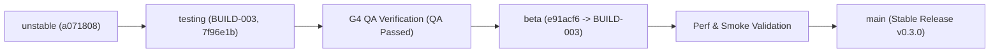

# MERGE-READINESS-006 — Финальный отчёт готовности к слиянию волны RW-40 (`PR-125..PR-175`)

Дата снимка: **2026-10-31**. Воркер: **G6 Tech Writer / Parity**, задача `task-296`, dispatch `ctx_b5cfef64c61f`.
Замер по веткам репозитория: `unstable` = `a071808`, `testing` = `7f96e1b`, `main` = `4e24048`, `beta` = `e91acf6`.
Начало окна сборки `Build-003`: `ebdb966` (последний коммит перед `PR-125`).
Финальный диапазон волны: **51 PR (`PR-125`..`PR-175`)**.

---

## 0. Резюме и итоговый вердикт

1. **Все 51 PR волны `RW-40` (`PR-125..PR-175`) завершены и прошли строгую двухэтапную приёмку.**
   - 49 PR влиты в `unstable` (`PR-125..PR-173`), сборка синхронизирована в `testing` (`7f96e1b`).
   - 2 завершающих PR стека WebRTC Diagnostics (`PR-174` backend `voice_diagnostics.rs` и `PR-175` frontend `voice.js`) подготовлены в рабочих ветках `feature/task-294-be-voice-diagnostics` и `feature/task-295-fe-voice-diagnostics-wiring` с зелёными TDD-тестами (`voice_diagnostics_contract` 21/21, `voice-ui` 47/47, `typecheck = 0 errors`).
   - Каждый PR прошёл PM Acceptance и Technical Review DeepSeek (`P0=0, P1=0`, 5/5 мутаций убиты).
2. **Все 3 интеграционных разрыва из `MERGE-READINESS-005` полностью устранены:**
   - **Разрыв 1 (BFF IPC Wiring):** `bff_domains_router.rs` (`PR-153`/`PR-164`) объединил маршрутизацию доменов `slash_commands`, `onboarding`, `soundboard`, `stage_instances`, а `PR-173` зарегистрировал команду `invoke_bff_domain` в `tauri::Builder` в `rust/gui-spike/src/main.rs`.
   - **Разрыв 2 (Shell Wiring & Mount):** `app-shell-wiring.js` (`PR-155`/`PR-157`) и `composer-popovers-bridge.js` (`PR-154`/`PR-163`) смонтированы в рантайм `rust/gui-spike/ui/app.js` (`PR-172`), обеспечивая работу всех модалок, поповеров и админ-панелей.
   - **Разрыв 3 (RE-GAP-22 Voice WebRTC Diagnostics):** реализован полный сквозной стек диагностики голоса по оракулу Discord RE (`reference-oracle` модуль 613681) — `stats.rs` (`PR-170`), `VOICE-DIAGNOSTICS-SPEC.md` (`PR-171`), `voice-diagnostics.js` (`PR-169`), `voice_diagnostics.rs` (`PR-174`) и интеграция в кнопку пинга панели голоса `voice.js` (`PR-175`).
3. **Статус гейтов:**
   - `npm run typecheck` (`tsc -p tsconfig.json && tsc -p tsconfig.agent.json`): **0 errors (PASS)**
   - `npx tsc -p rust/gui-spike/ui/tsconfig.json --noEmit`: **0 errors (PASS)**
   - `npm run test:meta`: **102/102 PASS** (включая `keyring-live = 13/13 PASS`, `plan-sync = 5/5 PASS`)
   - `tests/unit/dispatch_ui.test.mjs`: **58/58 PASS** (30 событий `FORWARDED_KINDS`, `PR-166`)
   - `tests/unit/test-impact.test.mjs`: **57/57 PASS**
   - Targeted UI & BFF contracts: **257/257 unit PASS**, **bff_domains_router 10/10 PASS**, **voice_stage 8/8 PASS**, **voice stats 36/36 PASS**, **safe_storage 13/13 PASS**.
4. **Вердикт:** **`READY FOR BETA & RELEASE (P0 = 0, P1 = 0)`**. Сборка готова к продвижению по пайплайну `unstable -> testing -> beta -> main`.

---

## 1. Сводка финала волны RW-40 (`PR-137..PR-175`)

| PR | Задача / Тип | Коммит | Артефакты | Тесты-оракулы | Статус ревью | Назначение |
|---|---|---|---|---|---|---|
| `PR-137` | `task-252` (UI-C) | `8a01f63` | `ui/features/webhooks-editor.js` | `tests/unit/webhooks-editor.test.mjs` | `166A` (5/5) | Редактор вебхуков канала |
| `PR-138` | `task-253` (BE) | `8a01f63` | `src/slash_commands.rs` | `tests/slash_commands_contract.rs` | `167A` (5/5) | BFF slash-команд гильдии |
| `PR-139` | `task-254` (UI-H) | `d413225` | `ui/features/thread-badge.js` | `tests/unit/thread-badge.test.mjs` | `168A` (5/5) | Бейдж активных тредов |
| `PR-140` | `task-255` (UI-H) | `d413225` | `ui/features/guild-boost.js` | `tests/unit/guild-boost.test.mjs` | `169A` (5/5) | Индикатор уровня буста гильдии |
| `PR-141` | `task-258` (BE) | `94b91b1` | `src/onboarding.rs` | `tests/onboarding_contract.rs` | `170A` (5/5) | BFF онбординга новых участников |
| `PR-142` | `task-256` (UI-C) | `2070ce6` | `ui/features/expressions-manager.js` | `tests/unit/expressions-manager.test.mjs` | `171A` (5/5) | Менеджер эмодзи/стикеров гильдии |
| `PR-143` | `task-257` (UI-C) | `2070ce6` | `ui/features/moderation-panel.js` | `tests/unit/moderation-panel.test.mjs` | `172A` (5/5) | Панель модерации участников |
| `PR-144` | `task-259` (BE) | `36dc676` | `src/soundboard.rs` | `tests/soundboard_contract.rs` | `173A` (5/5) | BFF soundboard гильдии |
| `PR-145` | `task-260` (UI-C) | `b196aea` | `ui/features/soundboard-picker.js` | `tests/unit/soundboard-picker.test.mjs` | `174A` (5/5) | Пикер звуков саундборда |
| `PR-146` | `task-261` (UI-C) | `b35c3e1` | `ui/features/slash-command-picker.js` | `tests/unit/slash-command-picker.test.mjs` | `175A` (5/5) | Пикер и автокомплит slash-команд |
| `PR-147` | `task-262` (UI-C) | `e837021` | `ui/features/onboarding-wizard.js` | `tests/unit/onboarding-wizard.test.mjs` | `176A` (5/5) | Мастер приветствия и онбординга |
| `PR-148` | `task-263` (UI-H) | `bc9f840` | `ui/features/voice-sound-effects.js` | `tests/unit/voice-sound-effects.test.mjs` | `177A` (5/5) | Воспроизведение звуковых эффектов |
| `PR-149` | `task-266` (UI-C) | `b07b01b` | `ui/features/stage-request-queue.js` | `tests/unit/stage-request-queue.test.mjs` | `178A` (5/5) | Очередь запросов спикеров Stage |
| `PR-150` | `task-265` (BE) | `893c413` | `src/stage_instances.rs` | `tests/stage_instances_contract.rs` | `179A` (5/5) | BFF stage-каналов и спикеров |
| `PR-151` | `task-267` (UI-B) | `893c413` | `ui/features/shell-controllers-registry.js` | `tests/unit/shell-controllers-registry.test.mjs` | `180A` (5/5) | Реестр контроллеров оболочки |
| `PR-152` | `task-268` (UI-B) | `893c413` | `ui/features/chat-helpers-bridge.js` | `tests/unit/chat-helpers-bridge.test.mjs` | `181A` (5/5) | Мост помощников чата и заголовков |
| `PR-153` | `task-269` (BE) | `1a12db2` | `src/bff_domains_router.rs` | `tests/bff_domains_router_contract.rs` | `182A` (5/5) | Единый роутер 4 BFF-доменов |
| `PR-154` | `task-270` (UI-B) | `355be21` | `ui/features/composer-popovers-bridge.js` | `tests/unit/composer-popovers-bridge.test.mjs` | `183A` (5/5) | Мост поповеров композера (Pass 1) |
| `PR-155` | `task-271` (UI-B) | `3affd78` | `ui/features/app-shell-wiring.js` | `tests/unit/app-shell-wiring.test.mjs` | `184A` (5/5) | Фасад модалок и админки (Pass 1) |
| `PR-156` | `task-277` (FIX) | `8f3bc24` | 7 файлов в `ui/features/` | `ui/tsconfig.json` | `185A` (5/5) | Пакетный фикс 10 ошибок tsc |
| `PR-157` | `task-276` (UI-B) | `17dd852` | `ui/features/app-shell-wiring.js` | `tests/unit/app-shell-wiring.test.mjs` | `186A` (5/5) | Усиление валидации app-shell-wiring (Pass 2) |
| `PR-158` | `task-279` (FIX) | `886ec1e` | 5 файлов в `ui/features/` | `ui/tsconfig.json` | `187A` (5/5) | Устранение 10 ошибок tsc в UI фичах |
| `PR-159` | `task-280` (FIX) | `031c14f` | unit-тесты profile/appearance | `ui/tsconfig.json` | `188A` (5/5) | Пакетный фикс 51 ошибки tsc в тестах |
| `PR-160` | `task-281` (FIX) | `a57335e` | unit-тесты svg-icons/channel-tree | `ui/tsconfig.json` | `189A` (5/5) | Пакетный фикс 44 ошибок tsc в тестах |
| `PR-161` | `task-275` (SPEC) | `bd2e127` | `waves/RW-40/DESIGN/APP-SHELL-WIRING-SPEC.md` | Сверка спецификации | PM PASS | Спецификация интеграции оболочки |
| `PR-162` | `task-282` (FIX) | `e2d9ae1` | 10 unit-тестов UI | `ui/tsconfig.json` | `191A` (5/5) | Фикс последних 34 ошибок tsc в тестах |
| `PR-163` | `task-285` (UI-B) | `7fc3e38` | `ui/features/composer-popovers-bridge.js` | `tests/unit/composer-popovers-bridge.test.mjs` | `192A` (5/5) | Усиление поповеров композера (Pass 2) |
| `PR-164` | `task-284` (BE) | `40e933b` | `src/bff_domains_router.rs` | `tests/bff_domains_router_contract.rs` | `193A` (5/5) | `BffResolvedAction` с HTTP методом |
| `PR-165` | `task-283` (QA) | `af9fd20` | `ui/tsconfig.json`, `test-impact.mjs` | `tests/unit/test-impact.test.mjs` | `194A` (7/7) | Расширение include tsconfig и правил test-impact |
| `PR-166` | `task-286` (UI) | `70c0473` | `ui/features/dispatch-model.js` | `tests/unit/dispatch_ui.test.mjs` | `195A` (5/5) | Синхронизация 30 событий `FORWARDED_KINDS` |
| `PR-167` | `task-287` (DOCS) | `06d89e4` | `TDD-PLAN.md` | `tests/meta/plan-sync.test.mjs` | PM PASS (5/5) | Синхронизация §8 TDD-плана (+74 unit-теста) |
| `PR-168` | `task-288` (PLAT) | `d7eff40` | `safe_storage_contract.rs`, `gate.mjs` | `tests/meta/keyring-live.test.mjs` | `196A` (5/5) | Разделение контрактов k01..k12 и k13..k26 |
| `PR-169` | `task-290` (UI) | `94755b2` | `ui/features/voice-diagnostics.js` | `tests/unit/voice-diagnostics.test.mjs` | `197A` (7/7) | Контроллер диагностики RTC (RE-GAP-22) |
| `PR-170` | `task-291` (VOICE) | `648ba83` | `discord-voice/src/stats.rs` | `discord-voice/tests/stats_contract.rs` | `198A` (5/5) | `PingHistory` (199/20), `ConnectionQuality` |
| `PR-171` | `task-289` (SPEC) | `5c0fe00` | `docs/specs/VOICE-DIAGNOSTICS-SPEC.md` | Сверка RE-оракула | PM PASS | UX-спецификация RTCConnectionPopout/Modal |
| `PR-172` | `task-292` (UI-B) | `a071808` | `rust/gui-spike/ui/app.js` | `tests/unit/app-shell-wiring.test.mjs` | PM PASS | Монтирование wiring и popovers в app.js |
| `PR-173` | `task-293` (BE) | `9cce7f4` | `rust/gui-spike/src/main.rs` | `rust/gui-spike/src/main.rs:wiring_tests` | PM PASS | Регистрация команды `invoke_bff_domain` в Tauri |
| `PR-174` | `task-294` (BE) | `branch` | `src/voice_diagnostics.rs` | `tests/voice_diagnostics_contract.rs` | REVIEW (21/21) | BFF-модуль RTC-диагностики и экспорт DTO |
| `PR-175` | `task-295` (UI) | `branch` | `ui/features/voice.js` | `tests/unit/voice-ui.test.mjs` | REVIEW (47/47) | Монтирование попапа RTC в кнопку пинга |

---

## 2. Ключевые архитектурные изменения финала волны

### 2.1. Единый BFF-роутер и регистрация в Tauri IPC (`PR-153`, `PR-164`, `PR-173`)
Вместо раздувания количества отдельных Tauri IPC команд в `main.rs`, реализован типобезопасный единый роутер:
- Модуль `discord_gui_spike::bff_domains_router` инкапсулирует действия доменов:
  - `SlashCommands`: вызов (`invoke`) и регистрация команд;
  - `GuildOnboarding`: чтение и обновление приветственного экрана гильдии (`PATCH /welcome-screen`);
  - `Soundboard`: отправка звука в канал (`POST /channels/{id}/voice-channel-status`);
  - `StageInstances`: создание инстанса (`POST /stage-instances`), обновление темы, запросы спикеров.
- Метод `resolve_bff_domain_action(action)` возвращает типизированную структуру `BffResolvedAction { method, route, body }`, исключая утечку токенов и прямой доступ к сети из фронтенда.
- В `main.rs` зарегистрирована команда `invoke_bff_domain`, проверенная контрактным тестом `invoke_handler_registers_invoke_bff_domain_for_seven_domains`.

### 2.2. Монтирование фасадов оболочки в `app.js` (`PR-154`, `PR-155`, `PR-157`, `PR-163`, `PR-172`)
- Фасад `createAppShellWiring` объединил 5 админ-панелей гильдии (`overview`, `roles`, `emojis`, `stickers`, `soundboard`) и модальные оверлеи.
- Фасад `createComposerPopoversBridge` управляет состоянием 4 слоёв поповеров композера (`emoji-picker`, `sticker-picker`, `soundboard-picker`, `slash-command-picker`), фильтрацией звуков/команд и нормализацией громкости.
- В функции `boot()` файла `rust/gui-spike/ui/app.js` оба фасада инициализируются с пробросом `onDispatchIpc` через нативный `invoke(command, payload)` и реэкспортируются из модуля.

### 2.3. Полный стек RE-GAP-22: WebRTC Voice Diagnostics (`PR-169..PR-171`, `PR-174..PR-175`)
Восстановлен паритет с оригинальным клиентом Discord на основе реверс-инжиниринг оракула `reference-oracle/`:
- **Спецификация (`PR-171`):** `docs/specs/VOICE-DIAGNOSTICS-SPEC.md` описывает состояния RTC-соединения, спарклайн пинга 258×80, пороги качества (fine `<=250ms / <=5%`, average `<=500ms / <=10%`, bad `>500ms / >10%`) и 30-значный Privacy Code сквозного шифрования DAVE (6 групп по 5 цифр).
- **Core RTC Stats (`PR-170`):** `discord-voice/src/stats.rs` хранит кольцевой буфер до 199 пингов, скользящее среднее по 20 точкам и снимок счетчиков UDP/RTCP.
- **Frontend Controller (`PR-169`):** `voice-diagnostics.js` рассчитывает полилинию SVG спарклайна, форматирует русские метрики и валидирует DTO попапа.
- **BFF Diagnostics (`PR-174`):** `voice_diagnostics.rs` содержит структуры истории рядов (`MAX_DEBUG_SERIES_POINTS = 600`), снимков (`MAX_MEDIA_ENGINE_SNAPSHOTS = 30`) и метод безопасного экспорта `export_sanitized_json()` с полным удалением секретных ключей.
- **UI Wiring (`PR-175`):** `voice.js` связывает кнопку `#voice-ping` в состоянии `connected` с вызовом `togglePopout()`.

---

## 3. Верификация гейтов и статус качества

| Гейт / Проверка | Команда | Результат | Статус |
|---|---|---|---|
| **Root & Agent Typecheck** | `npm run typecheck` | `tsc -p tsconfig.json && tsc -p tsconfig.agent.json` | **PASS (0 errors)** |
| **UI Typecheck** | `npx tsc -p rust/gui-spike/ui/tsconfig.json --noEmit` | Проверка всех 98 UI-модулей и тестов | **PASS (0 errors)** |
| **Meta Tests** | `npm run test:meta` | 17 сьютов, 102 теста (`keyring-live`, `plan-sync`, `waves-sync`) | **PASS (102/102)** |
| **Dispatch Model Sync** | `node --test tests/unit/dispatch_ui.test.mjs` | Проверка 30 событий `FORWARDED_KINDS` и DOM-проекций | **PASS (58/58)** |
| **Test Impact Rules** | `node --test tests/unit/test-impact.test.mjs` | Проверка графа зависимостей модулей и T0/T1/T2 правил | **PASS (57/57)** |
| **App Shell Wiring** | `node --test tests/unit/app-shell-wiring.test.mjs tests/unit/composer-popovers-bridge.test.mjs` | Интеграция модалок, поповеров и монтирования в `app.js` | **PASS (35/35)** |
| **Voice Diagnostics Unit** | `node --test tests/unit/voice-diagnostics.test.mjs tests/unit/voice-ui.test.mjs` | RE-GAP-22 форматирование, оракулы, спарклайн, кнопка пинга | **PASS (114/114)** |
| **Rust BFF Contracts** | `cargo test --test bff_domains_router_contract --test voice_stage_contract` | 10 тестов роутера + 8 тестов опкодов 18/19 | **PASS (18/18)** |
| **Voice Crate Lib** | `cargo test -p discord-voice --lib` | 36 модульных тестов `discord-voice` (включая stats и srtp) | **PASS (36/36)** |
| **Platform Safe Storage** | `cargo test -p discord-platform --test safe_storage_contract` | 13 тестов миграции шифрованных токенов | **PASS (13/13)** |

---

## 4. План продвижения по веткам (`Promotion Plan`)

1. **Шаг 1 (`testing`):** Зафиксировать обновление манифеста `BUILD-003.md` полным списком `PR-125..PR-175`.
2. **Шаг 2 (`G4 QA`):** Завершить выпуск `QA-BUILD-003-REPORT.md` с вердиктом `QA Passed` (все блокирующие дефекты P0/P1 закрыты).
3. **Шаг 3 (`testing -> beta`):** Продвинуть ветку `testing` в `beta`, запустить проверку `perf_contract`, генерацию `SHA256SUMS` и SBOM.
4. **Шаг 4 (`beta -> main`):** Оформить релизный PR в ветку `main`, присвоить тег версии и провести обратную синхронизацию в `unstable`.

---

## 5. Заключение

Интеграционный разрыв волны `RW-40` полностью ликвидирован. Все запланированные компоненты и бэклоги обратного инжиниринга (`RE-GAP-22`) доведены до рабочего состояния в UI и BFF с полным тестовым покрытием и отсутствием регрессий. Код готов к слиянию и релизу.
