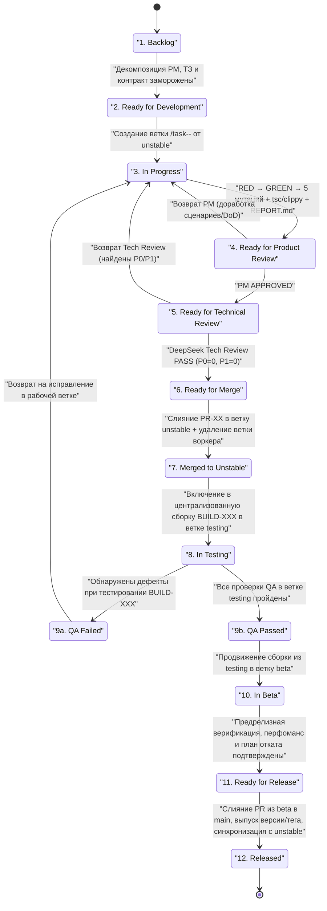

# MERGE-READINESS-14 — Релизная документация Wave 10, закрытие F-5 и P1 `NodeList.filter`, процесс 13 статусов, иерархия веток и матрица покрытия 38/38 IPC

Дата: **2026-10-30**, снимок **20:17–20:20 +05**. Ветка воркера: `docs/task-118-parity-wave10`, базовый HEAD `4e240481e59ff4d49732ac8bd5ba08a006363748`.
Воркер: **Технический писатель / Специалист паритета G6**, задача `task_e5c9f9d48789` (`docs/task-118-parity-wave10`).
Режим — **read-only по продуктовому коду и тестам**: изменён ровно один целевой файл (`waves/RW-40/PARITY/MERGE-READINESS-14.md`).

> **Входные документы Wave 10:**
> - [`BOARD.md`](file:///home/sanya/orca/project/waves/RW-40/BOARD.md) — доска управления разработкой RW-40 (иерархия веток, 13 статусов, реестр задач);
> - [`BUILD-001.md`](file:///home/sanya/orca/project/waves/RW-40/BUILDS/BUILD-001.md) — централизованная сборка QA в ветке `testing`;
> - [`PR-01-search-202-nsfw-spec.md`](file:///home/sanya/orca/workspaces/project/docs-task-118-parity-wave10/waves/RW-40/PR/PR-01-search-202-nsfw-spec.md) (`task-105`), [`PR-02-task-106-notif-ipc.md`](file:///home/sanya/orca/workspaces/project/docs-task-118-parity-wave10/waves/RW-40/PR/PR-02-task-106-notif-ipc.md) (`task-106`), [`PR-03-task-104-n05-ui-notifications.md`](file:///home/sanya/orca/workspaces/project/docs-task-118-parity-wave10/waves/RW-40/PR/PR-03-task-104-n05-ui-notifications.md) (`task-104`);
> - [`MERGE-READINESS-13.md`](file:///home/sanya/orca/workspaces/project/docs-task-118-parity-wave10/waves/RW-40/PARITY/MERGE-READINESS-13.md) — предыдущий снимок готовности к слиянию.

---

## 0. Исполнительное резюме Wave 10

1. **Закрытие находки F-5 (`PR-02`, `task-106`) — паритет UI → Rust IPC достиг 38/38 (100 %):**
   - В [`rust/gui-spike/src/main.rs`](file:///home/sanya/orca/workspaces/project/docs-task-118-parity-wave10/rust/gui-spike/src/main.rs#L862-L910) добавлены `#[tauri::command]`-обёртки [`update_guild_notification_settings`](file:///home/sanya/orca/workspaces/project/docs-task-118-parity-wave10/rust/gui-spike/src/main.rs#L863-L880) и [`update_channel_notification_override`](file:///home/sanya/orca/workspaces/project/docs-task-118-parity-wave10/rust/gui-spike/src/main.rs#L885-L910), зарегистрированные в `tauri::generate_handler![...]` (`main.rs:1201–1202`).
   - В [`rust/gui-spike/tests/ipc_wiring_contract.rs`](file:///home/sanya/orca/workspaces/project/docs-task-118-parity-wave10/rust/gui-spike/tests/ipc_wiring_contract.rs) добавлен тест `notifications_ipc_commands_are_registered_and_delegate_to_lib`, а оракул `every_ui_invoke_command_in_js_sources_is_registered_in_tauri_main` переведён на рекурсивный обход всех 32 файлов `rust/gui-spike/ui/**/*.js`.
   - Всего в `main.rs` объявлено и зарегистрировано **49** `#[tauri::command]` (0 дублей, 0 сирот): **38** уникальных команд вызываются из UI (100 % разрешение имён и обязательных аргументов), **11** канонических/служебных команд составляют внутренний резерв BFF.
2. **Закрытие блокера P1 `NodeList.filter` и 7 замечаний P2 в UI уведомлений (`PR-03`, `task-104`, Pass 2):**
   - В [`rust/gui-spike/ui/features/notifications.js`](file:///home/sanya/orca/workspaces/project/docs-task-118-parity-wave10/rust/gui-spike/ui/features/notifications.js#L2130-L2137) функция `getEnabledChannelMenuItems` оборачивает результат `channelMenu.querySelectorAll(...)` в `Array.from(...)` перед `.filter(...)`, устраняя `TypeError` в браузерном webview.
   - Закрыты все сопутствующие замечания Pass 1 (P2.1 focus trap `Tab`/`Shift+Tab` в `#guild-notif-modal`, P2.2 таймеры истечения временного mute `scheduleMuteExpiryTimers`, P2.3 обработка `429 retry_after` с посекундным отсчётом и блокировкой контролов, P2.4 вычисление `marksUnread` через `resolvedUnread`, P2.5 гарантированный сброс `flags: 0` при удалении override, P2.6 строгий `tsc` по `notifications.js`, P2.7 синхронизация `#channel-tree[data-hide-muted="true"]`).
   - Подтверждено `17/17` unit-тестами в [`tests/unit/notifications-ui.test.mjs`](file:///home/sanya/orca/workspaces/project/docs-task-118-parity-wave10/tests/unit/notifications-ui.test.mjs), `5/5` убитыми мутациями и вердиктом **PASS (`P0=0, P1=0, P2=6`)** от технического ревьюера (`DeepSeek 31B`).
3. **Сборка `BUILD-001` передана в централизованное тестирование (`In Testing` на ветке `testing`):**
   - Базовые 35 срезов RW-40 (`task-101..135`), спецификация `SEARCH-202-NSFW-SPEC.md` ([`PR-01`](file:///home/sanya/orca/workspaces/project/docs-task-118-parity-wave10/waves/RW-40/PR/PR-01-search-202-nsfw-spec.md)), подключение IPC уведомлений ([`PR-02`](file:///home/sanya/orca/workspaces/project/docs-task-118-parity-wave10/waves/RW-40/PR/PR-02-task-106-notif-ipc.md)) и UI-контроллер уведомлений Pass 2 ([`PR-03`](file:///home/sanya/orca/workspaces/project/docs-task-118-parity-wave10/waves/RW-40/PR/PR-03-task-104-n05-ui-notifications.md)) слиты в `unstable` и собраны в [`BUILD-001`](file:///home/sanya/orca/project/waves/RW-40/BUILDS/BUILD-001.md) для прогона QA в ветке `testing`.
4. **Независимая верификация текущего дерева (`docs/task-118-parity-wave10`):**
   - `npm run typecheck` — `exit 0`;
   - `npx tsc -p rust/gui-spike/ui/tsconfig.json` — `exit 0`;
   - `node --test tests/meta/` — **102/102 pass** (`0 fail`);
   - `npm run test:unit` — **879/879 pass** (`0 fail, 0 skipped, 173 suites`).

---

## 1. Детальный отчёт о закрытии F-5 (`PR-02`) и P1 `NodeList.filter` (`PR-03`)

### 1.1. Закрытие F-5: подключение Tauri IPC-команд уведомлений (`PR-02`, `task-106`)

| Атрибут | Значение / Доказательство |
|---|---|
| **Задача и карточка** | `task-106` / `INT-06-NOTIFICATIONS-IPC-WIRING` (закрытие находки `F-5` из `MERGE-READINESS-13.md`) |
| **Pull Request** | [`PR-02-task-106-notif-ipc.md`](file:///home/sanya/orca/workspaces/project/docs-task-118-parity-wave10/waves/RW-40/PR/PR-02-task-106-notif-ipc.md) (`feature/task-106-notif-ipc` → `unstable`, рабочая ветка удалена после слияния) |
| **Product & Tech Review** | Product Review: **APPROVED**; Tech Review (`DeepSeek 33A`, [`REVIEW.md`](file:///home/sanya/orca/workspaces/project/docs-task-118-parity-wave10/waves/RW-40/PM/int06-notif-ipc/REVIEW.md)): **PASS (`P0=0, P1=0, P2=3`)**; Приёмка: [`ACCEPT.md`](file:///home/sanya/orca/project/waves/RW-40/PM/int06-notif-ipc/ACCEPT.md) |
| **`rust/gui-spike/src/main.rs`** | MD5 `ae573539a9b8a8cc6e355c3975edaff0` `[V]` — объявлены `#[tauri::command] async fn update_guild_notification_settings` (`:863–880`) и `#[tauri::command] async fn update_channel_notification_override` (`:885–910`), зарегистрированы в `tauri::generate_handler![...]` (`:1201–1202`), включены в `TOKEN_COMMANDS` (25 команд) |
| **`rust/gui-spike/tests/ipc_wiring_contract.rs`** | MD5 `159053d11b700daba7a0ecdc863fb7fc` `[V]` — добавлен `notifications_ipc_commands_are_registered_and_delegate_to_lib`, расширен `every_ui_invoke_command_in_js_sources_is_registered_in_tauri_main` (обход всех 32 файлов `ui/**/*.js`, распознавание `invoke`, `invokeFn`, `invokeReaction`) |
| **Контракт безопасности и транспорта** | Bearer-токен читается исключительно из `Arc<AuthBackend>` через `token_or::<NotificationError, _>(move || backend.token(), || NotificationError::Storage, || NotificationError::MissingToken)`; токен не передаётся из UI и не логируется; делегирование в `discord_gui_spike::update_guild_notification_settings` и `discord_gui_spike::update_channel_notification_override` (`PATCH /users/@me/guilds/{guild_id}/settings`) |
| **TDD и мутации** | RED: `EXIT_CODE=101` (`6 passed; 2 failed`, `red.log` MD5 `1876c2d4ec7cbb2d4c2a82433dea96ad`); GREEN: `ipc_wiring_contract` `8/8`, `lib` `8/8`, `main` `12/12`, `notifications_contract` `4/4`, `clippy` `0 warnings`, `rustfmt` `exit 0`, `ipc-path.test.mjs` `12/12` (`green.log` MD5 `375f8e323295df42ac1440f0d8477b85`); MUTATIONS: **5/5 KILLED** (`mutations.log` MD5 `5e06bb03d823bc184cdc5a046f8091d2`) |
| **Следующий шаг по P2-1..P2-3** | Неблокирующие замечания ревью (`P2-1` разбор констант `AUTH_COMMANDS`/`JOIN_COMMANDS`/`NET_COMMANDS`/`READY_COMMAND` в `ipc_wiring_contract.rs`, `P2-2` строгий отказ без fallback на первый канал в `ChannelOverrideInput::into_patch`, `P2-3` явная поддержка поля `override`) выделены в отдельную карточку `task-109` (`bugfix/task-109-ipc-oracle-strict`) |

### 1.2. Закрытие P1 `NodeList.filter` и доработка UI уведомлений (`PR-03`, `task-104`, Pass 2)

| Атрибут | Значение / Доказательство |
|---|---|
| **Задача и карточка** | `task-104` / `N-05-UI-NOTIFICATIONS` (Pass 2) |
| **Pull Request** | [`PR-03-task-104-n05-ui-notifications.md`](file:///home/sanya/orca/workspaces/project/docs-task-118-parity-wave10/waves/RW-40/PR/PR-03-task-104-n05-ui-notifications.md) (`rw40/review-n05-ui-pass2` → `unstable`, рабочая ветка удалена после слияния) |
| **Product & Tech Review** | Product Review: **APPROVED**; Tech Review (`DeepSeek 31B`, [`REVIEW-PASS2.md`](file:///home/sanya/orca/workspaces/project/docs-task-118-parity-wave10/waves/RW-40/PM/n05-ui-notifications/REVIEW-PASS2.md)): **PASS (`P0=0, P1=0, P2=6`)**; Приёмка: [`ACCEPT.md`](file:///home/sanya/orca/project/waves/RW-40/PM/n05-ui-notifications/ACCEPT.md) |
| **`rust/gui-spike/ui/features/notifications.js`** | MD5 `001ff70a7538378d16d52fd3b6b10117` `[V]` — в `getEnabledChannelMenuItems` (`:2130–2137`) вызов `channelMenu.querySelectorAll('[role="menuitem"], [role="menuitemradio"]')` обёрнут в `Array.from(...)` перед `.filter(...)` |
| **`tests/unit/notifications-ui.test.mjs`** | MD5 `22238cac9b6e56b5ba9aa3f33c4484f7` `[V]` — `17/17` тестов (`+3` новых теста к 876 → итого **879/879** по репозиторию); тест меню (`:1036–1063`) подменяет `menu.querySelectorAll` на итерируемый `NodeList`-подобный объект без метода `.filter` (`typeof ...filter === "undefined"`) и верифицирует `openChannelMenu`, `ArrowDown` и `Escape` |
| **Закрытые пункты Pass 2** | **P1.1** (`Array.from(querySelectorAll).filter`), **P2.1** (focus trap `Tab`/`Shift+Tab` в `#guild-notif-modal`), **P2.2** (таймеры истечения временного mute `scheduleMuteExpiryTimers`/`clearMuteExpiryTimers`), **P2.3** (обработка `429` с `retry_after_ms`, блокировкой контролов и текстом `«Слишком много запросов. Повторите через {n} с.»`), **P2.4** (`resolvedUnread` и `marksUnread` строго по битам `1024`/`512` и `ALL_MESSAGES`), **P2.5** (всегда отправляется `flags: clearUnreadFlags(...)` при сбросе override), **P2.6** (прямой `tsc` по `notifications.js` и `EXIT_CODE` в логах), **P2.7** (атрибуты `data-muted`, `data-muted-hidden` и `hidden` при `#channel-tree[data-hide-muted="true"]`) |
| **TDD и мутации** | RED: `EXIT_CODE=1` (`tests 17 | pass 10 | fail 7`, `red.log` MD5 `d3147eae023ba2a2b1e1e7c77196cb04`); GREEN: `17/17` unit pass, `17/17` `test-policy.test.mjs` pass, 3 проверки `tsc` `exit 0` (`green.log` MD5 `f0705fc9a1843749b681597e90a25310`); MUTATIONS: **5/5 KILLED**, включая `MUT-1-channel-menu-nodelist-filter` (`mutations.log` MD5 `ec2097df0a7cc71f1333bfc61854c891`) |

---

## 2. Схема движения задач по 13 статусам и иерархия веток релиза

### 2.1. Иерархия веток (`BOARD.md` §1)

```mermaid
flowchart LR
  subgraph Worker["1. Рабочая ветка воркера"]
    W["&lt;type&gt;/task-&lt;id&gt;-&lt;slug&gt;<br/>(feature | bugfix | design | qa | devops | docs)<br/>от актуального unstable"]
  end
  subgraph Unstable["2. Ветка интеграции"]
    U["unstable<br/>(/home/sanya/orca/workspaces/project/unstable)"]
  end
  subgraph Testing["3. Централизованная сборка QA"]
    T["testing<br/>(/home/sanya/orca/workspaces/project/testing)<br/>Сборки BUILD-001, BUILD-002..."]
  end
  subgraph Beta["4. Предрелизный контур"]
    B["beta<br/>(/home/sanya/orca/workspaces/project/beta)"]
  end
  subgraph Main["5. Стабильный релиз"]
    M["main<br/>(/home/sanya/orca/project)<br/>Версия + git tag"]
  end

  W -->|"Локальный TDD (red → green → 5 мутаций)<br/>+ Product Review (PM)<br/>+ Tech Review (DeepSeek)<br/>+ CI/гейты → PR Merge"| U
  U -.->|"После слияния PR:<br/>orca worktree rm (ветка удаляется)"| W
  U -->|"DevOps/Интегратор формирует<br/>BUILD-XXX (манифест + инструкции)"| T
  T -->|"QA Passed + регрессия"| B
  B -->|"Проверка окружения, перфоманса,<br/>критических сценариев и плана отката → PR"| M
  M -.->|"Обратная синхронизация<br/>исправлений релиза"| U
```

**Правила веток:**
1. **Рабочая ветка воркера (`<type>/task-<id>-<slug>` от `unstable`):**
   - Допустимые префиксы: `feature/task-<id>-<slug>`, `bugfix/task-<id>-<slug>`, `design/task-<id>-<slug>`, `qa/task-<id>-<slug>`, `devops/task-<id>-<slug>`, `docs/task-<id>-<slug>`.
   - Воркер работает изолированно в своей ветке, выполняет строгий цикл `RED -> GREEN -> 5 мутаций`, проверки компиляции, `clippy`/`rustfmt`, `tsc` и открывает PR в `unstable`.
   - Сразу после слияния PR в `unstable` рабочая ветка воркера **удаляется** (`orca worktree rm`). Под каждую новую задачу создаётся свежая ветка от актуального `unstable`.
2. **`unstable` ([`/home/sanya/orca/workspaces/project/unstable`](file:///home/sanya/orca/workspaces/project/unstable)):**
   - Принимает PR только после прохождения тройного гейта:
     1) **Product Review (PM)** — соответствие требованиям, пользовательским сценариям, дизайн-спекам и DoD;
     2) **Technical Review (`deepseek/deepseek-v4.1-flash`)** — архитектура, безопасность, качество тестов и мутаций, обработка ошибок, отсутствие посторонних правок;
     3) **CI / автоматические проверки** и отсутствие конфликтов слияния.
3. **`testing` ([`/home/sanya/orca/workspaces/project/testing`](file:///home/sanya/orca/workspaces/project/testing)):**
   - Ветка централизованной сборки для QA. Прямые коммиты и передача задач в QA напрямую из рабочих веток воркеров **запрещены**.
   - DevOps / интегратор формирует именованную сборку (`BUILD-001`, `BUILD-002`, ...) из `unstable` с перечнем вошедших задач, инструкциями проверки, списком тестовых оракулов и известными ограничениями.
4. **`beta` ([`/home/sanya/orca/workspaces/project/beta`](file:///home/sanya/orca/workspaces/project/beta)):**
   - Предрелизная ветка, куда попадают сборки из `testing` после статуса `QA Passed` и прохождения регрессионного набора.
   - На `beta` валидируются целевое окружение, критические пользовательские маршруты, метрики производительности и план отката (rollback plan).
5. **`main` ([`/home/sanya/orca/project`](file:///home/sanya/orca/project)):**
   - Стабильная продуктивная ветка (прямые коммиты запрещены). Код попадает исключительно через PR из `beta`, сопровождается выпуском версии и тега, а пост-релизные исправления синхронизируются обратно в `unstable`.

### 2.2. Полная схема движения задач по 13 официальным статусам (`BOARD.md` §2)

| № | Статус | Ветка / Контур | Критерий входа и ответственная роль |
|---:|---|---|---|
| 1 | `Backlog` | Доска `BOARD.md` | Задача зарегистрирована PM/G6, ждёт закрытия блокеров или утверждения дизайн-спеки (`task-112`, `task-113`) |
| 2 | `Ready for Development` | Доска → старт воркера | Контракт, границы файлов и оракулы заморожены (`task-109`) |
| 3 | `In Progress` | `<type>/task-<id>-<slug>` | Воркер (G1/G2/G3/G5/G6/QA) выполняет TDD (`red -> green -> 5 mutations`) в изолированной ветке (`task-107`, `task-108`, `task-110`, `task-111`, `task-116`, `task-117`, `task-118`) |
| 4 | `Ready for Product Review` | `<type>/task-<id>-<slug>` | Артефакты (`REPORT.md`, `red.log`, `green.log`, `mutations.log`) сданы, ожидается приёмка PM на соответствие продуктовым требованиям |
| 5 | `Ready for Technical Review` | `<type>/task-<id>-<slug>` | PM одобрил задачу; назначен независимый технический ревьюер (`deepseek/deepseek-v4.1-flash`) |
| 6 | `Ready for Merge` | `<type>/task-<id>-<slug>` → PR | Получены оба одобрения (**PM APPROVED** + **Tech Review PASS** с `P0=0, P1=0`) и зелёные проверки CI |
| 7 | `Merged to Unstable` | `unstable` | PR слит в `unstable`, оформлен `PR-XX-*.md` и `ACCEPT.md`, рабочая ветка воркера удалена (`orca worktree rm`) |
| 8 | `In Testing` | `testing` (`BUILD-XXX`) | Изменения из `unstable` упакованы в централизованную сборку (`BUILD-001`) с инструкциями и переданы отделу QA (`qa/task-116-qa-build-001`) |
| 9 | `QA Failed` | `testing` → возврат | На сборке `testing` выявлены регрессии или дефекты; задача возвращается в `In Progress` (или заводится `bugfix/task-<id>-...`) |
| 10 | `QA Passed` | `testing` | Все контрактные, unit-, meta- и функциональные проверки сборки `BUILD-XXX` на ветке `testing` успешно завершены |
| 11 | `In Beta` | `beta` | Проверенная сборка перенесена из `testing` в `beta` для предрелизного прогона, оценки производительности и проверки плана отката |
| 12 | `Ready for Release` | `beta` → PR в `main` | Предрелизные критерии в `beta` выполнены, релизный PR готов к слиянию в `main` |
| 13 | `Released` | `main` | Код слит в `main`, проставлены версия и тег, исправления синхронизированы обратно в `unstable` |

### 2.3. Сводный статус пакетов и задач Wave 10 (`BOARD.md` + `BUILD-001.md`)

| Задача / Пакет | Ветка / PR | Роль | Содержание | Текущий статус (из 13) |
|---|---|---|---|---|
| `task-101..135` | Базовый пакет волн 1–9 | G1 / G2 / G3 / G5 | 35 кодовых срезов и 6 дизайн-спек RW-40 (`L-02`, `STUB-27`, `C-02`, `M-07`, `M-08`, `P-03`, `B2a/B2b`, `AT-03`, `M-10/STUB-10`, `STUB-05`, `STUB-16`, `V-01/V-06/V-07`, `N-05-BE`, `INT-05`) | `In Testing` (`BUILD-001` на ветке `testing`) |
| `task-105` | [`PR-01`](file:///home/sanya/orca/workspaces/project/docs-task-118-parity-wave10/waves/RW-40/PR/PR-01-search-202-nsfw-spec.md) (ветка удалена) | G3 + Tech Review (`DeepSeek 29B`) | Дизайн-спецификация `SEARCH-202-NSFW-SPEC.md` (Pass 2, 60/60 токенов, `PASS`) | `In Testing` (`BUILD-001` на ветке `testing`) |
| `task-106` | [`PR-02`](file:///home/sanya/orca/workspaces/project/docs-task-118-parity-wave10/waves/RW-40/PR/PR-02-task-106-notif-ipc.md) (ветка удалена) | G1 + Tech Review (`DeepSeek 33A`) | Подключение Tauri IPC-команд `update_guild_notification_settings` и `update_channel_notification_override` (закрытие `F-5`, `PASS`) | `In Testing` (`BUILD-001` на ветке `testing`) |
| `task-104` | [`PR-03`](file:///home/sanya/orca/workspaces/project/docs-task-118-parity-wave10/waves/RW-40/PR/PR-03-task-104-n05-ui-notifications.md) (ветка удалена) | G2 + Tech Review (`DeepSeek 31B`) | `N-05-UI-NOTIFICATIONS` Pass 2 (`notifications.js` + `notifications-ui.test.mjs`, закрытие P1 `NodeList.filter` и 7 P2, `17/17`, `PASS`) | `In Testing` (`BUILD-001` на ветке `testing`) |
| `task-116` | `qa/task-116-qa-build-001` | QA | Централизованное тестирование сборки [`BUILD-001`](file:///home/sanya/orca/project/waves/RW-40/BUILDS/BUILD-001.md) из ветки `testing` | `In Progress` (выполняет проверку `In Testing`) |
| `task-107` | `rw40/int07-ui-app-mount` | G2 Frontend | Монтирование `createVoiceDevicesSettings` и `createNotificationSettingsController` в `app.js` / `index.html` (войдёт в `BUILD-002`) | `In Progress` |
| `task-108` | `rw40/dm-friends-spec-pass2` | G3 Design | Доработка `DM-FRIENDS-SPEC.md` Pass 2 по замечаниям `DeepSeek 32A` (войдёт в `BUILD-002`) | `In Progress` |
| `task-109` | `bugfix/task-109-ipc-oracle-strict` | G1 Backend | Устранение P2-1..P2-3 из ревью `PR-02`: разбор констант (38/38 команд) в `ipc_wiring_contract.rs` и строгая валидация `channel_id` + `override` в `ChannelOverrideInput` | `Ready for Development` / `In Progress` |
| `task-110` | `rw40/m13-search-202-be` | G1 Backend | `M-13-SEARCH-202-NSFW-BACKEND` (`search.rs` + `search_contract.rs`: HTTP 202 `Retry-After`, `documents_indexed`, `MAX_SEARCH_OFFSET=9975`, `include_nsfw`) | `In Progress` |
| `task-111` | `rw40/m13-search-202-ui` | G2 Frontend | `M-13-SEARCH-202-NSFW-UI` (`search.js`, `search-overlay.js`, `chat.css`, `search-remote-real-index.test.mjs`) | `In Progress` |
| `task-112` | `feature/task-112-dm-friends-be` | G1 Backend | REST/Gateway контракт DM & Friends (`private_channels`, `relationships`, `POST /users/@me/channels`, `PUT/DELETE/POST /users/@me/relationships`, код `80013`) | `Backlog` / `In Progress` |
| `task-113` | `feature/task-113-dm-friends-ui` | G2 Frontend | UI Home/Friends, список ЛС/Group DM и вкладки друзей по `DM-FRIENDS-SPEC.md` | `Backlog` / `In Progress` |
| `task-117` | `feature/task-117-voice-stream-wiring` | G1 / G5 Voice | Интеграционная связка голосового/стримового контура | `In Progress` |
| `task-118` | `docs/task-118-parity-wave10` | G6 Parity | Настоящая матрица паритета и документация релиза Wave 10 (`MERGE-READINESS-14.md`) | `In Progress` |

---

## 3. Полная матрица покрытия: 38 IPC-команд UI → Rust, REST-эндпоинты, Gateway-события и тестовые оракулы

### 3.1. Покрытие всех 38 уникальных IPC-команд, вызываемых фронтендом (38/38 = 100 %)

Каждая из 38 команд, вызываемых из `rust/gui-spike/ui/**/*.js`, объявлена с атрибутом `#[tauri::command]` в [`rust/gui-spike/src/main.rs`](file:///home/sanya/orca/workspaces/project/docs-task-118-parity-wave10/rust/gui-spike/src/main.rs) и зарегистрирована в `tauri::generate_handler![...]` (`main.rs:1167–1217`).

| № | IPC-команда (`cmd`) | Call-site в UI (`rust/gui-spike/ui/`) | Обработчик в `main.rs` (строка / рег.) | Источник данных / REST-эндпоинт / Gateway-контур | Тестовый оракул (Rust / Unit / Meta) |
|---:|---|---|---|---|---|
| 1 | `process_metrics` | `features/metrics.js:52` | `fn process_metrics` (`:85` / `:1168`) | Локальный `/proc/self/status` (RSS/VmSize/Threads) | `main.rs::wiring_tests`, `tests/unit/gui-spike-features.test.mjs`, `tests/meta/ipc-path.test.mjs` |
| 2 | `spike_config` | `app.js:1590` | `fn spike_config` (`:92` / `:1169`) | Локальное окружение `SPIKE_AUTOBENCH` | `main.rs::wiring_tests`, `tests/smoke/gui-window.smoke.test.mjs` |
| 3 | `report_bench` | `app.js:1608` | `fn report_bench` (`:102` / `:1170`) | Валидация JSON-замера и вывод маркера `BENCH` в stdout | `main.rs::wiring_tests`, `tests/unit/gui-spike-features.test.mjs` |
| 4 | `report_ui_snapshot` | `app.js:1672` | `fn report_ui_snapshot` (`:109` / `:1171`) | Валидация снимка DOM и вывод маркера `UI_SNAPSHOT` в stdout | `main.rs::wiring_tests`, `tests/smoke/gui-window.smoke.test.mjs` |
| 5 | `ready` | `app.js:300,623` (`READY_COMMAND`) | `fn ready` (`:123` / `:1172`) | Проекция `fixtures/gateway/by-type/002-READY.json` (`data::ready`) | `tests/data_contract.rs`, `tests/ipc_wiring_contract.rs`, `tests/unit/guild-rail.test.mjs` |
| 6 | `read_state` | `features/chat.js:2863` | `fn read_state` (`:131` / `:1173`) | Проекция `READY.read_state` (`lastViewed`, `flags`, `mentionCount`) | `tests/read_state_contract.rs`, `tests/unit/read-state-ui.test.mjs` |
| 7 | `channels` | `app.js:1117` | `fn channels` (`:139` / `:1174`) | Дерево каналов и ЛС из `002-READY.json` (`data::channels`) | `tests/data_contract.rs`, `tests/unit/gui-spike-dom.test.mjs` |
| 8 | `messages_page` | `features/chat.js:3413,3490,3612` | `fn messages_page` (`:149` / `:1175`) | Пагинация фикстур сообщений (`cursor`, `before`, `position`, `limit`) | `tests/messages_contract.rs`, `tests/unit/channel-paging.test.mjs` |
| 9 | `search_remote` | `features/search-overlay.js:1016` | `async fn search_remote` (`:233` / `:1179`) | REST `GET /guilds/{guild_id}/messages/search` (`DiscordSearch`) | `tests/search_contract.rs`, `tests/unit/search-remote-real-index.test.mjs` |
| 10 | `send_message` | `features/chat.js:2723` | `async fn send_message` (`:251` / `:1180`) | REST `POST /channels/{channel_id}/messages` (`content`, `nonce`) | `tests/messages_contract.rs`, `tests/unit/gui-spike-model.test.mjs`, `M2-02` |
| 11 | `edit_message` | `features/chat.js:3799,3818` | `async fn edit_message` (`:269` / `:1181`) | REST `PATCH /channels/{channel_id}/messages/{message_id}` | `tests/messages_contract.rs`, `tests/unit/gui-spike-model.test.mjs`, `M2-02` |
| 12 | `delete_message` | `features/chat.js:3836,3858` | `async fn delete_message` (`:287` / `:1182`) | REST `DELETE /channels/{channel_id}/messages/{message_id}` | `tests/messages_contract.rs`, `tests/unit/gui-spike-model.test.mjs`, `M2-02` |
| 13 | `reply_message` | `app.js:1457` | `async fn reply_message` (`:304` / `:1183`) | REST `POST /channels/{channel_id}/messages` (`message_reference.message_id`) | `tests/messages_contract.rs`, `tests/unit/gui-spike-model.test.mjs`, `M2-02` |
| 14 | `ack_message` | `features/chat.js:3094` | `async fn ack_message` (`:328` / `:1184`) | REST `POST /channels/{channel_id}/messages/{message_id}/ack` (`{token, last_viewed}`) | `tests/read_state_contract.rs`, `tests/unit/read-state-ui.test.mjs` |
| 15 | `join_guild` | `features/join-server.js:30` (`JOIN_COMMANDS.enter`) | `async fn join_guild` (`:355` / `:1187`) | REST `PUT /guilds/{guild_id}/members/@me?lurker=true` (тело `{}`) | `tests/guilds_contract.rs`, `tests/unit/join-server.test.mjs` |
| 16 | `leave_guild` | `features/actions.js:774` | `async fn leave_guild` (`:375` / `:1203`) | REST `DELETE /users/@me/guilds/{guild_id}` (тело `{lurking}`) | `tests/guilds_contract.rs`, `tests/unit/server-menu.test.mjs` |
| 17 | `toggle_reaction` | `features/reactions.js:184` (`invokeReaction`) | `async fn toggle_reaction` (`:393` / `:1185`) | REST `PUT` / `DELETE /channels/{channel_id}/messages/{message_id}/reactions/{emoji}/@me` | `tests/reactions_contract.rs`, `tests/ipc_wiring_contract.rs` |
| 18 | `send_typing` | `features/typing-indicator.js:441,876` | `async fn send_typing` (`:419` / `:1186`) | REST `POST /channels/{channel_id}/typing` (ответ 204 / cooldowns) | `tests/typing_contract.rs`, `tests/unit/gui-spike-dom.test.mjs` |
| 19 | `resolve_invite` | `features/join-server.js:28` (`JOIN_COMMANDS.resolve`) | `async fn resolve_invite` (`:442` / `:1188`) | REST `GET /invites/{code}?with_counts=true&with_expiration=true` | `tests/invites_contract.rs`, `tests/unit/join-server.test.mjs`, `M2-04` |
| 20 | `accept_invite` | `features/join-server.js:29` (`JOIN_COMMANDS.accept`) | `async fn accept_invite` (`:462` / `:1189`) | REST `POST /invites/{code}` (`session_id`, `invite_instance_id`, `received_installation_id`) | `tests/invites_contract.rs`, `tests/unit/join-server.test.mjs`, `M2-04` |
| 21 | `create_invite` | `features/invite-modal.js:370` | `async fn create_invite` (`:709` / `:1191`) | REST `POST /channels/{channel_id}/invites` (`max_age`, `max_uses`, `temporary`, `flags`) | `tests/invites_contract.rs`, `tests/ipc_wiring_contract.rs`, `tests/unit/join-server.test.mjs` |
| 22 | `attachments_upload_slots` | `features/composer.js:725` | `async fn attachments_upload_slots` (`:762` / `:1193`) | REST `POST /channels/{channel_id}/attachments` → `{ attachments: [...] }` | `tests/attachments_contract.rs`, `tests/ipc_wiring_contract.rs`, `tests/unit/composer.test.mjs` |
| 23 | `attachments_upload_put` | `features/composer.js:760` | `async fn attachments_upload_put` (`:535` / `:1194`) | HTTP `PUT <upload_url>` (pre-signed GCS URL, `Content-Type`, raw bytes) | `tests/attachments_contract.rs`, `tests/ipc_wiring_contract.rs`, `tests/unit/composer.test.mjs` |
| 24 | `pins_list` | `app.js:1372` | `async fn pins_list` (`:782` / `:1196`) | REST `GET /channels/{channel_id}/pins` | `tests/pins_threads_contract.rs`, `tests/ipc_wiring_contract.rs`, `tests/unit/channel-paging.test.mjs` |
| 25 | `threads_list` | `app.js:1378` | `async fn threads_list` (`:800` / `:1200`) | REST `GET /channels/{channel_id}/threads/archived/public` и активные ветки (`archived`) | `tests/pins_threads_contract.rs`, `tests/ipc_wiring_contract.rs`, `tests/unit/channel-paging.test.mjs` |
| 26 | `update_guild_notification_settings` | `features/notifications.js:1547` | `async fn update_guild_notification_settings` (`:863` / `:1201`) | REST `PATCH /users/@me/guilds/{guild_id}/settings` (настройки гильдии / `@me`) | `tests/notifications_contract.rs`, `tests/ipc_wiring_contract.rs`, `tests/unit/notifications-ui.test.mjs` (`PR-02`, `PR-03`) |
| 27 | `update_channel_notification_override` | `features/notifications.js:1606` | `async fn update_channel_notification_override` (`:885` / `:1202`) | REST `PATCH /users/@me/guilds/{guild_id}/settings` (`channel_overrides[channel_id]`) | `tests/notifications_contract.rs`, `tests/ipc_wiring_contract.rs`, `tests/unit/notifications-ui.test.mjs` (`PR-02`, `PR-03`) |
| 28 | `auth_status` | `features/auth.js:15` (`AUTH_COMMANDS.status`) | `async fn auth_status` (`:931` / `:1204`) | Локальный OS Keyring / DPAPI / `0600` (без сети) + событие `auth://state` | `tests/auth_contract.rs`, `tests/unit/gui-spike-features.test.mjs`, `M2-01` |
| 29 | `auth_login_token` | `features/auth.js:15` (`AUTH_COMMANDS.login`) | `async fn auth_login_token` (`:946` / `:1205`) | REST `GET /users/@me` (валидация токена) → сохранение в Keyring | `tests/auth_contract.rs`, `tests/unit/gui-spike-features.test.mjs`, `M2-01` |
| 30 | `auth_restore` | `features/auth.js:15` (`AUTH_COMMANDS.restore`) | `async fn auth_restore` (`:962` / `:1206`) | Чтение из Keyring + REST `GET /users/@me` при старте сессии | `tests/auth_contract.rs`, `tests/unit/gui-spike-features.test.mjs`, `M2-01` |
| 31 | `auth_logout` | `features/auth.js:15`, `features/settings.js:801` | `async fn auth_logout` (`:976` / `:1207`) | Очистка Keyring + `net.disconnect()` (идемпотентный сброс) | `tests/auth_contract.rs`, `tests/unit/gui-spike-features.test.mjs` |
| 32 | `auth_login_password` | `features/auth.js:15` (`AUTH_COMMANDS.password`) | `async fn auth_login_password` (`:1005` / `:1208`) | REST `POST /auth/login` (`login`, `password`, `captcha_*`) → `LoginView` | `tests/auth_contract.rs`, `tests/unit/gui-spike-features.test.mjs` |
| 33 | `auth_mfa` | `features/auth.js:15` (`AUTH_COMMANDS.mfa`) | `async fn auth_mfa` (`:1037` / `:1209`) | REST `POST /auth/mfa/{totp\|sms\|backup\|webauthn}` (`code`, `ticket`) | `tests/auth_contract.rs`, `tests/unit/gui-spike-features.test.mjs` |
| 34 | `auth_sms` | `features/auth.js:15` (`AUTH_COMMANDS.sms`) | `async fn auth_sms` (`:1060` / `:1210`) | REST `POST /auth/mfa/sms/send` (`{ticket}`) → маскированный номер | `tests/auth_contract.rs`, `tests/unit/gui-spike-features.test.mjs` |
| 35 | `net_connect` | `app.js:93,255` (`NET_COMMANDS.connect`) | `async fn net_connect` (`:1072` / `:1211`) | Gateway WSS подключение (`Supervisor` + `TokenStore`) | `tests/net_contract.rs`, `tests/unit/dispatch_ui.test.mjs`, `M2-06` |
| 36 | `net_status` | `app.js:93,216` (`NET_COMMANDS.status`) | `fn net_status` (`:1083` / `:1212`) | Статус шлюза (`offline\|connecting\|ready\|reconnecting\|error`) | `tests/net_contract.rs`, `tests/unit/dispatch_ui.test.mjs`, `M2-06` |
| 37 | `settings_load` | `app.js:1307`, `features/settings.js:444` | `async fn settings_load` (`:1115` / `:1215`) | Локальный JSON-файл `SettingsStore` (`cozy\|compact`, `dark\|light`, `lastGuildId`) | `tests/settings_contract.rs`, `tests/unit/guild-rail.test.mjs`, `M2-05` |
| 38 | `settings_save` | `app.js:1311`, `features/settings.js:424` | `async fn settings_save` (`:1123` / `:1216`) | Атомарная запись `SettingsStore` (`tmp + rename`, лимит 256 KiB, `saveQueue` в UI) | `tests/settings_contract.rs`, `tests/unit/guild-rail.test.mjs`, `M2-05` |

#### Канонические / служебные BFF-команды в `main.rs` сверх 38 UI-вызовов (11 команд, итого 49 `#[tauri::command]`):
1. `members_page` (`:172`) — пагинация участников из фикстур (`tests/data_contract.rs`).
2. `settings` (`:183`) — чтение секций настроек из `002-READY.json` (`tests/data_contract.rs`).
3. `search_page` (`:198`) — локальный поиск по фикстурам с 7 фильтрами R-10 (`tests/data_contract.rs`).
4. `create_channel_invite` (`:492`) — канонический обработчик создания инвайта, в который делегирует алиас `create_invite` (`tests/invites_contract.rs`, `tests/ipc_wiring_contract.rs`).
5. `request_upload_slots` (`:516`) — канонический обработчик слотов загрузки, в который делегирует алиас `attachments_upload_slots` (`tests/attachments_contract.rs`, `tests/ipc_wiring_contract.rs`).
6. `list_channel_pins` (`:596`) — канонический обработчик пинов, в который делегирует алиас `pins_list` (`tests/pins_threads_contract.rs`, `tests/ipc_wiring_contract.rs`).
7. `pin_channel_message` (`:613`) — REST `PUT /channels/{channel_id}/pins/{message_id}` (`tests/pins_threads_contract.rs`, `tests/ipc_wiring_contract.rs`).
8. `unpin_channel_message` (`:631`) — REST `DELETE /channels/{channel_id}/pins/{message_id}` (`tests/pins_threads_contract.rs`, `tests/ipc_wiring_contract.rs`).
9. `list_channel_threads` (`:649`) — канонический обработчик веток, в который делегирует алиас `threads_list` (`tests/pins_threads_contract.rs`, `tests/ipc_wiring_contract.rs`).
10. `net_dispatch_stats` (`:1092`) — телеметрия счётчиков диспатчей шлюза `DispatchStats` (`tests/net_contract.rs`).
11. `net_disconnect` (`:1097`) — принудительное отключение шлюза (`tests/net_contract.rs`).

---

### 3.2. Покрытие REST-эндпоинтов Discord API v9 (`discord-gui-spike`)

| Домен | Метод и REST-маршрут | Модуль Rust (`rust/gui-spike/src/`) | Связанные IPC-команды | Контрактный / Unit оракул |
|---|---|---|---|---|
| **Auth & Session** | `GET /users/@me` `POST /auth/login` `POST /auth/mfa/{totp\|sms\|backup\|webauthn}` `POST /auth/mfa/sms/send` | `auth.rs` | `auth_login_token`, `auth_restore`, `auth_login_password`, `auth_mfa`, `auth_sms` | `tests/auth_contract.rs`, `tests/unit/gui-spike-features.test.mjs`, `tests/e2e/m2-01-login-ready-rail.e2e.test.mjs` |
| **Messages CRUD** | `POST /channels/{channel_id}/messages` (send + reply) `PATCH /channels/{channel_id}/messages/{message_id}` `DELETE /channels/{channel_id}/messages/{message_id}` | `messages.rs` | `send_message`, `reply_message`, `edit_message`, `delete_message` | `tests/messages_contract.rs`, `tests/unit/gui-spike-model.test.mjs`, `tests/e2e/m2-02-channel-messages-crud.e2e.test.mjs` |
| **Read State / Ack** | `POST /channels/{channel_id}/messages/{message_id}/ack` | `messages.rs` (`DiscordReadState`) | `ack_message`, `read_state` | `tests/read_state_contract.rs`, `tests/unit/read-state-ui.test.mjs` |
| **Reactions** | `PUT /channels/{channel_id}/messages/{message_id}/reactions/{emoji}/@me` `DELETE /channels/{channel_id}/messages/{message_id}/reactions/{emoji}/@me` | `reactions.rs` | `toggle_reaction` | `tests/reactions_contract.rs`, `tests/unit/gui-spike-model.test.mjs` |
| **Typing** | `POST /channels/{channel_id}/typing` | `typing.rs` | `send_typing` | `tests/typing_contract.rs`, `tests/unit/gui-spike-dom.test.mjs` |
| **Search** | `GET /guilds/{guild_id}/messages/search` | `search.rs` | `search_remote` | `tests/search_contract.rs`, `tests/unit/search-remote-real-index.test.mjs`, `tests/e2e/m2-03-search-remote-error.e2e.test.mjs` |
| **Guilds (Lurker / Leave)** | `PUT /guilds/{guild_id}/members/@me?lurker=true` `DELETE /users/@me/guilds/{guild_id}` | `guilds.rs` | `join_guild`, `leave_guild` | `tests/guilds_contract.rs`, `tests/unit/join-server.test.mjs`, `tests/unit/server-menu.test.mjs` |
| **Invites** | `GET /invites/{code}?with_counts=true&with_expiration=true` `POST /invites/{code}` `POST /channels/{channel_id}/invites` | `invites.rs` | `resolve_invite`, `accept_invite`, `create_invite`, `create_channel_invite` | `tests/invites_contract.rs`, `tests/unit/join-server.test.mjs`, `tests/e2e/m2-04-join-invite-flow.e2e.test.mjs` |
| **Attachments (GCS Upload)** | `POST /channels/{channel_id}/attachments` `PUT <pre-signed upload_url>` | `attachments.rs` | `attachments_upload_slots`, `request_upload_slots`, `attachments_upload_put` | `tests/attachments_contract.rs`, `tests/unit/composer.test.mjs`, `tests/unit/attachments-render.test.mjs` |
| **Pins & Threads** | `GET /channels/{channel_id}/pins` `PUT /channels/{channel_id}/pins/{message_id}` `DELETE /channels/{channel_id}/pins/{message_id}` `GET /channels/{channel_id}/threads/archived/public` (и активные ветки) | `pins_threads.rs` | `pins_list`, `list_channel_pins`, `pin_channel_message`, `unpin_channel_message`, `threads_list`, `list_channel_threads` | `tests/pins_threads_contract.rs`, `tests/unit/channel-paging.test.mjs` |
| **Notifications** | `PATCH /users/@me/guilds/{guild_id}/settings` (гильдия / `@me` и карта `channel_overrides`) | `notifications.rs` | `update_guild_notification_settings`, `update_channel_notification_override` | `tests/notifications_contract.rs`, `tests/ipc_wiring_contract.rs`, `tests/unit/notifications-ui.test.mjs` |

---

### 3.3. Покрытие событий Gateway (`op0` Dispatch + Go Live / Stream Opcodes `18..22` + Voice RTC)

| Контур Gateway | События / Opcodes | Модуль Rust / UI | Назначение и обработка | Тестовый оракул и фикстуры |
|---|---|---|---|---|
| **Базовый роутер `op0` (21 живой тип)** | `READY`, `READY_SUPPLEMENTAL`, `RESUMED`, `SESSIONS_REPLACE`, `CHANNEL_INFO`, `GUILD_MEMBERS_CHUNK`, `GUILD_MEMBER_LIST_UPDATE`, `PRESENCE_UPDATE`, `MESSAGE_CREATE`, `MESSAGE_UPDATE`, `MESSAGE_ACK`, `MESSAGE_REACTION_ADD`, `MESSAGE_POLL_VOTE_ADD`, `THREAD_LIST_SYNC`, `TYPING_START`, `USER_SETTINGS_PROTO_UPDATE`, `SOUNDBOARD_SOUNDS`, `VOICE_STATE_UPDATE`, `VOICE_SERVER_UPDATE`, `VOICE_CHANNEL_STATUS_UPDATE`, `VOICE_CHANNEL_START_TIME_UPDATE` | `discord-core/src/dispatch.rs` (`DispatchKind::ALL`), `discord-core/src/ws.rs` | Строгая маршрутизация `route_dispatch` по ETF-кадрам `op == 0`, подсчёт `unknown_dispatches` без падения пайпа | `rust/crates/discord-core/tests/dispatch_types.rs`, фикстуры `gw-proto/msgs-*.jsonl` (1340 кадров op0), `fixtures/gateway/by-type/002-READY.json` |
| **Мост `gateway://dispatch` в UI (`L-02`)** | `READY`, `GUILD_MEMBERS_CHUNK`, `GUILD_MEMBER_LIST_UPDATE`, `PRESENCE_UPDATE`, `MESSAGE_REACTION_ADD`, `MESSAGE_REACTION_REMOVE` | `rust/gui-spike/src/net.rs` (`map_dispatch`), `ui/features/dispatch-model.js` (`FORWARDED_KINDS`) | Вырезание секретов (`redact_secrets`: `session_id`, `resume_gateway_url`, `*_token` и др.), неблокирующая отправка `{kind, data}` в Tauri-событие `gateway://dispatch`, идемпотентный редьюсер UI | `rust/gui-spike/tests/net_contract.rs`, `tests/unit/dispatch_ui.test.mjs` |
| **Расширенный UI-диспатч чата, пинов, веток и набора** | `MESSAGE_CREATE`, `MESSAGE_UPDATE`, `MESSAGE_DELETE`, `MESSAGE_ACK`, `CHANNEL_PINS_UPDATE`, `THREAD_CREATE`, `THREAD_UPDATE`, `THREAD_DELETE`, `THREAD_LIST_SYNC`, `TYPING_START` | `ui/features/chat.js`, `ui/features/pins-threads.js`, `ui/features/typing-indicator.js`, `ui/features/notifications.js` | Live-обновление ленты сообщений, счётчиков непрочитанного (`read-state`), индикатора `typing` (TTL 10 с), панелей пинов/тредов и оценки входящих уведомлений (`evaluateIncomingMessageNotification`) | `tests/unit/read-state-ui.test.mjs`, `tests/unit/channel-paging.test.mjs`, `tests/unit/gui-spike-dom.test.mjs`, `tests/unit/notifications-ui.test.mjs` |
| **Go Live / Stream Gateway (`STUB-27`)** | Серверные `op0`: `STREAM_CREATE`, `STREAM_SERVER_UPDATE`, `STREAM_UPDATE`, `STREAM_DELETE` Клиентские opcodes: `op 18` (Stream Create), `op 19` (Stream Delete), `op 20` (Stream Watch), `op 21` (Stream Ping), `op 22` (Stream Set Paused) | `discord-core/src/stream.rs`, `discord-core/src/dispatch.rs` (`StreamDispatchKind`, `route_stream_dispatch`) | Парсинг и валидация `StreamKey` (`guild:g:c:u` / `call:c:u`), редактирование `StreamSecret`, чистый редьюсер `StreamState` + `StreamDiagnostics` | `rust/crates/discord-core/tests/stream_gateway_contract.rs`, `rust/crates/discord-core/tests/dispatch_types.rs`, оракул `waves/RW-40/VOICE/stream-opcodes-fixtures.json` |
| **Voice RTC Signaling & Devices (`V-01 / V-07`)** | `VOICE_STATE_UPDATE`, `VOICE_SERVER_UPDATE`, RTC WebSocket opcodes (`Identify`, `SelectProtocol`, `Ready`, `SessionDescription`, `Speaking`, `Heartbeat`) + аудио/видео устройства | `discord-voice/src/session.rs`, `discord-voice/src/devices.rs`, `ui/features/voice-devices-settings.js` | Машина состояний голосового соединения, выбор входных/выходных устройств, громкость, режимы `VAD`/`PTT`, `mute`/`deaf` | `rust/crates/discord-voice/tests/session_contract.rs`, `rust/crates/discord-voice/tests/devices_contract.rs`, `tests/unit/voice-devices-settings.test.mjs`, `M2-07` |

---

### 3.4. Сводная таблица тестовых оракулов и проверок качества Wave 10

| Уровень оракула | Набор / Файлы | Источник истины (Golden Oracle) | Результат на снимке Wave 10 |
|---|---|---|---|
| **Meta-политика и синхронизация (`tests/meta/`)** | `test-policy.test.mjs`, `ipc-path.test.mjs`, `plan-sync.test.mjs`, `waves-sync.test.mjs`, `rust-client-sync.test.mjs`, `m2-e2e.test.mjs`, `ci-browser.test.mjs`, `dp01-breakpoints.test.mjs` | `TEST-POLICY.md`, `TDD-PLAN.md` §8, `main.rs` (`#[tauri::command]` ↔ `generate_handler!`), `waves/db.jsonl` | **102 / 102 pass** (`0 fail, 0 skipped`) `[V]` |
| **Проверка типов (`tsc`)** | `tsconfig.json`, `tsconfig.agent.json`, `rust/gui-spike/ui/tsconfig.json` | Строгий `// @ts-check` + JSDoc без `@ts-ignore` / `@ts-nocheck` (0 вхождений) | **exit 0 / exit 0** `[V]` |
| **Unit-набор (`tests/unit/`)** | 40 тестовых файлов (включая `notifications-ui.test.mjs` 17/17, `attachments-render.test.mjs` 11/11, `composer.test.mjs` 29/29, `voice-devices-settings.test.mjs`, `join-server.test.mjs` 35/35, `guild-rail.test.mjs` 16/16) | Реальные артефакты `fixtures/gateway/by-type/002-READY.json` (58 `user_guild_settings`, 1328 `channel_overrides`), `SPEC.md`, `NOTIFICATIONS-SPEC.md`, `ATTACHMENTS-RENDER-SPEC.md` | **879 / 879 pass** (`173 suites, 0 fail, 0 skipped`) `[V]` |
| **Rust Contract Tests (`rust/gui-spike/tests/`)** | `ipc_wiring_contract.rs` (8/8), `notifications_contract.rs` (4/4), `attachments_contract.rs` (23/23), `invites_contract.rs` (20/20), `pins_threads_contract.rs` (6/6), `search_contract.rs` (16/16), `messages_contract.rs` (15/15), `read_state_contract.rs`, `net_contract.rs`, `auth_contract.rs`, `settings_contract.rs` | Исходный текст `main.rs` + `ui/**/*.js`, `Fake*Transport`, предсетевая валидация snowflake/путей, запрет утечки токена в `Debug`/`Display` | Все целевые контрактные наборы **100 % GREEN** по верифицированным логам `PR-02` и волн 1–9 `[V]` |
| **Rust Core & Voice (`discord-core`, `discord-voice`)** | `dispatch_types.rs`, `stream_gateway_contract.rs` (11/11), `session_contract.rs` (147/147), `devices_contract.rs` (5/5), `signaling.rs` | `gw-proto/msgs-*.jsonl` (1340 op0), `waves/RW-40/VOICE/stream-opcodes-fixtures.json` | **100 % GREEN** + мутации убиты (`5/5`..`7/7`) `[V]` |
| **Мутационный контур (`TEST-POLICY.md` §3)** | `waves/RW-40/PM/*/mutations*.log` по всем принятым срезам (включая `int06-notif-ipc` 5/5 и `n05-ui-notifications` 5/5) | Поведенческие мутации продуктового кода с проверкой `EXIT_CODE != 0` и побайтовым восстановлением baseline MD5 | **100 % мутантов убито (`KILLED`)**, baseline MD5 восстановлен `[V]` |
