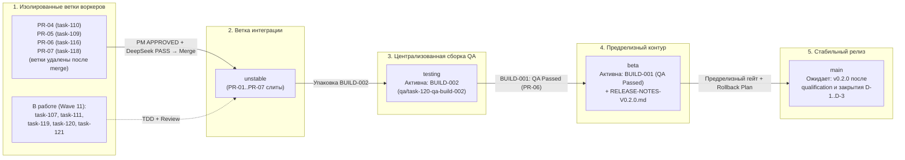

# MERGE-READINESS-15 — Релизная документация Wave 11: слияние PR-04..PR-07, продвижение BUILD-001 в `beta` и запуск сборки BUILD-002 в `testing`

Дата: **2026-10-30**, снимок **20:44–20:50 +05**. Ветка воркера: `docs/task-121-parity-wave11`, базовый HEAD `4e240481e59ff4d49732ac8bd5ba08a006363748`.
Воркер: **Технический писатель / Специалист паритета G6**, задача `task_0b8bd8c9fc5a` (`docs/task-121-parity-wave11`, dispatch `ctx_93b506da9c77`).
Режим — **read-only по продуктовому коду и тестам**: изменены ровно два целевых документационного артефакта (`waves/RW-40/PARITY/MERGE-READINESS-15.md` и `waves/RW-40/BUILDS/RELEASE-NOTES-V0.2.0.md`).

> **Входные документы Wave 11:**
> - [`MERGE-READINESS-14.md`](file:///home/sanya/orca/workspaces/project/docs-task-121-parity-wave11/waves/RW-40/PARITY/MERGE-READINESS-14.md) (`md5: 6f80719b979a9cc6f168bdcc31dc3087`) — снимок готовности Wave 10;
> - [`BUILD-001.md`](file:///home/sanya/orca/workspaces/project/docs-task-121-parity-wave11/waves/RW-40/BUILDS/BUILD-001.md) (`md5: 0b76263a7eab93af74618de5d384c188`) и [`BUILD-002.md`](file:///home/sanya/orca/workspaces/project/docs-task-121-parity-wave11/waves/RW-40/BUILDS/BUILD-002.md) (`md5: a70a18bfbe3a971ee40a1cc0e8bb557f`) — манифесты централизованных сборок QA;
> - [`QA-BUILD-001-REPORT.md`](file:///home/sanya/orca/workspaces/project/docs-task-121-parity-wave11/waves/RW-40/QUALITY/QA-BUILD-001-REPORT.md) (`md5: a950608d9c73bb5fcef5c344469f1619`) и [`DEVOPS-BUILD-001-REPORT.md`](file:///home/sanya/orca/workspaces/project/docs-task-121-parity-wave11/waves/RW-40/BUILDS/DEVOPS-BUILD-001-REPORT.md) (`md5: 578e2800247951866292062b4d8f274f`);
> - [`PR-04-task-110-search-202-be.md`](file:///home/sanya/orca/workspaces/project/docs-task-121-parity-wave11/waves/RW-40/PR/PR-04-task-110-search-202-be.md) (`task-110`), [`PR-05-task-109-ipc-oracle-strict.md`](file:///home/sanya/orca/workspaces/project/docs-task-121-parity-wave11/waves/RW-40/PR/PR-05-task-109-ipc-oracle-strict.md) (`task-109`), [`PR-06-task-116-qa-build-001.md`](file:///home/sanya/orca/workspaces/project/docs-task-121-parity-wave11/waves/RW-40/PR/PR-06-task-116-qa-build-001.md) (`task-116`), [`PR-07-task-118-parity-wave10.md`](file:///home/sanya/orca/workspaces/project/docs-task-121-parity-wave11/waves/RW-40/PR/PR-07-task-118-parity-wave10.md) (`task-118`);
> - [`RELEASE-NOTES-V0.2.0.md`](file:///home/sanya/orca/workspaces/project/docs-task-121-parity-wave11/waves/RW-40/BUILDS/RELEASE-NOTES-V0.2.0.md) — предрелизные заметки версии `v0.2.0`.

---

## 0. Исполнительное резюме Wave 11

1. **Слит [`PR-04`](file:///home/sanya/orca/workspaces/project/docs-task-121-parity-wave11/waves/RW-40/PR/PR-04-task-110-search-202-be.md) (`task-110` — `M-13-SEARCH-202-NSFW-BACKEND` Pass 2):**
   - В [`rust/gui-spike/src/search.rs`](file:///home/sanya/orca/workspaces/project/docs-task-121-parity-wave11/rust/gui-spike/src/search.rs) (`md5: 3ec29ae3219be411465ce3b2cc749287`) реализован неблокирующий IPC-конверт для `HTTP 202 Indexing` по Варианту B ([`SEARCH-202-NSFW-SPEC.md` §3.1](file:///home/sanya/orca/workspaces/project/docs-task-121-parity-wave11/waves/RW-40/DESIGN/SEARCH-202-NSFW-SPEC.md#L436-L458)): `execute()` мгновенно возвращает `Ok(SearchResponse { indexing: true, retry_after_ms: Some(delay_ms), documents_indexed: 0, messages: [] })` без чтения тела `202` и без блокировки потока IPC; `execute_with_retry()` выполняет до 5 повторов с параметром `&attempts=1..5` и при 6-м `202` возвращает `SearchError::Indexing { retry_after_ms, attempts: 5 }`; `documents_indexed: u64` десериализуется с `#[serde(default)]`; `include_nsfw=true` передаётся только при `Some(true)`.
   - Подтверждено `23/23` интеграционными тестами в [`rust/gui-spike/tests/search_contract.rs`](file:///home/sanya/orca/workspaces/project/docs-task-121-parity-wave11/rust/gui-spike/tests/search_contract.rs) (`md5: f113b75de5727b82fe1ca5dc0f57eb3b`), `2/2` unit-тестами `--lib search`, `5/5` убитыми мутациями (`KILLED`), одобрением PM ([`ACCEPT.md`](file:///home/sanya/orca/workspaces/project/docs-task-121-parity-wave11/waves/RW-40/PM/m13-search-be/ACCEPT.md)) и вердиктом **PASS (`P0=0, P1=0, P2=2`)** от `DeepSeek 34B` ([`REVIEW-PASS2.md`](file:///home/sanya/orca/workspaces/project/docs-task-121-parity-wave11/waves/RW-40/PM/m13-search-be/REVIEW-PASS2.md)).
2. **Слит [`PR-05`](file:///home/sanya/orca/workspaces/project/docs-task-121-parity-wave11/waves/RW-40/PR/PR-05-task-109-ipc-oracle-strict.md) (`task-109` — `BUGFIX-IPC-ORACLE-STRICT`, закрытие P2-1..P2-3 из `PR-02`):**
   - В [`rust/gui-spike/tests/ipc_wiring_contract.rs`](file:///home/sanya/orca/workspaces/project/docs-task-121-parity-wave11/rust/gui-spike/tests/ipc_wiring_contract.rs) (`md5: 01929cf0e635a2e4ef946e416a61801f`) статический оракул `extract_ui_invoke_commands` расширен на разбор констант `AUTH_COMMANDS`, `JOIN_COMMANDS`, `NET_COMMANDS` и `READY_COMMAND`, автоматически подтверждая 100 % покрытие всех **38/38** UI IPC-команд (`ALL_38_UI_IPC_COMMANDS`).
   - В [`rust/gui-spike/src/main.rs`](file:///home/sanya/orca/workspaces/project/docs-task-121-parity-wave11/rust/gui-spike/src/main.rs#L827-L946) (`md5: 24bb37a8f233213ba7c59dc7b9fb1b22`) удалён тихий fallback `.into_values().next()` в `ChannelOverrideInput::into_patch` (при чужом `channel_id` в непустом конверте возвращается `Err(NotificationError::InvalidChannelId)`) и добавлена прямая поддержка поля `override` (`r#override` / `#[serde(rename = "override")]`).
   - Подтверждено `9/9` тестами `ipc_wiring_contract`, `12/12` тестами `--bin discord-gui-spike`, `5/5` убитыми мутациями (`KILLED`), одобрением PM ([`ACCEPT.md`](file:///home/sanya/orca/workspaces/project/docs-task-121-parity-wave11/waves/RW-40/PM/task109-ipc-oracle/ACCEPT.md)) и вердиктом **PASS (`P0=0, P1=0, P2=0`)** от `DeepSeek 36A` ([`REVIEW.md`](file:///home/sanya/orca/workspaces/project/docs-task-121-parity-wave11/waves/RW-40/PM/task109-ipc-oracle/REVIEW.md)).
3. **Слиты [`PR-06`](file:///home/sanya/orca/workspaces/project/docs-task-121-parity-wave11/waves/RW-40/PR/PR-06-task-116-qa-build-001.md) (`task-116` — `QA Passed` по `BUILD-001`) и [`PR-07`](file:///home/sanya/orca/workspaces/project/docs-task-121-parity-wave11/waves/RW-40/PR/PR-07-task-118-parity-wave10.md) (`task-118` — `MERGE-READINESS-14`):**
   - Сборка [`BUILD-001`](file:///home/sanya/orca/workspaces/project/docs-task-121-parity-wave11/waves/RW-40/BUILDS/BUILD-001.md) прошла централизованное тестирование в ветке `testing` со статусом **QA Passed (`P0=0, P1=0, P2=3`)** ([`QA-BUILD-001-REPORT.md`](file:///home/sanya/orca/workspaces/project/docs-task-121-parity-wave11/waves/RW-40/QUALITY/QA-BUILD-001-REPORT.md): `102/102` meta, `0` ошибок `tsc`, `183/183` целевых unit, `35/35` контрактов Rust) и продвинута в предрелизную ветку `beta` (`/home/sanya/orca/workspaces/project/beta`).
   - Выводы DevOps-аудита [`DEVOPS-BUILD-001-REPORT.md`](file:///home/sanya/orca/workspaces/project/docs-task-121-parity-wave11/waves/RW-40/BUILDS/DEVOPS-BUILD-001-REPORT.md) (актуализация `rust/dist/SHA256SUMS`, учёт `CARGO_TARGET_DIR` в `scripts/release.sh`, поднятие версии до `0.2.0`) взяты в работу в параллельной карточке `devops/task-119-fix-release-sha256-and-beta`, а замечание `QA-B001-P2-01` (`--manifest-path rust/gui-spike/Cargo.toml`) сразу учтено в инструкции `BUILD-002.md`.
4. **Сформирована и передана в `testing` централизованная сборка [`BUILD-002`](file:///home/sanya/orca/workspaces/project/docs-task-121-parity-wave11/waves/RW-40/BUILDS/BUILD-002.md):**
   - Включает `PR-04` (`task-110`), `PR-05` (`task-109`), `PR-06` (`task-116`) и `PR-07` (`task-118`) поверх `BUILD-001`. Передана на централизованный прогон отделу QA (`qa/task-120-qa-build-002`).

---

## 1. Детальный отчёт о слитых PR Wave 11 (`PR-04`..`PR-07`) и сборках `BUILD-001` / `BUILD-002`

### 1.1. `PR-04` (`task-110` — `M-13-SEARCH-202-NSFW-BACKEND`, Pass 2)

| Атрибут | Значение / Доказательство |
|---|---|
| **Задача и карточка** | `task-110` / `M-13-SEARCH-202-NSFW-BACKEND` (Pass 2, закрытие `P1-1` и `P2-1..P2-5` по Варианту B `SEARCH-202-NSFW-SPEC.md` §3.1) |
| **Pull Request** | [`PR-04-task-110-search-202-be.md`](file:///home/sanya/orca/workspaces/project/docs-task-121-parity-wave11/waves/RW-40/PR/PR-04-task-110-search-202-be.md) (`rw40/m13-search-202-be` → `unstable`, рабочая ветка удалена после слияния) |
| **Product & Tech Review** | Product Review: **APPROVED** ([`ACCEPT.md`](file:///home/sanya/orca/workspaces/project/docs-task-121-parity-wave11/waves/RW-40/PM/m13-search-be/ACCEPT.md)); Tech Review (`DeepSeek 34B`, [`REVIEW-PASS2.md`](file:///home/sanya/orca/workspaces/project/docs-task-121-parity-wave11/waves/RW-40/PM/m13-search-be/REVIEW-PASS2.md)): **PASS (`P0=0, P1=0, P2=2`)** |
| **`rust/gui-spike/src/search.rs`** | MD5 `3ec29ae3219be411465ce3b2cc749287` `[V]` — `execute()` при `HTTP 202` возвращает неблокирующий IPC-конверт `SearchResponse { indexing: true, retry_after_ms: Some(delay_ms), documents_indexed: 0, messages: [] }` (`:493–503`); `execute_with_retry()` выполняет до 5 повторов с `&attempts=1..5` (`:359–387`); `documents_indexed: u64` с `#[serde(default)]` (`:179–181`); `include_nsfw=true` только при `Some(true)` (`:481–483`); потолок `MAX_SEARCH_OFFSET = 9975` |
| **`rust/gui-spike/tests/search_contract.rs`** | MD5 `f113b75de5727b82fe1ca5dc0f57eb3b` `[V]` — **23/23** интеграционных тестов (16 базовых + 7 тестов M-13, включая локальный TCP HTTP/1.1 mock-сервер с проверкой `&attempts=1` по проводу) |
| **TDD и мутации** | RED: `EXIT_CODE=101` (`17 passed; 6 failed`, `red.log` MD5 `e9e16189cb373e7460ffa3950aa18152`); GREEN: `search_contract` **23/23**, `--lib search` **2/2**, `test-policy.test.mjs` **17/17**, `rustfmt` `exit 0` (`green.log` MD5 `334a7fd4ace05320700309cac8035ca8`); MUTATIONS: **5/5 KILLED** (`mutations.log` MD5 `98cca7b2ff60094cf2cf172dfdc796d3`) |

### 1.2. `PR-05` (`task-109` — `BUGFIX-IPC-ORACLE-STRICT`, закрытие P2-1..P2-3 из `PR-02`)

| Атрибут | Значение / Доказательство |
|---|---|
| **Задача и карточка** | `task-109` / `BUGFIX-IPC-ORACLE-STRICT` (закрытие `P2-1`, `P2-2`, `P2-3` из ревью `INT-06` и `QA-B001-P2-03`) |
| **Pull Request** | [`PR-05-task-109-ipc-oracle-strict.md`](file:///home/sanya/orca/workspaces/project/docs-task-121-parity-wave11/waves/RW-40/PR/PR-05-task-109-ipc-oracle-strict.md) (`bugfix/task-109-ipc-oracle-strict` → `unstable`, рабочая ветка удалена после слияния) |
| **Product & Tech Review** | Product Review: **APPROVED** ([`ACCEPT.md`](file:///home/sanya/orca/workspaces/project/docs-task-121-parity-wave11/waves/RW-40/PM/task109-ipc-oracle/ACCEPT.md)); Tech Review (`DeepSeek 36A`, [`REVIEW.md`](file:///home/sanya/orca/workspaces/project/docs-task-121-parity-wave11/waves/RW-40/PM/task109-ipc-oracle/REVIEW.md)): **PASS (`P0=0, P1=0, P2=0`)** |
| **`rust/gui-spike/src/main.rs`** | MD5 `24bb37a8f233213ba7c59dc7b9fb1b22` `[V]` — `ChannelOverrideInput::into_patch` (`:841–860`) возвращает `Err(NotificationError::InvalidChannelId)` при непустом конверте `channel_overrides` без запрошенного `channel_id` (тихий fallback `.into_values().next()` удалён); добавлен вариант `OverrideField` (`#[serde(rename = "override", alias = "override_field", alias = "overrideField")]`, `:833–836`) и параметр `r#override: Option<ChannelNotificationOverridePatch>` в `update_channel_notification_override` (`:912–946`) |
| **`rust/gui-spike/tests/ipc_wiring_contract.rs`** | MD5 `01929cf0e635a2e4ef946e416a61801f` `[V]` — **9/9** контрактных тестов: `extract_ui_invoke_commands` (`:826–975`) разбирает `AUTH_COMMANDS`, `JOIN_COMMANDS`, `NET_COMMANDS`, `READY_COMMAND` и сверяет все **38/38** команд с `ALL_38_UI_IPC_COMMANDS`, `generate_handler![]` и `fn <cmd>(` в `main.rs` |
| **TDD и мутации** | RED: `EXIT_CODE=101` (`7 passed; 2 failed`, `red.log` MD5 `ce62fc6c62dcc996d69f7a53068269db`); GREEN: `ipc_wiring_contract` **9/9**, `--bin discord-gui-spike` **12/12**, `--lib` **8/8**, `notifications_contract` **4/4**, `clippy -D warnings` `0`, `rustfmt` `exit 0`, `ipc-path.test.mjs` **12/12** (`green.log` MD5 `cf3ac9478a0b6b800dded041a1b6da8a`); MUTATIONS: **5/5 KILLED** (`mutations.log` MD5 `fcc1274d02d76fd0e5796ee0f3a0d45a`) |

### 1.3. `PR-06` (`task-116` — `QA Passed` по `BUILD-001`), продвижение `BUILD-001` в `beta` и `PR-07` (`task-118`)

| Атрибут | Значение / Доказательство |
|---|---|
| **Отчёт QA (`PR-06`, `task-116`)** | [`PR-06-task-116-qa-build-001.md`](file:///home/sanya/orca/workspaces/project/docs-task-121-parity-wave11/waves/RW-40/PR/PR-06-task-116-qa-build-001.md) и [`QA-BUILD-001-REPORT.md`](file:///home/sanya/orca/workspaces/project/docs-task-121-parity-wave11/waves/RW-40/QUALITY/QA-BUILD-001-REPORT.md) (`md5: a950608d9c73bb5fcef5c344469f1619`): вердикт **QA Passed (`P0=0, P1=0, P2=3`)** по сборке `BUILD-001` (`meta` 102/102, `tsc` root + UI 0 ошибок, целевые `unit` 183/183, `cargo test` контракты 35/35). Сборка `BUILD-001` продвинута из `testing` в предрелизную ветку `beta`. |
| **Закрытие замечаний QA `BUILD-001`** | `QA-B001-P2-01` (флаг `--manifest-path rust/gui-spike/Cargo.toml`) и `QA-B001-P2-02` (точная привязка файлов) учтены в [`BUILD-002.md`](file:///home/sanya/orca/workspaces/project/docs-task-121-parity-wave11/waves/RW-40/BUILDS/BUILD-002.md#L24-L30); `QA-B001-P2-03` (оракул 38/38 и `ChannelOverrideInput`) полностью закрыт в [`PR-05`](file:///home/sanya/orca/workspaces/project/docs-task-121-parity-wave11/waves/RW-40/PR/PR-05-task-109-ipc-oracle-strict.md) (`task-109`). |
| **Аудит DevOps (`task-115`)** | [`DEVOPS-BUILD-001-REPORT.md`](file:///home/sanya/orca/workspaces/project/docs-task-121-parity-wave11/waves/RW-40/BUILDS/DEVOPS-BUILD-001-REPORT.md) (`md5: 578e2800247951866292062b4d8f274f`): подтверждена детерминированность пересборки (`sha256: 3a9be209…500b` и SBOM `71900e99…f5a5`) и прохождение `gate:worker` (`879/879` unit, `1142` Rust pass); актуализация `rust/dist/SHA256SUMS`, `CARGO_TARGET_DIR` в `scripts/release.sh` и bump версии `0.2.0` выделены в `devops/task-119-fix-release-sha256-and-beta`. |
| **Документация Wave 10 (`PR-07`, `task-118`)** | [`PR-07-task-118-parity-wave10.md`](file:///home/sanya/orca/workspaces/project/docs-task-121-parity-wave11/waves/RW-40/PR/PR-07-task-118-parity-wave10.md) и [`MERGE-READINESS-14.md`](file:///home/sanya/orca/workspaces/project/docs-task-121-parity-wave11/waves/RW-40/PARITY/MERGE-READINESS-14.md) (`md5: 6f80719b979a9cc6f168bdcc31dc3087`) приняты и слиты в `unstable`. |

### 1.4. Запуск централизованной сборки `BUILD-002` в ветке `testing`

Сборка [`BUILD-002`](file:///home/sanya/orca/workspaces/project/docs-task-121-parity-wave11/waves/RW-40/BUILDS/BUILD-002.md) (`md5: a70a18bfbe3a971ee40a1cc0e8bb557f`) сформирована из актуального `unstable` в ветке `testing` (`/home/sanya/orca/workspaces/project/testing`) и включает поверх `BUILD-001`:
1. `task-110` ([`PR-04`](file:///home/sanya/orca/workspaces/project/docs-task-121-parity-wave11/waves/RW-40/PR/PR-04-task-110-search-202-be.md)) — `M-13-SEARCH-202-NSFW-BACKEND` Pass 2 (`search.rs` + `search_contract.rs`, `23/23`);
2. `task-109` ([`PR-05`](file:///home/sanya/orca/workspaces/project/docs-task-121-parity-wave11/waves/RW-40/PR/PR-05-task-109-ipc-oracle-strict.md)) — `BUGFIX-IPC-ORACLE-STRICT` (`main.rs` + `ipc_wiring_contract.rs`, `38/38` UI IPC, `9/9` contract + `12/12` bin);
3. `task-116` ([`PR-06`](file:///home/sanya/orca/workspaces/project/docs-task-121-parity-wave11/waves/RW-40/PR/PR-06-task-116-qa-build-001.md)) — `QA-BUILD-001-REPORT.md` (`QA Passed`);
4. `task-118` ([`PR-07`](file:///home/sanya/orca/workspaces/project/docs-task-121-parity-wave11/waves/RW-40/PR/PR-07-task-118-parity-wave10.md)) — `MERGE-READINESS-14.md`.

Сборка `BUILD-002` передана в статус `In Testing` и проверяется воркером `qa/task-120-qa-build-002`.

---

## 2. Движение задач по 13 статусам и иерархия веток на снимке Wave 11

### 2.1. Конвейер веток и сборок (`worker -> PR -> unstable -> testing -> beta -> main`)

### 2.2. Сводный реестр задач и пакетов Wave 11 (по 13 официальным статусам)

| Задача / Пакет | Ветка / PR | Роль | Содержание | Текущий статус (из 13) |
|---|---|---|---|---|
| `task-101..135` | Базовый пакет волн 1–9 (`BUILD-001`) | G1 / G2 / G3 / G5 | 35 кодовых срезов и 6 дизайн-спек RW-40 (`L-02`, `STUB-27`, `C-02`, `M-07`, `M-08`, `P-03`, `B2a/B2b`, `AT-03`, `M-10/STUB-10`, `STUB-05`, `STUB-16`, `V-01/V-06/V-07`, `N-05-BE`, `INT-05`) | **11. `In Beta`** (`BUILD-001` после `QA Passed`) |
| `task-105` | [`PR-01`](file:///home/sanya/orca/workspaces/project/docs-task-121-parity-wave11/waves/RW-40/PR/PR-01-search-202-nsfw-spec.md) (`BUILD-001`) | G3 + `DeepSeek 29B` | Дизайн-спецификация `SEARCH-202-NSFW-SPEC.md` (Pass 2, 60/60 токенов, `PASS`) | **11. `In Beta`** (`BUILD-001` после `QA Passed`) |
| `task-106` | [`PR-02`](file:///home/sanya/orca/workspaces/project/docs-task-121-parity-wave11/waves/RW-40/PR/PR-02-task-106-notif-ipc.md) (`BUILD-001`) | G1 + `DeepSeek 33A` | Подключение Tauri IPC-команд `update_guild_notification_settings` и `update_channel_notification_override` (закрытие `F-5`, `PASS`) | **11. `In Beta`** (`BUILD-001` после `QA Passed`) |
| `task-104` | [`PR-03`](file:///home/sanya/orca/workspaces/project/docs-task-121-parity-wave11/waves/RW-40/PR/PR-03-task-104-n05-ui-notifications.md) (`BUILD-001`) | G2 + `DeepSeek 31B` | `N-05-UI-NOTIFICATIONS` Pass 2 (`notifications.js` + `notifications-ui.test.mjs`, закрытие P1 `NodeList.filter` и 7 P2, `17/17`, `PASS`) | **11. `In Beta`** (`BUILD-001` после `QA Passed`) |
| `task-116` | [`PR-06`](file:///home/sanya/orca/workspaces/project/docs-task-121-parity-wave11/waves/RW-40/PR/PR-06-task-116-qa-build-001.md) (`BUILD-001` → `BUILD-002`) | G4 QA | Отчёт централизованного тестирования `BUILD-001` ([`QA-BUILD-001-REPORT.md`](file:///home/sanya/orca/workspaces/project/docs-task-121-parity-wave11/waves/RW-40/QUALITY/QA-BUILD-001-REPORT.md), вердикт `QA Passed`) | **10. `QA Passed`** / **7. `Merged to Unstable`** |
| `task-118` | [`PR-07`](file:///home/sanya/orca/workspaces/project/docs-task-121-parity-wave11/waves/RW-40/PR/PR-07-task-118-parity-wave10.md) (`BUILD-002`) | G6 Parity | Релизная матрица паритета Wave 10 ([`MERGE-READINESS-14.md`](file:///home/sanya/orca/workspaces/project/docs-task-121-parity-wave11/waves/RW-40/PARITY/MERGE-READINESS-14.md)) | **8. `In Testing`** (`BUILD-002` на ветке `testing`) |
| `task-110` | [`PR-04`](file:///home/sanya/orca/workspaces/project/docs-task-121-parity-wave11/waves/RW-40/PR/PR-04-task-110-search-202-be.md) (`BUILD-002`) | G1 + `DeepSeek 34B` | `M-13-SEARCH-202-NSFW-BACKEND` Pass 2 (`search.rs` + `search_contract.rs`: `23/23`, `5/5` мутаций, `PASS`) | **8. `In Testing`** (`BUILD-002` на ветке `testing`) |
| `task-109` | [`PR-05`](file:///home/sanya/orca/workspaces/project/docs-task-121-parity-wave11/waves/RW-40/PR/PR-05-task-109-ipc-oracle-strict.md) (`BUILD-002`) | G1 + `DeepSeek 36A` | `BUGFIX-IPC-ORACLE-STRICT` (оракул `38/38` UI IPC-команд, строгий `InvalidChannelId`, поле `override`, `9/9` + `12/12`, `5/5` мутаций, `PASS`) | **8. `In Testing`** (`BUILD-002` на ветке `testing`) |
| `task-120` | `qa/task-120-qa-build-002` | G4 QA | Централизованное тестирование сборки [`BUILD-002`](file:///home/sanya/orca/workspaces/project/docs-task-121-parity-wave11/waves/RW-40/BUILDS/BUILD-002.md) на ветке `testing` | **3. `In Progress`** (проверяет `BUILD-002` в `In Testing`) |
| `task-119` | `devops/task-119-fix-release-sha256-and-beta` | DevOps | Закрытие находок `DEVOPS-BUILD-001-REPORT.md` (`SHA256SUMS`, `CARGO_TARGET_DIR` в `scripts/release.sh`, подготовка промоушена `beta`) | **3. `In Progress`** |
| `task-107` | `rw40/int07-ui-app-mount` | G2 Frontend | `INT-07-UI-APP-MOUNT` Pass 2 (монтирование `createVoiceDevicesSettings` и `createNotificationSettingsController` в `app.js` / `index.html`, войдёт в `BUILD-003`) | **3. `In Progress`** |
| `task-111` | `rw40/m13-search-202-ui` | G2 Frontend | `M-13-SEARCH-202-NSFW-UI` Pass 2 (баннер индексации `HTTP 202`, таймер повторов, NSFW-гейт в `search-overlay.js`, войдёт в `BUILD-003`) | **3. `In Progress`** |
| `task-108` | `rw40/dm-friends-spec-pass2` | G3 Design | Доработка `DM-FRIENDS-SPEC.md` Pass 2 | **3. `In Progress`** |
| `task-112` | `feature/task-112-dm-friends-be` | G1 Backend | Контракт REST/Gateway для DM & Friends (`private_channels`, `relationships`, код `80013`) | **1. `Backlog`** / **3. `In Progress`** |
| `task-113` | `feature/task-113-dm-friends-ui` | G2 Frontend | UI Home/Friends, список ЛС/Group DM и вкладки друзей | **1. `Backlog`** / **3. `In Progress`** |
| `task-117` | `feature/task-117-voice-stream-wiring` | G1 / G5 Voice | Интеграционная связка голосового и стримового контура | **3. `In Progress`** |
| `task-121` | `docs/task-121-parity-wave11` | G6 Parity | Настоящая матрица `MERGE-READINESS-15.md` и предрелизные заметки `RELEASE-NOTES-V0.2.0.md` | **3. `In Progress`** |

---

## 3. Актуализированная матрица паритета 38/38 IPC-команд и тестовых оракулов Wave 11

После слияния [`PR-05`](file:///home/sanya/orca/workspaces/project/docs-task-121-parity-wave11/waves/RW-40/PR/PR-05-task-109-ipc-oracle-strict.md) (`task-109`) покрытие всех **38 уникальных IPC-команд UI → Rust** (`ALL_38_UI_IPC_COMMANDS`) верифицируется автоматически тестом `every_ui_invoke_command_in_js_sources_is_registered_in_tauri_main` в [`rust/gui-spike/tests/ipc_wiring_contract.rs`](file:///home/sanya/orca/workspaces/project/docs-task-121-parity-wave11/rust/gui-spike/tests/ipc_wiring_contract.rs#L826-L1168) как по 26 прямым строковым литералам `invoke(...)`/`invokeFn(...)`/`invokeReaction(...)`, так и по 4 константным объектам/строкам (`AUTH_COMMANDS`, `JOIN_COMMANDS`, `NET_COMMANDS`, `READY_COMMAND`).

| № | IPC-команда (`cmd`) | Источник вызова в UI (`rust/gui-spike/ui/`) | Обработчик в `main.rs` (строка / рег.) | Контрактный / Unit / Meta оракул (Wave 11) |
|---:|---|---|---|---|
| 1 | `process_metrics` | `features/metrics.js:52` (литерал) | `fn process_metrics` (`:85` / `:1204`) | `ipc_wiring_contract.rs` (9/9), `main.rs::wiring_tests` (12/12), `ipc-path.test.mjs` (12/12) |
| 2 | `spike_config` | `app.js:1590` (литерал) | `fn spike_config` (`:92` / `:1205`) | `ipc_wiring_contract.rs`, `main.rs::wiring_tests`, `gui-window.smoke.test.mjs` |
| 3 | `report_bench` | `app.js:1608` (литерал) | `fn report_bench` (`:102` / `:1206`) | `ipc_wiring_contract.rs`, `main.rs::wiring_tests`, `gui-spike-features.test.mjs` |
| 4 | `report_ui_snapshot` | `app.js:1672` (литерал) | `fn report_ui_snapshot` (`:109` / `:1207`) | `ipc_wiring_contract.rs`, `main.rs::wiring_tests`, `gui-window.smoke.test.mjs` |
| 5 | `ready` | `app.js:300,623` (`READY_COMMAND`) | `fn ready` (`:123` / `:1208`) | `ipc_wiring_contract.rs` (`READY_COMMAND`), `data_contract.rs`, `guild-rail.test.mjs` |
| 6 | `read_state` | `features/chat.js:2863` (литерал) | `fn read_state` (`:131` / `:1209`) | `ipc_wiring_contract.rs`, `read_state_contract.rs`, `read-state-ui.test.mjs` |
| 7 | `channels` | `app.js:1117` (литерал) | `fn channels` (`:139` / `:1210`) | `ipc_wiring_contract.rs`, `data_contract.rs`, `gui-spike-dom.test.mjs` |
| 8 | `messages_page` | `features/chat.js:3413,3490,3612` (литерал) | `fn messages_page` (`:149` / `:1211`) | `ipc_wiring_contract.rs`, `messages_contract.rs`, `channel-paging.test.mjs` |
| 9 | `search_remote` | `features/search-overlay.js:1016` (литерал) | `async fn search_remote` (`:233` / `:1215`) | `search_contract.rs` (**23/23**, `PR-04`), `search-remote-real-index.test.mjs` |
| 10 | `send_message` | `features/chat.js:2723` (литерал) | `async fn send_message` (`:251` / `:1216`) | `messages_contract.rs` (15/15), `gui-spike-model.test.mjs`, `M2-02` |
| 11 | `edit_message` | `features/chat.js:3799,3818` (литерал) | `async fn edit_message` (`:269` / `:1217`) | `messages_contract.rs` (15/15), `gui-spike-model.test.mjs`, `M2-02` |
| 12 | `delete_message` | `features/chat.js:3836,3858` (литерал) | `async fn delete_message` (`:287` / `:1218`) | `messages_contract.rs` (15/15), `gui-spike-model.test.mjs`, `M2-02` |
| 13 | `reply_message` | `app.js:1457` (литерал) | `async fn reply_message` (`:304` / `:1219`) | `messages_contract.rs` (15/15), `gui-spike-model.test.mjs`, `M2-02` |
| 14 | `ack_message` | `features/chat.js:3094` (литерал) | `async fn ack_message` (`:328` / `:1220`) | `read_state_contract.rs`, `read-state-ui.test.mjs` |
| 15 | `join_guild` | `features/join-server.js:30` (`JOIN_COMMANDS.enter`) | `async fn join_guild` (`:355` / `:1223`) | `ipc_wiring_contract.rs` (`JOIN_COMMANDS`), `guilds_contract.rs`, `join-server.test.mjs` |
| 16 | `leave_guild` | `features/actions.js:774` (литерал) | `async fn leave_guild` (`:375` / `:1239`) | `ipc_wiring_contract.rs`, `guilds_contract.rs`, `server-menu.test.mjs` |
| 17 | `toggle_reaction` | `features/reactions.js:184` (`invokeReaction`) | `async fn toggle_reaction` (`:393` / `:1221`) | `ipc_wiring_contract.rs`, `reactions_contract.rs` |
| 18 | `send_typing` | `features/typing-indicator.js:441,876` (литерал) | `async fn send_typing` (`:419` / `:1222`) | `ipc_wiring_contract.rs`, `typing_contract.rs`, `gui-spike-dom.test.mjs` |
| 19 | `resolve_invite` | `features/join-server.js:28` (`JOIN_COMMANDS.resolve`) | `async fn resolve_invite` (`:442` / `:1224`) | `ipc_wiring_contract.rs` (`JOIN_COMMANDS`, `MUT-2`), `invites_contract.rs` (20/20) |
| 20 | `accept_invite` | `features/join-server.js:29` (`JOIN_COMMANDS.accept`) | `async fn accept_invite` (`:462` / `:1225`) | `ipc_wiring_contract.rs` (`JOIN_COMMANDS`), `invites_contract.rs` (20/20) |
| 21 | `create_invite` | `features/invite-modal.js:370` (литерал) | `async fn create_invite` (`:709` / `:1227`) | `ipc_wiring_contract.rs`, `invites_contract.rs`, `join-server.test.mjs` |
| 22 | `attachments_upload_slots` | `features/composer.js:725` (литерал) | `async fn attachments_upload_slots` (`:762` / `:1229`) | `ipc_wiring_contract.rs`, `attachments_contract.rs` (23/23), `composer.test.mjs` |
| 23 | `attachments_upload_put` | `features/composer.js:760` (литерал) | `async fn attachments_upload_put` (`:535` / `:1230`) | `ipc_wiring_contract.rs`, `attachments_contract.rs` (23/23), `composer.test.mjs` |
| 24 | `pins_list` | `app.js:1372` (литерал) | `async fn pins_list` (`:782` / `:1232`) | `ipc_wiring_contract.rs`, `pins_threads_contract.rs` (6/6), `channel-paging.test.mjs` |
| 25 | `threads_list` | `app.js:1378` (литерал) | `async fn threads_list` (`:800` / `:1236`) | `ipc_wiring_contract.rs`, `pins_threads_contract.rs` (6/6), `channel-paging.test.mjs` |
| 26 | `update_guild_notification_settings` | `features/notifications.js:1547` (`invokeFn`) | `async fn update_guild_notification_settings` (`:889` / `:1237`) | `ipc_wiring_contract.rs` (9/9), `notifications_contract.rs` (4/4), `notifications-ui.test.mjs` (17/17) |
| 27 | `update_channel_notification_override` | `features/notifications.js:1606` (`invokeFn`) | `async fn update_channel_notification_override` (`:912` / `:1238`) | `ipc_wiring_contract.rs` (9/9, `PR-05`), `main.rs::wiring_tests` (`r#override`, `InvalidChannelId`) |
| 28 | `auth_status` | `features/auth.js:15` (`AUTH_COMMANDS.status`) | `async fn auth_status` (`:967` / `:1240`) | `ipc_wiring_contract.rs` (`AUTH_COMMANDS`, `MUT-1`), `auth_contract.rs` |
| 29 | `auth_login_token` | `features/auth.js:15` (`AUTH_COMMANDS.login`) | `async fn auth_login_token` (`:982` / `:1241`) | `ipc_wiring_contract.rs` (`AUTH_COMMANDS`), `auth_contract.rs`, `M2-01` |
| 30 | `auth_restore` | `features/auth.js:15` (`AUTH_COMMANDS.restore`) | `async fn auth_restore` (`:998` / `:1242`) | `ipc_wiring_contract.rs` (`AUTH_COMMANDS`), `auth_contract.rs`, `M2-01` |
| 31 | `auth_logout` | `features/auth.js:15`, `features/settings.js:801` | `async fn auth_logout` (`:1012` / `:1243`) | `ipc_wiring_contract.rs` (`AUTH_COMMANDS` + литерал), `auth_contract.rs` |
| 32 | `auth_login_password` | `features/auth.js:15` (`AUTH_COMMANDS.password`) | `async fn auth_login_password` (`:1041` / `:1244`) | `ipc_wiring_contract.rs` (`AUTH_COMMANDS`), `auth_contract.rs` |
| 33 | `auth_mfa` | `features/auth.js:15` (`AUTH_COMMANDS.mfa`) | `async fn auth_mfa` (`:1073` / `:1245`) | `ipc_wiring_contract.rs` (`AUTH_COMMANDS`), `auth_contract.rs` |
| 34 | `auth_sms` | `features/auth.js:15` (`AUTH_COMMANDS.sms`) | `async fn auth_sms` (`:1096` / `:1246`) | `ipc_wiring_contract.rs` (`AUTH_COMMANDS`), `auth_contract.rs` |
| 35 | `net_connect` | `app.js:93,255` (`NET_COMMANDS.connect`) | `async fn net_connect` (`:1108` / `:1247`) | `ipc_wiring_contract.rs` (`NET_COMMANDS`), `net_contract.rs` (24/24), `dispatch_ui.test.mjs` |
| 36 | `net_status` | `app.js:93,216` (`NET_COMMANDS.status`) | `fn net_status` (`:1119` / `:1248`) | `ipc_wiring_contract.rs` (`NET_COMMANDS`), `net_contract.rs` (24/24), `dispatch_ui.test.mjs` |
| 37 | `settings_load` | `app.js:1307`, `features/settings.js:444` (литерал) | `async fn settings_load` (`:1151` / `:1251`) | `ipc_wiring_contract.rs`, `settings_contract.rs`, `guild-rail.test.mjs`, `M2-05` |
| 38 | `settings_save` | `app.js:1311`, `features/settings.js:424` (литерал) | `async fn settings_save` (`:1159` / `:1252`) | `ipc_wiring_contract.rs`, `settings_contract.rs`, `guild-rail.test.mjs`, `M2-05` |

---

## 4. Сводная верификация и контрольные суммы (MD5) Wave 11

| Контур / Артефакт | Путь | Результат / MD5 |
|---|---|---|
| **Meta-политика (`tests/meta/*.test.mjs`)** | [`tests/meta/`](file:///home/sanya/orca/workspaces/project/docs-task-121-parity-wave11/tests/meta) | **102 / 102 pass** (`0 fail, 0 skipped`) `[V]` |
| **Проверка типов (`tsc`)** | [`tsconfig.json`](file:///home/sanya/orca/workspaces/project/docs-task-121-parity-wave11/tsconfig.json), [`rust/gui-spike/ui/tsconfig.json`](file:///home/sanya/orca/workspaces/project/docs-task-121-parity-wave11/rust/gui-spike/ui/tsconfig.json) | **exit 0 / exit 0** (`0 errors`) `[V]` |
| **Unit-тесты (`npm run test:unit`)** | [`tests/unit/`](file:///home/sanya/orca/workspaces/project/docs-task-121-parity-wave11/tests/unit) | **879 / 879 pass** (`173 suites, 0 fail, 0 skipped`) `[V]` |
| **`rust/gui-spike/src/search.rs` (`PR-04`)** | [`rust/gui-spike/src/search.rs`](file:///home/sanya/orca/workspaces/project/docs-task-121-parity-wave11/rust/gui-spike/src/search.rs) | `3ec29ae3219be411465ce3b2cc749287` (`23/23` `search_contract`, `2/2` `--lib search`, `5/5` мутаций) `[V]` |
| **`rust/gui-spike/tests/search_contract.rs` (`PR-04`)** | [`rust/gui-spike/tests/search_contract.rs`](file:///home/sanya/orca/workspaces/project/docs-task-121-parity-wave11/rust/gui-spike/tests/search_contract.rs) | `f113b75de5727b82fe1ca5dc0f57eb3b` `[V]` |
| **`rust/gui-spike/src/main.rs` (`PR-05`)** | [`rust/gui-spike/src/main.rs`](file:///home/sanya/orca/workspaces/project/docs-task-121-parity-wave11/rust/gui-spike/src/main.rs) | `24bb37a8f233213ba7c59dc7b9fb1b22` (`9/9` `ipc_wiring_contract`, `12/12` `--bin`, `5/5` мутаций) `[V]` |
| **`rust/gui-spike/tests/ipc_wiring_contract.rs` (`PR-05`)** | [`rust/gui-spike/tests/ipc_wiring_contract.rs`](file:///home/sanya/orca/workspaces/project/docs-task-121-parity-wave11/rust/gui-spike/tests/ipc_wiring_contract.rs) | `01929cf0e635a2e4ef946e416a61801f` `[V]` |
| **`QA-BUILD-001-REPORT.md` (`PR-06`)** | [`waves/RW-40/QUALITY/QA-BUILD-001-REPORT.md`](file:///home/sanya/orca/workspaces/project/docs-task-121-parity-wave11/waves/RW-40/QUALITY/QA-BUILD-001-REPORT.md) | `a950608d9c73bb5fcef5c344469f1619` (**QA Passed**) `[V]` |
| **`DEVOPS-BUILD-001-REPORT.md` (`task-115`)** | [`waves/RW-40/BUILDS/DEVOPS-BUILD-001-REPORT.md`](file:///home/sanya/orca/workspaces/project/docs-task-121-parity-wave11/waves/RW-40/BUILDS/DEVOPS-BUILD-001-REPORT.md) | `578e2800247951866292062b4d8f274f` `[V]` |
| **`MERGE-READINESS-14.md` (`PR-07`)** | [`waves/RW-40/PARITY/MERGE-READINESS-14.md`](file:///home/sanya/orca/workspaces/project/docs-task-121-parity-wave11/waves/RW-40/PARITY/MERGE-READINESS-14.md) | `6f80719b979a9cc6f168bdcc31dc3087` `[V]` |
| **`BUILD-001.md` (`beta`)** | [`waves/RW-40/BUILDS/BUILD-001.md`](file:///home/sanya/orca/workspaces/project/docs-task-121-parity-wave11/waves/RW-40/BUILDS/BUILD-001.md) | `0b76263a7eab93af74618de5d384c188` `[V]` |
| **`BUILD-002.md` (`testing`)** | [`waves/RW-40/BUILDS/BUILD-002.md`](file:///home/sanya/orca/workspaces/project/docs-task-121-parity-wave11/waves/RW-40/BUILDS/BUILD-002.md) | `a70a18bfbe3a971ee40a1cc0e8bb557f` `[V]` |
