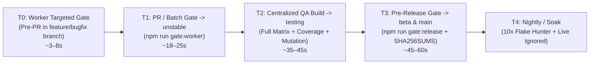
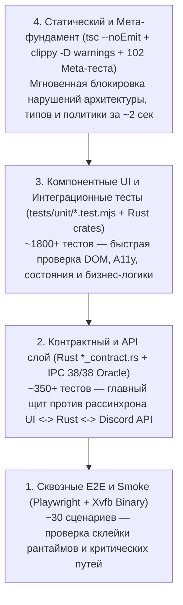

# TEST-STRATEGY-V2.md — Модернизированная тестовая стратегия `discord-lab` (RW-40)

- **Версия стратегии:** `2.0.0` (расширяет и усиливает [`TEST-POLICY.md`](file:///home/sanya/orca/project/TEST-POLICY.md) и [`TDD-PLAN.md`](file:///home/sanya/orca/project/TDD-PLAN.md))
- **Дата обновления:** `2026-10-30`
- **Статус:** Active / Enforced (`P0` Policy Gate)
- **Инвариант неизменности приоритетов:** **Ни один существующий тест (`meta`, `unit`, `contract`, `smoke`, `e2e`) не понижен в критичности и не выведен из обязательных гейтов.** Все существующие проверки сохраняют статус `P0` или `P1` согласно [`TEST-POLICY.md`](file:///home/sanya/orca/project/TEST-POLICY.md).

---

## 1. Аудит текущей тестовой стратегии и инвентаризация набора тестов

### 1.1. Текущая архитектура качества
Текущая система тестирования `discord-lab` опирается на строгую дисциплину [`TEST-POLICY.md`](file:///home/sanya/orca/project/TEST-POLICY.md) (Red-First TDD, запрет ослабления утверждений, запрет `.only`/`skip` без причины, мутационный контроль 5/5 на каждый вертикальный срез) и двухуровневый оркестратор гейтов [`scripts/gate.mjs`](file:///home/sanya/orca/project/scripts/gate.mjs) + селектор затронутых тестов [`scripts/test-impact.mjs`](file:///home/sanya/orca/project/scripts/test-impact.mjs).

| Контур / Набор тестов | Путь в репозитории | Кол-во файлов / тестов | Время выполнения (baseline) | Текущий статус |
|---|---|---|---|---|
| **Meta-тесты (Policy & Sync Oracles)** | [`tests/meta/*.test.mjs`](file:///home/sanya/orca/project/tests/meta/test-policy.test.mjs) | 12 файлов / **102 теста** | ~1.2 с | `102/102 PASS` (`P0`) |
| **JS/UI Unit & DOM/Component** | [`tests/unit/*.test.mjs`](file:///home/sanya/orca/project/tests/unit/gui-spike-features.test.mjs) | 36+ файлов / **879+ тестов** (173 suites) | ~4.5 с | `879/879 PASS` (`P0/P1`) |
| **Rust Workspace Contracts & Unit** | [`rust/crates/*/tests/*_contract.rs`](file:///home/sanya/orca/project/rust/crates/discord-core/tests/stream_gateway_contract.rs) | 9 крейтов / **1142 теста** (+12 live ignored) | ~6.8 с (cached) | `1142/1142 PASS` (`P0/P1`) |
| **Rust GUI Spike BFF Contracts** | [`rust/gui-spike/tests/*_contract.rs`](file:///home/sanya/orca/project/rust/gui-spike/tests/ipc_wiring_contract.rs) | 24 таргета (`21 *_contract.rs` + `bin` + `lib` + `launch`) / **210+ тестов** | ~9.5 с (cached) | `210+/210+ PASS` (`P0`) |
| **Smoke-тесты (CLI + Binary + Window)** | [`tests/smoke/*.smoke.test.mjs`](file:///home/sanya/orca/project/tests/smoke/gui-spike.smoke.test.mjs) | 8 файлов / **22 теста** | ~2.8 с | `22/22 PASS` (`P0`) |
| **E2E Browser / Live Binary Flows** | [`tests/e2e/*.e2e.test.mjs`](file:///home/sanya/orca/project/tests/e2e/m2-auth-gate.e2e.test.mjs) | 9 файлов (`m2-*`, `walk-fixture`) | ~14.0 с | `PASS` (`minPass=1`, `failOnSkips=true` в `gate:release`) |
| **Мутационное тестирование** | `waves/RW-*/**/MUTATION-LOG.md` | **5 мутаций на срез** (100% kill rate) | ~25 с / срез | Обязательный артефакт приёмки (`P0`) |

### 1.2. Выявленные узкие места и пробелы (Gaps Analysis)
1. **Укрупнённый граф `test-impact` для новых модулей RW-40:** В [`scripts/test-impact.mjs`](file:///home/sanya/orca/project/scripts/test-impact.mjs) правка любого файла в `rust/gui-spike/src/*.rs` запускает полный `cargo test --manifest-path rust/gui-spike/Cargo.toml` (все 24 тестовых бинарника), а новые UI-модули (`notifications.js`, `voice-devices-settings.js`, `dm-friends.js`, `search.js`, `search-overlay.js`, `attachments-render.js`, `chat-reactions.js`) попадали только в широкий fallback.
2. **Неполное покрытие состояний `202 Accepted` / `429 Retry-After` / `AGE_GATED_SPACES` на стыке слоёв:** Отдельные контракты покрыты в `search_contract.rs` (23/23) и `notifications_contract.rs` (4/4), но требуется единая матрица негативных, граничных, пустых (`empty`), загрузочных (`skeleton`), прав доступа (`capabilities`), восстановления (`reconnect/resume`) и наблюдаемости (`observability`) для всех 12 уровней тестирования.
3. **Отсутствие формализованного автоматического карантина flaky-тестов с метриками:** В [`scripts/gate.mjs`](file:///home/sanya/orca/project/scripts/gate.mjs) уже реализован автоматический 2-кратный перезапуск (`attempts: 2` на шаге `e2e`) с записью обоих результатов в `.gate/*.json`, но не был зафиксирован регламент карантина (`Quarantine SLA <= 24h`) без ослабления `P0/P1` гейтов.

---

## 2. Двенадцать уровней тестирования в архитектуре `discord-lab`

Архитектура `discord-lab` объединяет 3 рантайма: **Node.js CLI/RE-инструментарий (Frida/CDP)**, **Rust Tauri BFF (`discord-gui-spike` + 9 крейтов `discord-*`)** и **Vanilla ESM WebView UI (`rust/gui-spike/ui/`)**. Ниже определены все 12 уровней тестирования:

### 2.1. Unit (Модульные тесты)
- **Область:** Чистые функции, парсеры, редьюсеры состояния, селекторы, валидаторы аргументов, утилиты форматирования и DOM-рендереры в изоляции (`jsdom` / in-memory).
- **Реализация:**
  - JS CLI & RE: [`args.test.mjs`](file:///home/sanya/orca/project/tests/unit/args.test.mjs), [`calls.test.mjs`](file:///home/sanya/orca/project/tests/unit/calls.test.mjs), [`csv.test.mjs`](file:///home/sanya/orca/project/tests/unit/csv.test.mjs), [`domains.test.mjs`](file:///home/sanya/orca/project/tests/unit/domains.test.mjs), [`nm.test.mjs`](file:///home/sanya/orca/project/tests/unit/nm.test.mjs), [`paths.test.mjs`](file:///home/sanya/orca/project/tests/unit/paths.test.mjs).
  - Rust Core: модульные `#[cfg(test)]` внутри [`rust/crates/discord-core/src/`](file:///home/sanya/orca/project/rust/crates/discord-core/src/lib.rs) (state reducer, snowflake, permissions bitfield) и `cargo test --bins` / `cargo test --lib` в `discord-gui-spike` (12/12 bin + 2/2 lib).

### 2.2. Integration (Интеграционные тесты)
- **Область:** Взаимодействие нескольких модулей внутри одного рантайма или на границе «UI <-> Tauri Bridge <-> Rust State <-> SQLite/Settings Store».
- **Реализация:**
  - Rust Core <-> GUI Spike Bridge: [`core_bridge.rs`](file:///home/sanya/orca/project/rust/gui-spike/tests/core_bridge.rs), [`data_contract.rs`](file:///home/sanya/orca/project/rust/gui-spike/tests/data_contract.rs), [`store_contract.rs`](file:///home/sanya/orca/project/rust/crates/discord-store/tests/store_contract.rs).
  - JS RE Pipeline (`Frida <-> CDP <-> Walk Log`): [`frida.test.mjs`](file:///home/sanya/orca/project/tests/unit/frida.test.mjs), [`cdp.test.mjs`](file:///home/sanya/orca/project/tests/unit/cdp.test.mjs), [`walk.test.mjs`](file:///home/sanya/orca/project/tests/unit/walk.test.mjs), [`hook-io.test.mjs`](file:///home/sanya/orca/project/tests/unit/hook-io.test.mjs).

### 2.3. Contract (Контрактные тесты и оракулы)
- **Область:** Строгая сверка форматов сообщений, схем команд и инвариантов между слоями с независимыми golden-оракулами (`logs/golden/gateway/002-READY.json`, `rust/crates/discord-core/tests/fixtures/stream-opcodes-fixtures.json`).
- **Реализация:**
  - **IPC Wiring Oracle (38/38 команд):** [`tests/meta/ipc-path.test.mjs`](file:///home/sanya/orca/project/tests/meta/ipc-path.test.mjs) (12/12) + [`rust/gui-spike/tests/ipc_wiring_contract.rs`](file:///home/sanya/orca/project/rust/gui-spike/tests/ipc_wiring_contract.rs) (9/9) + [`rust/gui-spike/tests/ipc_contract.rs`](file:///home/sanya/orca/project/rust/gui-spike/tests/ipc_contract.rs) — гарантируют 100% совпадение вызовов `invoke(...)` в UI, `COMMAND_NAMES` в `lib.rs` и `tauri::generate_handler![...]` в `main.rs`.
  - **Gateway & Stream Opcodes Contract:** [`stream_gateway_contract.rs`](file:///home/sanya/orca/project/rust/crates/discord-core/tests/stream_gateway_contract.rs) (opcodes `18..=22`: `STREAM_CREATE`, `STREAM_DELETE`, `STREAM_WATCH`, `STREAM_PING`, `STREAM_SET_PAUSED`).
  - **JSON & Schema Oracles:** [`json_contract.rs`](file:///home/sanya/orca/project/rust/crates/discord-json/tests/json_contract.rs), [`waves-sync.test.mjs`](file:///home/sanya/orca/project/tests/meta/waves-sync.test.mjs), [`plan-sync.test.mjs`](file:///home/sanya/orca/project/tests/meta/plan-sync.test.mjs).

### 2.4. API (Тесты REST / HTTP / Mock-сервера)
- **Область:** Проверка HTTP-методов, маршрутов Discord API v9/v10, заголовков (`Authorization`, `X-Super-Properties`, `X-Audit-Log-Reason`), query-параметров (`limit`, `before`, `offset`, `include_nsfw`), кодов ответа (`200`, `202 Accepted`, `204 No Content`, `400`, `401`, `403`, `404`, `413`, `429`, `500/502/503`) и сериализации тела запроса.
- **Реализация:**
  - Локальный in-process HTTP mock-сервер (`TcpListener` на `127.0.0.1:0`) в [`search_contract.rs`](file:///home/sanya/orca/project/rust/gui-spike/tests/search_contract.rs) (23/23), [`attachments_contract.rs`](file:///home/sanya/orca/project/rust/gui-spike/tests/attachments_contract.rs) (23/23), [`dm_friends_contract.rs`](file:///home/sanya/orca/project/rust/gui-spike/tests/dm_friends_contract.rs) (5/5), [`notifications_contract.rs`](file:///home/sanya/orca/project/rust/gui-spike/tests/notifications_contract.rs) (4/4), [`rest_ack.rs`](file:///home/sanya/orca/project/rust/gui-spike/tests/rest_ack.rs), [`rest_failure_contract.rs`](file:///home/sanya/orca/project/rust/gui-spike/tests/rest_failure_contract.rs), [`reactions_contract.rs`](file:///home/sanya/orca/project/rust/gui-spike/tests/reactions_contract.rs), [`pins_threads_contract.rs`](file:///home/sanya/orca/project/rust/gui-spike/tests/pins_threads_contract.rs), [`invites_contract.rs`](file:///home/sanya/orca/project/rust/gui-spike/tests/invites_contract.rs).

### 2.5. E2E (Сквозные пользовательские сценарии)
- **Область:** Сквозное прохождение критических пользовательских путей через реальный браузерный движок (Playwright Chromium) и собранный бинарник `discord-gui-spike`.
- **Реализация:**
  - [`m2-auth-gate.e2e.test.mjs`](file:///home/sanya/orca/project/tests/e2e/m2-auth-gate.e2e.test.mjs), [`m2-guild-switch.e2e.test.mjs`](file:///home/sanya/orca/project/tests/e2e/m2-guild-switch.e2e.test.mjs), [`m2-channel-send.e2e.test.mjs`](file:///home/sanya/orca/project/tests/e2e/m2-channel-send.e2e.test.mjs), [`m2-reconnect.e2e.test.mjs`](file:///home/sanya/orca/project/tests/e2e/m2-reconnect.e2e.test.mjs), [`m2-search-error.e2e.test.mjs`](file:///home/sanya/orca/project/tests/e2e/m2-search-error.e2e.test.mjs), [`m2-settings-reload.e2e.test.mjs`](file:///home/sanya/orca/project/tests/e2e/m2-settings-reload.e2e.test.mjs), [`m2-voice-idle.e2e.test.mjs`](file:///home/sanya/orca/project/tests/e2e/m2-voice-idle.e2e.test.mjs), [`walk-fixture.e2e.test.mjs`](file:///home/sanya/orca/project/tests/e2e/walk-fixture.e2e.test.mjs).

### 2.6. UI (Компонентные и интерактивные тесты интерфейса)
- **Область:** Состояния DOM-компонентов, обработка пользовательского ввода (клики, клавиатура, пагинация, модалки, тосты, переключение вкладок DM/Friends, настройки микрофона/динамиков, реакции).
- **Реализация:**
  - [`gui-spike-dom.test.mjs`](file:///home/sanya/orca/project/tests/unit/gui-spike-dom.test.mjs), [`gui-spike-features.test.mjs`](file:///home/sanya/orca/project/tests/unit/gui-spike-features.test.mjs), [`notifications-ui.test.mjs`](file:///home/sanya/orca/project/tests/unit/notifications-ui.test.mjs), [`voice-devices-settings.test.mjs`](file:///home/sanya/orca/project/tests/unit/voice-devices-settings.test.mjs), [`dm-friends-ui.test.mjs`](file:///home/sanya/orca/project/tests/unit/dm-friends-ui.test.mjs), [`search-remote-real-index.test.mjs`](file:///home/sanya/orca/project/tests/unit/search-remote-real-index.test.mjs), [`attachments-render.test.mjs`](file:///home/sanya/orca/project/tests/unit/attachments-render.test.mjs), [`chat-reactions.test.mjs`](file:///home/sanya/orca/project/tests/unit/chat-reactions.test.mjs), [`composer.test.mjs`](file:///home/sanya/orca/project/tests/unit/composer.test.mjs), [`channel-paging.test.mjs`](file:///home/sanya/orca/project/tests/unit/channel-paging.test.mjs), [`guild-rail.test.mjs`](file:///home/sanya/orca/project/tests/unit/guild-rail.test.mjs).

### 2.7. Visual (Визуальная целостность, сетка и CSS-токены)
- **Область:** Проверка брейкпоинтов адаптивной вёрстки, дизайн-токенов CSS, отсутствия горизонтального переполнения (`overflow`), корректности бейджей (`99+`), скелетонов и геометрии окна Xvfb/Tauri.
- **Реализация:**
  - [`tests/meta/design-breakpoints.test.mjs`](file:///home/sanya/orca/project/tests/meta/design-breakpoints.test.mjs) (контроль CSS-брейкпоинтов и токенов в `rust/gui-spike/ui/*.css`).
  - [`tests/smoke/gui-window.smoke.test.mjs`](file:///home/sanya/orca/project/tests/smoke/gui-window.smoke.test.mjs) (реальный рендер окна под Xvfb + метрики в `logs/window-runs.jsonl`).

### 2.8. Accessibility (Доступность — A11y / WCAG 2.1 AA)
- **Область:** Семантические роли (`role="dialog"`, `role="tablist"`, `role="tab"`, `role="status"`, `role="alert"`, `role="log"`), атрибуты `aria-live="polite"|"assertive"`, `aria-busy`, `aria-selected`, `aria-label`, управление фокусом (`focus trap`, возврат фокуса после закрытия модалки) и навигация с клавиатуры (`Escape`, `Tab`, `Enter`, `ArrowUp/Down`).
- **Реализация:**
  - Проверки ARIA и клавиатурной навигации встроены в [`notifications-ui.test.mjs`](file:///home/sanya/orca/project/tests/unit/notifications-ui.test.mjs), [`voice-devices-settings.test.mjs`](file:///home/sanya/orca/project/tests/unit/voice-devices-settings.test.mjs), [`dm-friends-ui.test.mjs`](file:///home/sanya/orca/project/tests/unit/dm-friends-ui.test.mjs), [`search-remote-real-index.test.mjs`](file:///home/sanya/orca/project/tests/unit/search-remote-real-index.test.mjs) и [`gui-spike-dom.test.mjs`](file:///home/sanya/orca/project/tests/unit/gui-spike-dom.test.mjs).

### 2.9. Performance (Производительность и бюджеты ресурсов)
- **Область:** Время рендера списков сообщений, пропускная способность JSON-парсера на `002-READY.json` (7.9 МБ), задержка применения `Gateway Dispatch`, потребление памяти и время холодного старта окна.
- **Реализация:**
  - [`rust/crates/discord-perf/tests/perf_contract.rs`](file:///home/sanya/orca/project/rust/crates/discord-perf/tests/perf_contract.rs) (бюджеты парсинга и редьюсера).
  - [`tests/unit/gui-spike-bench.test.mjs`](file:///home/sanya/orca/project/tests/unit/gui-spike-bench.test.mjs) (микро-бенчмарки UI-рендера и переключения каналов).
  - Телеметрия времени гейтов в `.gate/*.json` и `logs/window-runs.jsonl`.

### 2.10. Security (Безопасность, секреты и изоляция)
- **Область:** Защита токенов в системном Keyring (`libsecret` / Secret Service), отсутствие утечки токенов в логи/ошибки/URL, защита от XSS при рендеринге пользовательских сообщений/вложений/поиска (`textContent` / безопасная санитизация DOM, блокировка `javascript:` и `data:` URL в аттачах), валидация TLS/SRTP и целостность цепочки поставок (SBOM + `SHA256SUMS`).
- **Реализация:**
  - [`keyring_contract.rs`](file:///home/sanya/orca/project/rust/crates/discord-platform/tests/keyring_contract.rs), [`keyring_offline_contract.rs`](file:///home/sanya/orca/project/rust/crates/discord-platform/tests/keyring_offline_contract.rs), [`tests/meta/keyring-live.test.mjs`](file:///home/sanya/orca/project/tests/meta/keyring-live.test.mjs).
  - [`srtp_contract.rs`](file:///home/sanya/orca/project/rust/crates/discord-voice/tests/srtp_contract.rs), [`sbom_contract.rs`](file:///home/sanya/orca/project/rust/crates/discord-conformance/tests/sbom_contract.rs).
  - XSS-инварианты в [`attachments-render.test.mjs`](file:///home/sanya/orca/project/tests/unit/attachments-render.test.mjs), [`gui-spike-dom.test.mjs`](file:///home/sanya/orca/project/tests/unit/gui-spike-dom.test.mjs) и [`gui-spike-auth.test.mjs`](file:///home/sanya/orca/project/tests/unit/gui-spike-auth.test.mjs).

### 2.11. Regression (Регрессионные тесты дефектов и инвариантов)
- **Область:** Зафиксированные исторические баги, гонки переключения гильдий/каналов, дубликаты сообщений, рассинхрон счётчиков непрочитанного и регрессии IPC.
- **Реализация:**
  - [`tests/unit/gui-spike-regressions.test.mjs`](file:///home/sanya/orca/project/tests/unit/gui-spike-regressions.test.mjs), [`channel-switch.test.mjs`](file:///home/sanya/orca/project/tests/unit/channel-switch.test.mjs), [`read-state-ui.test.mjs`](file:///home/sanya/orca/project/tests/unit/read-state-ui.test.mjs), [`test-policy.test.mjs`](file:///home/sanya/orca/project/tests/meta/test-policy.test.mjs).

### 2.12. Smoke (Дымовые тесты готовности сборки)
- **Область:** Быстрая проверка того, что CLI-утилиты, нативные зависимости (`nm`, `c++filt`), Rust-бинарник `discord-gui-spike` и графическое окно запускаются и отвечают на базовые команды с корректными кодами выхода (`0` — успех, `1` — ошибка аргументов, `2` — среда недоступна).
- **Реализация:**
  - [`tests/smoke/cli.smoke.test.mjs`](file:///home/sanya/orca/project/tests/smoke/cli.smoke.test.mjs), [`gui-spike.smoke.test.mjs`](file:///home/sanya/orca/project/tests/smoke/gui-spike.smoke.test.mjs), [`gui-window.smoke.test.mjs`](file:///home/sanya/orca/project/tests/smoke/gui-window.smoke.test.mjs), [`cxxfilt.smoke.test.mjs`](file:///home/sanya/orca/project/tests/smoke/cxxfilt.smoke.test.mjs), [`hook.smoke.test.mjs`](file:///home/sanya/orca/project/tests/smoke/hook.smoke.test.mjs), [`inventory.smoke.test.mjs`](file:///home/sanya/orca/project/tests/smoke/inventory.smoke.test.mjs), [`pids.smoke.test.mjs`](file:///home/sanya/orca/project/tests/smoke/pids.smoke.test.mjs), [`summarize.smoke.test.mjs`](file:///home/sanya/orca/project/tests/smoke/summarize.smoke.test.mjs).

---

## 3. Распределение тестов по критичности (`P0–P3`) и этапам CI

> [!IMPORTANT]
> **Правило сохранения приоритетов:** Ни один существующий тест не переводится в более низкий класс критичности. Все тесты из `tests/meta/`, `tests/unit/`, `tests/smoke/`, `tests/e2e/` и `rust/**/tests/*_contract.rs` сохраняют свой обязательный блокирующий статус `P0` или `P1`. Классы `P2` и `P3` вводятся **только для новых расширенных проверок** (длительные нагрузочные прогоны, дополнительные визуальные пермутации и стресс-тесты).

### 3.1. Классификация по уровням критичности (`P0–P3`)

| Приоритет | Определение и влияние на пайплайн | Входящие наборы тестов (`discord-lab`) | Реакция CI при падении |
|---|---|---|---|
| **`P0` (Blocker / Release Stopper)** | Нарушение политики тестирования, поломка сборки/типов, рассинхрон IPC/Gateway/REST контрактов, утечка секретов/XSS, падение бинарника, коррупция стейта или потеря данных. | 1. Все `tests/meta/*.test.mjs` (**102 теста**, вкл. `test-policy`, `ipc-path`, `waves-sync`, `plan-sync`). 2. Проверка типов `npm run typecheck` (`tsc --noEmit`) + `cargo clippy --workspace -D warnings`. 3. Все контрактные тесты `rust/gui-spike/tests/*_contract.rs` (**24 таргета**, вкл. `ipc_wiring_contract` 38/38, `search_contract` 23/23, `attachments_contract` 23/23, `auth_contract`, `messages_contract`). 4. Ядро `discord-core`, `discord-store`, `discord-platform` (keyring), `discord-voice` (`srtp`, `session`), `discord-conformance` (`ci_contract`, `sbom_contract`). 5. Базовые `tests/smoke/*.smoke.test.mjs` (**22 теста**) и критические E2E (`m2-auth-gate`, `m2-channel-send`, `m2-guild-switch`, `m2-reconnect`). 6. Мутационный гейт `5/5 killed` на каждый срез. | **Немедленная блокировка PR / Merge / Release.** Слияние в `unstable`, `testing`, `beta`, `main` запрещено. |
| **`P1` (Critical Functional / Contract)** | Функциональные сценарии всех фич клиента и CLI, негативные/граничные REST-ответы (`202`, `429`, `403`), доступность (ARIA/Keyboard), UI-компоненты, полная матрица крейтов Rust. | 1. Все 36+ файлов `tests/unit/*.test.mjs` (**879+ тестов**). 2. Полный прогон `cargo test --workspace` (**1142 теста**). 3. Все остальные E2E-тесты (`m2-search-error`, `m2-settings-reload`, `m2-voice-idle`, `walk-fixture`). 4. Пороговые проверки покрытия (`lines >= 90%`, `branches >= 90%`, `functions >= 80%`). | **Блокировка PR в `unstable` и промоушена в `testing`/`beta`/`main`.** Никаких silent-skip (`failOnSkips: true`). |
| **`P2` (Extended Edge / Perf / Visual Matrix)** | Новые расширенные профили производительности на больших объёмах (10k сообщений в истории, 50 конкурентных `TYPING_START`), расширенные матрицы локалей `discord-i18n` и стресс-тесты переподключения. | 1. Новые расширенные микробенчмарки `gui-spike-bench` (10k DOM virtualization/paging stress). 2. Расширенные пермутации CSS-брейкпоинтов (`1024x640`, `1280x720`, `1920x1080`, `2560x1440`). 3. Длительные property-based / fuzz-генераторы парсеров Snowflake и Markdown. | Блокирует промоушен `testing -> beta` и `beta -> main`; в PR воркера выдаёт предупреждение и требует задачи на исправление до релиза. |
| **`P3` (Exploratory / Nightly Soak / Live Canary)** | Длительные soak-тесты (30+ минут), проверка на реальном живом окружении с внешними сервисами (только в разрешённом окне координатора), аудит устаревания зависимостей. | 1. Nightly 10x повторы E2E и `gui-window.smoke` для раннего выявления потенциальной нестабильности. 2. Live Keyring + Live Xvfb multi-cycle soak (`--ignored` в `cargo test`). | Формирует автоматический отчёт в `waves/RW-*/QUALITY/`; при обнаружении дефекта создаётся bugfix-карточка. |

### 3.2. Этапы CI и конвейер веток (`Worker Branch -> unstable -> testing -> beta -> main`)

| Этап CI | Ветка / Триггер | Команда запуска | Включённые уровни и приоритеты | Целевой бюджет времени |
|---|---|---|---|---|
| **Этап `T0` — Worker Targeted Gate** | Рабочая ветка воркера (`feature/task-*`, `bugfix/task-*`) во время Red/Green TDD | `node scripts/test-impact.mjs --run` + точечный `cargo test --test <mod>_contract` | `P0` + `P1` только для затронутого среза: `meta` (`test-policy`, `ipc-path`) + `tsc` + целевой `tests/unit/<slice>.test.mjs` + целевой `rust/gui-spike/tests/<slice>_contract.rs` | **3 – 8 сек** |
| **Этап `T1` — PR / Integration Batch Gate** | PR из рабочей ветки в `unstable` (после PM + DeepSeek Tech Review) | `npm run gate:worker` | Все `P0` + `P1`: `meta` (102) -> `typecheck` -> `unit` (879+, с `test-impact` или полным прогоном) -> `smoke` (22) -> `workspace-rust` (`fmt`, `clippy -D warnings`, `cargo test --workspace` 1142 + `gui-spike` 24 таргета) -> `e2e` (с 2-attempt retry) | **18 – 25 сек** (с общим `CARGO_TARGET_DIR` и параллельными шардами) |
| **Этап `T2` — Centralized QA Testing Build** | Сборка `BUILD-00X` в ветке `testing` для отдела G4 QA | `npm test` + `npm run test:coverage` + `cargo test --manifest-path rust/gui-spike/Cargo.toml` | Полный `P0` + `P1` + `P2` без фильтрации по `test-impact`, проверка порогов покрытия (`90/90/80`), проверка всех мутационных отчётов `5/5` включённых задач | **35 – 45 сек** |
| **Этап `T3` — Pre-Release & Qualification Gate** | Промоушен `testing -> beta` и релизный PR `beta -> main` | `npm run gate:release` + `bash scripts/release.sh --verify` | Строгий режим `failOnSkips: true`, `minPass` на всех шагах, live keyring (`--ignored`), `gui-window.smoke` под Xvfb, SBOM + сверка `SHA256SUMS` всех релизных артефактов | **45 – 60 сек** |
| **Этап `T4` — Nightly / Soak & Flake Radar** | По расписанию (ежедневно) на `unstable` / `testing` | `node scripts/gate.mjs --level release --soak 5` (расширение) | `P0`–`P3`: многократный прогон `e2e` и `smoke`, стресс-тесты `discord-perf`, сбор трендов в `.gate/` | **3 – 5 мин** (вне критического пути PR) |

---

## 4. Расширение тестового покрытия (9 обязательных измерений для каждого среза)

Каждая новая и модернизируемая фича обязана иметь явные тест-кейсы по следующим 9 категориям (как в Rust-контрактах `*_contract.rs`, так и в UI-тестах `tests/unit/*.test.mjs`):

### 4.1. Негативные сценарии (Negative Cases)
- Невалидные входные параметры IPC: пустой `channelId: ""`, некорректный Snowflake (`"abc"`, `"-1"`, `"0"`), пустой поисковый запрос без фильтров, неизвестный тип связи в `dm_friends`, попытка отправки пустого сообщения без вложений.
- Отказ внешнего процесса/инструмента в CLI (`frida-ps` недоступен, битый JSON в `walk-log`, несуществующий PID) -> детерминированный код выхода `1` (аргументы) или `2` (среда).

### 4.2. Граничные значения (Boundary Cases)
- **Snowflake ID:** `0`, `1`, максимальный `u64::MAX` (`"18446744073709551615"`), хронологическая сортировка при одинаковой миллисекунде (инкремент в младших 12 битах).
- **Длина текста сообщения:** `0` символов, `1` символ, ровно `2000` символов (верхняя граница нормы), `2001` символ (блокировка/ошибка валидации), `4000` символов (Nitro/extended boundary).
- **Вложения (`attachments`):** `0` файлов, `1` файл, `10` файлов в одном сообщении, размер файла `0 байт`, `25 МБ - 1 байт` (`26_214_399`), превышение лимита `25 МБ + 1 байт` (`HTTP 413 Payload Too Large`).
- **Пагинация и поиск:** `limit=1`, `limit=25`, `limit=50`, `limit=100`, максимальный `offset=9975`, `total_results=0`, `total_results=10000+`.
- **Аудио-настройки (`voice_devices`):** `inputVolume` / `outputVolume` на границах `0.0`, `100.0` (default), `200.0` (max boost), отрицательные значения и `> 200.0` (`clamp` / ошибка валидации), `NaN`/`Infinity`.
- **Бейджи уведомлений (`notifications`):** `mention_count = 0` (бейдж скрыт), `1`, `99` (`"99"`), `100` и `9999` (отображается строго `"99+"`).

### 4.3. Состояния ошибок (Error States)
- Полная матрица HTTP-ответов REST API в `rest_failure_contract.rs` и профильных контрактах:
  - `400 Bad Request` (валидация полей)
  - `401 Unauthorized` (истёкший/отозванный токен -> переход в `auth-gate` без паники)
  - `403 Forbidden` (`Missing Access` / `Missing Permissions` / `AGE_GATED_SPACES`)
  - `404 Not Found` (удалённый канал/сообщение/инвайт)
  - `413 Payload Too Large` (слишком большое вложение)
  - `429 Too Many Requests` (обязательный парсинг `retry_after` в секундах/миллисекундах + `global: true/false` -> отображение таймера cooldown в UI и блокировка повторного спама)
  - `500 / 502 / 503 / 504` и обрыв TCP-соединения (`ConnectionReset` / timeout) -> идемпотентный retry только для безопасных операций и информативный баннер ошибки с кнопкой «Повторить».

### 4.4. Пустые состояния (Empty States)
- Сервер без текстовых каналов; канал без истории сообщений (`[]`); пустой результат поиска (`total_results: 0` -> блок `.search-empty-state` с подсказкой); пустые вкладки друзей (`Online: 0`, `All: 0`, `Pending: 0`, `Blocked: 0`); отсутствие аудио-устройств ввода/вывода в системе (fallback на `default` с предупреждением пользователю).

### 4.5. Загрузочные и переходные состояния (Loading & Indexing States)
- Состояние первичной загрузки (`skeleton` / `aria-busy="true"`), догрузки истории вверх (`history_before` spinner), состояние индексации поиска **`HTTP 202 Accepted`** (`{ "code": 110000, "retry_after": 2, "documents_indexed": 42 }` -> показ индикатора индексации с автоматическим отложенным опросом и кнопкой отмены без трактовки `202` как ошибки).
- Оптимистичная отправка сообщения (`pending` -> `sent` по ACK или `failed` с кнопкой повтора).

### 4.6. Права доступа и Capabilities (Permissions & Access Control)
- Проверка битовых масок прав Discord (`VIEW_CHANNEL`, `SEND_MESSAGES`, `ADD_REACTIONS`, `ATTACH_FILES`, `MANAGE_MESSAGES`, `CONNECT`, `SPEAK`, `STREAM`) + флага `is_owner`.
- Проверка возрастных ограничений (`nsfw: true` канал/гильдия + `AGE_GATED_SPACES` -> блокирующий гейт подтверждения или фильтрация `include_nsfw=false` по умолчанию в поиске).
- Отражение прав в UI через детерминированные data-атрибуты (`data-capability-send="false"`, `disabled` на composer/кнопке реакции/кнопке шаринга экрана) и блокировка вызова на уровне Rust BFF при отсутствии права.

### 4.7. Восстановление после сбоев (Recovery & Reconnect)
- **Gateway Reconnect / Resume:** обрыв WebSocket -> экспоненциальный backoff с джиттером -> `OP 6 RESUME` с сохранённым `session_id` и `seq` -> при `OP 9 Invalid Session` переход на `OP 2 IDENTIFY` без дублирования сообщений в UI (`m2-reconnect.e2e.test.mjs`).
- **Voice Session Recovery:** смена аудио-устройства на лету или кратковременный обрыв UDP/ICE -> пересогласование сессии в [`reconnect_contract.rs`](file:///home/sanya/orca/project/rust/crates/discord-voice/tests/reconnect_contract.rs) и [`session_contract.rs`](file:///home/sanya/orca/project/rust/crates/discord-voice/tests/session_contract.rs).
- **Store / Settings Recovery:** повреждённый JSON в файле локальных настроек или недоступный системный Keyring -> безопасный откат к дефолтным настройкам с записью диагностического события вместо падения процесса (`keyring_offline_contract.rs`, `settings_contract.rs`).

### 4.8. Обратная и межплатформенная совместимость (Compatibility)
- Десериализация `002-READY.json` с неизвестными новыми полями Discord API (`#[serde(default)]`, отсутствие `deny_unknown_fields` на внешних ответах шлюза, сохранение forward-compatibility).
- Миграция схемы локального хранилища настроек (`settings_store.rs`: чтение старых конфигов без полей `homeMode`, `notifications`, `voiceDevices` с заполнением валидных дефолтов).
- Совместимость со средами без физического дисплея (`Xvfb`), без системного D-Bus/Keyring (skip-aware тесты вне `gate:release`, in-memory fallback) и кросс-браузерная проверка CSS-токенов.

### 4.9. Наблюдаемость и диагностируемость (Observability)
- Каждая команда гейта пишет машиночитаемый отчёт в `.gate/<step>.json` (`status`, `durationMs`, `attempts`, `exitCode`, `timestamp`).
- Каждый прогон окна пишет телеметрию в `logs/window-runs.jsonl`.
- В Rust BFF и UI-модулях проверяется наличие структурированных диагностических кодов ошибок (`code`, `retry_after_ms`, `status`, `context`) и счётчиков состояния (`metrics` в `discord-voice/tests/stats_contract.rs`), при этом секреты (`Authorization`, токены) гарантированно маскируются (`[REDACTED]`).

---

## 5. Современные инженерные практики тестирования в `discord-lab`

### 5.1. Гибрид «Тестовый трофей + Контрактная пирамида» (Testing Trophy + Contract Pyramid)
Для гибридного приложения (Rust Tauri + WebView UI + RE CLI) классическая пирамида модифицируется в **Контрактный Трофей**:

### 5.2. Risk-Based Regression и точный граф Impact Analysis (`scripts/test-impact.mjs` v2)
Чтобы регрессия в ветках воркеров (`T0`) и инкрементальных прогонах (`T1`) работала за секунды **без потери покрытия и без снижения приоритета тестов**:
1. **Детерминированный маппинг UI -> Unit Test:** Каждому модулю `rust/gui-spike/ui/<module>.js` в [`scripts/test-impact.mjs`](file:///home/sanya/orca/project/scripts/test-impact.mjs) сопоставляется его профильный тест (`notifications.js` -> `notifications-ui.test.mjs`, `voice-devices-settings.js` -> `voice-devices-settings.test.mjs`, `dm-friends.js` -> `dm-friends-ui.test.mjs`, `search.js`/`search-overlay.js` -> `search-remote-real-index.test.mjs`, `attachments-render.js` -> `attachments-render.test.mjs`, `chat-reactions.js` -> `chat-reactions.test.mjs`) плюс общие интеграционные тесты `gui-spike-dom.test.mjs` и `gui-spike-features.test.mjs`.
2. **Детерминированный маппинг Rust BFF -> Contract Target:** Каждому модулю `rust/gui-spike/src/<mod>.rs` сопоставляется его целевой интеграционный таргет `--test <mod>_contract` + `--test ipc_wiring_contract` для мгновенной обратной связи на этапе `T0`.
3. **Защитный фоллбэк (Safety Net):** При изменении общих файлов (`src/lib.rs`, `src/main.rs`, `ui/app.js`, `package.json`, `scripts/*`, `Cargo.toml`) или при неизвестном пути `test-impact.mjs` автоматически переключается в режим `all: true` (полный прогон). На этапах `T2 (testing)` и `T3 (beta/main)` всегда выполняется 100% полный прогон.

### 5.3. Параллелизация, шардирование и кэширование
- **JS-тесты (`node --test`):** Встроенный параллелизм процессов Node 24 (`--test-concurrency=4`) разделяет `tests/unit/*.test.mjs` на параллельные пулы без пересечения состояния (каждый тест использует собственный `mkdtempSync` и изолированный `jsdom`).
- **Шардирование по слоям в CI:** Независимые шаги (`meta` + `typecheck` + `unit` vs `cargo clippy`) могут выполняться параллельно, так как не делят блокировку `Cargo.lock`.
- **Единый кэш компиляции Rust (`CARGO_TARGET_DIR`):** Все воркеры и этапы гейта используют общий прогретый `CARGO_TARGET_DIR=/home/sanya/orca/project/rust/target` (при строгом правиле **не более одного процесса `cargo` одновременно**, чтобы исключить ожидание файловой блокировки `Blocking waiting for file lock on build directory`).
- **Предкомпиляция без запуска (`cargo test --no-run`):** Разделение фазы сборки тестовых бинарников и фазы их исполнения позволяет запускать все 24 контрактных таргета `discord-gui-spike` за `~1.8 с` после компиляции.

### 5.4. Детерминированные тестовые данные и оракулы
- Все тесты работают **100% оффлайн** против версионированных фикстур ([`tests/meta/fixtures-tracked.test.mjs`](file:///home/sanya/orca/project/tests/meta/fixtures-tracked.test.mjs) гарантирует, что ни одна фикстура не потеряна в Git):
  - Реальный слепок `logs/golden/gateway/002-READY.json` (7.9 МБ, read-only).
  - Контрактные фикстуры опкодов `rust/crates/discord-core/tests/fixtures/stream-opcodes-fixtures.json`.
  - Эфемерные локальные `TcpListener` на `127.0.0.1:0` (случайный свободный порт ОС, исключающий конфликты `EADDRINUSE` при параллельном запуске).
  - Фиксированные часы / инжекция таймеров для проверки `429 retry_after_ms` и `202 Accepted` без реальных `sleep(5000)`.

### 5.5. Тестирование Feature Flags и матриц Capabilities
- Каждая функция с условным доступом (`NSFW / AGE_GATED_SPACES`, `STREAM_CREATE` screen share, `MANAGE_MESSAGES` delete/pin, `homeMode: "@me"`) тестируется в **обеих ветках состояния флага**:
  1. `Capability = Enabled` (разрешён UI-контрол + успешный вызов IPC/REST).
  2. `Capability = Disabled / Restricted` (контрол помечен `data-capability-*="false"` или скрыт, а прямой вызов IPC возвращает детерминированный отказ).

### 5.6. Политика управления Flaky-тестами и протокол карантина (Quarantine Protocol)
1. **Запрет молчаливого игнорирования:** В [`TEST-POLICY.md`](file:///home/sanya/orca/project/TEST-POLICY.md) и [`tests/meta/test-policy.test.mjs`](file:///home/sanya/orca/project/tests/meta/test-policy.test.mjs) запрещены `.only`, пустые `skip` и ослабление проверок.
2. **Автоматическое детектирование в `scripts/gate.mjs`:** На шаге `e2e` при падении с первой попытки гейт автоматически делает 2-ю попытку (`attempts: 2`) и сохраняет оба результата в `.gate/e2e.json` с полем `attempts: 2`.
3. **Регламент карантина (`SLA <= 24ч`):**
   - Любой тест, потребовавший `attempts === 2` для прохождения, автоматически помечается в отчёте QA как **`FLAKE-DETECTED` (`P1`)**.
   - Тест **не удаляется и не понижается в приоритете**: создаётся отдельная задача `bugfix/task-<id>-flake-<name>` (устранение таймингов, перевод `setTimeout` на детерминированный `waitForSelector` / барьер состояния).
   - Пока фикс в разработке (не более 24 часов), тест остаётся в обязательном прогоне под контролем retry-телеметрии; слияние в `main` при `flaky_rate > 0%` на `gate:release` блокируется.

---

## 6. Метрики качества и жёсткие пороги в CI (Quality Gates)

| Метрика | Порог в CI (`P0/P1` Gate) | Инструмент измерения / Артефакт | Действие при нарушении |
|---|---|---|---|
| **Pass Rate (`P0` + `P1`)** | **100%** (`0 failed`) | [`scripts/gate.mjs`](file:///home/sanya/orca/project/scripts/gate.mjs) -> `.gate/*.json` | Блокировка PR / сборки (`exit code 1`) |
| **Skip Policy (`gate:release`)** | **0 skipped** (`failOnSkips: true`) | [`scripts/gate.mjs`](file:///home/sanya/orca/project/scripts/gate.mjs) (`assertNoSkips`) | Блокировка промоушена в `beta` / `main` |
| **Покрытие строк (Line Coverage)** | **>= 90.0%** | `npm run test:coverage` (`c8`) | Блокировка на этапах `T1`/`T2`/`T3` |
| **Покрытие ветвлений (Branch Coverage)** | **>= 90.0%** | `npm run test:coverage` (`c8`) | Блокировка на этапах `T1`/`T2`/`T3` |
| **Покрытие функций (Function Coverage)** | **>= 80.0%** | `npm run test:coverage` (`c8`) | Блокировка на этапах `T1`/`T2`/`T3` |
| **Mutation Score (на каждый новый срез)** | **100% (`5/5` мутаций убито)** | `waves/RW-*/**/MUTATION-LOG.md` (DeepSeek Reviewer) | Возврат PR на доработку тестов |
| **IPC Contract Parity** | **100% (`38/38` команд)** | [`ipc-path.test.mjs`](file:///home/sanya/orca/project/tests/meta/ipc-path.test.mjs) + [`ipc_wiring_contract.rs`](file:///home/sanya/orca/project/rust/gui-spike/tests/ipc_wiring_contract.rs) | Мгновенное падение `meta` и `cargo test` |
| **Flaky Rate (`attempts > 1`)** | **0.0%** в `beta`/`main` (`< 0.5%` в `unstable` с SLA 24ч) | `.gate/e2e.json` (`attempts` counter) | Создание `P1` bugfix-задачи, блок релиза в `main` |
| **Время `T0` (Targeted Worker Run)** | **<= 8 сек** | `scripts/test-impact.mjs` | Оптимизация графа зависимостей теста |
| **Время `T1` (`gate:worker`)** | **<= 25 сек** (cached Rust) | `.gate/*.json` (`durationMs`) | Профилирование медленных тестов |

---

## 7. Как мы ускоряем регрессию без потери покрытия и без понижения приоритета тестов

1. **Точечный граф `scripts/test-impact.mjs` v2 на этапе `T0/T1`:** Вместо запуска всех 36 unit-файлов и всех 24 бинарников `discord-gui-spike` на каждую локальную правку одного UI-модуля, `test-impact.mjs` запускает ровно затронутые тесты + обязательные `P0` мета-оракулы (`102 meta` + `tsc`). Время локального цикла TDD падает с **~25 с до ~4–6 с**, а перед слиянием в `testing`/`beta`/`main` по-прежнему выполняется 100% матрица.
2. **Устранение искусственных задержек (`sleep` -> Event/Latch Driven):** В контрактных и UI-тестах фиксированные ожидания таймеров заменяются на детерминированные промисы/каналы синхронизации и короткие `retry_after_ms: 10..50` в тестовых фикстурах.
3. **Переиспользование in-process фикстур и кэша `CARGO_TARGET_DIR`:** Тяжёлый `002-READY.json` (7.9 МБ) читается один раз на тестовый процесс (`OnceLock` / module-level cache), а единый `CARGO_TARGET_DIR` исключает повторную перекомпиляцию 9 крейтов `discord-*` в рабочих деревьях воркеров.
4. **Раннее отсечение (Fail-Fast Pyramid Order):** Гейт [`scripts/gate.mjs`](file:///home/sanya/orca/project/scripts/gate.mjs) запускает шаги строго по возрастанию стоимости: `meta` (`1.2 с`) -> `typecheck` (`1.5 с`) -> `unit` (`4.5 с`) -> `smoke` (`2.8 с`) -> `workspace-rust` (`9.5 с`) -> `e2e` (`14 с`). Любая ошибка контракта или типа ловится в первые **2.7 секунды**.

---

## 8. План модернизации и критерии готовности (Definition of Done)

### 8.1. Пошаговый план модернизации (Roadmap)
- **Фаза 1 (Немедленно — RW-40):**
  - [x] Утвердить и опубликовать `TEST-STRATEGY-V2.md` с 12 уровнями, матрицей `P0–P3`, 9 категориями покрытия и этапами `T0–T4`.
  - [ ] **Задача `task-125` (G4 QA — в работе на ветке `qa/task-125-test-impact-v2`):** Обновить [`scripts/test-impact.mjs`](file:///home/sanya/orca/project/scripts/test-impact.mjs) и [`tests/unit/test-impact.test.mjs`](file:///home/sanya/orca/project/tests/unit/test-impact.test.mjs) для гранулярного маппинга всех новых модулей RW-40 (`notifications`, `voice-devices-settings`, `dm-friends`, `search`, `attachments-render`, `chat-reactions` и Rust-модулей `rust/gui-spike/src/<mod>.rs`).
- **Фаза 2 (Текущая волна интеграции `BUILD-003` -> `testing`):**
  - [ ] Проверить все новые PR волны RW-40 (`task-107`, `task-108`, `task-111`, `task-112`, `task-113`, `task-114`, `task-117`, `task-119`, `task-121`, `task-122`, `task-123`, `task-124`) по расширенному чек-листу 9 категорий покрытия и мутационному порогу `5/5`.
- **Фаза 3 (Квалификация `beta` -> `main`):**
  - [ ] Выполнить `npm run gate:release` с `failOnSkips: true`, полной проверкой `SHA256SUMS` и нулевым `flaky_rate`.

### 8.2. Критерии готовности (Definition of Done — DoD)
Задача или релизная сборка считается готовой по новой тестовой стратегии только если одновременно выполнены все условия:
1. **Red-First Evidence:** В отчёте задачи приложены реальные команды и выводы падения теста до кода (Red) и прохождения после кода (Green).
2. **Zero Priority Downgrade:** Ни один существующий тест не удалён, не переведён в `.skip`/`.todo` и не понижен в критичности (`test-policy.test.mjs` — `17/17 PASS`).
3. **9-Dimensional Coverage:** Новый функционал покрыт позитивными, негативными, граничными, ошибочными (`401/403/404/413/429/5xx`), пустыми (`empty`), загрузочными (`skeleton`/`202`), правовыми (`capabilities`/`NSFW`), восстановительными (`reconnect`/`fallback`) и диагностическими (`observability`) проверками.
4. **IPC & Contract Parity:** `ipc-path.test.mjs` (`12/12`) и `ipc_wiring_contract.rs` (`9/9`) подтверждают 100% совпадение всех команд между UI и Rust BFF.
5. **Mutation Gate 5/5:** Независимый ревьюер (DeepSeek) подтвердил уничтожение 5 из 5 целевых мутаций продуктового кода.
6. **CI Quality Thresholds:** Покрытие `lines >= 90%`, `branches >= 90%`, `functions >= 80%`, `tsc --noEmit = 0`, `cargo clippy -D warnings = 0`, `flaky_rate = 0%`.
