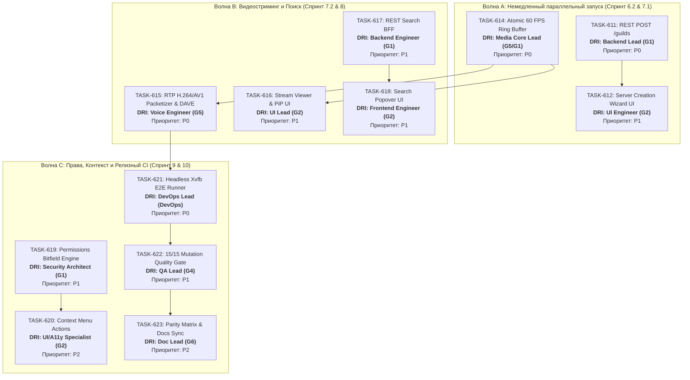

# Доска задач и распределение по отделам ECC 2.0 (discord-lab)

- **Дата актуализации**: 2026-11-07
- **Текущее состояние репозитория**: Ветка `unstable` (`HEAD`: `122d529`), `testing` (`122d529`), `beta` (`122d529`). Ветка `main` заморожена (`10b2a66`).
- **Сквозной гейт**: `PASS` (1842 unit, 102 meta, 22 smoke, 1346+ workspace rust, 0 fail).
- **Единый главный ответственный координатор (Global DRI)**: **ECC Chief Product Manager (`pm_review`)** — координация Zero-Idle, соблюдение бюджета памяти (`WORKER_RAM_LIMIT <= 25 GB`), блокировок `flock` и гейтов приёмки.

---

## 1. Сводная матрица задач, приоритетов и ответственных

| ID Задачи | Название и суть | Отдел | Ответственный специалист (DRI) | Агент и Модель | Приоритет | Статус |
|---|---|---|---|---|---|---|
| **TASK-610** | hCaptcha Solver Modal при 40003 | G2 Frontend + G1 Backend | Frontend Lead (`G2`) | `antigravity` (gemini-4-argon-high) | `P0` | **DONE** (`98cc26b`) |
| **TASK-613** | Screen Capture PipeWire / X11 SHM | G5 Voice & Platform | Voice Lead (`G5`) | `antigravity` (gemini-4-argon-high) | `P0` | **DONE** (`b2b4848`) |
| **TASK-611** | REST POST /guilds (создание сервера) | G1 Backend | Backend Lead (`G1`) | `antigravity` (gemini-4-argon-high) | **P0** | **Ready for Dev** |
| **TASK-614** | Atomic 60 FPS Ring Buffer (Go Live) | G1 Backend + G5 Voice | Media Core Engineer (`G5/G1`) | `antigravity` (gemini-4-argon-high) | **P0** | **Ready for Dev** |
| **TASK-615** | RTP H.264/AV1 + DAVE MLS v1 Video | G5 Voice & Platform | Voice Security Engineer (`G5`) | `antigravity` (gemini-4-argon-high) | **P0** | **Ready for Dev** |
| **TASK-612** | Визард шаблонов создания сервера | G2 Frontend + G3 Design | UI Engineer (`G2`) | `antigravity` (gemini-4-argon-high) | **P1** | **Ready for Dev** |
| **TASK-616** | UI Видео-плеера и Picture-in-Picture | G2 Frontend | UI Lead (`G2`) | `antigravity` (gemini-4-argon-high) | **P1** | **Ready for Dev** |
| **TASK-617** | BFF REST-поиска сообщений с фасетами | G1 Backend | Backend Engineer (`G1`) | `antigravity` (gemini-4-argon-high) | **P1** | **Ready for Dev** |
| **TASK-618** | UI Поискового попапа с токенами | G2 Frontend | Frontend Engineer (`G2`) | `antigravity` (gemini-4-argon-high) | **P1** | **Ready for Dev** |
| **TASK-619** | Вычислитель битовых прав доступа v9 | G1 Backend | Security Architect (`G1`) | `antigravity` (gemini-4-argon-high) | **P1** | **Ready for Dev** |
| **TASK-620** | Контекстные меню сообщений/пользователей | G2 Frontend | UI/A11y Specialist (`G2`) | `antigravity` (gemini-4-argon-high) | **P2** | **Ready for Dev** |
| **TASK-621** | Headless Xvfb E2E Runner для CI | DevOps + G4 QA | DevOps Lead (`DevOps`) | `opencode` (deepseek-v4.1-flash) | **P0** | **Ready for Dev** |
| **TASK-622** | Мутационный набор 15/15 Quality Gate | G4 QA + Tech Reviewer | QA Automation Lead (`G4`) | `opencode` (deepseek-v4.1-flash) | **P1** | **Ready for Dev** |
| **TASK-623** | Актуализация Parity Matrix & Release Notes | G6 Tech Writer | Documentation Lead (`G6`) | `antigravity` (gemini-4-argon-high) | **P2** | **Ready for Dev** |

---

## 2. Граф зависимостей и параллельные дорожки (Zero-Idle)

---

## 3. Детальные спецификации и ТЗ по активным дорожкам

### Дорожка 1: Серверный функционал (STUB-03 / STUB-05)

#### [TASK-611] REST POST /guilds (Создание сервера пользователем)
- **Приоритет**: `P0` (Критично для работы без 403)
- **Отдел**: `G1 Backend (Rust Core & Tauri BFF)`
- **Единый ответственный (DRI)**: **Backend Lead (`G1`)**
- **Исполнитель**: `antigravity` (`gemini-4-argon-high`, `--effort high`)
- **Рабочая ветка**: `feature/task-611-rest-guild-create` (от `unstable`)
- **Область записи**: `rust/gui-spike/src/guilds.rs`, `rust/crates/discord-core/src/rest/guilds.rs`, `rust/gui-spike/tests/guild_create_contract.rs`.
- **RE-Оракул**: `reference-oracle/rest-d02.md`, заголовки `X-Super-Properties`, `X-Discord-Locale: ru`.
- **Критерии приёмки (DoD)**:
  1. Корректное формирование структуры тела запроса (`name`, `icon`, `channels`, `system_channel_flags`).
  2. Обработка успешного создания (HTTP 201 Created) с разбором полученной гильдии, каналов и немедленной интеграцией в локальный `GuildRail`.
  3. Обработка лимитов (HTTP 400 `MAXIMUM_GUILDS 30005`, HTTP 403 `NO_VERIFIED_PHONE`).
  4. 5/5 мутаций KILLED, `cargo test --test guild_create_contract`.

---

#### [TASK-612] Шаблоны и визард создания серверов (STUB-05)
- **Приоритет**: `P1`
- **Отдел**: `G2 Frontend` + `G3 Design`
- **Единый ответственный (DRI)**: **UI Engineer (`G2`)**
- **Исполнитель**: `antigravity` (`gemini-4-argon-high`, `--effort high`)
- **Рабочая ветка**: `feature/task-612-create-guild-wizard` (от `unstable`)
- **Область записи**: `rust/gui-spike/ui/features/create-guild.js`, `rust/gui-spike/ui/styles/create-guild.css`, `tests/unit/create-guild-wizard.test.mjs`.
- **RE-Оракул**: `reference-oracle/frontend-d03.md` (модалка `CreateGuildModal`: шаги «Свой шаблон», «Для меня и друзей», «Клуб/сообщество»).
- **Критерии приёмки (DoD)**:
  1. Выбор категории шаблона автоматически предзаполняет дефолтные каналы (`#general`, `#gaming`, `🔊 Голосовой`).
  2. Валидация названия (1–100 символов, обрезка пробелов).
  3. A11y: управление стрелками, Escape, автофокус на поле ввода.
  4. 100% прохождение unit-тестов, 5/5 мутаций KILLED.

---

### Дорожка 2: Видеоконвейер Go Live (STUB-27 / Task-601..604)

#### [TASK-614] Атомарный буфер 60 FPS (Latest-Frame Ring Buffer)
- **Приоритет**: `P0`
- **Отдел**: `G1 Backend` + `G5 Voice & Platform`
- **Единый ответственный (DRI)**: **Media Core Lead (`G5/G1`)**
- **Исполнитель**: `antigravity` (`gemini-4-argon-high`, `--effort high`)
- **Рабочая ветка**: `feature/task-614-atomic-frame-slot` (от `unstable`)
- **Область записи**: `rust/crates/discord-media/src/buffer.rs`, `rust/crates/discord-media/src/capture/portal.rs`, `rust/gui-spike/src/voice_stage.rs`.
- **Критерии приёмки (DoD)**:
  1. Структура `LatestFrameSlot`: потокобезопасный `Arc<AtomicPtr<VideoFrame>>` или двойной буфер `ArcSwapOption`.
  2. Задержка публикации кадра < 2 мс, 0 блокировок UI-потока.
  3. Обработка переполнения: устаревший кадр немедленно заменяется новым без накопления очередей памяти.
  4. Контрактные тесты на гонки данных при 60 FPS (Miri/ASan).

---

#### [TASK-615] Пакетная сборка RTP видеопотока и DAVE MLS v1 (Task-602)
- **Приоритет**: `P0`
- **Отдел**: `G5 Voice & Platform`
- **Единый ответственный (DRI)**: **Voice Security Engineer (`G5`)**
- **Исполнитель**: `antigravity` (`gemini-4-argon-high`, `--effort high`)
- **Рабочая ветка**: `feature/task-615-rtp-video-dave` (от `unstable`)
- **Область записи**: `rust/crates/discord-voice/src/rtp/video.rs`, `rust/crates/discord-voice/src/dave/mls.rs`.
- **RE-Оракул**: `reference-oracle/voice-deep.md`, опкоды 18 `STREAM_CREATE`, 20 `STREAM_WATCH`, 22 `STREAM_SET_PAUSED`.
- **Критерии приёмки (DoD)**:
  1. Пакетизация H.264 NALU (Single NAL, FU-A фрагментация > 1200 байт, STAP-A).
  2. Интеграция с ключами эпохи DAVE MLS v1 для видеопотока.
  3. Контрактный тест `cargo test -p discord-voice --test rtp_video_contract`.

---

#### [TASK-616] UI Видео-плеера трансляций и Picture-in-Picture (Task-604)
- **Приоритет**: `P1`
- **Отдел**: `G2 Frontend`
- **Единый ответственный (DRI)**: **UI Lead (`G2`)**
- **Исполнитель**: `antigravity` (`gemini-4-argon-high`, `--effort high`)
- **Рабочая ветка**: `feature/task-616-stream-viewer-pip` (от `unstable`)
- **Область записи**: `rust/gui-spike/ui/features/stream-viewer.js`, `rust/gui-spike/ui/styles/stream-viewer.css`.
- **RE-Оракул**: `reference-oracle/voice/ui7/` (компоненты стрима, оверлей стримера, бейдж LIVE).
- **Критерии приёмки (DoD)**:
  1. Отображение тайла стрима в голосовом канале.
  2. Сворачивание в плавающий PiP-виджет при переходе в чаты или настройки.
  3. 100% покрытие модульными тестами `tests/unit/stream-viewer.test.mjs`.

---

### Дорожка 3: Автоматизация и Релизный контур CI (Sprint 10)

#### [TASK-621] Headless Xvfb E2E Runner для CI (M2-E2E)
- **Приоритет**: `P0`
- **Отдел**: `DevOps` + `G4 QA`
- **Единый ответственный (DRI)**: **DevOps Lead (`DevOps`)**
- **Исполнитель**: `opencode` (`deepseek/deepseek-v4.1-flash`)
- **Рабочая ветка**: `devops/task-621-headless-xvfb-ci` (от `unstable`)
- **Область записи**: `scripts/ci.sh`, `scripts/gate.mjs`.
- **Критерии приёмки (DoD)**:
  1. Автоматический запуск `xvfb-run -a` при отсутствии `DISPLAY`.
  2. Авто-обнаружение Chromium/Brave по стандартным путям.
  3. Все 11 E2E-тестов проходят в headless-режиме без skip и флаков.

---

## 4. Регламент распределения слотов и лимитов (Zero-Idle)

1. **Лимит активных слотов воркеров**: Строго **не более 4–5 параллельных терминалов**.
2. **Лимит памяти**: `WORKER_RAM_LIMIT <= 25 GB` (из 45 GB доступных).
3. **Блокировка Cargo**: Все вызовы `cargo build/test` выполняются исключительно через `flock /tmp/discord-lab-cargo.lock`.
4. **Конвейер смены задач**: Как только воркер завершает задачу (`worker_done`), координатор принимает PR (`ACCEPT.md` + `REVIEW.md`), вливает код в `unstable`, освобождает терминал (`worker-release`) и немедленно запускает следующий тикет из очереди.
