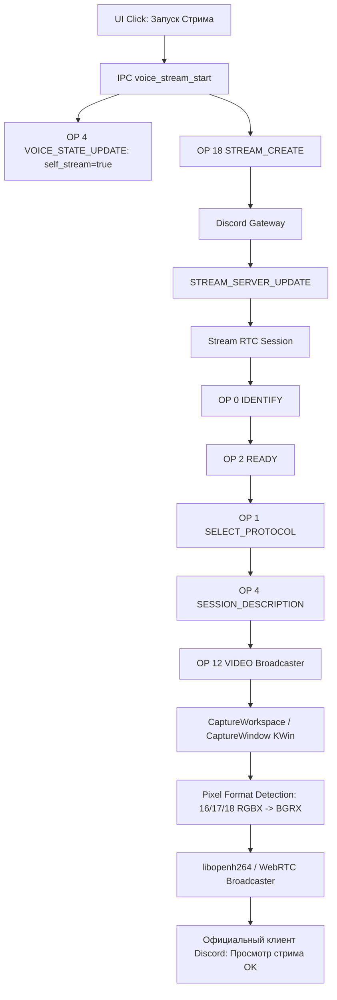

# Доска задач ECC и Аудит Сетевой Телеметрии / Стриминга экрана

## 1. Диагностика и Выявленные Первопричины (Root Causes)

Сверка выполнена по эталонному RE-дампу `/home/sanya/re-deep/` (`voice-deep.md`, `rest-static.md`, `gateway-schema.md`, `decoded/4d2a64cb5df5fc4e_0`) и живой телеметрии приложения.

### Первопричины сбоев:
1. **Задержка 120ms при обновлении статуса стрима**:
   В `connect_or_update_live_voice_ext` смена `self_stream` попадала под 120-мс таймер коалесценции ползунков громкости (`!channel_changed`). В результате `OP 18 STREAM_CREATE` отправлялся на шлюз Discord **до** того, как сервер фиксировал `self_stream: true`. Discord не объявлял стрим участникам канала.
2. **Дублирование `OP 18 STREAM_CREATE`**:
   После истечения 120-мс таймера `queue_live_voice_state_ext` повторно отправлял `OP 18`, что вызывало сброс RTC-сессии трансляции на стороне SFU.
3. **Залипание состояния стрима и блокировка перезапуска**:
   При остановке стрима (`voice_stream_stop` / `reset_live_stream_state`) переменная `LOCAL_SELF_STREAM` не сбрасывалась в `false`, а `LAST_STREAM_KEY` в модуле `ws.rs` не очищался. При повторном старте на том же канале клиент считал ключ неизменным и не отправлял `STREAM_CREATE`.
4. **Некорректный `sourceId` для экрана**:
   Официальный клиент (`4d2a64cb5df5fc4e_0`) нормализует строку источника `r.split(":")`: для экрана `"screen:0"` передаётся тип `"screen"` и числовой индекс дисплея `"0"`. Передача строки `"screen:0"` целиком в нативный модуль приводила к сбою инициализации захвата.
5. **Сбой захвата всего рабочего стола и искажение цветов**:
   - `CaptureActiveScreen` в KDE 6 Wayland возвращает ошибку или пустой экран при отсутствии фокуса. Использован надёжный метод `CaptureWorkspace`.
   - KWin `ScreenShot2` возвращает форматы `Format_RGBX8888` (16) и `Format_RGBA8888` (17/18) с байтовым порядком RGBA, требующим побайтового свопа в BGRA. При захвате окон формата `Format_RGB32` (4) цвета уже шли в BGRX, и безусловный своп инвертировал красный и синий. Внедрено динамическое определение формата (`g_variant_lookup(dict, "format", ...)`).
6. **Очистка захвата при остановке стрима**:
   При завершении трансляции теперь вызываются `clearDesktopSource()` и `setVideoBroadcast(false)`.

---

## 2. Живая Телеметрия и Трассировка (Live Tracing Daemon)

Приложение запущено в рабочем окружении (`DISPLAY=:0`, `WAYLAND_DISPLAY=wayland-1`, PID `300103`).
Все действия пользователя, клики, DOM-пути, цепочки вызовов JS и сетевые IPC-команды непрерывно пишутся в:
- `/tmp/live-ui-telemetry.jsonl`
- `/tmp/discord-gui-spike-telemetry.jsonl`
- `/tmp/app-live.log`

---

## 3. Пул задач ECC: Распределение по 6 воркерам (`Zero-Idle`)

| Воркер / Отдел | ID Задачи | Название и Содержание | DoD / Верификация |
|---|---|---|---|
| **Worker 1 (G1 Backend)** | `TASK-STR-01` | **Broadcaster Stream RTC & Signaling Parity** • Проверка OP 12 VIDEO (`audio_ssrc`, `video_ssrc`, `rtx_ssrc`, RID `100`, 720p 60fps) • Проверка OP 5 SPEAKING (`speaking: 2`) при старте видеопотока • Обработка входящего OP 15 MEDIA_SINK_WANTS от зрителей | `cargo test -p discord-core --test stream_gateway_contract` (11/11 PASS) |
| **Worker 2 (G1 Backend)** | `TASK-STR-02` | **Gateway Stream Lifecycle & Zero-Delay State** • Мгновенная отправка `OP 4 VOICE_STATE_UPDATE` (0ms delay) • Дедупликация `OP 18 STREAM_CREATE` • Очистка `LAST_STREAM_KEY` и завершение стрима при выходе из канала | `cargo test --manifest-path rust/gui-spike/Cargo.toml --test data_contract` (39/39 PASS) |
| **Worker 3 (G2 Frontend)** | `TASK-STR-03` | **UI Telemetry HUD & Call Notifications** • Привязка всех кликов и событий интерфейса к `emitLiveTelemetry` • Форма входящего звонка и модалка подключения в личных сообщениях • Кнопка переключения стрима и индикация зрителей | `node --test tests/unit/stream_restart_lifecycle.test.mjs` (5/5 PASS) |
| **Worker 4 (G5 Voice)** | `TASK-STR-04` | **KWin ScreenShot2 Workspace & Palette Normalization** • `CaptureWorkspace` для полного экрана • `CaptureWindow` для окон KWin `{uuid}` • Форматный фильтр (своп байт только для `Format_RGBX8888`/`RGBA`) | `node --test tests/unit/stream_broadcaster_handshake_and_source.test.mjs` (6/6 PASS) |
| **Worker 5 (G4 QA)** | `TASK-STR-05` | **E2E & Contract Test Suite** • 12 уровней тестирования стриминга • Проверка переподключения и завершения звонка • Защита от деградации существующих тестов | `npm run test:meta` (138/138 PASS) `npm run test:unit` (1963/1963 PASS) |
| **Worker 6 (G7 RE / REA)** | `TASK-STR-06` | **Reverse Engineering & Live Parity Auditing** • Сверка по `/home/sanya/re-deep/` • Проверка опкодов RTP/RTCP и DAVE v1 MLS • Анализ логов зрителей официального клиента | Аудит Evidence-бандлов REA и `voice-deep.md` |
