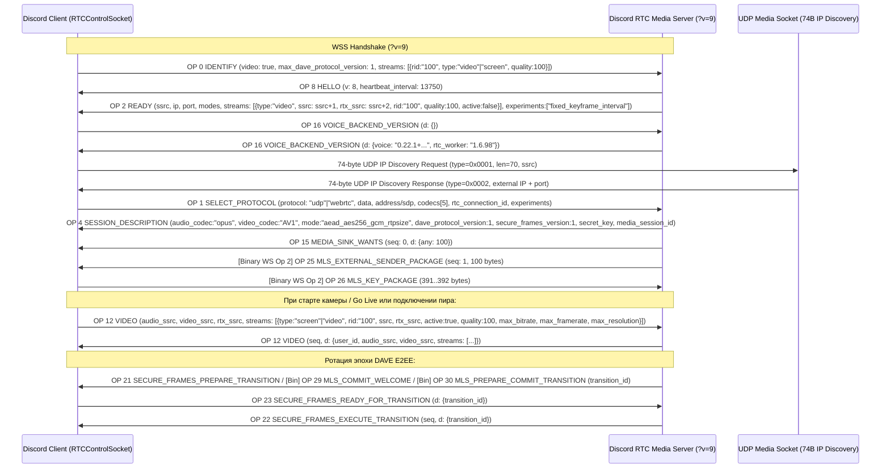

# RE-GAP-VIDEO-SDP: Go Live Сигнализация и Видео/SDP Контракты (`Voice Opcodes 1, 12, 16, 22`)

- **Карточка:** `TASK-781`
- **Волна:** `RW-41-ECC-INTEGRATION`
- **Отдел:** `G7 RE / REA` (Воркер `W8`)
- **Дата аудита:** `2026-11-10`
- **Статус:** `Completed (Read-Only RE Audit)`
- **Целевой контур модернизации:** `G5 Voice & Platform` ([`discord-voice/src/lib.rs`](file:///home/user/orca/project/rust/crates/discord-voice/src/lib.rs), [`discord-voice/src/session.rs`](file:///home/user/orca/project/rust/crates/discord-voice/src/session.rs), [`discord-voice/src/dave.rs`](file:///home/user/orca/project/rust/crates/discord-voice/src/dave.rs), [`discord-core/src/stream.rs`](file:///home/user/orca/project/rust/crates/discord-core/src/stream.rs), [`gui-spike/src/voice_stage.rs`](file:///home/user/orca/project/rust/gui-spike/src/voice_stage.rs))

---

## 0. Паспорт аудита и реестр эталонных оракулов

| Артефакт / Оракул | Путь | Объём / Метрика | Назначение в аудите |
|---|---|---|---|
| **Сводка Voice RE** | [`reference-oracle/voice-deep.json`](file://reference-oracle/voice-deep.json) / [`voice-deep.md`](file://reference-oracle/voice-deep.md) | `82 строки JSON` / `132 строки MD` | Таблица Voice WS (`v=9`), `OP 0/1/2/4/8/11/12/13/15/16/18/20` + бинарные DAVE (`OP 21..31`), 5 кодеков (`opus`, `AV1`, `H265`, `H264`, `VP8`), шифрование `aead_aes256_gcm_rtpsize` и `aead_xchacha20_poly1305_rtpsize` |
| **Живой CDP-трейс (Run 2)** | [`reference-oracle/capture-run2.jsonl`](file://reference-oracle/capture-run2.jsonl) | `23 598 строк` (`L9751..9857`, `L16994..17107`) | Две полные живые сессии RTC WebSocket (`v=9`): `requestId: "95974.8158"` (`wss://c-fra19-4da7fe5f.discord.media:2053/?v=9`) и `requestId: "95974.12735"` (`wss://c-arn02-5229f1fc.discord.media:2096/?v=9`) |
| **Дамп фреймов RTC 1/2** | [`reference-oracle/voice/rtc1-frames.jsonl`](file://reference-oracle/voice/rtc1-frames.jsonl), [`rtc2-frames.jsonl`](file://reference-oracle/voice/rtc2-frames.jsonl), [`rtc1-summary.json`](file://reference-oracle/voice/rtc1-summary.json) | `22 + 20 фреймов`, `189 строк JSON` | Эталонные фреймы `OP 8 -> OP 0 -> OP 2 -> OP 16 -> OP 1 -> OP 4 -> OP 15 -> OP 25 (bin) -> OP 26 (bin)` |
| **Лог нативного движка** | [`reference-oracle/voice/engine-log-session1.txt`](file://reference-oracle/voice/engine-log-session1.txt), [`session3.out`](file://reference-oracle/voice/session3.out) | `26 строк` / `367 строк` | Тайминги UDP Discovery (`74 байта`), `CreateAudioConnection`, `AddVideoOutputSink`, DAVE MLS (`OP 25/26`) |
| **Эталонный Web-бандл Discord 1.0.162** | [`reference-oracle/out/bundles/discord.com_assets_web.4d4b2f75fdea5470.js`](file://reference-oracle/out/bundles/discord.com_assets_web.4d4b2f75fdea5470.js) | `12 105 911 байт` | Классы `RTCControlSocket` (`@2,391,800..2,406,500`), `GoLiveQualityManager` (`@2,382,250..2,384,300`), `RTCConnection` (`@2,465,000..2,522,000`), `StreamRTCConnection` (`@9,351,500..9,366,500`), `MediaEngineStore` (`@9,194,240..9,194,650`), `NativeConnection` (`@10,786,500..10,828,000`), `WebRTCConnection` & SDP (`@10,879,000..10,931,000`) |
| **Текущая реализация `discord-lab`** | [`rust/crates/discord-voice/src/lib.rs`](file:///home/user/orca/project/rust/crates/discord-voice/src/lib.rs), [`session.rs`](file:///home/user/orca/project/rust/crates/discord-voice/src/session.rs), [`dave.rs`](file:///home/user/orca/project/rust/crates/discord-voice/src/dave.rs) | `lib.rs` (`L80..1100`), `session.rs` (`L710..2100`), `dave.rs` (`L1..350`) | Текущий парсер/сериализатор `VoiceOp`, `SelectProtocol`, `VoiceVideo`, `VoiceSessionDriver`, `DaveControlFrame` |

---

## 1. Сквозная архитектура и последовательность сигнализации Go Live (`Gateway Op 18..22` + `RTC WS v=9`)

### 1.1. Двухсокетная модель Go Live (`default` vs `stream`)
В эталонном клиенте ([`discord.com_assets_web.4d4b2f75fdea5470.js`](file://reference-oracle/out/bundles/discord.com_assets_web.4d4b2f75fdea5470.js) `@9,351,500..9,366,500`, `class j extends O.A` — `StreamRTCConnection`) трансляция экрана **Go Live** не переиспользует основное голосовое соединение (`context: "default"`), а поднимает **второе параллельное RTC-соединение** с контекстом `context: "stream"`:

1. **Сигнализация в основном Gateway WebSocket (`Opcodes 18..22`):**
   - `OP 18 STREAM_CREATE` (`C -> S`): `{"op":18,"d":{"type":"guild"|"call","guild_id":...,"channel_id":...,"preferred_region":...}}`.
   - `STREAM_CREATE` (`S -> C Dispatch`): содержит `stream_key`, `rtc_server_id`, `rtc_channel_id`, `region`, `viewer_ids`, `paused`.
   - `STREAM_SERVER_UPDATE` (`S -> C Dispatch`): содержит `stream_key`, `endpoint`, `token`.
   - `OP 22 STREAM_SET_PAUSED` (`C -> S`, `@4,955,477` / `@4,999,329`): `{"op":22,"d":{"stream_key":"guild:<gid>:<cid>:<uid>","paused":true|false}}`.
2. **Формирование `server_id` и `channel_id` для `StreamRTCConnection` (`@2,477,610`):**
   - В `RTCConnection.constructor` вычисляются:
     ```js
     let l = n ?? a ?? o, // streamServerId ?? guildId ?? channelId
         c = null != r ? r : null != n ? (BigInt(n) - 1n).toString() : o; // streamChannelId ?? (BigInt(streamServerId) - 1n).toString() ?? channelId
     ```
   - Если `rtc_channel_id` не передан, клиент вычисляет `trueChannelId = (BigInt(rtc_server_id) - 1n).toString()`.
3. **Различие `streams` в `OP 0 IDENTIFY` между `default` и `stream` (`MediaEngineStore.getVideoStreamParameters` `@9,194,248`):**
   ```js
   function er(e = p.x.DEFAULT) {
     let t = [{ rid: "100", type: e === p.x. DEFAULT ? p.mI.VIDEO : p.mI.SCREEN, quality: 100 }];
     return e === p.x.DEFAULT && P && t.push({ rid: "50", type: p.mI.VIDEO, quality: 50 }), t;
   }
   ```
   - Для обычного голосового/видео-канала (`context === "default"`) в `OP 0 IDENTIFY` отправляется `"type": "video"` (как зафиксировано в [`capture-run2.jsonl:9758`](file://reference-oracle/capture-run2.jsonl#L9758) и [`capture-run2.jsonl:17001`](file://reference-oracle/capture-run2.jsonl#L17001)).
   - Для **Go Live** (`context === "stream"`) в `OP 0 IDENTIFY` отправляется `"type": "screen"`:
     `streams: [{"rid": "100", "type": "screen", "quality": 100}]`.

### 1.2. Полная хронология рукопожатия RTC WebSocket (`v=9`) по `capture-run2.jsonl`

В [`capture-run2.jsonl`](file://reference-oracle/capture-run2.jsonl) записаны две полные сессии голосового/видео сигналинга:
- **Сессия A (`requestId: "95974.8158"`, строки `9751..9857`):** `wss://c-fra19-4da7fe5f.discord.media:2053/?v=9` (`ssrc=17843`, `video_ssrc=17844`, `rtx_ssrc=17845`, `udp=104.29.147.145:19309`).
- **Сессия B (`requestId: "95974.12735"`, строки `16994..17107`):** `wss://c-arn02-5229f1fc.discord.media:2096/?v=9` (`ssrc=9208`, `video_ssrc=9209`, `rtx_ssrc=9210`, `udp=104.29.146.60:19329`).



---

## 2. Точная структура пакета `Voice Opcode 1 (SELECT_PROTOCOL)`

### 2.1. Код генерации в эталонном клиенте (`RTCControlSocket.selectProtocol`)
В [`discord.com_assets_web.4d4b2f75fdea5470.js`](file://reference-oracle/out/bundles/discord.com_assets_web.4d4b2f75fdea5470.js) (`@2,391,835` и `@2,405,299`) сериализация `OP 1 SELECT_PROTOCOL` реализована следующим образом:

```js
// Сериализатор списка кодеков (offset 2,391,835)
function ex(e) {
  return e.map(e => ({
    name: e.name,
    type: e.type,
    priority: e.priority,
    payload_type: e.payloadType,
    rtx_payload_type: e.rtxPayloadType,
    encode: e.encode,
    decode: e.decode
  }));
}

// Метод отправки OP 1 SELECT_PROTOCOL в RTCControlSocket (offset 2,405,299)
selectProtocol(e, t, n, i) {
  let r, a = {};
  null == n
    ? r = null
    : "sdp" in n && null != n.sdp && "" !== n.sdp
      ? (r = n.sdp, a = { ...n, codecs: ex(n.codecs), rtc_connection_id: t })
      : "address" in n && null != n.address && "" !== n.address && n.port && null != n.mode && "" !== n.mode
        && (r = { address: n.address, port: n.port, mode: n.mode },
            a = { ...n, codecs: ex(n.codecs), rtc_connection_id: t, experiments: i }),
  this.send(1, { protocol: e, data: r, ...a });
}
```

> [!IMPORTANT]
> Из-за конструкции `{ protocol: e, data: r, ...a }`, где `a = { ...n, codecs: ex(n.codecs), rtc_connection_id: t, experiments: i }`, эталонный клиент **всегда дублирует** транспортные параметры:
> - В режиме `protocol: "udp"` поля `address`, `port`, `mode` присутствуют **и внутри `d.data`, и на верхнем уровне `d`**.
> - В режиме `protocol: "webrtc"` строка SDP присутствует **и в `d.data`, и в `d.sdp` на верхнем уровне `d`**.

### 2.2. Вариант А: Нативный режим `protocol: "udp"` (эталон из `capture-run2.jsonl`)
Точный пакет из [`capture-run2.jsonl:17009`](file://reference-oracle/capture-run2.jsonl#L17009) (аналогично [`capture-run2.jsonl:9765`](file://reference-oracle/capture-run2.jsonl#L9765) и [`voice/rtc1-frames.jsonl:7`](file://reference-oracle/voice/rtc1-frames.jsonl#L7)):

```json
{
  "op": 1,
  "d": {
    "protocol": "udp",
    "data": {
      "address": "188.243.182.138",
      "port": 51267,
      "mode": "aead_aes256_gcm_rtpsize"
    },
    "address": "188.243.182.138",
    "port": 51267,
    "mode": "aead_aes256_gcm_rtpsize",
    "codecs": [
      {
        "name": "opus",
        "type": "audio",
        "priority": 1000,
        "payload_type": 120
      },
      {
        "name": "AV1",
        "type": "video",
        "priority": 1000,
        "payload_type": 101,
        "rtx_payload_type": 102,
        "encode": true,
        "decode": true
      },
      {
        "name": "H265",
        "type": "video",
        "priority": 2000,
        "payload_type": 103,
        "rtx_payload_type": 104,
        "encode": false,
        "decode": true
      },
      {
        "name": "H264",
        "type": "video",
        "priority": 3000,
        "payload_type": 105,
        "rtx_payload_type": 106,
        "encode": true,
        "decode": true
      },
      {
        "name": "VP8",
        "type": "video",
        "priority": 4000,
        "payload_type": 107,
        "rtx_payload_type": 108,
        "encode": true,
        "decode": true
      }
    ],
    "rtc_connection_id": "3a61f9dd-a103-4dce-93cf-2f988aa3c1ba",
    "experiments": [
      "fixed_keyframe_interval"
    ]
  }
}
```

#### Правила расчёта полей `SELECT_PROTOCOL` (UDP) в `NativeConnection`:
1. **Выбор `mode` (`NativeConnection.chooseEncryptionMode` `@10,827,450`):**
   - Список поддерживаемых клиентом режимов сверяется с `ready.modes` в порядке приоритета клиента:
     1. `"aead_aes256_gcm_rtpsize"` (выбирается первым, если доступен в `OP 2 READY`)
     2. `"aead_xchacha20_poly1305_rtpsize"`
   - В [`capture-run2.jsonl:9760`](file://reference-oracle/capture-run2.jsonl#L9760) сервер присылает `modes: ["aead_aes256_gcm_rtpsize", "aead_xchacha20_poly1305_rtpsize"]`, и клиент выбирает `"aead_aes256_gcm_rtpsize"`.
2. **Таблица кодеков и формула `payload_type` (`NativeConnection.initialize` `@10,803,520`):**
   - Для аудио (`L` `@10,801,250`): `name: "opus"`, `type: "audio"`, `priority: 1000`, `payload_type: 120`. Поля `rtx_payload_type`, `encode`, `decode` равны `undefined` и при `JSON.stringify` **опускаются**.
   - Для видео (`y` и `D` `@10,801,310..10,803,650`): пересечение возможностей нативного модуля (`AV1`, `H265`, `H264`, `VP8`) с ранжированным списком; для каждого видеокодека с индексом `idx` (`0..3`):
     - `payload_type = 101 + 2 * idx` (`101, 103, 105, 107`)
     - `rtx_payload_type = payload_type + 1` (`102, 104, 106, 108`)
     - `priority = (idx + 1) * 1000` (`1000, 2000, 3000, 4000`)
     - `encode: bool`, `decode: bool` (на Linux/Web в дампе у `H265` `encode: false, decode: true`).
3. **Фильтрация `experiments` (`RTCConnection._chooseExperiments` `@2,477,820`):**
   - Клиент пересекает `d.experiments` из `OP 2 READY` со своим списком поддерживаемых экспериментов (`["fixed_keyframe_interval"]`) и передаёт результат в `OP 1 SELECT_PROTOCOL`.

### 2.3. Вариант Б: Режим `protocol: "webrtc"` (SDP Offer/Answer для WebView / Browser)
Когда используется WebRTC PeerConnection (`class eU extends O.A` — `WebRTCConnection`, `@10,893,000..10,926,200`), после сбора ICE-кандидатов вызывается `this.emit(E.yq.Connected, "webrtc", eD(e.sdp, this.hasH265()))` (`@10,926,175`), а `RTCConnection._handleConnect` (`@2,496,513`) вызывает `selectProtocol("webrtc", rtcConnectionId, info)`:

```json
{
  "op": 1,
  "d": {
    "protocol": "webrtc",
    "data": "a=ice-ufrag:...\na=ice-pwd:...\na=fingerprint:sha-256 ...\na=candidate:...\na=rtpmap:111 opus/48000/2\na=rtpmap:96 VP8/90000\na=rtpmap:97 rtx/90000\na=extmap:1 urn:ietf:params:rtp-hdrext:ssrc-audio-level\n...",
    "sdp": "a=ice-ufrag:...\na=ice-pwd:...\na=fingerprint:sha-256 ...\na=candidate:...\na=rtpmap:111 opus/48000/2\na=rtpmap:96 VP8/90000\na=rtpmap:97 rtx/90000\na=extmap:1 urn:ietf:params:rtp-hdrext:ssrc-audio-level\n...",
    "codecs": [
      {
        "name": "opus",
        "type": "audio",
        "priority": 1000,
        "payload_type": 111,
        "rtx_payload_type": null
      },
      {
        "name": "H264",
        "type": "video",
        "priority": 1000,
        "payload_type": 102,
        "rtx_payload_type": 103
      },
      {
        "name": "VP8",
        "type": "video",
        "priority": 2000,
        "payload_type": 96,
        "rtx_payload_type": 97
      }
    ],
    "rtc_connection_id": "ca331b96-30f2-4ad1-af7d-706fa031ef2c"
  }
}
```

#### Особенности SDP-контракта (`eD`, `ey`, `eR`, `eO` `@10,893,000..10,897,000`):
1. **Сжатие исходящего SDP (`eD(sdp, hasH265)` `@10,893,420`):**
   - Discord **не отправляет** полный WebRTC SDP в `OP 1 SELECT_PROTOCOL`. Функция `ew(sdp, ...)` оставляет только строки, совпадающие с регулярным выражением `/^a=ice|a=extmap|a=fingerprint|opus|VP8|H264|H265|VP9|${rtxPt} rtx/i`, склеенные через `\n`.
   - Кодеки извлекаются из SDP парсером `ey(sdp, hasH265)` (`@10,893,490`): приоритеты назначаются в порядке `(idx + 1) * 1000`, причём поля `encode` и `decode` в WebRTC-режиме отсутствуют (`undefined`), а `rtx_payload_type` для `opus` равен `null`.
   - Поле `experiments` в режиме `protocol: "webrtc"` **не передаётся**.
2. **Входящий `OP 4 SESSION_DESCRIPTION` в режиме `webrtc` (`_handleSDP` `@2,508,990` и `setSDP` `@10,920,620`):**
   - Сервер возвращает в `OP 4` поле `"sdp": "<server_minified_sdp>"` (плюс `"audio_codec"`, `"video_codec"`, `"media_session_id"`, `"dave_protocol_version"`, опционально `"keyframe_interval"` и `"bandwidth_estimation_experiment"`).
   - Клиент валидирует серверный SDP функцией `ev(sdp)` (`@10,896,690`: наличие `a=fingerprint`, `a=ice-ufrag`, `a=ice-pwd`, `a=candidate`, `c=`) и разворачивает его в полноценный `RTCSessionDescription` (`type: "answer"`) через `eR`/`eO` (Unified Plan / Plan B с `UDP/TLS/RTP/SAVPF`, `a=msid-semantic: WMS *`, `a=ssrc-group:FID <videoSsrc> <rtxSsrc>`, `x-google-max-bitrate=2500`).

---

## 3. Точная структура пакета `Voice Opcode 12 (VIDEO)` при трансляции экрана (Go Live) и камеры

В протоколе Discord RTC `OP 12 VIDEO` является **двунаправленным** (`Client -> Server` и `Server -> Client`), причём схемы исходящего и входящего пакетов имеют существенные различия.

### 3.1. Исходящий пакет `OP 12 VIDEO` (`Client -> Server`)

#### Код сериализации в `RTCControlSocket.video` (`@2,391,900` и `@2,405,695`):
```js
// Сериализатор элемента streams[] (offset 2,391,900)
function ek(e) {
  return null == e ? void 0 : e.map(e => ({
    type: e.type,
    rid: e.rid,
    ssrc: e.ssrc,
    active: e.active,
    quality: e.quality,
    rtx_ssrc: e.rtxSsrc,
    max_bitrate: e.maxBitrate,
    max_framerate: e.maxFrameRate,
    max_resolution: null != e.maxResolution ? {
      type: e.maxResolution.type,
      width: e.maxResolution.width,
      height: e.maxResolution.height
    } : void 0
  }));
}

// Отправка OP 12 VIDEO (offset 2,405,695)
video(e, t, n, i) {
  this.send(12, {
    audio_ssrc: e,
    video_ssrc: t,
    rtx_ssrc: n,
    streams: ek(i)
  });
}
```

#### Эталонный JSON-пакет `OP 12 VIDEO` при активной трансляции экрана Go Live (720p @ 30fps):
```json
{
  "op": 12,
  "d": {
    "audio_ssrc": 9208,
    "video_ssrc": 9209,
    "rtx_ssrc": 9210,
    "streams": [
      {
        "type": "screen",
        "rid": "100",
        "ssrc": 9209,
        "active": true,
        "quality": 100,
        "rtx_ssrc": 9210,
        "max_bitrate": 3500000,
        "max_framerate": 30,
        "max_resolution": {
          "type": "fixed",
          "width": 1280,
          "height": 720
        }
      }
    ]
  }
}
```

#### Эталонный JSON-пакет `OP 12 VIDEO` при трансляции Go Live в исходном разрешении (`Source` / 60fps):
```json
{
  "op": 12,
  "d": {
    "audio_ssrc": 9208,
    "video_ssrc": 9209,
    "rtx_ssrc": 9210,
    "streams": [
      {
        "type": "screen",
        "rid": "100",
        "ssrc": 9209,
        "active": true,
        "quality": 100,
        "rtx_ssrc": 9210,
        "max_bitrate": 9000000,
        "max_framerate": 60,
        "max_resolution": {
          "type": "source",
          "width": 0,
          "height": 0
        }
      }
    ]
  }
}
```

#### Эталонный JSON-пакет `OP 12 VIDEO` при остановке видео / экрана (`video_ssrc = 0`):
В `RTCConnection.sendVideo` (`@2,475,185`: `0 !== t && (this._sentVideo = !0), this._sentVideo && r.video(e, t, n, i)`) и `NativeConnection.handleVideo` (`@10,827,760`) при выключении видео (только если `this._sentVideo === true`) отправляется:
```json
{
  "op": 12,
  "d": {
    "audio_ssrc": 9208,
    "video_ssrc": 0,
    "rtx_ssrc": 0,
    "streams": [
      {
        "type": "screen",
        "rid": "100",
        "ssrc": 9209,
        "active": false,
        "quality": 100,
        "rtx_ssrc": 9210,
        "max_bitrate": 3500000,
        "max_framerate": 30,
        "max_resolution": {
          "type": "fixed",
          "width": 1280,
          "height": 720
        }
      }
    ]
  }
}
```

#### Правила вычисления полей `OP 12 VIDEO` в `NativeConnection` и `StreamRTCConnection`:
1. **`type` внутри `streams[]`:**
   - `"screen"` (`K.mI.SCREEN`) для Go Live (`StreamRTCConnection`, `context === "stream"`).
   - `"video"` (`K.mI.VIDEO`) для веб-камеры в голосовом канале (`context === "default"`).
2. **Формула `rtx_ssrc` (`function j(e)` `@10,801,220`):**
   - `rtx_ssrc = video_ssrc > 0 ? video_ssrc + 1 : 0` (или берётся из `OP 2 READY` `d.streams[0].rtx_ssrc`).
   - В `StreamRTCConnection.sendVideo` (`@9,365,303`) на пике инициализации также заполняется `stream.ssrc = videoSsrc` и `stream.rtxSsrc = j(videoSsrc)`, если в `OP 2 READY` массив `streams` был пустым.
3. **Расчёт `max_resolution` (`setGoLiveSource` `@10,819,820` и `setDesktopEncodingOptions` `@10,821,450`):**
   - Если выбран пресет `Source` (`resolution === 0`): `width = 0`, `height = 0`, `max_resolution = { type: "source", width: 0, height: 0 }`.
   - Если выбран фиксированный пресет (`480`, `720`, `1080`, `1440`):
     - `width = resolution <= 480 ? (resolution / 3) * 4 : (resolution / 9) * 16` (`640x480`, `1280x720`, `1920x1080`, `2560x1440`)
     - `height = resolution`
     - `max_resolution = { type: "fixed", width, height }`.
4. **Расчёт `max_bitrate` (`calcMaxBitrateFunc` `@2,492,850`, константы `O.lo` / `O.oL` `@10,764,450`):**
   - Базовый десктопный битрейт (`O.lo`): **`3 500 000` бит/с** (`3.5 Mbps`) при `height <= 720 && framerate <= 30`.
   - Повышенный десктопный битрейт (`O.oL`): **`9 000 000` бит/с** (`9.0 Mbps`), когда `(height === 0 && framerate >= 10) || height > 720 || framerate > 30`.
   - Для AV1 при `height <= 720 && framerate <= 30` (или `height === 0 && framerate < 10`) (`2026-05-av1-bitrate-tuning` `@2,384,350`): **`3 500 000` бит/с**.
   - Для обычной камеры (`context === "default"`, `O.lq` `@10,764,445`): **`2 500 000` бит/с** (`2.5 Mbps`).

### 3.2. Входящий пакет `OP 12 VIDEO` (`Server -> Client`)
Когда другой участник включает/выключает камеру или Go Live, сервер присылает клиенту `OP 12 VIDEO` с порядковым номером `seq`.

#### Код парсинга в `RTCControlSocket` (`@2,392,050` и `@2,396,420`) и `RTCConnection._handleVideo` (`@2,503,890`):
```js
// Парсер входящего массива streams (offset 2,392,050)
function eF(e) {
  return null == e ? [] : e.map(e => ({
    type: e.type,
    rid: e.rid,
    ssrc: e.ssrc,
    active: e.active,
    quality: e.quality,
    rtxSsrc: e.rtx_ssrc,
    maxBitrate: e.max_bitrate,
    maxFrameRate: e.max_framerate,
    maxResolution: null != e.max_resolution ? {
      type: e.max_resolution.type,
      width: e.max_resolution.width,
      height: e.max_resolution.height
    } : void 0
  }));
}

// Диспетчер RTCControlSocket (offset 2,396,420)
case 12:
  this.emit("video", i.user_id, i.audio_ssrc, i.video_ssrc, eF(i.streams));
  break;
```

#### Схема входящего `OP 12 VIDEO` (`Server -> Client`):
```json
{
  "op": 12,
  "seq": 4,
  "d": {
    "user_id": "384299970632876032",
    "audio_ssrc": 9208,
    "video_ssrc": 9209,
    "streams": [
      {
        "type": "video",
        "rid": "100",
        "ssrc": 9209,
        "rtx_ssrc": 9210,
        "active": true,
        "quality": 100,
        "max_bitrate": 2500000,
        "max_framerate": 30,
        "max_resolution": {
          "type": "fixed",
          "width": 1280,
          "height": 720
        }
      }
    ]
  }
}
```
- **Ключевые отличия входящего `OP 12` от исходящего:**
  1. Присутствует обязательное поле `"user_id": "<snowflake>"` (в исходящем `OP 12` его нет).
  2. На верхнем уровне `d` **может отсутствовать** `"rtx_ssrc"` (оно передаётся внутри `d.streams[i].rtx_ssrc`).
  3. Поля `max_bitrate`, `max_framerate`, `max_resolution` в `d.streams[i]` являются **опциональными** (`void 0`), а массив `d.streams` может быть пустым — в этом случае `WebRTCConnection` (`@10,923,410`) синтезирует дефолтный элемент `{type: "video", rid: "100", ssrc: video_ssrc, rtxSsrc: video_ssrc + 1, quality: 100, active: video_ssrc > 0}`.
  4. В `_handleVideo` (`@2,503,890`) `video_ssrc` и `streams` передаются в `GoLiveQualityManager.onUserVideo(userId, videoSsrc, streams)` (`@2,382,650`), который пересчитывает `OP 15 MEDIA_SINK_WANTS` (`{"op":15,"d":{"any":100,"<ssrc>":100,"pixelCounts":{"<ssrc>":921600}}}`).

---

## 4. Роль и точная структура `Opcode 16` и `Opcode 22` в Go Live

### 4.1. `Voice Opcode 16 (VOICE_BACKEND_VERSION)`
1. **Запрос клиента (`Client -> Server`):**
   - В `RTCControlSocket.handleReady` (`@2,400,145`) сразу после получения `OP 2 READY` выполняется проверка `this.serverVersion >= 6 && this.send(16, {})`.
   - В обоих трейсах [`capture-run2.jsonl:9761`](file://reference-oracle/capture-run2.jsonl#L9761) и [`capture-run2.jsonl:17005`](file://reference-oracle/capture-run2.jsonl#L17005) (а также [`voice/rtc1-frames.jsonl:5`](file://reference-oracle/voice/rtc1-frames.jsonl#L5)) клиент отправляет:
     ```json
     {"op":16,"d":{}}
     ```
2. **Ответ сервера (`Server -> Client`):**
   - В [`capture-run2.jsonl:9762`](file://reference-oracle/capture-run2.jsonl#L9762) и [`capture-run2.jsonl:17006`](file://reference-oracle/capture-run2.jsonl#L17006) сервер отвечает:
     ```json
     {
       "op": 16,
       "d": {
         "voice": "0.22.1+denbeigh.remove-voice-curator-74a3bd0c5",
         "rtc_worker": "1.6.98"
       }
     }
     ```
   - В `RTCControlSocket` (`case 16` `@2,396,590`) и `RTCConnection._handleCodeVersion` (`@2,510,035`) поля `d.voice` и `d.rtc_worker` сохраняются в `this.voiceVersion` и `this.rtcWorkerVersion` и включаются в аналитические события `VIDEO_STREAM_STARTED` / `VIDEO_STREAM_ENDED` в `StreamRTCConnection` (`@9,362,650`).

### 4.2. Двойная семантика `Opcode 22` в Go Live: `Voice Op 22` vs `Gateway Op 22`

В архитектуре Go Live номер опкода `22` задействован **в двух разных сокетах одновременно**:

| Контур | Опкод и имя | Направление | Формат на проводе | Назначение в Go Live |
|---|---|---|---|---|
| **Voice RTC WebSocket (`?v=9`)** | `OP 22 SECURE_FRAMES_EXECUTE_TRANSITION` | `Server -> Client` (JSON text frame) | `{"op":22,"seq":12,"d":{"transition_id":7}}` | Команда выполнения подготовленного перехода эпохи/протокола DAVE E2EE для аудио и видео/Go Live фреймов |
| **Main Gateway WebSocket** | `OP 22 STREAM_SET_PAUSED` | `Client -> Server` (JSON/ETF frame) | `{"op":22,"d":{"stream_key":"guild:<gid>:<cid>:<uid>","paused":true}}` | Пауза / снятие с паузы трансляции экрана Go Live |

#### Детали `Voice Opcode 22 (SECURE_FRAMES_EXECUTE_TRANSITION)`:
- Обрабатывается в `RTCControlSocket` (`case 22` `@2,396,790`), `RTCConnection._handleSecureFramesExecuteTransition` (`@2,516,490`) и `DaveSessionManager.executeSecureFramesTransition` (`@10,910,360`).
- Полный цикл перехода DAVE E2EE в Go Live / Voice сессии:
  1. При старте (`OP 4 SESSION_DESCRIPTION` содержит `"dave_protocol_version": 1, "secure_frames_version": 1`) сервер присылает бинарный фрейм `OP 25 MLS_EXTERNAL_SENDER_PACKAGE` (`capture-run2.jsonl:9768`, `100 байт`, префикс `[seq_hi, seq_lo, 0x19, ...]`), на что клиент отвечает бинарным `OP 26 MLS_KEY_PACKAGE` (`capture-run2.jsonl:17013`, `391 байт`, префикс `[0x1a, ...]`).
  2. При смене состава участников/зрителей стрима или downgrade до plaintext сервер присылает:
     - либо JSON `OP 21 SECURE_FRAMES_PREPARE_TRANSITION` (`{"op":21,"seq":<n>,"d":{"transition_id":<u16>,"protocol_version":<u16>}}`),
     - либо бинарный `OP 29 MLS_COMMIT_WELCOME` / JSON `OP 30 MLS_PREPARE_COMMIT_TRANSITION` (`{"op":30,"seq":<n>,"d":{"transition_id":<u16>,"epoch":<u64>}}`).
  3. Если `transition_id !== 0`, клиент готовит ratchet-ключи и отправляет JSON `OP 23 SECURE_FRAMES_READY_FOR_TRANSITION`:
     ```json
     {"op":23,"d":{"transition_id":7}}
     ```
  4. Сервер синхронизирует всех участников и присылает JSON `OP 22 SECURE_FRAMES_EXECUTE_TRANSITION`:
     ```json
     {"op":22,"seq":12,"d":{"transition_id":7}}
     ```
  5. По получении `OP 22` клиент вызывает `executeSecureFramesTransition(d.transition_id)`, удаляет запись из `pendingTransitions` и переключает исходящий шифратор видео/аудио (`setupKeyRatchetForUser(this.userId, protocolVersion, ENCRYPT)`).

#### Детали `Gateway Opcode 22 (STREAM_SET_PAUSED)`:
- Отправляется методом `streamSetPaused(streamKey, paused)` (`@4,955,477` / `@4,999,329`) в основной Gateway:
  ```json
  {
    "op": 22,
    "d": {
      "stream_key": "guild:1014537851418980372:1176785373989445703:384299970632876032",
      "paused": true
    }
  }
  ```
- В ответ основной Gateway рассылает `STREAM_UPDATE` (`paused: true|false`), который вызывает `StreamRTCConnection.streamUpdate(paused)` (`@9,353,365`): `this._videoQuality.pause()` при `paused === true` или `this._videoQuality.resume()` при `paused === false`.

---

## 5. Сверка с текущей реализацией `discord-lab` и реестр расхождений (`RE-GAP Backlog`)

### Сводная таблица паритета `Voice Opcodes 0, 1, 4, 12, 16, 22`

| Элемент контракта | Эталон (`reference-oracle/`) | Текущая реализация (`discord-lab`) | Статус |
|---|---|---|---|
| `OP 0 IDENTIFY` (`streams[].type` в Go Live) | `"type": "screen"` для `context === "stream"`, `"type": "video"` для `context === "default"`; `trueChannelId = (BigInt(rtcServerId) - 1n)` при отсутствии `rtc_channel_id` | [`VoiceSessionDriver::build_identify`](file:///home/user/orca/project/rust/crates/discord-voice/src/session.rs#L1744-L1780) всегда хардкодит `kind: "video"` даже для `new_go_live` | **GAP (`GAP-781-01`)** |
| `OP 1 SELECT_PROTOCOL` (UDP поля `rtc_connection_id`, `experiments`, приоритет `mode`) | Дублирует `address/port/mode`, передаёт `rtc_connection_id` (UUID v4) и `experiments` из `READY`, выбирает `aead_aes256_gcm_rtpsize` первым | [`SelectProtocol::to_json`](file:///home/user/orca/project/rust/crates/discord-voice/src/lib.rs#L494-L549) поддерживает эти поля, но [`handle_discovery_response`](file:///home/user/orca/project/rust/crates/discord-voice/src/session.rs#L1382-L1390) передаёт `rtc_connection_id: None`, `experiments: Vec::new()`, а [`select_encryption_mode`](file:///home/user/orca/project/rust/crates/discord-voice/src/session.rs#L526-L539) ставит `xchacha20` выше `aes256_gcm` | **GAP (`GAP-781-02`)** |
| `OP 1 SELECT_PROTOCOL` & `OP 4 SESSION_DESCRIPTION` (режим `protocol: "webrtc"` / SDP) | `OP 1` поддерживает `protocol: "webrtc"`, `data: "<sdp>"`, `sdp: "<sdp>"`; `OP 4` содержит `sdp`, `keyframe_interval`, `bandwidth_estimation_experiment` | [`parse_select_protocol`](file:///home/user/orca/project/rust/crates/discord-voice/src/lib.rs#L703-L778) требует `data.address/port/mode` и падает на `protocol: "webrtc"`; [`SessionDescription`](file:///home/user/orca/project/rust/crates/discord-voice/src/lib.rs#L564-L573) не имеет поля `sdp` | **GAP (`GAP-781-03`)** |
| `OP 12 VIDEO` (исходящий `C -> S` и входящий `S -> C`) | `C -> S`: `type: "screen"|"video"`, `max_resolution: {type: "fixed"|"source", width, height}`, `max_bitrate: 3.5M|9M`, stop (`video_ssrc: 0, active: false`). `S -> C`: содержит `user_id`, опциональный top-level `rtx_ssrc` и опциональные `max_*` | [`VoiceVideo::parse_json`](file:///home/user/orca/project/rust/crates/discord-voice/src/session.rs#L818-L895) не знает про `user_id`, требует обязательные `rtx_ssrc` и `max_*` (падает на входящих `OP 12` от сервера); `handle_ws_frame` (`session.rs:1283`) игнорирует `VoiceOp::Video` (`Op 12`) | **GAP (`GAP-781-04`)** |
| `OP 16 VOICE_BACKEND_VERSION` (`C -> S` и `S -> C`) | После `OP 2 READY` (`v >= 6`) клиент шлёт `{"op":16,"d":{}}`, сервер отвечает `{"op":16,"d":{"voice":"...","rtc_worker":"..."}}` | [`VoiceOp::VoiceBackendVersion`](file:///home/user/orca/project/rust/crates/discord-voice/src/lib.rs#L99) объявлен в enum, но ни `parse_frame`, ни `VoiceSessionDriver::handle_ready` / `handle_ws_frame` его не отправляют и не парсят | **GAP (`GAP-781-05`)** |
| `Voice OP 22 SECURE_FRAMES_EXECUTE_TRANSITION` + `Gateway OP 22 STREAM_SET_PAUSED` | `Voice OP 22` парсится и исполняет переход `transition_id`; `Gateway OP 22` ставит стрим на паузу | `DaveControlFrame::ExecuteTransition` (`dave.rs:95`) и `StreamCommand::set_paused` (`stream.rs:133`) реализованы, но `VoiceSessionDriver::handle_ws_frame` (`session.rs:1244-1288`) не маршрутизирует JSON DAVE-опкоды `21..24, 31` в `handle_dave_json_frame` автоматически | **Частично (`GAP-781-04`)** |

---

### Детальные карточки задач для `PM` и `G5 Voice & Platform`

#### `GAP-781-01` (P1, `G5 Voice`): Корректный `streams[].type = "screen"` в `OP 0 IDENTIFY` и `trueChannelId` для Go Live сессий
- **Где в `discord-lab`:** [`rust/crates/discord-voice/src/session.rs:1194-1212`](file:///home/user/orca/project/rust/crates/discord-voice/src/session.rs#L1194-L1212), [`rust/crates/discord-voice/src/session.rs:1744-1780`](file:///home/user/orca/project/rust/crates/discord-voice/src/session.rs#L1744-L1780).
- **Эталон RE:** `MediaEngineStore.getVideoStreamParameters` (`discord.com_assets_web.4d4b2f75fdea5470.js` `@9,194,248`) и `RTCConnection.constructor` (`@2,477,610`).
- **Суть расхождения:**
  1. В `VoiceSessionDriver::build_identify()` при `self.identify_video == true` всегда создаётся `StreamSpec { kind: "video", rid: Some("100"), quality: Some(100), .. }`, даже если драйвер создан через `VoiceSessionDriver::new_go_live(...)` (`self.is_go_live() == true`). В оригинальном клиенте для `context === "stream"` отправляется `"type": "screen"`.
  2. При создании Go Live соединения, если `rtc_channel_id` отсутствует в `STREAM_CREATE`, эталон вычисляет `channel_id = (rtc_server_id.parse::<u64>() - 1).to_string()`.
- **Рекомендация:** В `build_identify()` выбирать `kind: if self.is_go_live() { "screen" } else { "video" }`, а в конструкторе Go Live поддержать fallback `rtc_server_id - 1`.

#### `GAP-781-02` (P1, `G5 Voice`): Проброс `rtc_connection_id`, `experiments` и эталонный приоритет `aead_aes256_gcm_rtpsize` в `OP 1 SELECT_PROTOCOL`
- **Где в `discord-lab`:** [`rust/crates/discord-voice/src/session.rs:526-539`](file:///home/user/orca/project/rust/crates/discord-voice/src/session.rs#L526-L539), [`rust/crates/discord-voice/src/session.rs:1382-1390`](file:///home/user/orca/project/rust/crates/discord-voice/src/session.rs#L1382-L1390).
- **Эталон RE:** [`capture-run2.jsonl:9765`](file://reference-oracle/capture-run2.jsonl#L9765), [`capture-run2.jsonl:17009`](file://reference-oracle/capture-run2.jsonl#L17009), `RTCControlSocket.selectProtocol` (`@2,405,299`), `NativeConnection.chooseEncryptionMode` (`@10,827,450`).
- **Суть расхождения:**
  1. В `VoiceSessionDriver::handle_discovery_response` структура `SelectProtocol` создаётся с `rtc_connection_id: None` и `experiments: Vec::new()`, хотя `self.experiments` уже сохранён из `OP 2 READY` (`session.rs:1309`).
  2. Функция `select_encryption_mode` (`session.rs:526`) ставит `"aead_xchacha20_poly1305_rtpsize"` перед `"aead_aes256_gcm_rtpsize"`, тогда как эталонный клиент при наличии обоих режимов выбирает `"aead_aes256_gcm_rtpsize"`.
  3. В дефолтном списке `default_select_protocol_codecs` (`lib.rs:475`) у `H265` стоит `encode: Some(true)`, тогда как в Linux/Web дампе [`capture-run2.jsonl:17009`](file://reference-oracle/capture-run2.jsonl#L17009) у `H265` `encode: false, decode: true`.
- **Рекомендация:** Пробрасывать сгенерированный `rtc_connection_id` и отфильтрованный `self.experiments` (`["fixed_keyframe_interval"]`) в `SelectProtocol` внутри `handle_discovery_response`, а в `select_encryption_mode` поставить `"aead_aes256_gcm_rtpsize"` первым приоритетом.

#### `GAP-781-03` (P1, `G5 Voice`): Поддержка режима `protocol: "webrtc"` (SDP) в `OP 1 SELECT_PROTOCOL` и `OP 4 SESSION_DESCRIPTION`
- **Где в `discord-lab`:** [`rust/crates/discord-voice/src/lib.rs:445-573`](file:///home/user/orca/project/rust/crates/discord-voice/src/lib.rs#L445-L573), [`rust/crates/discord-voice/src/lib.rs:703-832`](file:///home/user/orca/project/rust/crates/discord-voice/src/lib.rs#L703-L832).
- **Эталон RE:** `RTCControlSocket.selectProtocol` (`@2,405,299`), `WebRTCConnection` (`@10,893,420..10,926,200`), `RTCConnection._handleSDP` (`@2,508,990`).
- **Суть расхождения:**
  1. `SelectProtocol` и `parse_select_protocol` жёстко требуют `address`, `port`, `mode` и возвращают ошибку при `protocol: "webrtc"`, где `d.data` и `d.sdp` содержат сжатую SDP-строку (`a=ice-ufrag|a=ice-pwd|a=fingerprint|a=candidate|a=rtpmap|a=extmap`).
  2. `SessionDescription` (`OP 4`) требует `secret_key: [u8; 32]` и `mode`, которые отсутствуют в WebRTC SDP-ответе `OP 4` (`{"op":4,"d":{"sdp":"...","audio_codec":"opus","video_codec":"VP8","media_session_id":"...","dave_protocol_version":1}}`).
- **Рекомендация:** Расширить `SelectProtocol` и `SessionDescription` поддержкой `sdp: Option<String>` (с дублированием в `data` и `sdp` при `protocol == "webrtc"`), а также опциональных полей `keyframe_interval: Option<u64>` и `bandwidth_estimation_experiment: Option<String>`.

#### `GAP-781-04` (P1, `G5 Voice`): Двунаправленный контракт `OP 12 VIDEO` (`C -> S` / `S -> C`), пресеты `Source` (`9 Mbps`) и автоматическая маршрутизация в `VoiceSessionDriver::handle_ws_frame`
- **Где в `discord-lab`:** [`rust/crates/discord-voice/src/session.rs:718-895`](file:///home/user/orca/project/rust/crates/discord-voice/src/session.rs#L718-L895), [`rust/crates/discord-voice/src/session.rs:1244-1288`](file:///home/user/orca/project/rust/crates/discord-voice/src/session.rs#L1244-L1288).
- **Эталон RE:** `RTCControlSocket.video` (`@2,405,695`), `ek`/`eF` (`@2,391,900..2,392,050`), `setDesktopEncodingOptions` (`@10,821,450`), `StreamRTCConnection.sendVideo` (`@9,365,303`).
- **Суть расхождения:**
  1. `VoiceVideo::parse_json` (`session.rs:818`) не парсит входящие `OP 12 VIDEO` от сервера (`S -> C`), так как не сохраняет `user_id: Option<String>`, требует `rtx_ssrc` на верхнем уровне `d` и требует обязательного наличия `max_bitrate`, `max_framerate`, `max_resolution` в каждом элементе `streams`.
  2. В `VoiceVideo` отсутствуют конструкторы для `max_resolution.type = "source"` (`width: 0, height: 0`, `max_bitrate: 9_000_000`) и пакета остановки стрима (`video_ssrc: 0, rtx_ssrc: 0, active: false`), а порядок ключей в `to_json()` (`quality` перед `ssrc`) отличается от эталона `ek` (`type, rid, ssrc, active, quality, rtx_ssrc, max_bitrate, max_framerate, max_resolution`).
  3. `VoiceSessionDriver::handle_ws_frame` (`session.rs:1244-1288`) не обрабатывает входящие `VoiceOp::Video` (`Op 12`) и JSON-фреймы DAVE (`Op 21, 22, 24, 31`), увеличивая `unhandled_opcodes`.
- **Рекомендация:** Сделать `user_id`, top-level `rtx_ssrc` и `max_*` опциональными в `VoiceVideo`/`VideoStreamDesc`, добавить конструктор `VideoMaxResolution::source()` и расчёт битрейта `3.5 Mbps / 9.0 Mbps`, а также подключить обработку `Op 12` и `Op 21..24, 31` напрямую в `VoiceSessionDriver::handle_ws_frame`.

#### `GAP-781-05` (P1, `G5 Voice`): Автоматическая отправка и парсинг `OP 16 VOICE_BACKEND_VERSION`
- **Где в `discord-lab`:** [`rust/crates/discord-voice/src/lib.rs:604-681`](file:///home/user/orca/project/rust/crates/discord-voice/src/lib.rs#L604-L681), [`rust/crates/discord-voice/src/session.rs:1299-1347`](file:///home/user/orca/project/rust/crates/discord-voice/src/session.rs#L1299-L1347).
- **Эталон RE:** [`capture-run2.jsonl:9761-9762`](file://reference-oracle/capture-run2.jsonl#L9761-L9762), [`capture-run2.jsonl:17005-17006`](file://reference-oracle/capture-run2.jsonl#L17005-L17006), `RTCControlSocket.handleReady` (`@2,400,145`), `case 16` (`@2,396,590`).
- **Суть расхождения:**
  1. После получения `OP 2 READY` (`hello_version >= 6`) `VoiceSessionDriver::handle_ready` не ставит в `outbound_ws` фрейм `{"op":16,"d":{}}`.
  2. Ответ сервера `{"op":16,"d":{"voice":"0.22.1+...","rtc_worker":"1.6.98"}}` попадает в `VoiceFrame::Unknown` и инкрементирует `unhandled_opcodes`.
- **Рекомендация:** Добавить `VoiceBackendVersion { voice: Option<String>, rtc_worker: Option<String> }` в `discord-voice`, ставить `{"op":16,"d":{}}` в `outbound_ws` при `handle_ready` и сохранять версии `voice` / `rtc_worker` в состоянии `VoiceSessionDriver`.
