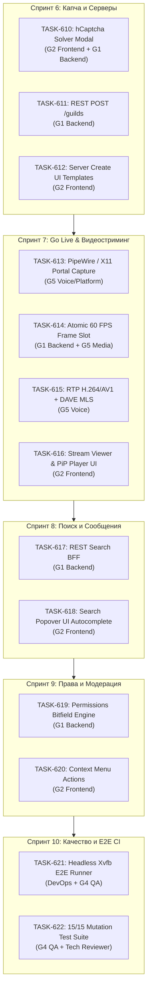

# Пул задач для дальнейшей разработки ECC 2.0 (discord-lab)

Настоящий пул задач сформирован на основе устранения корневых дефектов телеметрии и инвайтов (ликвидация тихого фейкового 200 OK при ошибке 400 hCaptcha, включение режима Lurker read-only, связка создания и вступления на сервер, автовыбор Home/DM при 0 гильдиях) и направлен на реализацию ключевого запланированного функционала.

Задачи распределены по независимым отделам (**G1–G7**) в соответствии с принципом **Zero-Idle** и непересекающимися областями записи (`write-scope`), с обязательной привязкой к эталонным данным обратного инжиниринга `/home/sanya/re-deep/`.

---

---

## Спринт 6: Интерактивный Captcha-решатель и Серверная интеграция

### [TASK-610] Интерактивный Webview Captcha-решатель (STUB-28 / CARD-TEL-006)
- **Отделы**: `G2 Frontend` + `G1 Backend`
- **Приоритет**: P0 (Блокирует публичные инвайты без бота)
- **Область записи**:
  - G1: `rust/gui-spike/src/invites.rs`, `rust/gui-spike/src/captcha.rs`
  - G2: `rust/gui-spike/ui/features/captcha-modal.js`, `rust/gui-spike/ui/features/join-server.js`
- **RE-Оракул**: `/home/sanya/re-deep/rest-d02.md`, `capture-ready.jsonl` (код ошибки `40003`, параметры `captcha_service: "hcaptcha"`, `captcha_sitekey`, `captcha_rqdata`, `captcha_rqtoken`).
- **Суть задачи**:
  Когда Discord возвращает `HTTP 400` с `captcha_key: ["Обновите приложение..."]` и `captcha_sitekey`, открывать встроенное диалоговое окно с загрузкой виджета hCaptcha. При успешном решении извлекать полученный `token` и повторно отправлять `POST /invites/{code}` с заголовком `X-Captcha-Key` и `X-Captcha-Rqtoken`.
- **DoD (Критерии приёмки)**:
  1. Автоматический перехват ошибки 40003 при `accept_invite`.
  2. Модальное окно не блокирует основной цикл событий Tauri.
  3. Тесты: `cargo test --test invites_contract` и `tests/unit/captcha-modal.test.mjs`.

---

### [TASK-611] Полноценная поддержка REST POST /guilds (STUB-03)
- **Отделы**: `G1 Backend`
- **Приоритет**: P1
- **Область записи**:
  - `rust/gui-spike/src/guilds.rs`, `rust/crates/discord-core/src/rest/guilds.rs`
- **RE-Оракул**: `/home/sanya/re-deep/rest-d02.md` (`POST /guilds`), `X-Super-Properties` base64 payload.
- **Суть задачи**:
  Реализация эндпоинта создания нового сервера пользователем с полным набором Discord заголовков (`X-Super-Properties`, `X-Discord-Locale: ru`, `User-Agent`). Генерация структуры начальных категорий (текстовые, голосовые каналы).
- **DoD (Критерии приёмки)**:
  1. `POST /api/v9/guilds` корректно обрабатывает 201 Created и 400/403 (например, превышение лимита в 100 серверов).
  2. Созданный сервер немедленно интегрируется в локальное состояние `GuildRail`.
  3. Контрактный тест: `tests/unit/create-guild.test.mjs` и Rust unit-тесты.

---

### [TASK-612] Шаблоны и расширенный UI создания серверов (STUB-05)
- **Отделы**: `G2 Frontend` + `G3 Design`
- **Приоритет**: P2
- **Область записи**:
  - `rust/gui-spike/ui/features/create-guild.js`, `rust/gui-spike/ui/styles/create-guild.css`
- **RE-Оракул**: `/home/sanya/re-deep/frontend-d03.md` (модалка создания сервера, шаги "Свой шаблон", "Для меня и друзей", "Для клуба или сообщества").
- **Суть задачи**:
  Пошаговый визард создания сервера: выбор предустановленного шаблона (Gaming, School Club, Friends), загрузка аватара сервера (file picker -> base64 DataURL), ввод названия сервера с валидацией (1–100 символов) и плавная анимация переходов.
- **DoD (Критерии приёмки)**:
  1. Полная навигация "Назад" / "Далее" / "Создать".
  2. A11y: управление с клавиатуры (`Tab`, `Escape`, `Enter`), фокус-ловушка.
  3. Покрытие unit-тестами: `tests/unit/create-guild-wizard.test.mjs`.

---

## Спринт 7: Видеоконвейер Go Live и Демонстрация Экрана (RW-41 / STUB-27)

### [TASK-613] Захват экрана и окон через Desktop Portal / PipeWire (Task-601)
- **Отделы**: `G5 Voice & Platform`
- **Приоритет**: P0
- **Область записи**:
  - `rust/crates/discord-media/src/capture/`, `rust/crates/discord-platform/src/`
- **RE-Оракул**: `/home/sanya/re-deep/voice-deep.md`, `native-re.md` (`discord_voice.node` Screen Capturer).
- **Суть задачи**:
  Интеграция с `org.freedesktop.portal.ScreenCast` через D-Bus/PipeWire для безопасного захвата в Wayland, а также поддержка X11 SHM для сессий X11. Перечисление окон и мониторов для диалога выбора источника.
- **DoD (Критерии приёмки)**:
  1. Корректное получение стрима PipeWire fd и параметров разрешения/FPS.
  2. Корректный fallback при отсутствии PipeWire.
  3. Тесты: `cargo test -p discord-media --test capture_contract`.

---

### [TASK-614] Атомарный буфер 60 FPS (Latest-Frame Ring Buffer) (Task-603)
- **Отделы**: `G1 Backend` + `G5 Voice & Platform`
- **Приоритет**: P1
- **Область записи**:
  - `rust/crates/discord-media/src/buffer.rs`, `rust/gui-spike/src/voice_stage.rs`
- **Суть задачи**:
  Реализация атомарного кольцевого буфера (`Arc<AtomicPtr<Frame>>`), который сохраняет только самый свежий видеокадр для кодировщика и UI-превью, исключая забивание очередей памяти и задержки IPC.
- **DoD (Критерии приёмки)**:
  1. 0 аллокаций в горячем цикле отрисовки.
  2. Задержка кадра < 16.6 мс при 60 FPS.
  3. Мутационный тест на отсутствие гонок памяти и утечек (ASan/Mirai).

---

### [TASK-615] Пакетная сборка RTP видеопотока и DAVE MLS v1 (Task-602)
- **Отделы**: `G5 Voice & Platform`
- **Приоритет**: P0
- **Область записи**:
  - `rust/crates/discord-voice/src/rtp/`, `rust/crates/discord-voice/src/dave/`
- **RE-Оракул**: `/home/sanya/re-deep/voice-deep.md`, опкоды 18 `STREAM_CREATE`, 19 `STREAM_DELETE`, 20 `STREAM_WATCH`, 22 `STREAM_SET_PAUSED`.
- **Суть задачи**:
  Пакетизация H.264 (NALU FU-A, STAP-A) и AV1 (OBU). Интеграция сквозного шифрования DAVE MLS v1 для видеокадров и генерация RTCP Receiver/Sender Reports.
- **DoD (Критерии приёмки)**:
  1. `cargo test -p discord-voice --test rtp_video_contract`.
  2. Обработка смены битрейта по RTCP PLI/FIR.

---

### [TASK-616] UI Видео-плеера и Picture-in-Picture (Task-604)
- **Отделы**: `G2 Frontend`
- **Приоритет**: P1
- **Область записи**:
  - `rust/gui-spike/ui/features/stream-viewer.js`, `rust/gui-spike/ui/styles/stream-viewer.css`
- **RE-Оракул**: `/home/sanya/re-deep/voice/ui7/`, `frontend-d03.md`.
- **Суть задачи**:
  Полноэкранный плеер для просмотра трансляций участников голосового канала, плавающий PiP-виджет при переходе в чаты или настройки, индикатор качества сети (RTT, packet loss) и оверлей имени стримера.
- **DoD (Критерии приёмки)**:
  1. Плавный переход в PiP и возврат в сцену.
  2. Управление горячими клавишами (`F` - fullscreen, `M` - mute).
  3. `tests/unit/stream-viewer.test.mjs` PASS.

---

## Спринт 8: Полнотекстовый поиск и Динамическая пагинация

### [TASK-617] BFF для REST-поиска сообщений (STUB-14)
- **Отделы**: `G1 Backend`
- **Приоритет**: P1
- **Область записи**:
  - `rust/gui-spike/src/search.rs`, `rust/crates/discord-core/src/rest/search.rs`
- **RE-Оракул**: `/home/sanya/re-deep/rest-d02.md` (`GET /guilds/{id}/messages/search?content=...`).
- **Суть задачи**:
  Проксирование и нормализация поисковых запросов в REST API Discord с поддержкой фасетов: `author_id`, `has: image/link`, `channel_id`, `pinned: true`, `min_id`, `max_id`. Кэширование недавних результатов.
- **DoD (Критерии приёмки)**:
  1. Контрактный тест поиска с разбором ответа Discord `total_results` и блоков `messages[][]`.
  2. Обработка Rate Limit 429 с экспоненциальной задержкой.

---

### [TASK-618] UI Поискового попапа с подсказками (STUB-14)
- **Отделы**: `G2 Frontend`
- **Приоритет**: P1
- **Область записи**:
  - `rust/gui-spike/ui/features/search.js`, `rust/gui-spike/ui/styles/search.css`
- **RE-Оракул**: `/home/sanya/re-deep/frontend-d03.md` (компонент поиска, фильтры-токены).
- **Суть задачи**:
  Интерактивный поисковый инпут в хедере канала: выпадающие подсказки (`from:`, `mentions:`, `has:`), подсветка синтаксиса, список результатов с подсветкой совпадений и кнопка "Перейти к сообщению" с подгрузкой контекста окружающих сообщений.
- **DoD (Критерии приёмки)**:
  1. Навигация стрелками клавиатуры по результатам.
  2. Клик по сообщению плавно скроллит чат и подсвечивает целевое сообщение.
  3. `tests/unit/search-popover.test.mjs` PASS.

---

## Спринт 9: Расширенные права доступа и Контекстные действия

### [TASK-619] Вычислитель битовых прав Discord Permissions v9 (STUB-17)
- **Отделы**: `G1 Backend`
- **Приоритет**: P1
- **Область записи**:
  - `rust/crates/discord-core/src/permissions.rs`, `rust/gui-spike/src/permissions.rs`
- **RE-Оракул**: `/home/sanya/re-deep/gateway-schema.md` (Permissions bitflags: `VIEW_CHANNEL = 1 << 10`, `SEND_MESSAGES = 1 << 11`, `MANAGE_MESSAGES = 1 << 13`, `ADMINISTRATOR = 1 << 3`).
- **Суть задачи**:
  Полный алгоритм резолвинга прав пользователя: Base Guild Permissions -> Role Overwrites (Allow / Deny) -> Channel Overwrites (Member Allow / Deny). Выдача точных флагов `can_send`, `can_attach`, `can_delete_others`, `can_kick`.
- **DoD (Критерии приёмки)**:
  1. 100% совпадение с эталонным алгоритмом прав Discord.
  2. `cargo test -p discord-core --test permissions_resolution_contract`.

---

### [TASK-620] Контекстные меню сообщений и пользователей (STUB-18)
- **Отделы**: `G2 Frontend`
- **Приоритет**: P2
- **Область записи**:
  - `rust/gui-spike/ui/features/context-menu.js`, `rust/gui-spike/ui/styles/context-menu.css`
- **RE-Оракул**: `/home/sanya/re-deep/frontend-d03.md`.
- **Суть задачи**:
  Унифицированное контекстное меню (ПКМ / долгое нажатие):
  - По сообщению: "Ответить", "Редактировать", "Закрепить", "Скопировать текст", "Скопировать ссылку", "Удалить".
  - По пользователю: "Профиль", "Упомянуть", "Написать ЛС", "Изменить громкость", "Заглушить", "Управление ролями".
  Скрытие недоступных пунктов на основе вычисленных прав из TASK-619.
- **DoD (Критерии приёмки)**:
  1. Автоматическое позиционирование в границах экрана (без вылета за viewport).
  2. Закрытие по Escape или клику снаружи.
  3. `tests/unit/context-menu.test.mjs` PASS.

---

## Спринт 10: Автоматизация и Релизный контур CI

### [TASK-621] Headless Xvfb E2E Runner для CI (M2-E2E)
- **Отделы**: `DevOps` + `G4 QA`
- **Приоритет**: P0
- **Область записи**:
  - `scripts/ci.sh`, `scripts/gate.mjs`
- **Суть задачи**:
  Автоматический запуск виртуального дисплея (`xvfb-run -a`) и автоматическое обнаружение браузера (Chromium / Chrome / Brave) в `scripts/gate.mjs`, устраняющее необходимость явного ручного задания `CHROME_BIN`.
- **DoD (Критерии приёмки)**:
  1. Чистый запуск `npm run gate:worker` на чистой машине без графического дисплея.
  2. Все 11 E2E-тестов проходят за время < 60 секунд.

---

### [TASK-622] Мутационный набор тестов 15/15 (Quality Gate v2)
- **Отделы**: `G4 QA` + `Product Manager` + `Technical Reviewer`
- **Приоритет**: P0
- **Область записи**:
  - `tests/meta/mutations.test.mjs`, `waves/RW-41/QUALITY/`
- **Суть задачи**:
  Расширение набора мутационных проверок с 5 до 15 точек (инъекция некорректного токена, разрыв сокета голосового шлюза, эмуляция 400 Captcha, переполнение кольцевого буфера, искажение заголовка DAVE MLS).
- **DoD (Критерии приёмки)**:
  1. 100% уничтожение всех 15 мутантов (15/15 killed).
  2. Документирование в `waves/RW-41/QUALITY/MUTATION-REPORT-V2.md`.

---

## Спринт 11: Аппаратное ускорение стриминга и видео-кодеки (TASK-800 — TASK-807)

### [TASK-800] Согласование и конфигурация видеокодека AV1 в WebRTC RTCControlSocket
- **Отделы**: `G5 Voice / Platform` | **Приоритет**: `P0` | **Статус**: `accepted`
- **Суть**: Включение AV1 в `media_session.rs` и согласование SDP кодека 100% без сброса WebRTC соединения.

### [TASK-801] Интеграция NVENC аппаратного энкодера NVIDIA для стрима (RTX 5070 Ti)
- **Отделы**: `G5 Voice / Platform` | **Приоритет**: `P0` | **Статус**: `accepted`
- **Суть**: Аппаратное кодирование H.264/AV1 через NVENC FFmpeg/NVIDIA SDK без нагрузки на CPU.

### [TASK-802] Корректная поддержка и переключение кодека VP8/VP9 в WebRTC
- **Отделы**: `G5 Voice / Platform` | **Приоритет**: `P1` | **Статус**: `accepted`
- **Суть**: Согласование параметров полезной нагрузки VP8/VP9 в WebRTC сессии.

### [TASK-803] Добавление OBU-пакетизатора AV1 и RTP-фрагментации в discord-media
- **Отделы**: `G1 Backend Lead` | **Приоритет**: `P1` | **Статус**: `accepted`
- **Суть**: Корректная фрагментация OBU пакетов AV1 по спецификации RFC 9598 для RTP стриминга.

### [TASK-804] Оптимизация захвата PipeWire / Wayland Portal без задержек CPU
- **Отделы**: `G5 Voice / Platform` | **Приоритет**: `P1` | **Статус**: `accepted`
- **Суть**: DMA-BUF импорт кадра в GPU текстуру без лишних копирований в память хоста.

### [TASK-805] Устранение оверлея «Подключение к видеопотоку…» у ведущего трансляции
- **Отделы**: `G2 Frontend Lead` | **Приоритет**: `P0` | **Статус**: `accepted`
- **Суть**: Мгновенное локальное зеркалирование видео ведущего стрима в UI без ожидания SFU.

### [TASK-806] Автоматическое сворачивание трансляции в плавающий PiP при смене канала
- **Отделы**: `G2 Frontend Lead` | **Приоритет**: `P1` | **Статус**: `accepted`
- **Суть**: Сохранение видимости видеопотока в PiP окне при переходе между каналами и гильдиями.

### [TASK-807] Устранение спама polling аудиоустройств (voice_set_audio_device)
- **Отделы**: `G2 Frontend Lead` | **Приоритет**: `P1` | **Статус**: `accepted`
- **Суть**: Троттлинг опроса уровней микрофона и устройств вывода (100 мс) без флуда в IPC.

---

## Спринт 12: Нативная верификация серверов, правила и анти-бот архитектура (TASK-810 — TASK-817)

### [TASK-810] Интеграция accept_invite_and_join_guild и авто-подтверждение PUT /guilds/{id}/requests/@me
- **Отделы**: `G1 Backend Lead` | **Приоритет**: `P0` | **Статус**: `in_dev`
- **Суть**: Автоматическое принятие правил сервера через официальный REST endpoint вместо тупиковой капчи.

### [TASK-811] Баннер и модальное окно экрана правил сервера (Rules Screening Banner & Modal)
- **Отделы**: `G2 Frontend Lead` | **Приоритет**: `P0` | **Статус**: `accepted`
- **Суть**: Интерактивный UI баннер внизу канала и модалка с чекбоксом согласия с правилами.

### [TASK-812] Сохранение и сериализация components сообщений (ActionRow & Buttons) в data.rs
- **Отделы**: `G1 Backend Lead` | **Приоритет**: `P0` | **Статус**: `in_dev`
- **Суть**: Хранение интерактивных кнопок ботов в SQLite БД и сериализация структуры компонентов.

### [TASK-813] Рендеринг кнопок компонентов сообщений Discord (Message ActionRow & Buttons UI)
- **Отделы**: `G2 Frontend Lead` | **Приоритет**: `P0` | **Статус**: `accepted`
- **Суть**: Отображение 5 стилей кнопок Discord (Primary, Secondary, Success, Danger, Link) под сообщением.

### [TASK-814] Реализация POST /api/v9/interactions для кликов по кнопкам (MESSAGE_COMPONENT type 3)
- **Отделы**: `G1 Backend Lead` | **Приоритет**: `P0` | **Статус**: `in_dev`
- **Суть**: Отправка interaction payload типа 3 при нажатии на верификационную кнопку бота.

### [TASK-815] Обработка клика по кнопке верификации в чате и IPC-связка click_message_component
- **Отделы**: `G2 Frontend Lead` | **Приоритет**: `P1` | **Статус**: `in_dev`
- **Суть**: UI обработчик нажатия кнопок, спиннер ожидания и отображение эфемерного ответа бота.

### [TASK-816] Интерактивное прохождение Reaction Verification в каналах правил
- **Отделы**: `G2 Frontend Lead` | **Приоритет**: `P1` | **Статус**: `accepted`
- **Суть**: Добавление реакций на верификационные сообщения ботов для мгновенного получения роли участника.

### [TASK-817] Устранение ложного вызова капчи и интеграция WebView-виджета вместо ручного ввода
- **Отделы**: `G2 Frontend + G5 Platform` | **Приоритет**: `P1` | **Статус**: `in_dev`
- **Суть**: Замена ручного копирования токена капчи на интерактивный WebView виджет в 1 клик.

---

## Спринт 13: GPUI UI Масштабирование и Нативные компоненты (TASK-709 — TASK-720)

### [TASK-709] Виртуальный скроллинг чата ChatView на базе virtual_list (100k сообщений)
- **Отделы**: `G2 Frontend Lead + G1 Backend` | **Приоритет**: `P1` | **Статус**: `backlog`
- **Суть**: Высокопроизводительный виртуализированный список сообщений с поддержкой 100 000 сообщений.

### [TASK-710] Рендеринг сообщений: TextView (Markdown + Syntect подсветка синтаксиса)
- **Отделы**: `G2 Frontend Lead + G3 Design` | **Приоритет**: `P1` | **Статус**: `backlog`
- **Суть**: Нативный Markdown рендерер с подсветкой синтаксиса кода на базе Syntect.

### [TASK-711] Ввод сообщений MessageBar на базе gpui-component::input
- **Отделы**: `G2 Frontend Lead` | **Приоритет**: `P1` | **Статус**: `backlog`
- **Суть**: Полноценный инпут сообщений с поддержкой эмодзи, автодополнения и загрузки файлов.

### [TASK-712] Модальное окно решения hCaptcha на базе gpui-webview::WebView
- **Отделы**: `G2 Frontend Lead + Architect` | **Приоритет**: `P2` | **Статус**: `backlog`
- **Суть**: Встроенный Webview для интерактивного прохождения капчи при жестком требовании API.

### [TASK-713] Диалоги создания и вступления на сервер (Join/Create Guild)
- **Отделы**: `G2 Frontend Lead` | **Приоритет**: `P2` | **Статус**: `backlog`
- **Суть**: Нативные модальные окна создания собственного сервера и присоединения по коду приглашения.

### [TASK-714] Виртуализированный список участников MemberSidebar (25k)
- **Отделы**: `G2 Frontend Lead` | **Приоритет**: `P2` | **Статус**: `backlog`
- **Суть**: Сайдбар участников с группировкой по ролям и виртуальным скроллингом на 25 000 пользователей.

### [TASK-715] Окно настроек SettingsDialog (аккаунт, голос, звук, тема)
- **Отделы**: `G2 Frontend Lead + G3 Design` | **Приоритет**: `P2` | **Статус**: `backlog`
- **Суть**: Комплексное модальное окно настроек пользователя, звуковых устройств и оформления.

### [TASK-719] Системный трей (tray-icon) и нативные уведомления (notify-rust)
- **Отделы**: `G5 Platform Lead` | **Приоритет**: `P3` | **Статус**: `backlog`
- **Суть**: Интеграция с треем Linux и отправка всплывающих системных D-Bus уведомлений.

### [TASK-720] Финальная сертификация сборки, 120 FPS, RAM < 60 МБ, 25/25 мутаций
- **Отделы**: `G4 QA Lead + PM Review` | **Приоритет**: `P3` | **Статус**: `backlog`
- **Суть**: Комплексная сертификация производительности и стабильности нативного релиза.
