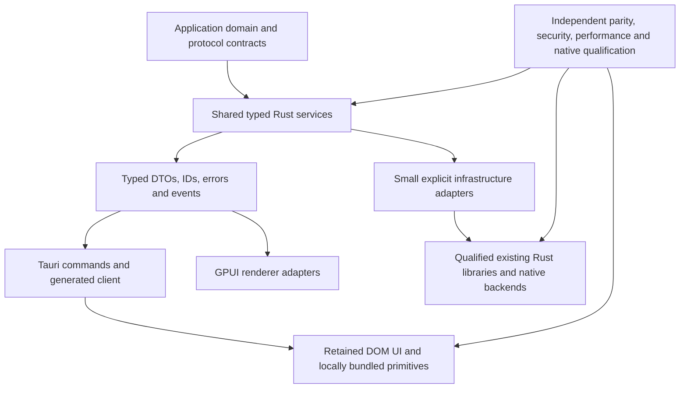

# RW-51: Library-first Rust modernization

ARM follow-up: [eight scoped ARM blockers](ARM-BLOCKERS.md) now gate dependency intake and native release acceptance.

Status: detailed plan and queue preparation; application migrations are not implemented by this document.

Operator request: reduce hand-written infrastructure across the whole application using maintained libraries/framework APIs, improve typing and modularity, preserve or improve every feature, load annotated tasks on Kanban, and execute through ECC.

Baseline: `2b7cfb52024be0453e3b9333aba292b2372e610e`, `release/developer-alpha-preview`, 2026-11-15. Planning branch: `docs/task-20261115-library-modernization`.

## 1. Intended result

The application owns its domain rules and a small number of explicit adapters. Standard mechanisms come from existing Rust/framework libraries wherever their real behavior satisfies the contracts. Rust owns shared domain services, serialization, cryptography, storage and OS integrations. Tauri and GPUI retain thin rendering/command adapters.

Use real APIs rather than home-made modules described as compatible with a library. Introduce a replacement one feature boundary at a time, demonstrate parity against an independent oracle, then delete the obsolete mechanism. A module split alone improves readability but does not count as code reduction.

This is an incremental program with independent acceptance per slice. It is not a simultaneous rewrite of the two frontends. Additional capabilities are earned by passing their acceptance tests; installing a dependency does not establish an improvement.

## 2. What the audit actually measured

`INVENTORY.json` and `SOURCE-BASELINE.csv` enumerate 589 tracked production-shaped source files at immutable base Git blobs: 391,194 physical lines. These numbers include comments, inline tests, HTML/CSS and generated tables. They are an inventory, **not** hand-written SLOC and **not** a deletion forecast. Generated markers identify 13,576 lines, including 13,475 lines of ICU-derived locale tables; classification is completed by `LIB-GOV-06`.

| Area | Physical lines | First action |
| --- | ---: | --- |
| Tauri UI | 114,608 | Separate domain actions from infrastructure and qualify actual UI packages. |
| Tauri Rust | 49,053 | Secure remote auth; generate typed IPC; remove duplicated service/command adapters. |
| Core Rust crates | 114,710 | Replace standard crypto, compression, SQLite/secret FFI, grammar and transport mechanics. |
| GPUI Rust | 73,701 | Reuse shared transport/domain services; qualify native media primitives. |
| Tooling | 36,881 | Remove duplicated embedded board data; use real control-plane capabilities. |
| Node core/agent/bin | 2,241 | Retain required CLI/Frida boundaries; audit duplication rather than moving them to Rust by default. |

| Verified hotspot | Physical lines | Observation |
| --- | ---: | --- |
| `rust/gui-spike/ui/app.js` | 18,611 | Large boot/event/action orchestration surface. |
| `rust/gui-spike/src/data.rs` | 14,264 | Typed DTO work already exists; domain/service duplication remains. |
| `rust/crates/chord-core/src/ws.rs` | 8,442 | Protocol state stays application-owned; standard runtime/transport mechanisms can be shared. |
| `rust/chord-gpui/src/net/mod.rs` | 5,799 | Duplicate request/service glue and bookkeeping pool. |
| `rust/chord-gpui/src/audio/mod.rs` | 4,594 | Native resource ownership and callback constraints require evidence. |
| `rust/crates/chord-voice/src/session.rs` | 3,716 | Preserve DAVE/voice lifecycle; do not replace it with a generic state machine blindly. |
| `rust/chord-gpui/src/state/mod.rs` | 3,501 | Share domain types rather than maintaining three models. |
| `rust/gui-spike/src/main.rs` | 2,977 | 79 registered commands, numerous forwarding wrappers. |
| Voice primitive crypto modules | 1,556 | Standard primitive implementations are strong library candidates. |

The initial audit covered the hotspots and all manifests. It does not claim line-by-line review of every one of the 589 files. The file-disposition task extends the same decision process to the remainder.

## 3. Existing work to reuse

`waves/STATE.md` records 61 completed RW-48/RW-49/RW-50 Tauri tasks. Reuse existing UUID/hash/base64 libraries, DTOs, extracted modules and tests. The audit found important unfinished boundaries:

- Extracted Tauri plugin modules often construct a plugin without an `invoke_handler`; `main.rs` still registers forwarding commands globally. Complete actual registration and generated contracts rather than repeat extraction cards.
- `ipc-bindings.js` describes Specta architecture but the Tauri manifest has no Specta dependencies. It is a test-reachable prototype rather than the live IPC registry; most of its 392 lines contain domain permissions/normalization helpers that require separate retention decisions.
- `reactive-store.js` (369 lines), `floating-popover.js` (102), and `virtualizer.js` (160) advertise compatible APIs but implement their own mechanisms. Together with IPC bindings they account for 1,023 physical lines, including domain behavior that must remain. The virtualizer and reactive-components modules are test-reachable prototypes; establish live reachability before deciding retirement versus adoption. The live app still uses VirtualList/model.js and raw invoke paths.
- Atomic settings persistence already uses `NamedTempFile`, `sync_all`, and `persist`. Do not replace it with another persistence wrapper or lose strict settings validation.
- Upstream `f72739e3` restored the RTC listener's `intervalMs: 1000` fallback to fix negotiating hangs. Removing polling requires producer-completeness evidence, not just a new subscription API.

The board has 220 historical cards and no TAURI cards despite the STATE narrative. Preserve those records; do not fabricate previously completed task/worker state or claim the board was synchronized with the old ECC run.

## 4. First priority: concrete security findings

`remote_auth.rs::Rsa2048KeyPair::generate` selects known factors from the public `VERIFIED_1024_BIT_PRIMES_HEX` table using counter/time jitter. Extracting `biguint.rs` did not fix production key generation. The RSA workstream therefore starts with independent contract vectors and a patched, OS-random backend; it is not ordinary cosmetic refactoring.

The current [RustSec advisory](https://rustsec.org/advisories/RUSTSEC-2023-0071.html) marks `rsa >=0.10.0` patched for the documented timing issue. Qualify the exact release, current MSRV/targets and error behavior. [The current RSA API](https://docs.rs/rsa/latest/rsa/) uses a 3072-bit generation default: this protocol requires **explicit 2048 bits**, OAEP SHA256/MGF1-SHA256 and the existing SPKI/fingerprint representation. Do not copy an older 0.9 example or claim every upstream version is independently audited.

Core identity also has a Unix entropy fallback that may produce repeated IDs on failure. Replace it with a fallible cross-platform OS randomness contract; do not allow success with predictable bytes.

## 5. Target structure

Keep the existing crate boundaries unless an accepted slice needs a shared domain module. Do not create a new facade crate for each dependency or mirror a library's entire API in a general-purpose wrapper.

Boundary rules:

1. Domain IDs use validated newtypes; serialized snowflakes/permission masks preserve all bits and do not become JavaScript numbers.
2. DTOs originate in Rust once. Serde input/output rules, optional/null/unit behavior and unknown variants are explicit. Generated clients remain subject to runtime validation and permissions.
3. Errors are typed at domain boundaries and converted once for each renderer. Framework errors and application errors remain distinguishable; logs redact secrets.
4. Resource ownership is explicit: owned file descriptors, connections, subscriptions, queue ends and cancellation handles. Destructors and completion paths must be tested.
5. Async runtime ownership is shared and explicit. Avoid nested `block_on` and UI-thread blocking; use the existing Tokio facilities.
6. Public comments and Rustdoc are in English. Explain invariants and non-obvious decisions. Functions/modules have one clear responsibility; reduce large files as a consequence of responsibility changes, not arbitrary relocation.

## 6. Replacement decisions

See [LIBRARY-MATRIX.md](LIBRARY-MATRIX.md) for mechanisms, retained policies, dependency status and rejection conditions.

High-confidence candidates first: secure RSA/randomness; already-used RustCrypto primitives; bounded `flate2`; `rusqlite`; reusable HTTP client; existing `ashpd`/typed `zbus`; explicit secure keyring stores; shared Serde DTOs; real Tauri registration and qualified generated bindings.

Qualification before adoption: exact 8-byte GCM authentication, strict duplicate-aware JSON, browser-profile HTTP behavior, Markdown AST transfer, native clipboard formats, real-time queue semantics, virtualizer performance and ICU4X locale data. Reject a candidate if it cannot preserve the behavior or produces more bespoke adapter infrastructure than it removes.

For the retained DOM frontend, real Signals/Floating UI/virtualization are small JavaScript exceptions. Moving DOM geometry to Rust/WASM would introduce serialization and lifecycle glue without demonstrated benefit. Rust remains the preferred implementation for shared application behavior. A third complete UI framework is not part of this plan.

Dependency intake must establish source/maintainer provenance, exact versions/features, license/SBOM implications, current advisories, MSRV, native SDK/link requirements, target support, build/runtime costs and rollback. Existing transitive dependencies do not automatically become available to a direct crate. There are three separately locked Rust workspaces; one integration owner updates manifests/locks and shared exports serially.

## 7. Executable decomposition

[TASKS.json](TASKS.json) is the machine-readable leaf manifest; [TASKS.md](TASKS.md) is the human-readable breakdown. Each card has a parent epic, priority, one outcome, dependencies, read/write scope, exclusive resource lease, independent oracle, targeted verification, English implementation instructions, requested ECC profile, rollback and dispatch state.

The full plan has 26 workstreams and 132 leaf cards, including 15 explicit dependency-integration tasks. Each implementation leaf must fit one small reviewable feature/API boundary. A qualification leaf produces a bounded decision artifact. If its exact consumer set exceeds the stated boundary, the coordinator creates explicit children before opening the implementation lease.

Execution order:

| Batch | Work | Exit condition |
| --- | --- | --- |
| 0 | Authentic ECC installation/capability check; board portability; feature/failure/dependency baseline; independent RSA contract. | Real runtime/provenance, truthful queue, frozen oracles and safe disjoint scopes. |
| 1 | Patched RSA/entropy; standard symmetric primitives; compression and SQLite contracts. | Independent security/parity evidence and accepted dependency decisions. |
| 2 | Bounded decompression/store migrations; qualified HTTP and Linux portal interfaces. | Existing wire/resource/database behavior preserved; actual transport reuse measured. |
| 3 | Local UI asset loading; generated settings bindings and real plugin registration. | Offline production/fixture loading and actual typed/permissioned IPC. |
| 4 | Serialized remaining IPC domains; shared DTO/message service; secrets and URL mechanisms. | Each domain accepted separately; old consumers removed only when unused. |
| 5 | Signals, overlays, virtualizer and Markdown; typed event completeness. | Real UI, accessibility and frame/memory evidence; RTC fallback retained until proven unnecessary. |
| 6 | Qualified native audio/clipboard/locale slices; remaining file dispositions. | Native parity winner exists for every adopted candidate. |
| 7 | Cross-platform acceptance, code/performance accounting and release qualification. | Independent review and complete required native/release evidence; no unreported regressions. |

Batch 0 initially reserves three independent worker slots: `LIB-GOV-01`, `LIB-GOV-02`, `LIB-RSA-01`. A runtime can import the entire DAG without launching every card. The 25 GiB aggregate ceiling and single Cargo lock apply; main registries/manifests/app.js/main.rs and shared services have exclusive coordinator leases.

## 8. Preservation and improvement gates

Every affected feature maps to old commands/events, independent fixtures and relevant native targets. Nine dimensions: positive, negative, boundaries, errors, empty, loading, permissions, recovery and telemetry. UI slices also preserve keyboard focus, accessibility, rendering and responsive geometry.

Keep existing assertions, payload expectations, skips and timeout policy. Do not make a library pass by widening acceptance or dropping stricter behavior. Keep historical oracles and release artifacts read-only. Use local mock/fixture/private-bus/temporary-store environments; no live account/media operation follows merely from queue dispatch.

Compare old/new pure functions on independent frozen inputs where safe. Do not dual-run side-effecting message sends, credential writes, uploads or portal requests. For those, use recorded request fixtures and isolated integration servers.

Each implemented behavior requires RED/GREEN/targeted evidence and reviewer-owned mutations. Integration runs T1 once per batch; native/release T2–T4 run when their prerequisites exist. Known previous failures stay visible in a baseline ledger; no assertion of an all-green whole application comes from a small targeted suite.

Platform evidence is separate:

- Linux: X11/Wayland, private D-Bus/portal/keyring, real window/capture/resource cleanup.
- Windows: native compiler/runtime, OS credentials/clipboard/window behavior and browser/WebView tests.
- macOS: Intel and Apple Silicon native compile/link/runtime and OS APIs.
- Linux ARM64: real SDK/std/sysroot, verified real packages and hardware/runtime; host cross-checks are not native qualification.

## 9. Code and capability accounting

At each accepted replacement, report removed and added hand-written production code, generated output, test code, dependency graph and native binary/assets separately. Renames, data relocation, minification, compressed files and deleted tests do not count as savings. Comments improving maintainability are not penalized as logic growth.

The adoption gate seeks measured net reduction in the replaced mechanism and equal or better behavior. Security fixes and new capability/strictness may temporarily increase code with an explicit rationale; do not distort the measurement to promise an arbitrary global percentage.

Measure release binary/asset size, cold start, idle RSS, relevant p95 latency/frame/audio deadlines, heap growth and file descriptor/subscription counts on the same fixture/hardware. Native resource and media budgets use actual measurements, not hard-coded success sentinels. Record both regressions and benefits.

Potential additional capabilities have explicit tests: correctly disposed reactive effects, resize-aware overlays, deterministic generated IPC diagnostics, variable-height lists with stable anchors, real transport pooling and secure cross-platform credential behavior. They are acceptance targets rather than completed features.

## 10. Kanban and ECC delivery

The existing board is `waves/kanban-board.json`, with generated `waves/kanban-board.html`. Historical card payloads remain unchanged; new `LIB-*` cards include their instructions and dependencies. Existing five visual columns coexist with the detailed 13-stage lifecycle field.

`HANDOFF.json` contains complete standalone mandates and the first batch. `DISPATCH-RECEIPTS.json` records actual runtime acceptance. A queued/imported card is not a running worker. Direct ECC execution requires a real session identity, isolated worktree, resolved harness/model/effort and heartbeat; Orca-specific IDs apply only if Orca is actually used. The former dangling `scripts/ecc`, STATE run ID and helper-agent messages do not supply those receipts.

The operator has authorized locating and installing authentic ECC from GitHub. Record exact upstream/revision/release, install path, version/capabilities and provider readiness in the installation report. Prefer ECC's actual supported session lifecycle over inventing an Orca-shaped compatibility layer. Adapt to real capabilities and preserve the detailed task/receipt model; never fake task execution to fit old configuration.

The selected source branch is ahead of the old `unstable` snapshot. The integration coordinator must resolve repository branch policy against this pinned current source before production cutover; silently running against an obsolete branch is not a valid migration. Do not push/merge shared branches from a worker.

## 11. Definition of ready and done

Ready: accepted prerequisites, independently defined behavior, vetted dependency, exact bounded file lease, target evidence plan and genuine provider readiness.

Done: implementation passes its strict contracts; independent product/technical review reproduces evidence; old mechanism is unused and removed where justified; code/performance/security accounting is attached; required native qualification passes; lifecycle is advanced only to the stage actually reached.

This plan, board import, a successful ECC installation, a started session and a completed application migration are distinct outcomes and must be reported separately.

## 12. First ECC findings incorporated

Three genuine Codex-backed ECC planning sessions completed source audits: 34 findings with 173 existing source references. Their structured reports are in `reports/` and exact session/provenance records are in `DISPATCH-RECEIPTS.json`. They executed no application tests, builds, dependency changes or migrations.

The plan now includes five additional explicit leaves prompted by that work: independent cross-frontend remote-auth wire adjudication, GPUI use of the shared secure cipher, secret redaction/session-activation errors, remaining GPUI HKDF mechanics, and standard MLS hash/HMAC primitives. The complete plan contains 132 leaves across 26 workstreams.

The source audit found that GPUI emits a hashed `proof` field where the checked-in clean-room remote-auth extract describes the raw decrypted bytes as the unpadded base64url `nonce` field. Resolve the independent contract and test provenance before changing either implementation or assertions. Preserve binary nonce bytes and distinguish caller-specific text/token rules.

It also identified intentional core Base64 trailing-bit/error-order behavior, duplicated digest families, a zstd manifest-comment/source discrepancy and separate fuzz-workspace dependencies. These are intake/compatibility constraints; they do not authorize blind dependency deduplication or a new compression backend.

Current card state separates the completed read-only planning phases from next-phase contract acquisition, implementation and acceptance. The two local control-plane prerequisites are prepared for review. Remaining cards stay queued behind admission and accepted dependencies.
